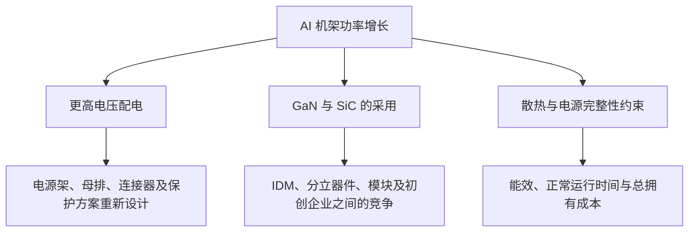

# 执行摘要
> **最后更新：** 2026-11-12
> **状态：** 草稿
> **标签：** 市场, 路线图, AI 机架, WBG, 战略

## 概述
AI 基础设施正在推动数据中心电源从以成本优化为导向的配套子系统，转变为制约性能的关键平台。更高的加速器功率、电流压摆率和机架密度，提升了设施前端、机架电源架、中间总线和负载点（POL）各环节的半导体价值量。硅仍是出货量的基础，而在开关损耗、无源器件尺寸、电压或温度足以支撑其溢价的场合，氮化镓（GaN）和碳化硅（SiC）的份额正在扩大。

电源架构并非从 12 V 一步跨越到 800 V。可观察到的演进路径是从 12 V 板级配电过渡到 48/54 V 机架级配电，目前正进一步迈向分离式高压“侧柜”供电：开放计算项目（OCP）于 2026-10-08 发布了 ±400 VDC Mt. Diablo v1.0.0 规范；英伟达（NVIDIA）分阶段推出 800 VDC，2H 2026 推出交流供电的 800 VDC 电源柜，2027 年推出行级电源中心（row power center），并自 2027 年起推出原生 800 VDC 的 Kyber 代机架。原生 800 VDC 仍是厂商生态系统路线图，而非经正式批准的机架标准；截至 2026-11-12，尚无已投入运行的原生 800 VDC 数据机房获得公开确认。安全、保护、连接器、可维护性及标准成熟度与器件效率同等重要。

2026 年下半年还出现了确凿的营收证据：英飞凌（Infineon）公布 FY2026 数据中心电源营收 ~€2.2B，并给出 FY2027 接近 €4B 的业绩指引；芯源系统（MPS）的企业数据（Enterprise Data）业务板块占季度营收的 42%；四家处理器供电初创企业（Empower、Claros、C2i、Ferric）在六个月内相继被收购。

## 关键发现 / 要点
- [估计，低-中置信度，2026-11] 数据中心功率半导体总可寻址市场（TAM）目前估计 2026 年为 ~$9B（区间 $8-10.5B），2030 年为 ~$20B；此前的 ~$4B [已被取代] 已被上调，原因是仅英飞凌、芯源系统和安森美（onsemi）三家的披露数据合计即达 ~$4.9B；各方口径差异较大 [参见：20_market_sizing.md]。
- [估计，中置信度，2024-2026] 机架功率密度范围为：传统机架 ~8-15 kW，主流 AI 机架 30-60 kW，领先的液冷系统 ~100-140 kW；自 2026-09 起出货的 Vera Rubin NVL72 机架配备四个 110 kW 电源架，估计功耗为 ~190-230 kW。
- [已确认，2024] Open Rack v3 采用标称 48 V 母线以及机架级电源架/电池备份单元（BBU）生态系统 [来源：OCP，2024]。
- [已确认，2024] 英飞凌启动了 300 mm（12 英寸）GaN 晶圆生产开发，这是制造成本方面的一个里程碑 [来源：Infineon，2024]。
- [估计，中置信度，2025] 宽禁带（WBG）器件在功率因数校正（PFC）/初级转换中的采用最为普遍；低压 POL 仍以硅器件为主。
- [待核实] 提示词中所述英飞凌“每个 130 kW 机架 $12k-$15k”的价值量说法，需要引用一手的业绩会文字记录/网页出处。
- [已确认，2026] 英伟达的 800 VDC 路线图以自 2027 年起实现 1 MW 及以上 IT 机架为目标，同时为存量改造的交流设施保留分阶段迁移路径 [来源：NVIDIA，2026]。
- [已被取代，2026-11] 英飞凌此前设定的 AI 电源解决方案营收目标（FY2026 约 €1.5B、FY2027 约 €2.5B）[来源：Infineon 年度股东大会，2026] 已被 FY2026 实际数据超越：AI 电源营收 ~€1.7B，数据中心电源总营收 ~€2.2B；FY2027 数据中心电源营收指引接近 €4B [来源：Infineon FY2026 业绩，2026-11-10]。
- [已确认，2026] 英飞凌于 7 月 2 日启用投资 €5B 的德累斯顿智能功率晶圆厂（Smart Power Fab），使德累斯顿基地的功率及模拟/混合信号产品产能翻倍 [来源：Infineon，2026-07-02]。
- [已确认，2026-10-08] OCP Mt. Diablo v1.0.0（微软（Microsoft）、Meta、谷歌（Google））对面向 100 kW-1 MW IT 机架的 ±400 VDC 侧柜式电源柜进行了标准化；谷歌、微软和英伟达牵头 OCP 中压交流（MV AC）至 800 VDC 固态变压器（SST）工作流（规范 v0.3）[来源：OCP，2026]。
- [已确认，2026] 处理器级供电领域出现整合：亚德诺（ADI）/Empower（~$1.5B）、纳微半导体（Navitas）/Claros、英飞凌/C2i，以及安森美/Ferric（最高 $775M，尚待完成）[参见：25_investment_and_ma_tracker.md]。
- [已确认，2026] 电气巨头与初创企业正在推进面向 800 VDC 的中压 SST 商业化（ABB、采用英飞凌 SiC 的伊顿（Eaton）、西门子（Siemens）/莱茵豪森（Reinhausen）、台达电子（Delta）、Heron Power、Amperesand、DG Matrix）；多数产品将于 2026-2027 年商用上市 [厂商路线图]。
- [已确认，2026-10] 知识产权风险已从器件层面扩大到架构层面：Vicor 向美国国际贸易委员会（ITC）提起的 337-TA-1526 案将台达电子、英飞凌、芯源系统、伟创力（Flex）、天弘（Celestica）、广达（Quanta）和立讯精密（Luxshare）旗下实体列为被诉方；与此同时，GaN 诉讼也在多条战线展开（英飞凌/英诺赛科（Innoscience）、Wolfspeed/纳微半导体、瑞萨电子（Renesas）/纳微半导体）。

## 图解

## 详细内容
### 战略主题

| 主题 | 2026 年定位 | 投资/工程影响 |
|---|---|---|
| 48 V 推广 | [已确认] 已商用并实现标准化 | 更多 48 V 转换器、保护器件、母排及 BBU 电子器件 |
| WBG 采用 | [已确认] GaN/SiC 选择性增长 | 器件选型取决于电压、频率、热条件和认证 |
| 数字电源 | [已确认] PMBus 遥测已成熟确立 | 固件、遥测、安全及集群优化至关重要 |
| 热协同设计 | [已确认] 液冷应用持续扩大 | 电源架和 VRM 必须纳入机架热设计 |
| 垂直整合 | [估计] 选择性而非普遍 | 超大规模云厂商自定电源架/ASIC 供电轨规格，但仍依赖商用 IC |
| HVDC 侧柜供电 | [已确认] ±400 VDC OCP 规范；800 VDC 机架处于送样/原型阶段 | 每 MW 的 SiC/GaN PFC、DC/DC、SSCB 及 BBU 半导体价值量上升 |
| 处理器级供电 | [已确认] IVR/垂直供电领域整合 | 大型 IDM 掌握封装邻近调节知识产权 |
| 知识产权执法 | [已确认] ITC 及多国 GaN 案件 | 双源采购和规避设计规划至关重要 |

### 架构拐点

| 架构 | 典型时期 | 主要优势 | 主要约束 |
|---|---:|---|---|
| 12 V 机架/电路板 | 2015 年以前至今 | 生态系统成熟 | 配电电流大 |
| 48 V 机架母线 | 2016 年至今；ORv3 2021+ | 更低的 I²R 损耗 | 增加板级转换 |
| 380/400 V DC | 试点/部署，2010 年代-2020 年代 | 更少的 AC/DC 转换级 | 保护与维护安全 |
| ±400 VDC 侧柜（OCP Mt. Diablo） | 规范 v1.0.0 2026-10-08 | 分离式机架供电，最高可达 1 MW | 保护、接地、可维护性 |
| 英伟达 800 VDC | 侧柜 2H 2026；行级电源中心 2027；原生 Kyber 2027+ | MW 级机架功率下电流更低 | 标准、保护、隔离、连接器生态系统 |

参见 [02_power_architecture_roadmap.md](02_power_architecture_roadmap.md) 和
[20_market_sizing.md](20_market_sizing.md)。

## 数据表（如适用）
| 指标 | 数值 | 来源 | 日期 |
|---|---|---|---|
| 传统机架功率 | [估计] 8-15 kW | 行业基线 | 2015 |
| 主流 AI 机架 | [估计] 30-60 kW | OEM 配置 | 2024-2026 |
| 领先的液冷 AI 机架 | [估计] 100-140 kW | OEM/英伟达生态系统 | 2025-2026 |
| Vera Rubin NVL72 机架 | 4 × 110 kW 电源架；[估计，中置信度] ~190-230 kW | OEM 数据表 / 分析师估计 | 2026 |
| 未来机架路线图 | [估计，低置信度] 250 kW（MGX 1.2 上限 [传闻]）至 1 MW | 厂商路线图 | 2027+ |
| 英伟达未来机架级别 | 1 MW 及以上 IT 机架 [厂商路线图] | 英伟达 | 2027+ |
| 数据中心功率半导体 TAM | [已被取代] ~$4B；[估计，低-中置信度] 修订为 ~$9B | 公司/市场数据三角验证 | 2026 |
| 英飞凌 AI 电源营收目标 | ~€1.5B FY2026；~€2.5B FY2027 [公司目标；已被取代] | 英飞凌 | 2026 |
| 英飞凌 FY2026 数据中心电源营收 | ~€2.2B（其中 AI ~€1.7B）；FY2027 指引 ~€4B | 英飞凌 | 2026-11-10 |
| Mt. Diablo v1.0.0 | ±400 VDC；100 kW-1 MW | OCP | 2026-10-08 |

## 待解决问题 / 数据缺口
- 界定可复现的自下而上 TAM 边界，避免对模块和 IC 重复计算。
- 为英飞凌所宣称的每 130 kW 机架价值量获取一手来源支持。
- 在每项基准中区分机架铭牌功率、平均 IT 负载和设施输入功率。
- 量化超大规模云厂商定制电源芯片导致的商用厂商份额实际流失。
- 确认首个投入运行的原生 800 VDC 数据机房及其实测效率。
- 查阅一手投资者关系（IR）文件，核对 2026-11 更新中通过搜索索引获取的数据。

## 参考文献
- OCP Open Rack | https://www.opencompute.org/wiki/Open_Rack/SpecsAndDesigns | 访问日期 2026-06-10
- NVIDIA GB200 NVL72 | https://www.nvidia.com/en-us/data-center/gb200-nvl72/ | 访问日期 2026-06-10
- Infineon 300 mm GaN announcement | https://www.infineon.com/cms/en/about-infineon/press/press-releases/2024/INFXX202409-158.html | 访问日期 2026-06-10
- NVIDIA 800 VDC architecture | https://www.nvidia.com/en-us/data-center/technologies/800-vdc-architecture/ | 访问日期 2026-07-28
- NVIDIA 800 VDC technical roadmap | https://developer.nvidia.com/blog/nvidia-800-v-hvdc-architecture-will-power-the-next-generation-of-ai-factories/ | 访问日期 2026-07-28
- Infineon FY2026 AGM CEO speech | https://www.infineon.com/assets/row/public/documents/corporate/investors/annual-general-meeting/2026/agm2026-key-points-speech-jochen-hanebeck-chief-executive-officer-v01-00-en.pdf | 访问日期 2026-07-28
- Infineon Dresden Smart Power Fab | https://www.infineon.com/press-release/2026/ifxpr202607-117 | 访问日期 2026-07-28
- Infineon FY2026 results (syndicated) | https://news.europawire.eu/infineon-reports-e16-35-billion-fy-2026-revenue-and-forecasts-over-20-percent-growth-for-2027/eu-press-release/2026/11/10/16/27/06/187084/ | 检索日期 2026-11-12
- NVIDIA 800 VDC rollout blog | https://blogs.nvidia.com/blog/800-vdc-power-architecture-ai-factory/ | 检索日期 2026-11-12
- OCP Mt. Diablo v1.0.0 | https://www.opencompute.org/wp-content/uploads/2026/10/OCP-Specification-Mt.-Diablo-Disaggregated-Power-Rack-Specification-v1.0.0.pdf | 检索日期 2026-11-12
- Supermicro Vera Rubin NVL72 shipping | https://ir.supermicro.com/news/news-details/2026/Supermicro-Now-Shipping-NVIDIA-Vera-Rubin-NVL72-Racks/default.aspx | 检索日期 2026-11-12
- USITC 337-TA-1526 | https://www.usitc.gov/press_room/news_release/2026/er1009_69342.htm | 检索日期 2026-11-12
