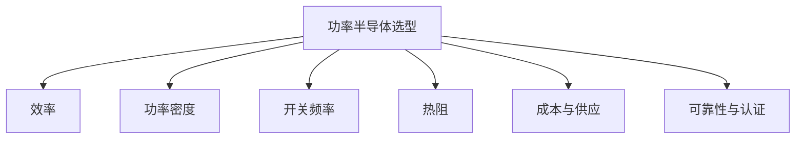

# 技术概述
> **最后更新：** 2026-06-30
> **状态：** 草稿
> **标签：** 基础知识, 术语表, 器件物理, 指标

## 概述
数据中心电力电子系统将电能从市电电压转换并调节为低于 1 V、千安级的处理器供电轨。每一级转换都需要在效率、隔离、瞬态响应、功率密度、EMI、散热裕量、成本和可靠性之间进行权衡。

器件材料只是设计变量之一。拓扑、磁性元件、电容、封装、栅极驱动、控制固件、散热以及供电网络（PDN）共同决定系统性能。本文件定义了贯穿整个数据库的术语与指标。

## 关键发现 / 要点
- [已确认] 电能依次流经设施交流配电、UPS/PDU、机架 PSU、母排、中间转换和 VRM 各级。
- [已确认] 处理器核心供电轨通常低于 1 V，瞬态电流可达数百安培乃至超过 1,000 A。
- [已确认] RDS(on) x Qg 是衡量开关/导通折中的常用品质因数，但并非完整的系统级指标。
- [已确认] GaN 适合高频及中低压开关应用；SiC 适合高压和高温应用。
- [已确认] 硅仍具备最广泛的成熟度、最低的成本和最强大的低压生态系统。

## 图解

## 详细内容
### 转换链

| 转换级 | 典型输入 | 典型输出 | 功能 |
|---|---:|---:|---|
| 设施供电/UPS | 3 相交流 | 交流或 380-400 V 直流 | 保护与备份 |
| PDU/机架电源架 | 交流或 HVDC | 48 V 或 12 V 直流 | 配电转换 |
| 中间总线 | 48 V | 12 V/5 V | 板级配电 |
| VRM/POL | 12/5/3.3 V | 0.5-1.8 V | 处理器/内存供电轨 |

### 关键指标

| 指标 | 定义 | 重要性 | 典型值 |
|---|---|---|---|
| 开关频率 | 每秒开关周期数 | 无源器件尺寸与开关损耗 | 50 kHz-2+ MHz |
| RDS(on) | 导通状态下的沟道电阻 | 导通损耗 | 依额定值从亚 mOhm 级至 >1 Ohm |
| 击穿电压 | 阻断电压额定值 | 架构/浪涌裕量 | 30 V-3.3 kV |
| RDS(on) x Qg | 电阻-栅极电荷品质因数（FOM） | 器件一阶折中 | 因器件而异 |
| 效率 | Pout/Pin | 能耗/散热成本 | 每级 90-99%+ |
| 功率密度 | 单位体积功率 | 机架/板卡容量 | ~0.5-10+ kW/L，取决于系统 |
| 热阻 | 每瓦温升 | 结温裕量 | <0.1 至数十 C/W |
| EMI/EMC | 传导/辐射发射及抗扰度 | 合规性与可靠性 | 取决于 IEC/CISPR 要求 |
| THD | 谐波电流畸变 | 电网质量 | 取决于应用/标准 |
| 功率因数 | 有功功率/视在功率 | 设施利用率 | 额定负载下通常 >0.95 |

### 材料对比

| 特性 | Si | 4H-SiC | GaN | beta-Ga2O3 | 金刚石 |
|---|---:|---:|---:|---:|---:|
| 禁带宽度（eV） | 1.12 | 3.26 | 3.4 | ~4.8 | 5.47 |
| 临界场强（MV/cm） | ~0.3 | ~2.5-3 | ~3.3 | ~8 [研究值] | ~10 [研究值] |
| 电子迁移率（cm2/Vs） | ~1,400 | ~900 | ~1,500-2,000 2DEG | ~100-300 | ~2,000 |
| 热导率（W/cm-K） | ~1.5 | ~3.7-4.9 | ~1.3-2.3 | ~0.1-0.3 | ~10-20 |
| 实际成熟度 | 大规模量产 | 大规模量产 | 大规模量产 | 研发/试产 | 研发 |
| 相对晶圆成本 | 低 | 高 | 中高 | 未知 | 极高 |

### 应用区间

- 低于 100 V 且频率适中：硅 MOSFET/DrMOS 通常具有成本优势。
- 48 V 高密度转换：硅与 100/200 V GaN 相互竞争。
- 400-650 V 高频 PFC/LLC：GaN 与硅超结器件相互竞争。
- 650-1,700 V 大功率转换：SiC 在宽禁带器件中地位最为稳固。

### 术语表

| 术语 | 定义 |
|---|---|
| VRM / PMIC | 电压调节模块 / 电源管理芯片 |
| PFC / LLC | 功率因数校正 / 谐振变换器系列 |
| Buck / boost | 降压 / 升压变换器 |
| 图腾柱（Totem-pole） | 采用有源半桥的无桥 PFC 拓扑 |
| ZVS / ZCS | 零电压 / 零电流开关 |
| CCM / DCM | 连续 / 断续导通模式 |
| PWM / DPWM | 模拟 / 数字生成的脉宽调制 |
| PSR | 原边调节 |
| PMBus | 源自 SMBus/I2C 的数字电源管理协议 |
| AVS / DVFS | 自适应电压调节 / 动态电压频率调节 |
| ORv3 / OCP | Open Rack v3 / 开放计算项目 |
| BBU / UPS / PDU | 电池备份单元 / 不间断电源 / 配电单元 |
| HVDC / BDC | 高压直流 / 总线或双向直流变换器 |
| LDO | 低压差线性稳压器 |
| FET / HEMT / IGBT | 场效应晶体管 / 高电子迁移率晶体管 / 绝缘栅双极型晶体管 |
| WBG / eGaN | 宽禁带 / 宜普电源转换（EPC）的增强型 GaN 商标 |
| SJ-MOSFET | 超结硅 MOSFET |
| SBD / JBS / BJT | 肖特基势垒二极管 / 结势垒肖特基二极管 / 双极型晶体管 |
| 栅极驱动芯片（Gate driver IC） | 为开关管栅极提供拉电流/灌电流的芯片 |
| DrMOS | 集成驱动器与高边/低边 MOSFET 的功率级 |
| CoT | 恒定导通时间控制 |
| 滞环控制（Hysteretic control） | 采用比较器窗口而非固定频率 PWM 实现调节的控制方式 |

相关：[主索引](README.md)。

## 数据表（如适用）
| 字段 | 数值 | 来源 | 日期 |
|---|---|---|---|
| 硅禁带宽度 | 1.12 eV | 标准半导体参考资料 | 2025 |
| 4H-SiC 禁带宽度 | 3.26 eV | 标准半导体参考资料 | 2025 |
| GaN 禁带宽度 | ~3.4 eV | 标准半导体参考资料 | 2025 |
| 核心供电轨电压 | [估计] 0.5-1.0 V | 处理器 VR 设计实践 | 2025 |
| POL 电流 | [估计] 100-1,000+ A | 加速器板卡设计实践 | 2025 |

## 待解决问题 / 数据缺口
- 按温度、晶向和测量方法对材料特性进行归一化。
- 为代表性产品补充封装级（而非仅裸片级）品质因数。
- 补充代表性 48 V 和 400 V 变换器的损耗计算示例。

## 参考文献
- IEEE Electron Device Society | https://eds.ieee.org/ | 访问日期 2026-06-10
- PMBus specifications | https://pmbus.org/specification-archives/ | 访问日期 2026-06-10
- OCP Rack and Power | https://www.opencompute.org/projects/rack-and-power | 访问日期 2026-06-10
