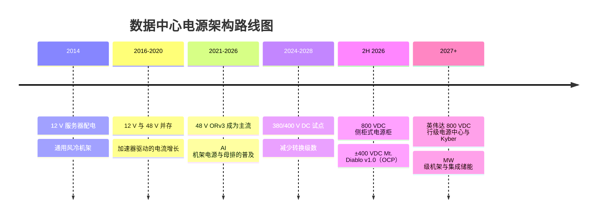
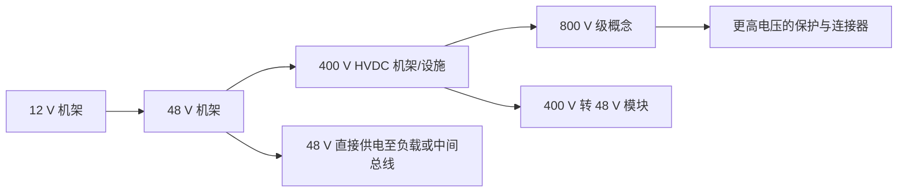

# 电源架构路线图
> **最后更新：** 2026-11-12
> **状态：** 草稿
> **标签：** 架构, 12V, 48V, HVDC, 路线图

## 概述
数据中心电源架构的演进方向是提高配电电压，并将转换环节移至更靠近负载的位置。更高的电压可降低电流和铜损，而就近调节可改善瞬态响应。由此带来的代价是对隔离、保护、控制、连接器和维护设计提出了更高要求。

48 V 凭借电信行业的技术传承和开放计算项目（OCP）的推动已实现商业化普及。380/400 V DC 已有部署先例，但并非通用的 AI 机架标准。英伟达（NVIDIA）已公布分阶段推出 800 VDC 的计划：2H 2026 推出交流供电的 800 VDC “侧柜”式电源柜，2027 年推出采用顶置母线槽的行级电源中心（row power center），并自 2027 年起推出原生 800 VDC 的 Kyber 代机架。与此同时，OCP 发布了 ±400 VDC Mt. Diablo 分离式电源机架规范（Disaggregated Power Rack Specification）v1.0.0（2026-10-08 生效）以及 v0.3 版固态变压器（SST）规范。截至 2026-11-12，±400 VDC 侧柜供电已有 OCP 规范，而原生 800 VDC 仍是由厂商主导的生态系统路线图，尚无经正式批准的 OCP/IEC 机架标准。

## 关键发现 / 要点
- [已确认，2024] ORv3 规定了 48 V 电源架与母排生态系统 [来源：OCP，2024]。
- [估计，2025] 领先的液冷 AI 机架以约 100-140 kW 的铭牌/配置功率运行。
- [已确认] 在功率相同的条件下，将配电电压从 12 V 提高到 48 V 可使电流降低 4x；在电阻相同的条件下，电阻损耗最多可降低 16x。
- [已确认，厂商路线图，2027+] 英伟达正牵头构建面向 1 MW 及以上 IT 机架的 800 VDC 生态系统，首发于 Kyber；量产时间与互操作性仍是执行层面的风险 [来源：NVIDIA，2026]。
- [已确认] 低于 1 V 的处理器供电轨迫使末级变换器在物理上紧邻封装。
- [已确认，2026] 英伟达公布的 Kyber 后期概念方案采用 64:1 高变比 LLC 转换，在计算节点附近将 800 VDC 降至 12 V [来源：NVIDIA，2026]。
- [已确认，厂商路线图，2026-08] 英伟达 800 VDC 三步走部署计划：（1）2H 2026 推出兼容 MGX 的 800 VDC 电源柜，由现有 415/480 VAC 供电，无需改造建筑；（2）2027 年推出行级电源中心，采用顶置 800 VDC 母线槽，每行最高 2 MW；（3）新建项目采用“直流电源模块”（DC power blocks），一步将电网电力转换为 800 VDC。英伟达表示，已有超过 80 家制造商在按该规范进行开发 [来源：NVIDIA 博客，2026-08]。
- [已确认，2026-10-08] OCP 发布了 Mt. Diablo v1.0.0（微软（Microsoft）、Meta、谷歌（Google））：一种基于 ORv3 的侧柜式电源柜，采用 +400 V/−400 V/公共端母排，可将 IT 机架功率从 100 kW 扩展至 1 MW [来源：OCP，2026-10-08]。
- [已确认，2026-09] Vera Rubin NVL72 机架已开始出货；OEM（原始设备制造商）配置显示每个机架配备四个 110 kW 电源架。机架功耗为 [估计，中置信度] ~190-230 kW，行业报道称 MGX 1.2 的设计上限为 250 kW [传闻；未审阅规范原文]。
- [已确认，2026-10] 节点级转换正从两级（800→50 V→12/6 V）转向单级 800 V→12 V 或 800 V→6 V GaN 变换器，相关演示来自纳微半导体（Navitas）/英伟达（24 kW）、微芯科技（Microchip）/纳微半导体、英飞凌（Infineon）/英伟达、德州仪器（TI）以及安森美（onsemi）（垂直 GaN）；以上均为演示或参考设计，并非量产 [来源：厂商发布，2026-10]。

## 图解

### 官方路线图图示参考
| 组织 | 待查阅的图示材料 | 官方来源 |
|---|---|---|
| 开放计算项目 | ORv3、电源架、母排及 HPR 架构图 | https://www.opencompute.org/wiki/Open_Rack/SpecsAndDesigns |
| 英伟达 | 800 VDC 设施/机架迁移及 MGX/Kyber 图示 | https://www.nvidia.com/en-us/data-center/technologies/800-vdc-architecture/ |
| Vicor | 48 V 供电及分比式电源架构图 | https://www.vicorpower.com/ |
| 台达电子（Delta Electronics） | 数据中心电源架及机架电源系统图示 | https://www.deltaww.com/en-US/solutions/Data-Center |
| 维谛技术（Vertiv） | 高密度机架及电源基础设施图 | https://www.vertiv.com/en-us/solutions/high-density-ai/ |

## 详细内容
### 演进时间线

| 阶段 | 年份 | 母线电压 | 机架功率 | 转换级数 | 关键标准 | 效率目标 | 驱动因素 |
|---|---:|---:|---:|---:|---|---|---|
| 传统阶段 | 2015 年以前 | 12 V | ~8-15 kW | 3-4 | ATX/OCP 早期 | 80 PLUS 各等级 | 通用服务器 |
| 并存阶段 | 2016-2020 | 12/48 V | ~15-30 kW | 3-4 | CRPS/电信/OCP | 铂金/钛金（Platinum/Titanium） | 加速器 |
| 48 V 主流阶段 | 2021-2026 | 48 V | ~30-140 kW | 3-4 | ORv3 | 电源架峰值 >97% | AI/HPC |
| HVDC 扩展阶段 | 2024-2028E | 380/400 V | 100 kW+ | 2-3 | 视具体部署而定 | 更少转换级 | 减少铜材/转换级 |
| ±400 VDC 侧柜（Mt. Diablo） | 2026+ | ±400 VDC | 100 kW-1 MW | 2-3 | OCP Mt. Diablo v1.0.0（2026-10-08） | [厂商宣称] 更少转换级 | 超大规模云厂商的分离式供电 |
| 英伟达 800 VDC 路线图 | 2H 2026 侧柜；2027E+ 原生 | 800 VDC | 1 MW 及以上 IT 机架 | 2-3 | 厂商架构；OCP SST 规范 v0.3；原生 800 VDC 机架规范尚未确定 | [厂商宣称] 更少转换级 | 极致功率密度 |

### 转换链

| 架构 | 第 1 级 | 第 2 级 | 第 3 级 | 第 4 级 | 总级数 | 示意性综合效率 |
|---|---|---|---|---|---:|---:|
| 传统 12 V | AC/UPS | AC-12 V | 12 V-POL | 负载 | 3 | 88-94% |
| ORv3 48 V | AC/UPS | AC-48 V 电源架 | 48 V-12 V 或直接转换 | POL | 3-4 | 90-95% |
| 400 V HVDC | AC-400 V | 400-48 V | 48 V-POL | 负载 | 2-3 | 92-96% |
| 800 V 直接转换概念 | MV AC-800 VDC | 节点附近 800-12/48 V | POL/负载 | - | 2-3 | 取决于具体架构；无通用实测基准 |
| 800 V 单级节点（2026 年演示） | MV AC 或侧柜-800 VDC | 800 V-12 V 或 800 V-6 V GaN 电路板 | 12/6 V-POL | 负载 | 3 | 800 V 级厂商目标值 ~96.5-97.6%；非现场数据 |

### 标准采用情况

| 标准 | 描述 | 年份 | 采用程度 | 推动方 |
|---|---|---:|---|---|
| CRPS | 通用冗余电源外形规格 | 2010 年代 | 广泛 | 服务器 OEM 生态系统 |
| Open Rack v3 | 48 V 机架/母排/电源 | 2021+ | 商用 | Meta/OCP 成员 |
| OCP HPR | 更高功率的 ORv3 生态系统 | 2024+ | 开发中 | Meta、威图（Rittal）、台达电子、AE |
| 380 V DC | 设施/机架 HVDC 实践 | 2010 年代起 | 选择性采用 | 电信与数据中心运营商 |
| 英伟达 800 VDC | AI 工厂电源架构 | 2025；侧柜 2H 2026；原生 2027+ | 生态系统开发中 | 英伟达；>80 家制造商按规范开发（NVIDIA，2026-08） |
| OCP Mt. Diablo | ±400 VDC 分离式电源机架 | v0.7 2026-03；v1.0.0 2026-10-08 | 已发布规范 | 微软、Meta、谷歌 |
| OCP SST 规范 | MV AC 至 800 VDC 固态变压器 | v0.3，2026-07 | 草案工作流 | 谷歌、微软、英伟达 |

### 功率密度路线图

| 年份 | 典型 AI 机架 | 领先机架 | 加速器 TDP | 备注 |
|---:|---:|---:|---:|---|
| 2018 | 10-20 kW | ~30 kW | 250-350 W | 风冷 |
| 2022 | 20-40 kW | ~60 kW | 400-700 W | GPU 集群 |
| 2025 | 40-80 kW | ~100-140 kW | 700-1,200 W 级 | 液冷应用扩大 |
| 2026 | 60-140 kW | ~190-230 kW [估计，中置信度]（Vera Rubin NVL72；4×110 kW 电源架） | ~1.8-2.3 kW 级 [估计] | 自 2026-09 起出货 |
| 2027E+ | 100-250 kW | 1 MW+ 路线图级别 | 2 kW+ | [厂商路线图；部署置信度低] |

相关：[主索引](README.md)。

## 数据表（如适用）
| 字段 | 数值 | 来源 | 日期 |
|---|---|---|---|
| ORv3 标称母线电压 | 48 V | OCP | 2024 |
| ORv3 HPR 公开目标 | 92 kW 或以上 | OCP 区域峰会材料 | 2024 |
| GB200 NVL72 GPU 数量 | 72 个 Blackwell GPU | 英伟达 | 2024 |
| 英伟达 800 VDC 量产起点 | Kyber 代，2027 [已被取代的细节：侧柜机架 2H 2026；行级电源中心 2027] | 英伟达 | 2026-08 路线图 |
| 英伟达行级电源中心 | 每行最高 2 MW，顶置 800 VDC 母线槽 | 英伟达 | 2027 年路线图 |
| Mt. Diablo v1.0.0 | ±400 VDC；100 kW-1 MW IT 机架 | OCP | 2026-10-08 |
| Vera Rubin NVL72 电源架配置 | 每机架 4 × 110 kW 电源架 | 超微电脑（Supermicro）/思科（Cisco） | 2026-09 |
| Vera Rubin NVL72 机架功耗 | [估计，中置信度] ~190-230 kW | 分析师估计 | 2026 |
| 英伟达目标机架级别 | 1 MW 及以上 IT 机架 | 英伟达 | 2026 年路线图 |
| 48 V 相对 12 V 的电流降幅 | 4x | P=VI 计算 | 2026 |
| 固定电阻下的 I2R 降幅 | 16x | 工程计算 | 2026 |

## 待解决问题 / 数据缺口
- 获取 380/400 V DC 的部署数量，并区分设施母线与机架母线。
- 明确英伟达所提原生 800 VDC 机架架构的标准制定机构、连接器、保护及维护安全边界（原生 800 V 的“Mt. Diablo 2.0”属 [传闻]，尚未发布）。
- 获取 MGX 1.2 规范的一手原文，以确认 250 kW 上限及母排额定值。
- 以具体 SKU 的实测值/铭牌值替代机架功率范围。

## 参考文献
- OCP Open Rack specifications | https://www.opencompute.org/wiki/Open_Rack/SpecsAndDesigns | 访问日期 2026-06-10
- OCP ORv3 IT Gear Design Guide | https://www.opencompute.org/documents/ocp-orv3-it-gear-design-guide-rev-02-june032024-pdf | 访问日期 2026-06-10
- NVIDIA GB200 NVL72 | https://www.nvidia.com/en-us/data-center/gb200-nvl72/ | 访问日期 2026-06-10
- NVIDIA 800 VDC architecture | https://www.nvidia.com/en-us/data-center/technologies/800-vdc-architecture/ | 访问日期 2026-07-28
- NVIDIA MGX/Kyber roadmap | https://www.nvidia.com/en-us/data-center/products/mgx/ | 访问日期 2026-07-28
- NVIDIA 800 VDC rollout blog | https://blogs.nvidia.com/blog/800-vdc-power-architecture-ai-factory/ | 检索日期 2026-11-12
- NVIDIA OCP 2026 / Vera Rubin MGX contribution | https://blogs.nvidia.com/blog/ocp-global-summit-vera-rubin-scale-ai-factories/ | 检索日期 2026-11-12
- OCP Mt. Diablo v1.0.0 specification | https://www.opencompute.org/wp-content/uploads/2026/10/OCP-Specification-Mt.-Diablo-Disaggregated-Power-Rack-Specification-v1.0.0.pdf | 检索日期 2026-11-12
- OCP LVDC/SST workstream announcement | https://www.opencompute.org/news/powering-the-next-era-of-ai-how-google-microsoft-and-nvidia-are-standardizing-and-accelerating-the-industry-transition-to-lvdc/ | 检索日期 2026-11-12
- Supermicro Vera Rubin NVL72 shipping | https://ir.supermicro.com/news/news-details/2026/Supermicro-Now-Shipping-NVIDIA-Vera-Rubin-NVL72-Racks/default.aspx | 检索日期 2026-11-12
- Cisco/Supermicro Vera Rubin NVL72 datasheet | https://www.cisco.com/site/us/en/solutions/global-partners/supermicro/nvidia-vera-rubin-nvl72-ds.html | 检索日期 2026-11-12
- Navitas/NVIDIA 24 kW 800 V-to-12 V board | https://www.powerelectronicsnews.com/navitas-nvidia-develop-24-kw-800v-to-12v-power-board/ | 检索日期 2026-11-12
- TI 800 VDC architecture | https://www.nasdaq.com/press-release/ti-unveils-complete-800-vdc-power-architecture-future-generation-ai-data-centers | 检索日期 2026-11-12
