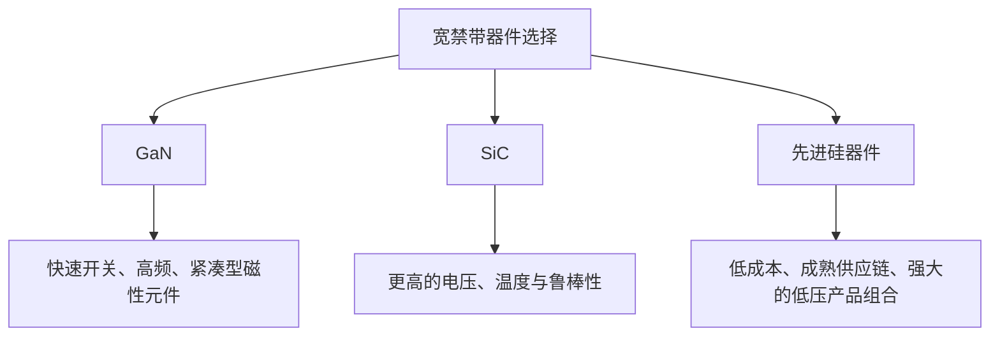
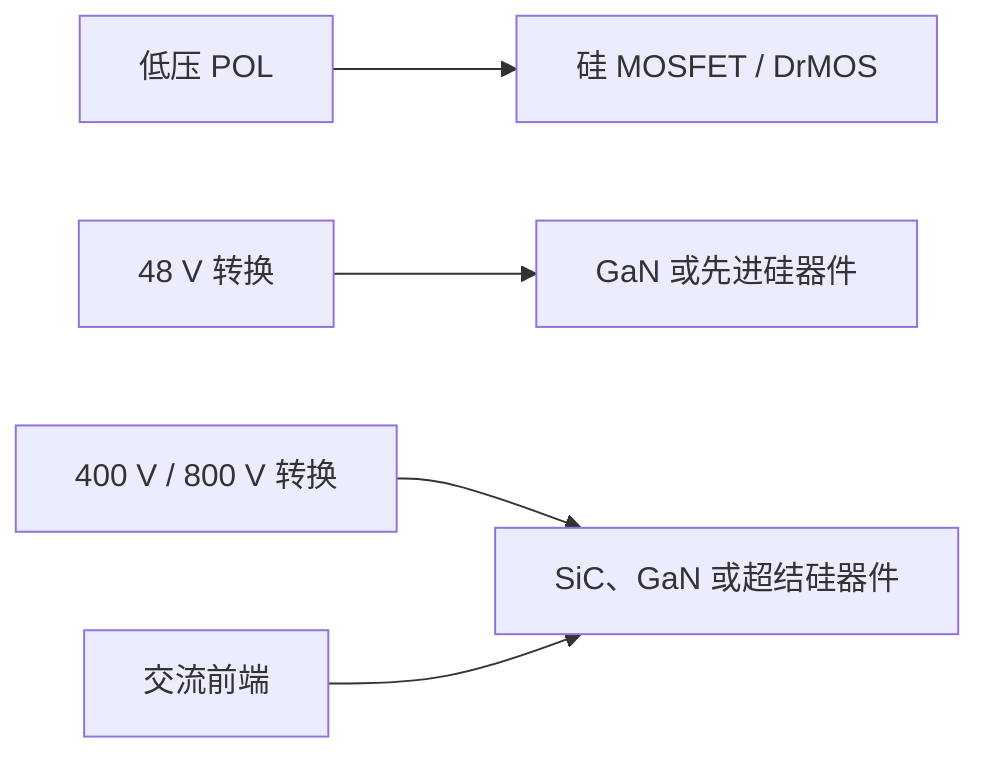

# 宽禁带半导体
> **最后更新：** 2026-11-12
> **状态：** 草稿
> **标签：** WBG, GaN, SiC, 可靠性, 市场采用

## 概述
与硅相比，宽禁带材料可承受更高的电场强度、开关速度和工作温度，从而在特定工作区间内缩小磁性元件尺寸并降低转换损耗。数据中心对宽禁带器件的采用因应用而异：GaN 在 100-650 V 快速转换中优势最强，而 SiC 在 650 V 及以上的大功率前端、UPS 和 HVDC 级中优势最强。

宽禁带（WBG）器件并不会自动改善变换器性能。布局电感、栅极驱动、反向导通、散热封装、EMI 滤波器、控制和认证，共同决定器件级优势能否在系统级得以保留。

## 关键发现 / 要点
- [已确认] 650 V 图腾柱 PFC 是 GaN 在数据中心的主要应用场景之一。
- [已确认] SiC 在 650-1,700 V 范围已实现商业化成熟，适用于 UPS/HVDC 供电。
- [估计，2025] 硅仍占数据中心功率半导体出货数量的大部分。
- [已确认] GaN 的动态导通电阻（RDS(on)）与 SiC 的栅氧化层稳定性需要针对各自技术进行专门认证。
- [估计，低置信度] Ga2O3 和金刚石在 2030 年前不太可能形成具有实质意义的数据中心营收。
- [已确认，2025-2026] 面向 800 VDC，GaN 的电压上限正在提高：帕沃英蒂格盛（Power Integrations）详细介绍了 1,250 V 和 1,700 V PowiGaN（2025-10），安森美（onsemi）在 OCP 2026 上演示了 1,200 V 垂直 GaN 800 V 转 6 V 转换级（效率为预测值，而非实测值）。主流商用 GaN 出货量仍以 650 V 级为主 [来源：Power Integrations，2025-10-13；onsemi，2026-10-09]。
- [已确认，2026-10] 由堆叠 650 V GaN 半桥构成的 800 V 转 12 V 和 800 V 转 6 V 单级节点变换器（例如纳微半导体（Navitas）/英伟达（NVIDIA）24 kW 电路板）表明，GaN 无需 1,200 V 器件即可服务 800 VDC 机架；在 MV SST 和 800 VDC 前端中，SiC 仍更受青睐。

## 图解

## 详细内容
### 器件矩阵

| 参数 | Si MOSFET | SiC MOSFET | GaN HEMT | 对数据中心的影响 |
|---|---|---|---|---|
| 常见电压 | 20-900 V | 650-3,300 V | 主流 30-700 V；1,200-1,700 V 新兴（2025-2026） | 由架构决定器件选型 |
| 频率 | 低频至 >1 MHz（低压） | 典型 ~10-500 kHz | 100 kHz-数 MHz | GaN 可缩小无源器件 |
| 成本 | 最低 | 最高 | 溢价 | 宽禁带器件需体现系统价值 |
| 热性能 | 成熟；热导率 k 中等 | 体热导率 k 高 | 取决于衬底/封装 | SiC 散热扩展能力出色 |
| 反向特性 | 体二极管 | 体二极管，Vf 较高 | 无本征体二极管 | 拓扑/栅极时序有所不同 |
| 供应链 | 广泛 | 衬底集中 | 晶圆代工/外延集中 | 双源供应至关重要 |

### 各应用成熟度

| 应用 | Si | SiC | GaN | 2025 年成熟度 |
|---|---|---|---|---|
| 图腾柱 PFC | 成熟 | 成熟 | 成熟/增长中 | 量产 |
| LLC 原边 | 成熟 | 成熟 | 成熟/增长中 | 量产 |
| 48 V 中间总线 | 主导 | 不太适合 | 增长中 | 量产 |
| 低于 1 V 的 VRM | 主导 | 不适合 | 新兴 | 早期量产 |
| 栅极驱动集成 | 成熟 | 成熟 | 单片集成优势突出 | 量产 |

### 采用 S 曲线

- GaN：已度过导入期，正在高密度 PSU 和充电器中规模化应用；2025 年其数据中心渗透率 [估计，中置信度] 处于早期增长阶段，尚未达到多数采用。
- SiC：受电动汽车和工业需求推动实现规模化；数据中心应用在 UPS/PFC/HVDC 领域 [估计] 仍处于早期阶段。
- 硅：成熟的在位技术，封装与超结技术持续改进。

### 可靠性

| 问题 | 材料 | 机理 | 缓解措施 |
|---|---|---|---|
| 动态导通电阻（RDS(on)） | GaN | 电荷俘获 | 工艺、场板、测试规程 |
| 阈值电压漂移 | SiC | 氧化层/界面陷阱 | 栅极偏压限制、筛选 |
| 短路 | SiC/GaN | 芯片面积小/热时间常数小 | 快速保护 |
| 宇宙射线失效 | 高压器件 | 单粒子烧毁 | 降额与认证 |

参见 [04_gan_technology.md](04_gan_technology.md) 和
[05_sic_technology.md](05_sic_technology.md)。

## 数据表（如适用）
| 字段 | 数值 | 来源 | 日期 |
|---|---|---|---|
| GaN 商用电压上限 | 主流 ~650-700 V | 厂商产品组合 | 2025 |
| GaN 高压前沿 | 1,250/1,700 V 横向器件（PowiGaN）；1,200 V 垂直器件演示（安森美） | 厂商披露 | 2025-2026 |
| SiC 商用电压范围 | 常见 650-3,300 V | 厂商产品组合 | 2025 |
| GaN 杀手级应用 | 图腾柱 PFC | 行业设计 | 2025 |
| SiC 数据中心应用区间 | UPS/PFC/HVDC | 厂商应用资料 | 2025 |
| 超越宽禁带材料的影响 | [估计] 2030 年后才形成实质性营收 | 分析师评估 | 2026 |

## 待解决问题 / 数据缺口
- 按变换器级建立基于出货量的宽禁带渗透率模型。
- 在等效任务剖面下补充现场返修率与 FIT 率的对比。
- 量化高海拔数据中心的宇宙射线降额实践。

## 参考文献
- JEDEC JEP173 overview | https://www.jedec.org/standards-documents/docs/jep173 | 访问日期 2026-06-10
- Infineon CoolGaN | https://www.infineon.com/cms/en/product/power/gallium-nitride-gan/ | 访问日期 2026-06-10
- Wolfspeed SiC devices | https://www.wolfspeed.com/products/power/ | 访问日期 2026-06-10
- Power Integrations 1,250/1,700 V PowiGaN | https://www.businesswire.com/news/home/20251013503136/en/power-integrations-details-1250-v-and-1700-v-powigan-technology-for-next-generation-800-vdc-ai-data-centers | 检索日期 2026-11-12
- onsemi grid-to-core OCP 2026 blog | https://www.onsemi.com/company/newsroom/blog/innovation/from-grid-to-core-powering-ai | 检索日期 2026-11-12
