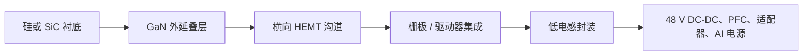
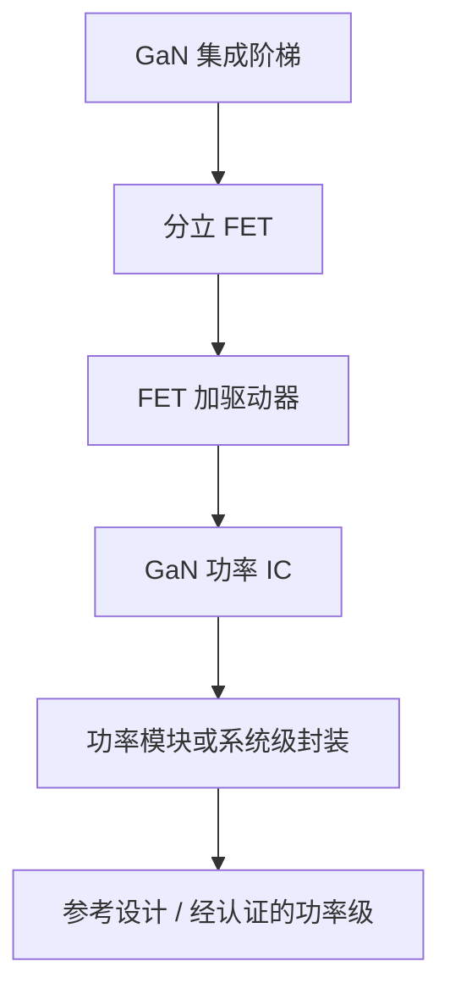

# GaN 技术
> **最后更新：** 2026-11-12
> **状态：** 草稿
> **标签：** GaN, HEMT, 衬底, PFC, 可靠性

## 概述
功率 GaN 采用高电子迁移率晶体管（HEMT），其导电沟道由 AlGaN/GaN 界面处形成的二维电子气构成。增强型器件在新的功率设计中占据主导地位；共源共栅（Cascode）器件则将常开型 GaN 晶体管与硅 MOSFET 组合，以实现常关型特性。

GaN 的低电荷和低输出电容使其能够在高频下工作，但封装/布局寄生参数、动态导通电阻（RDS(on)）、反向导通损耗、栅极电压裕量以及 EMI 都要求严谨的设计。数据中心领域的营收集中于 AC/DC PFC 和高密度 DC/DC。

## 关键发现 / 要点
- [已确认，2024] 英飞凌（Infineon）宣布开发的是 300 mm（12 英寸）而非 8 英寸 GaN 晶圆生产技术。
- [已确认] 硅基 GaN（GaN-on-Si）是大多数功率 GaN 的成本/规模化平台；SiC 基 GaN（GaN-on-SiC）常见于射频（RF）领域。
- [已确认] 650 V 增强型和共源共栅产品已实现商用。
- [已确认] 在特定条件下，图腾柱 PFC 样机/产品的峰值效率可超过 99%。
- [更正] 纳微半导体（Navitas）的 GeneSiC 是 SiC 产品品牌，而非全集成的 GaN 驱动器/控制器。
- [已确认，2023-2024] 英飞凌收购了 GaN Systems；瑞萨电子（Renesas）收购了 Transphorm。
- [已确认，2026] 安森美（onsemi）正向早期接入客户送样 700 V/1,200 V 垂直 GaN，并计划基于格芯（GlobalFoundries）的 200 mm 增强型硅基 GaN 工艺推出 650 V 横向 GaN [来源：onsemi，2026]。其 2026 年底垂直 GaN 量产目标目前属于 [公司目标；截至 2026-11-12 未确认]：OCP 2026 上展示的是一款 1,200 V 垂直 GaN 800 V 至 6 V 转换级，效率为*预计* 96%，且其 Q3 业绩未宣布量产。安森美于 Q2 2026 推出了 40-650 V GaNEXUS 横向 GaN 产品组合 [来源：onsemi，2026-08-03]。
- [已确认，2026-07] 美国国际贸易委员会（ITC）针对英诺赛科（Innoscience）侵权产品的进口/销售救济措施在总统审查期结束后成为终局，同时德国法院作出了更多有利于英飞凌的侵权裁决 [来源：Infineon，2026-07-07]。英诺赛科对救济范围提出异议（称仅涉及旧款产品），并在中国赢得了针对英飞凌 GaN 产品的裁决（苏州法院 2026-05-27；最高人民法院于 2026-06-12 维持禁令）[来源：Innoscience（经 Semiconductor Today 转载），2026-06]。
- [已确认，2026-10] GaN 现已成为英伟达（NVIDIA）800 VDC 节点转换的核心：纳微半导体/英伟达展示了一款 24 kW 单级 800 V 至 12 V 电路板（16 × 650 V GaN FET；满载效率目标 97%），英飞凌/英伟达同意联合开发 GaN 高压中间总线转换器（IBC；800 V 至 50/12/6 V，最高 1 MHz）。纳微半导体预计原生 800 V 产品最早于 2027 年底量产 [公司指引]。
- [已确认，2026-08] Yole 预测功率 GaN 器件市场规模将于 2031 年达到 $3.5B（2025-2031 年复合年增长率（CAGR）35%），其中电信/基础设施（含 AI 数据中心）到 2031 年将达 $750M（CAGR 45%）；按 2025 年功率 GaN 营收，Yole 将英诺赛科排在第一位 [来源：Yole（经 Semiconductor Today 转载）]。
- [已确认，2026] 晶圆代工格局正在变化：台积电（TSMC）将于 2027-07-31 前退出 GaN 代工生产；格芯获得台积电 650 V 和 80 V GaN 技术授权（2025-11-10）；宜普电源转换（EPC）将低压 eGaN 技术授权给瑞萨电子，作为合格的第二供应源（2026-02-12）。

## 图解

### 官方图示参考
| 厂商 | 待查阅的图示资料 | 官方来源 |
|---|---|---|
| 纳微半导体 | GaNFast、GaNSafe 及 AI 数据中心电源架构图示 | https://navitassemi.com/ |
| 英飞凌 | GaN Systems / CoolGaN 产品与应用示意图 | https://www.infineon.com/cms/en/product/power/gallium-nitride-gan/ |
| 宜普电源转换 | eGaN 器件、封装与应用示意图 | https://epc-co.com/epc/products/gan-fets-and-ics |
| 瑞萨电子 | Transphorm GaN 产品线与应用图示 | https://www.renesas.com/en/products/power-power-management/gan-fets |

## 详细内容
### 器件结构

| 结构 | 是否常关？ | 优势 | 局限 |
|---|---|---|---|
| 增强型横向 HEMT | 是 | 低电荷，可单片集成 | 栅极裕量小 |
| 共源共栅 GaN | 端口表现为常关 | 栅极驱动方式成熟 | 增加了硅器件/器件寄生参数 |
| 耗尽型 HEMT | 否 | 原生沟道性能强 | 失效安全设计复杂 |
| 垂直 GaN | 有可能 | 更高的电压/电流密度 | 制造处于早期阶段 |

### 衬底

| 平台 | 成本 | 散热 | 晶圆规格 | 功率应用 | 代表性生态 |
|---|---|---|---|---|---|
| 硅基 GaN（GaN-on-Si） | 成本最低的 GaN 路径 | 受限于 Si | 150/200/300 mm | 主流功率平台 | 英飞凌、纳微半导体合作伙伴、宜普电源转换 |
| SiC 基 GaN（GaN-on-SiC） | 高 | 优异 | 100/150 mm | 主要用于射频/特种应用 | Wolfspeed（原 Cree）/射频生态 |
| 同质衬底 GaN（GaN-on-GaN） | 很高 | 良好 | 小尺寸 | 垂直/特种应用 | Odyssey 类研发 |
| 蓝宝石基 GaN（GaN-on-sapphire） | 中等 | 差至中等 | 150/200 mm | LED/研发，部分器件 | 亚洲外延生态 |

### 数据中心产品系列

| 公司 | 产品系列 | 电压等级 | 集成/封装 | 目标应用 |
|---|---|---:|---|---|
| 纳微半导体 | GaNFast / GaNSafe | 650 V | IC/分立器件多种版本 | PFC/LLC |
| 宜普电源转换 | eGaN FET/IC | 常见 30-350 V | 芯片级/LGA | 48 V 转换 |
| 英飞凌 | CoolGaN / GaN Systems 既有产品 | 100-700 V | 分立/IC/模块 | PFC/DC-DC |
| 德州仪器（TI） | LMG | 100/600-650 V | 集成驱动器的功率级 | PFC/DC-DC |
| 瑞萨电子 | Transphorm SuperGaN | 650 V | 共源共栅/分立 | PFC/工业 |
| 意法半导体（ST） | MasterGaN | 600-650 V | 半桥 + 驱动器 | PSU/工业 |
| 安森美 | GaNEXUS 横向/垂直 GaN | 横向 40-650 V（2026 年推出）；垂直 700/1,200 V 送样/演示 | 分立/集成 | AI PSU/800 V 转换 |
| 帕沃英蒂格盛（Power Integrations） | PowiGaN | 1,250/1,700 V 横向 | 集成开关/IC | 800 VDC DC-DC（分析师预计 2028-29 年贡献营收） |
| 英诺赛科 | InnoGaN | 低/中压至 700 V 级；宣称最高 1,200 V | 分立/IC | 48 V/800 V AI 数据中心、消费电子 |

> ⚠️ 注意：价格取决于渠道、批量、封装和时间；分销商现货价格不能作为超大规模云厂商/OEM 合同平均售价（ASP）的有效参考。

### 集成阶梯

1. 分立 GaN FET 加外置驱动器/控制器。
2. GaN FET 与优化驱动器集成于同一封装或 IC 平台。
3. 带检测/保护功能的半桥/功率级集成。
4. 包含磁性元件、电容和控制电路的变换器模块。

### 晶圆路线图

| 直径 | 状态 | 意义 |
|---:|---|---|
| 150 mm / 6 英寸 | 主流存量产能 | 外延/工艺成熟 |
| 200 mm / 8 英寸 | 规模扩张中 | 设备/代工兼容性更好 |
| 300 mm / 12 英寸 | 英飞凌于 2024 年宣布；截至 2026-11-12 大规模量产（HVM）尚未确认 | 有望带来裸片成本/生产率的阶跃式改善 |

安森美的垂直 GaN 项目基于 GaN-on-GaN，而非主流的横向 GaN-on-Si 平台。在量产和现场数据披露之前，早期接入送样、2026 年 OCP 演示以及 2026 年底量产目标均不应被视为经认证的大规模部署。

### 2026 年晶圆代工与供应变化

| 日期 | 事件 | 影响 |
|---|---|---|
| 2025-11-10 | 格芯获得台积电 650 V/80 V GaN 技术授权，用于佛蒙特州 Burlington 工厂 | 与美国/欧盟对齐的第二供应源；投产时间 [待核实] |
| 2026-02-12 | 宜普电源转换将低压 eGaN 技术授权给瑞萨电子作为第二供应源 | 为 48 V AI 转换提供双重供应 |
| 2026-08-28 | 英诺赛科 H1 2026 营收 ~RMB 834M（+50.6%） | 硅基 GaN 出货规模领先者 |
| 2027-07-31 | 台积电 GaN 代工生产终止日期 | 无晶圆厂 GaN 厂商须完成转产（如转至力积电（PSMC）、格芯） |

### 知识产权与认证

JEDEC JEP173 提供了动态导通电阻的测量指南。部分厂商将 AEC-Q101 用作汽车级可靠性基准，但它并非针对数据中心的认证。关键知识产权集群包括增强型工艺/场板、单片驱动器集成、保护功能以及低电感封装。英飞凌于 2026 年 7 月报告其拥有约 450 个 GaN 专利族，但这一权利人自报数据仍需按法律状态和司法管辖区进行独立的规范化处理 [参见：16_patents_ip_landscape.md]。

相关：[主索引](README.md)。

## 数据表（如适用）
| 字段 | 数值 | 来源 | 日期 |
|---|---|---|---|
| 主要高压等级 | 650 V | 厂商产品组合 | 2025 |
| 英飞凌晶圆里程碑 | 300 mm GaN 开发 | 英飞凌 | 2024 |
| GaN Systems 收购 | 宣布交易金额 $830M | 英飞凌 | 2023 |
| Transphorm 所有者 | 瑞萨电子 | 瑞萨电子 | 2024 |
| 安森美垂直 GaN 路线图 | 700/1,200 V 送样；2026 年底量产目标 [截至 2026-11-12 未确认] | 安森美 | 2026 |
| 英飞凌自报 GaN 专利组合 | ~450 个专利族 [权利人自报] | 英飞凌 | 2026-07 |
| PFC 峰值效率 | >99%（特定设计条件下） | 厂商参考设计 | 2024-2025 |
| 纳微半导体/英伟达 800 V 至 12 V 电路板 | 24 kW；满载效率目标 97% | 纳微半导体 | 2026-10-13 |
| Yole 功率 GaN 预测 | 2031 年达 $3.5B；CAGR 35% | Yole | 2026-08 |
| 台积电退出 GaN 代工 | 2027-07-31 前 | 纳微半导体 8-K / 行业媒体 | 2025 |

## 待解决问题 / 数据缺口
- 补充当前产品级 RDS(on)、Qg、Coss、封装、认证及批量 ASP 快照数据。
- 核实纳微半导体的专利族数量，而非沿用营销口径的专利数量。
- 跟踪英飞凌宣布后 300 mm 的实际良率、产品及客户认证情况。
- 获取可比的动态 RDS(on) 和现场失效数据。
- 确认格芯基于台积电授权的 GaN 工艺以及纳微半导体向力积电的转产是否已进入量产。
- 将 Yole 2031 年 $750M 电信/基础设施 GaN 预测与本数据库的数据中心 GaN 细分市场进行核对。

## 参考文献
- Infineon 300 mm GaN | https://www.infineon.com/cms/en/about-infineon/press/press-releases/2024/INFXX202409-158.html | 访问日期 2026-06-10
- Renesas completes Transphorm acquisition | https://www.renesas.com/en/about/press-room/renesas-completes-acquisition-transphorm | 访问日期 2026-06-10
- ST MasterGaN | https://www.st.com/en/power-management/mastergan.html | 访问日期 2026-06-10
- TI GaN | https://www.ti.com/power-management/gallium-nitride/overview.html | 访问日期 2026-06-10
- EPC products | https://epc-co.com/epc/products/gan-fets-and-ics | 访问日期 2026-06-10
- onsemi/GF 200 mm lateral GaN collaboration | https://investor.onsemi.com/news-releases/news-release-details/onsemi-develop-next-generation-gan-power-devices-globalfoundries | 访问日期 2026-07-28
- onsemi Q1 2026 investor presentation | https://investor.onsemi.com/static-files/47c2ca2d-07d7-4d18-aa0b-87cc657b1ef4 | 访问日期 2026-07-28
- Infineon US ITC final determination | https://www.infineon.com/press-release/2026/ifxpr202607-118 | 访问日期 2026-07-28
- Infineon German infringement ruling | https://www.infineon.com/press-release/2026/infxx202606-115 | 访问日期 2026-07-28
- Navitas/NVIDIA 800 V-to-12 V board | https://semiconductor-today.com/news_items/2026/oct/navitas-131026.shtml | 检索日期 2026-11-12
- Infineon/NVIDIA GaN IBCs | https://www.semiconductor-today.com/news_items/2026/oct/infineon-211026.shtml | 检索日期 2026-11-12
- Yole Power GaN 2026 | https://semiconductor-today.com/news_items/2026/aug/yole-200826.shtml | 检索日期 2026-11-12
- GlobalFoundries/TSMC GaN license | https://semiconductor-today.com/news_items/2025/nov/globalfoundries-tsmc-101125.shtml | 检索日期 2026-11-12
- EPC/Renesas GaN licensing | https://www.businesswire.com/news/home/20260212384290/en/EPC-Announces-Strategic-GaN-Technology-Licensing-and-Second-Sourcing-Agreement-With-Renesas/ | 检索日期 2026-11-12
- Innoscience H1 2026 interim results | https://www1.hkexnews.hk/listedco/listconews/sehk/2026/0828/2026082803672.pdf | 检索日期 2026-11-12
- Innoscience China rulings vs Infineon | https://www.semiconductor-today.com/news_items/2026/jun/innoscience-infineon-150626.shtml | 检索日期 2026-11-12
- onsemi grid-to-core OCP 2026 blog | https://www.onsemi.com/company/newsroom/blog/innovation/from-grid-to-core-powering-ai | 检索日期 2026-11-12
