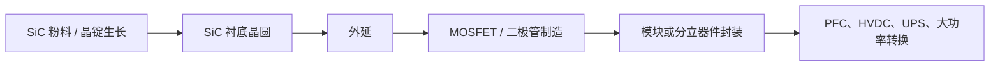
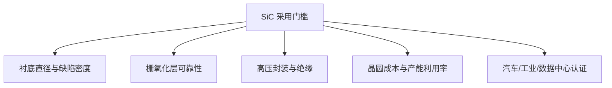

# 碳化硅技术
> **最后更新：** 2026-11-12
> **状态：** 草稿
> **标签：** SiC, MOSFET, 衬底, 产能, 可靠性

## 概述
4H-SiC 兼具高临界电场强度和高热导率，因而在高压、大功率转换领域颇具吸引力。数据中心应用集中于 UPS、PFC、HVDC 和机架级变换器，而非 100 V 以下的负载点（POL）调节。

SiC 价值链始于缓慢且对缺陷敏感的晶体生长，随后依次为晶圆加工、外延、器件制造和功率封装。由电动汽车（EV）主导的产能投资在 2024-2026 年造成了价格和产能利用率压力，这可能降低基础设施应用的器件成本，同时也给高杠杆供应商带来压力。

## 关键发现 / 要点
- [已确认] 4H-SiC 是电力电子领域的主流多型体（polytype）。
- [已确认] 栅氧化层/界面陷阱仍是 MOSFET 可靠性的核心问题。
- [已确认，2025] Wolfspeed（原 Cree）于 2025 年 6 月依据美国破产法第 11 章申请破产保护，并于 2025 年晚些时候完成财务重组。
- [更正] SK 矽德荣（SK Siltron）隶属于 SK 集团，而非三星子公司。
- [更正] 意法半导体（ST）与 Soitec 之间为 SmartSiC 供应关系；意法半导体在中国的 SiC 合资企业合作方为三安光电（Sanan）。
- [估计，2025-2026] EV 需求与产能错配加剧了 SiC 的价格压力，并提升了数据中心的供货可得性。
- [已确认，2026] Wolfspeed 于 2026 年 1 月获得美国外国投资委员会（CFIUS）批准后，完成了与瑞萨电子（Renesas）相关的最后一笔股权发行，达成了剩余的一项重组里程碑。
- [已确认，2026] Wolfspeed 已将 Durham 的 150 mm 器件生产转移至其 200 mm Mohawk Valley 晶圆厂，并报告已展示 300 mm SiC 晶圆制造能力；300 mm 属于开发里程碑，而非量产基准。
- [已确认，2026-11] Wolfspeed 报告 FY2026 营收为 $665.1M（FY2025：$757.6M），Q1 FY2027 营收 ~$155M，毛利率为负；公司表示其 AI 数据中心营收在 FY2026 增长超过一倍。2026-10-07，公司获得美国战争部战略资本办公室（Office of Strategic Capital）提供的最高 $1.5B、30 年期优先担保融资的有条件承诺 [来源：Wolfspeed 8-K 文件，2026]。
- [已确认，2026-10] 英飞凌（Infineon）将与 Wolfspeed 的 SiC 晶圆供应协议从 150 mm 扩展至 200 mm，并将为伊顿（Eaton）面向 800 VDC 的 MVSST 2.0 中压固态变压器（SST）供应 SiC 器件，2.3 kV 和 3.3 kV SiC 模块正在评估中。
- [已确认，2026-09] 力森诺科（Resonac）和住友金属矿山（Sumitomo Metal Mining）开始送样 300 mm SiC 衬底（住友的产品为键合衬底）；两家公司均未披露量产时间。
- [估计，中置信度，2026] 6 英寸 SiC 衬底价格在 Q1 2026 同比下降超过 30%，据报道到 2026 年年中已接近每片 $200-300，挤压了天岳先进（SICC）、意法半导体（受 200 mm 产线启动成本影响，其功率与分立器件（Power & Discrete）业务 Q3 2026 经营亏损 $81M）、安森美（onsemi）和 Wolfspeed 的利润率。

## 图解

### 官方图示参考
| 厂商 | 待查阅的图示资料 | 官方来源 |
|---|---|---|
| Wolfspeed | SiC 衬底、器件及 200 mm 制造图示 | https://www.wolfspeed.com/ |
| 安森美 | EliteSiC 器件与模块应用示意图 | https://www.onsemi.com/products/discrete-power-modules/silicon-carbide-sic |
| 意法半导体 | 碳化硅产品与应用图示 | https://www.st.com/en/power-transistors/sic-mosfets.html |
| 罗姆（ROHM） | SiC MOSFET 与模块封装图示 | https://www.rohm.com/products/sic-power-devices |

## 详细内容
### 器件物理与可靠性

| 主题 | 工程意义 |
|---|---|
| 4H 多型体 | 电场/迁移率/材料特性的平衡最为成熟 |
| SiO2/SiC 界面 | 陷阱密度影响迁移率和阈值稳定性 |
| 体二极管 | 正向压降较高；死区时间及外置二极管的选择至关重要 |
| 双极退化 | 基平面缺陷可能导致双极导通性能退化 |
| 雪崩/短路 | 必须在任务剖面温度和母线电压下进行测试 |

### 供应链

| 环节 | 瓶颈 | 领先企业/示例 |
|---|---|---|
| 晶锭生长 | 缺陷、周期时间、直径 | Wolfspeed、Coherent（原 II-VI）、SiCrystal、天岳先进、天科合达（TanKeBlue）、SK 矽德荣 |
| 晶圆加工 | 切口损耗、翘曲、表面质量 | 一体化及专业晶圆企业 |
| 外延 | 厚度/掺杂均匀性 | IDM 和外延供应商 |
| 器件制造 | 氧化层/界面、良率 | 英飞凌、意法半导体、安森美、罗姆、Wolfspeed |
| 封装 | 电感与热循环 | IDM/模块专业厂商 |

### 器件系列

| 公司 | 产品系列 | 电压等级 | 封装方向 | 数据中心目标应用 |
|---|---|---:|---|---|
| Wolfspeed | C3M/E3M | 650-1,700 V | TO/D2PAK/模块 | PFC/UPS |
| 英飞凌 | CoolSiC | 650-2,000 V 级；2.3/3.3 kV 模块正在评估用于 SST（2026） | 分立/模块 | PFC/UPS/HVDC/MV SST |
| 安森美 | EliteSiC | 650-1,200 V | 分立/模块 | PFC/能源 |
| 意法半导体 | STPOWER SiC | 650-1,200 V | 分立/模块 | PFC/工业 |
| 罗姆 | SCT/BH 系列 | 650-1,200 V | 分立/模块 | PFC/UPS |
| 微芯科技（Microchip） | mSiC | 700-3,300 V | 裸片/分立/模块 | 高可靠性电源 |

### 产能追踪

| 公司/基地 | 衬底/器件 | 直径 | 2026 年状态 | 投资/状态 |
|---|---|---:|---|---|
| Wolfspeed Mohawk Valley | 器件 | 200 mm | 爬坡中；产能利用率低 | 资产负债表已重组；$1.5B OSC 有条件贷款（2026-10） |
| Wolfspeed John Palmour 制造中心（北卡罗来纳州 Siler City） | 材料 | 200 mm | 爬坡/认证 | 项目已重组 |
| Coherent | 衬底 | 150/200 mm | 商用/爬坡中 | 独立第三方供应商 |
| SiCrystal/罗姆 | 衬底 | 150/200 mm 路线 | 一体化 | 欧洲基地 |
| 意法半导体/三安光电合资 | 器件 | 200 mm 规划 | 爬坡计划 | 中国制造 |
| 天岳先进/天科合达 | 衬底 | 150/200 mm 路线 | 扩产中 | 中国本土化；8 英寸产品占天岳先进 Q3 2026 营收 >50% [公司数据] |
| 意法半导体 Catania / 重庆（三安合资） | 器件/衬底 | 200 mm | 2026 年产生启动成本 | Q3 2026 功率与分立器件业务经营亏损 |
| 力森诺科 | 衬底 | 300 mm | 送样（2026-09） | 未宣布外延片计划 |
| 住友金属矿山 | 键合衬底（“SiCkrest”） | 300 mm | 送样（2026-09） | 量产时间未披露 |

> ⚠️ 注意：公开披露的“产能”以晶圆数量、营收产能、厂房面积或等效晶圆投片量等不同口径报告。这些单位不可直接比较；缺乏依据的 mm2/月估算已有意省略。

### 封装路线图

TO-247/D2PAK 仍然常见。四引脚开尔文源极（Kelvin-source）封装和低电感表面贴装封装可改善开关特性。随着功率和电压的提升，采用 DBC/AMB 基板的半桥及多开关模块更受青睐。参见 [21_thermal_management.md](21_thermal_management.md)。

## 数据表（如适用）
| 字段 | 数值 | 来源 | 日期 |
|---|---|---|---|
| 主流多型体 | 4H-SiC | 行业共识 | 2025 |
| 数据中心常用电压等级 | 650/1,200 V | 厂商产品组合 | 2025 |
| Mohawk Valley 晶圆直径 | 200 mm | Wolfspeed | 2025 |
| Wolfspeed 申请第 11 章破产保护 | 2025 年 6 月 30 日 | Wolfspeed/法院披露文件 | 2025 |
| Wolfspeed/瑞萨电子重组里程碑 | 获得 CFIUS 批准并完成最后一笔股权发行 | Wolfspeed | 2026-01-30 |
| Wolfspeed 300 mm 状态 | 已展示晶圆制造能力；非大规模量产（HVM） | Wolfspeed Q2 FY2026 | 2026 |
| 意法半导体中国 SiC 合作方 | 三安光电 | 意法半导体 | 2023 |
| Wolfspeed FY2026 营收 | $665.1M | Wolfspeed 8-K | 截至 2026-06-28 的财年 |
| Wolfspeed Q1 FY2027 营收 | ~$155M；非 GAAP 毛利率 (13)% | Wolfspeed 8-K | 2026-11-04 |
| Wolfspeed OSC 融资 | 最高 $1.5B，附条件 | Wolfspeed 8-K | 2026-10-07 |
| 6 英寸 SiC 衬底价格 | [估计，中置信度] ~$200-300/片 | Digitimes/集邦咨询（TrendForce） | 2026 年年中 |
| 300 mm SiC 衬底样品 | 力森诺科；住友金属矿山 | 公司/行业媒体 | 2026-09 |

## 待解决问题 / 数据缺口
- 将晶圆产能统一折算为每月 150 mm 等效良品晶圆数。
- 补充重组后 Wolfspeed 的产能利用率、资本支出及客户承诺。
- 将数据中心专用 SiC 出货量与 EV/工业出货量分开量化。
- 补充中国衬底缺陷密度与认证情况的比较。
- 跟踪 OSC 贷款是否完成交割，并用于为 Wolfspeed 的高票息第一留置权票据再融资。
- 量化 MV SST 和 800 VDC 侧柜（电源柜）中的 SiC 用量，并与 EV 需求进行比较。

## 参考文献
- Wolfspeed restructuring | https://investor.wolfspeed.com/ | 访问日期 2026-06-10
- Wolfspeed restructuring completion milestone | https://investor.wolfspeed.com/news/news-details/2026/Wolfspeed-Announces-CFIUS-Clearance-and-Completion-of-Equity-Issuance-to-Renesas-as-Part-of-Court-Approved-Restructuring/default.aspx | 访问日期 2026-07-28
- Wolfspeed Q2 FY2026 results | https://assets.wolfspeed.com/uploads/2026/02/Wolfspeed_Q2_2026_Earnings_Release.pdf | 访问日期 2026-07-28
- ST and Sanan SiC JV | https://newsroom.st.com/media-center/press-item.html/c3184.html | 访问日期 2026-06-10
- Soitec SmartSiC | https://www.soitec.com/en/products/smartcut/smartsic | 访问日期 2026-06-10
- ROHM SiC | https://www.rohm.com/sic | 访问日期 2026-06-10
- Microchip SiC | https://www.microchip.com/en-us/products/power-management/silicon-carbide | 访问日期 2026-06-10
- Wolfspeed Q4 FY2026 results | https://www.sec.gov/Archives/edgar/data/0000895419/000089541926000049/ex991q4-26.htm | 检索日期 2026-11-12
- Wolfspeed Q1 FY2027 results | https://www.sec.gov/Archives/edgar/data/0000895419/000089541926000075/ex991q1-27.htm | 检索日期 2026-11-12
- Wolfspeed OSC loan commitment | https://www.sec.gov/Archives/edgar/data/0000895419/000119312526416987/d122407dex991.htm | 检索日期 2026-11-12
- Infineon/Wolfspeed 200 mm supply extension | https://semiconductor-today.com/news_items/2026/oct/wolfspeed-infineon-161026.shtml | 检索日期 2026-11-12
- Infineon/Eaton MVSST 2.0 | https://www.infineon.com/press-release/2026/infpr202609-146 | 检索日期 2026-11-12
- Resonac / Sumitomo Metal Mining 300 mm SiC | https://eetimes.itmedia.co.jp/ee/articles/2609/25/news064.html | 检索日期 2026-11-12
- TrendForce China WBG pricing | https://www.trendforce.com/news/2026/05/14/news-chinas-wide-bandgap-chip-players-diverge-as-gan-rf-surges-sic-profitability-under-pressure/ | 检索日期 2026-11-12
- SICC H1 2026 interim results | https://www.hkexnews.hk/listedco/listconews/sehk/2026/0819/2026081901613.pdf | 检索日期 2026-11-12
- ST Q3 2026 results (reprint) | https://www.generation-nt.com/communiques-presse/stmicroelectronics-reports-q3-2026-financial-results-2083619 | 检索日期 2026-11-12
