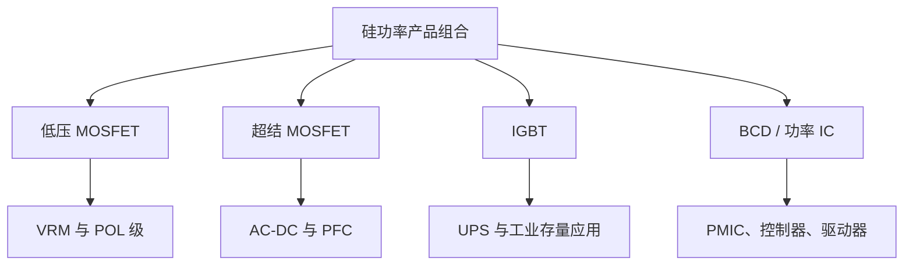
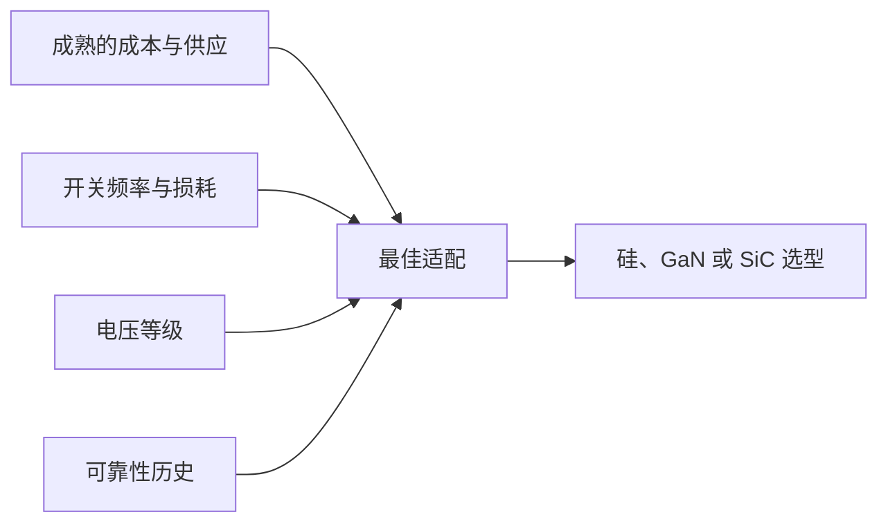

# 硅功率器件
> **最后更新：** 2026-11-12
> **状态：** 草稿
> **标签：** 硅, MOSFET, IGBT, 二极管, DrMOS

## 概述
硅仍是数据中心电源在经济性和出货量方面的基础。低压沟槽 MOSFET 和集成式 DrMOS 功率级主导处理器 VRM，而超结 MOSFET、整流器件和 IGBT 在 PSU 和 UPS 系统中仍占有一席之地。

当更高的频率、电压、温度或功率密度能带来足以抵消器件成本的系统级节约时，宽禁带（WBG）器件才会取代硅。硅器件通过元胞几何结构、薄晶圆、铜夹片（copper clip）封装、源极朝下（source-down）布局及集成化持续改进。

## 关键发现 / 要点
- [估计，中置信度，2025] 硅占数据中心功率器件出货数量的 80% 以上。
- [已确认] 低于 100 V 的 POL 是硅在数据中心最具优势的领域。
- [已确认] 超结 MOSFET 在 600-700 V 服务器 PSU 中仍具竞争力。
- [已确认] IGBT 仍用于大功率、较低频率的 UPS/逆变器级。
- [估计] 在 12/48 V、约 300-500 kHz 以下，硅仍具成本竞争力，具体取决于设计。
- [已确认，2026-11] 安森美（onsemi）报告其硅和 SiC MOSFET 已批量出货至包括谷歌（Google）在内的多个 AI 平台，覆盖 PSU 和 54 V 转 12 V 转换；在 54 V 中间总线级中，硅仍是在位技术 [来源：onsemi Q3 2026 业绩，2026-11-02]。
- [已确认，2026-07-07] 安森美同意根据其“fab right”战略剥离 Tarlac（菲律宾）和 Mountain Top（宾夕法尼亚州）两处工厂；交割时间 [待核实]。

## 图解

## 详细内容
### 器件图谱

| 器件 | 电压 | 厂商 | 最佳数据中心应用 | 宽禁带替代威胁 |
|---|---:|---|---|---|
| 沟槽 MOSFET | 20-200 V | 英飞凌（Infineon）、威世（Vishay）、万国半导体（AOS）、安森美、德州仪器（TI） | VRM/中间总线 | GaN 增长中 |
| 超结 MOSFET | 500-900 V | 英飞凌、意法半导体（ST）、安森美、威世 | PFC/LLC | GaN/SiC 已构成现实威胁 |
| 平面 MOSFET | 宽范围/传统 | 众多厂商 | 成本敏感/存量应用 | 逐步被内部替代 |
| IGBT | 600 V-6.5 kV | 英飞凌、三菱电机（Mitsubishi）、富士电机（Fuji）、安森美 | UPS/逆变器 | 高占空比/高频下被 SiC 替代 |
| 肖特基/超快恢复二极管 | 20-1,200 V | 威世、意法半导体、英飞凌、罗姆（ROHM） | 整流/钳位 | 高压下被 SiC SBD 替代 |

### 代表性产品系列

| 公司 | 产品系列 | 技术 | 数据中心相关性 |
|---|---|---|---|
| 英飞凌 | CoolMOS | 高压超结 | PFC/LLC |
| 英飞凌 | OptiMOS | 低压沟槽 MOSFET | 48 V/VRM |
| 意法半导体 | MDmesh | 高压超结 | PSU |
| 威世 | TrenchFET/EF/EF2 系列 | 低压/高压 MOSFET | VRM/PSU |
| 万国半导体 | AlphaMOS/DrMOS 产品组合 | 低压 MOSFET/功率级 | 服务器主板 |

### 每美元性能

| 区间 | 硅 | GaN | SiC | 可能的选择 |
|---|---|---|---|---|
| <100 V，<300 kHz | 优秀 | 持续改进 | 差 | 硅 |
| 100-200 V，0.3-2 MHz | 良好 | 优秀 | 差 | GaN/视设计而定 |
| 400-650 V，高频 | 良好 | 优秀 | 良好 | GaN/Si SJ/SiC |
| 650-1,700 V，大功率 | 有限 | 有限 | 优秀 | SiC |

参见 [08_vrm_and_pmic.md](08_vrm_and_pmic.md)。

## 数据表（如适用）
| 字段 | 数值 | 来源 | 日期 |
|---|---|---|---|
| POL 电压区间 | 输入 <100 V 的器件 | 厂商产品组合 | 2025 |
| SJ-MOSFET 区间 | 500-900 V | 厂商产品组合 | 2025 |
| IGBT UPS 区间 | [估计] >100 kW 系统 | 行业设计 | 2025 |
| 硅出货数量占比 | [估计] >80% | 分析师评估 | 2025 |
| 硅成本领先优势 | [已确认] 成熟的大规模量产晶圆厂 | 厂商披露 | 2025 |

## 待解决问题 / 数据缺口
- 获取仅限数据中心的 MOSFET 出货量与营收份额数据。
- 跟踪 800 V 转 12/6 V GaN 节点变换器是否会在 54 V 中间总线级取代硅。
- 比较源极朝下硅器件与 GaN 的封装级 FOM 与热阻。
- 按 UPS 占空比与电价量化 IGBT 向 SiC 切换的交叉点。

## 参考文献
- Infineon CoolMOS | https://www.infineon.com/cms/en/product/power/mosfet/high-voltage-mosfets/coolmos/ | 访问日期 2026-06-10
- ST MDmesh | https://www.st.com/en/power-transistors/mdmesh-mosfets.html | 访问日期 2026-06-10
- Vishay MOSFETs | https://www.vishay.com/en/mosfets/ | 访问日期 2026-06-10
- onsemi IGBTs | https://www.onsemi.com/products/discrete-power-modules/igbts | 访问日期 2026-06-10
- onsemi Q3 2026 results | https://www.onsemi.com/company/newsroom/news-and-insights/onsemi-reports-third-quarter-2026-results | 检索日期 2026-11-12
- onsemi fab divestitures | https://onsemi.gcs-web.com/news-releases/news-release-details/onsemi-advances-fab-right-strategy-agreements-divest-two | 检索日期 2026-11-12
