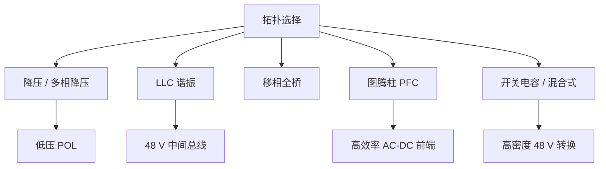

# 功率转换拓扑
> **最后更新：** 2026-11-12
> **状态：** 草稿
> **标签：** 拓扑, PFC, LLC, DAB, 多相, 开关电容

## 概述
变换器拓扑决定了电压变比、隔离方式、开关应力、磁性元件要求、控制复杂度，以及能否充分发挥半导体器件的速度优势。忽略拓扑和工作模式的器件比较通常具有误导性。

数据中心前端越来越多地采用无桥/图腾柱 PFC 和谐振 DC/DC，而处理器供电轨则采用多相降压（Buck）或专有的分比式/开关电容方案。双向 CLLC 和 DAB 级可支持 BBU、UPS 以及未来的 HVDC 架构。

## 关键发现 / 要点
- [已确认] 图腾柱 PFC 消除了二极管整流桥损耗，但提高了对控制/换流的要求。
- [已确认] LLC 利用谐振软开关，常见于隔离型服务器电源转换。
- [已确认] 多相运行可实现电流均分，并在输出端抵消纹波。
- [已确认] 双有源桥（DAB）利用两个有源桥实现隔离型双向功率传输。
- [估计] 随着转换变比提高，混合开关电容/电感设计的价值随之提升。
- [已确认，2026] 中压固态变压器（MV AC 至 800 VDC）已从概念进入产品项目阶段：ABB Infinitus（SST 于 2H 2027 商用上市）、伊顿（Eaton）采用英飞凌（Infineon）SiC 的 MVSST 2.0、西门子（Siemens）/莱茵豪森（Reinhausen）（输入最高 36 kV）、台达电子（Delta）、Heron Power、Amperesand 和 DG Matrix [来源：厂商发布，2026]。
- [已确认，2026-10] 采用堆叠 GaN 半桥和高变比谐振级，已演示从 800 V 直接转换至 12 V 或 6 V 的单级节点转换（纳微半导体（Navitas）/英伟达（NVIDIA）24 kW 800 V 转 12 V；微芯科技（Microchip）/纳微半导体及德州仪器（TI）800 V 转 6 V）。在独立测量结果公布之前，相关效率数值均为厂商目标值。

## 图解

## 详细内容
### 拓扑矩阵

| 拓扑 | 类型 | 电压/功率 | 效率潜力 | 复杂度 | 数据中心用途 | 宽禁带适配性 |
|---|---|---|---|---|---|---|
| 降压/升压/升降压 | 非隔离 | 低压-中压 | 高 | 低-中 | POL/母线 | 是 |
| SEPIC/反激 | 可选隔离 | 中小功率 | 中 | 低 | 辅助供电轨 | 是 |
| LLC/CLLC | 隔离谐振 | 100 W-100 kW 级 | 很高 | 中-高 | PSU/BBU | 强 |
| DAB | 隔离双向 | kW-MW 级 | 高 | 高 | HVDC/BBU | 强 |
| 图腾柱 PFC | AC/DC | 1-100+ kW | 已演示峰值 >99% | 高 | 前端 | 强 |
| 维也纳整流器 | 3 相 AC/DC | 大功率 | 高 | 高 | UPS/前端 | 适合 SiC |
| PSFB | 隔离 | kW 级 | 高 | 中 | 母线变换器 | 是 |
| 多相降压 | 非隔离 | 100-1,000+ A | 高 | 高 | CPU/GPU VRM | Si/GaN |
| 开关电容 | 非隔离 | 固定变比 | 高 | 中 | 48-12 V | GaN/Si |
| 分比式/SAC | 专有谐振 | 高变比 | 高 | 高 | 48 V-POL | 视模块而定 |

### 多相纹波

对于 N 个等间隔分布的相位，各相依次错开 360/N 度。在有利的占空比下，叠加后的电感纹波会部分相互抵消，从而可减小输出电容并加快瞬态响应。实际收益取决于均流、死区时间、封装/平面寄生参数以及控制器带宽。

### 新兴 800 V 方案

| 拓扑 | 作用 | 关键问题 |
|---|---|---|
| SiC DAB | 800 V 转隔离母线 | 变压器/漏感优化 |
| CLLC | 双向谐振转换 | 宽增益控制 |
| 部分功率处理 | 仅处理电压差部分 | 保护/故障路径 |
| 模块化多电平 | 通过单元级联扩展电压 | 成本/控制复杂度 |
| MV 固态变压器 | MV AC（13.8-36 kV）转 800 VDC，通常配备储能缓冲 | 认证、故障穿越、中压绝缘、每 MW 成本 |
| 堆叠半桥 GaN LLC | 在节点附近单级完成 800 V 转 12 V/6 V | 电压均衡、变压器变比、瞬态响应 |
| 多端口 SST | 将 MV AC、储能和发电端口接入同一直流母线 | 控制复杂度与保护协调 |

相关：[主索引](README.md)。

## 数据表（如适用）
| 字段 | 数值 | 来源 | 日期 |
|---|---|---|---|
| 典型 VRM 相数 | 6-20+ | 控制器/产品设计 | 2025 |
| 图腾柱峰值效率 | 已演示 >99% | 参考设计 | 2024-2025 |
| 相位间隔 | 360/N 度 | 拓扑恒等关系 | 2026 |
| DAB 方向性 | 双向 | 电力电子文献 | 2025 |
| LLC 开关方式 | 在设计范围内实现 ZVS/ZCS | 电力电子文献 | 2025 |
| 纳微半导体/英伟达单级电路板 | 24 kW，800 V 转 12 V，16 × 650 V GaN，满载目标效率 97% | 纳微半导体 | 2026-10-13 |
| 德州仪器 800 V 转 6 V 母线变换器 | 峰值 97.6% [厂商宣称]，>2,000 W/in³ | 德州仪器 | 2026-03-16 |
| 台达电子 MV SST | 最高 98.5% [厂商宣称，行业媒体] | 台达电子/OCP 相关报道 | 2026-10 |
| DG Matrix Interport | 多端口 SST，单台最高 2.4 MW | DG Matrix | 2026-02 |

## 待解决问题 / 数据缺口
- 针对各类 PFC/LLC 变体补充可直接对比的 5 kW 和 30 kW 损耗模型。
- 将 Vicor 的专有技术宣称与独立实测的效率及瞬态数据进行对照。
- 跟踪 OCP 大功率电源架参考拓扑。
- 将 MV SST 的效率、占地面积和每 MW 成本与工频变压器加整流器的基准方案进行比较。

## 参考文献
- IEEE Transactions on Power Electronics | https://ieeexplore.ieee.org/xpl/RecentIssue.jsp?punumber=63 | 访问日期 2026-06-10
- TI totem-pole PFC resources | https://www.ti.com/power-management/acdc-isolated-dcdc-switching-regulators/power-factor-correction-pfc/overview.html | 访问日期 2026-06-10
- Vicor Factorized Power | https://www.vicorpower.com/technology/factorized-power-architecture | 访问日期 2026-06-10
- ABB Infinitus DC portfolio | https://www.globenewswire.com/news-release/2026/09/21/3365178/0/en/abb-s-new-direct-current-portfolio-aims-to-rewire-ai-data-center-energy-infrastructure.html | 检索日期 2026-11-12
- Siemens/Reinhausen SST | https://www.techzine.eu/news/infrastructure/143672/siemens-and-reinhausen-are-developing-an-sst-for-800v-dc-ai-data-centers/ | 检索日期 2026-11-12
- Infineon/Eaton MVSST 2.0 | https://www.infineon.com/press-release/2026/infpr202609-146 | 检索日期 2026-11-12
- Navitas/NVIDIA 24 kW board | https://www.powerelectronicsnews.com/navitas-nvidia-develop-24-kw-800v-to-12v-power-board/ | 检索日期 2026-11-12
- Microchip/Navitas 800 V-to-6 V reference design | https://www.microchip.com/en-us/about/news-releases/products/the-data-center-is-moving-to-800v-microchip-and-navitas-are-enabling-transition | 检索日期 2026-11-12
- DG Matrix Series A | https://techcrunch.com/2026/02/18/dg-matrix-raises-60m-to-make-data-center-power-smarter | 检索日期 2026-11-12
