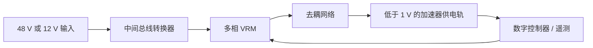
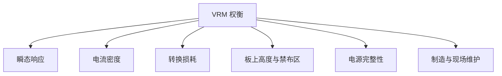

# VRM 与 PMIC
> **最后更新：** 2026-11-12
> **状态：** 草稿
> **标签：** VRM, PMIC, DrMOS, GPU, CPU, POL

## 概述
电压调节模块（VRM）将板级或机架级中间供电轨转换为严格调节的处理器、内存及辅助电压。AI 加速器兼具高平均功率与突发的负载瞬变，使电流密度、遥测、控制带宽、去耦和热设计成为核心问题。

大多数大电流供电轨采用多相控制器，配合集成式 DrMOS 或智能功率级。在电路板面积、铜损或垂直布局足以支撑采用不同架构的场合，专有模块和 48 V 直接转换方案形成了竞争。

## 关键发现 / 要点
- [已确认] H100 SXM 的可配置 TDP 最高为 700 W [来源：NVIDIA，2023]。
- [更正] H200 SXM 通常为 700 W 级产品，并非普遍确认的 1,000 W 器件。
- [更正] B200 SXM 最高约 1,000 W；1,200 W 的数据取决于具体配置/产品代际。
- [估计] 一条低于 1 V、1 kW 的供电轨在计入转换和配电裕量之前，即意味着超过 1,000 A 的电流。
- [已确认] DrMOS 将驱动器与高/低边 MOSFET 集成在一起，以降低寄生参数并节省面积。
- [已确认，2026] 集成式与垂直电压调节成为本年度并购的主旋律：亚德诺（ADI）完成对 Empower Semiconductor 的收购（~$1.5B 现金，2026-07-07）；纳微半导体（Navitas）完成对 Claros 的收购（最高 ~$232.8M，2026-10-06）；英飞凌（Infineon）完成对 C2i Semiconductors 的收购（金额未披露，~2026-10）；安森美（onsemi）同意收购 Ferric（$600M 现金外加最高 $175M 或有对价，2026-11-02 宣布）。
- [已确认，2026] 德州仪器（TI）公布的 800 VDC 架构采用隔离式 800 V 至 6 V GaN 母线转换器（峰值效率 97.6% [厂商宣称]），后接 6 V 至低于 1 V 的多相级 [来源：TI，2026-03-16]。
- [估计，中置信度] 据报道，Vera Rubin 代 GPU 的单封装功耗约为 1.8-2.3 kW，具体取决于功率模式；英伟达（NVIDIA）尚未公布供电轨级规格。
- [已确认，2026-09/10] Vicor 将其垂直供电（VPD）专利授权给一家未具名的“领先 AI OEM”，并向美国国际贸易委员会（ITC）提起诉状（337-TA-1526），将台达电子（Delta Electronics）、英飞凌、芯源系统（MPS）、伟创力（Flex）、天弘（Celestica）、广达（Quanta）和立讯精密（Luxshare）旗下实体列为被诉方；VPD 供应链目前面临知识产权风险。

## 图解

### 官方图示参考
| 厂商 | 待查阅的图示资料 | 官方来源 |
|---|---|---|
| 芯源系统 | VRM、电源模块及数据中心功率级图示 | https://www.monolithicpower.com/en/applications/data-center.html |
| 英飞凌 | XDP、功率级及多相 VRM 应用示意图 | https://www.infineon.com/cms/en/applications/computing/data-center-and-servers/ |
| 德州仪器 | 多相控制器、功率级及 PMBus 示例 | https://www.ti.com/power-management/non-isolated-dc-dc-switching-regulators/multiphase-controllers/overview.html |
| 瑞萨电子（Renesas） | 数字多相控制器与功率级示意图 | https://www.renesas.com/en/products/power-power-management/multiphase-controllers |
| 亚德诺 | 数字电源管理与 POL 稳压器图示 | https://www.analog.com/en/solutions/data-center.html |

## 详细内容
### VRM 演进

| 代际 | 时期 | 输入 | 输出 | 电流 | 相数 | 技术 | 示例 |
|---|---:|---:|---:|---:|---:|---|---|
| ATX12V/VR11 | 2000 年代 | 12 V | ~1 V | <150 A | 3-6 | 分立 FET | CPU |
| VR12/13 | 2010 年代 | 12 V | 低于 1.5 V | 100-300 A | 4-10 | DrMOS | Xeon/加速器 |
| VR14 时代 | 2020 年代 | 12 V | 低于 1 V | 300-800 A | 8-16 | 智能功率级 | CPU/GPU |
| 48 V 板级输入 | 2020 年代 | 48 V | 12 V/中间总线/POL | 负载 500-1,000+ A | 多级 | GaN/模块 | AI 电路板 |
| 直接/垂直供电 | 新兴 | 48 V/中间总线 | 低于 1 V | 1,000 A+ | 分布式 | 紧邻封装 | 路线图 |
| 800 V 至 6/12 V 节点 + 低压 POL | 2026 年演示 | 由 800 VDC 转换得到的 6 V 或 12 V | 低于 1 V | 2,000 A+ 级 | 多相/集成电压调节器（IVR） | GaN 母线转换器 + IVR | 德州仪器、纳微半导体/英伟达、英飞凌 |

### 加速器功耗概览

| 处理器 | 公开功耗 | 核心电压 | 对应电流 | 备注 |
|---|---:|---:|---:|---|
| 英伟达 H100 SXM | 最高 700 W | [待核实供电轨] | 数百 A | 产品可配置 |
| 英伟达 H200 SXM | 最高 700 W 级 | [待核实供电轨] | 数百 A | 显存增加 |
| 英伟达 B200 SXM | 最高 ~1,000 W | [待核实供电轨] | 核心 ~1,000 A 级 | 液冷系统 |
| AMD MI300X | 750 W 级 | [待核实供电轨] | 数百 A | OAM |
| 英伟达 Rubin（Vera Rubin NVL72） | ~1.8-2.3 kW [估计，中置信度] | [待核实供电轨] | 推算 >2,000 A 级 | 自 2026-09 起出货；非英伟达公布的 TDP |
| 英特尔（Intel）Xeon 8592+ | 350 W 基础功耗 | 多路供电轨 | 合计数百 A | CPU |

> ⚠️ 注意：TDP 并不等同于单一 VCC 供电轨。最大供电轨电流和所需相数属于平台设计参数，通常不会在公开的产品简介中披露。

### 厂商矩阵

| 公司 | 产品系列 | 输入范围 | 控制 | 定位 |
|---|---|---|---|---|
| 瑞萨电子 | RAA/ISL | 5-48 V 级 | 数字/多相 | 服务器 VR 实力强 |
| 芯源系统 | MP/MPQ | 宽范围 | 数字/模拟 | 集成功率级/模块 |
| 英飞凌 | XDPE/TDA/IR 功率级 | 宽范围 | 数字/多相 | 控制器 + FET |
| 德州仪器 | TPS/LM/UCD | 宽范围 | 模拟/数字 | 产品广度与遥测 |
| 万国半导体（AOS） | AOZ/功率级 | 低压 | 多相功率级 | 服务器/笔记本电源 |
| 立锜科技（Richtek）/矽力杰（Silergy） | 控制器/功率级系列 | 低压 | 混合 | ODM（原始设计制造商）/性价比细分市场 |
| 亚德诺（Empower，2026 年收购） | IVR + 硅电容 | 低压 | 集成 | 紧邻封装的电压调节 |
| 纳微半导体（Claros，2026 年收购） | 面向垂直/嵌入式供电的 IVR 堆叠 | 低压 | 集成 | 电网到 XPU（Grid-to-XPU）产品组合 |
| 安森美（Ferric，待完成） | IVR + 先进磁性元件 | 低压 | 集成 | 预计 2026 年底前完成交割 |
| 英飞凌（C2i，2026 年收购） | 软件定义多相控制器 + 智能功率级 | 12/6 V 级 | 数字 | AI 加速器 VR |
| Vicor | VPD/分比式（FPA）模块 | 48 V 至 POL | 模块 | 知识产权授权与 ITC 维权（2026） |

### 架构权衡

控制器/驱动器/FET 分离式设计可最大限度地扩大元件选择范围并改善热扩散。集成功率级可降低回路电感并减少设计工作量。完整模块可缩短上市时间并节省面积，但会加剧对单一厂商的依赖，并可能限制维修/定制。

相关：[主索引](README.md)。

## 数据表（如适用）
| 字段 | 数值 | 来源 | 日期 |
|---|---|---|---|
| H100 SXM TDP | 最高 700 W | 英伟达 | 2023 |
| H200 SXM TDP | 700 W 级 | 英伟达 | 2024 |
| B200 SXM TDP | 最高 ~1,000 W | 英伟达 | 2024 |
| MI300X 功耗 | 750 W 级 | AMD | 2023 |
| 大电流 VRM 相数 | [估计] 8-20+ | 电路板设计 | 2025 |
| 亚德诺/Empower | ~$1.5B 现金；2026-07-07 完成 | 亚德诺 | 2026 |
| 安森美/Ferric | $600M + 最高 $175M 或有对价；2026-11-02 宣布 | 安森美 | 2026 |
| 纳微半导体/Claros | 最高 ~$232.8M；2026-10-06 完成 | 纳微半导体 | 2026 |
| 德州仪器 800 V 至 6 V 转换器 | 峰值 97.6% [厂商宣称] | 德州仪器 | 2026-03-16 |

## 待解决问题 / 数据缺口
- 获取平台设计指南，以确定准确的供电轨电流、负载线和相数要求。
- 估算仅限数据中心的 VR 控制器和智能功率级市场份额。
- 梳理 GPU ODM 设计定点（socket）所对应的控制器、功率级、电感和电容供应商。
- 确定 2026 年各项 IVR 收购中哪些能进入量产设计定点，以及采用何种工艺/封装。

## 参考文献
- NVIDIA H100 datasheet | https://resources.nvidia.com/en-us-tensor-core | 访问日期 2026-06-10
- NVIDIA Blackwell platform | https://www.nvidia.com/en-us/data-center/technologies/blackwell-architecture/ | 访问日期 2026-06-10
- AMD Instinct MI300X | https://www.amd.com/en/products/accelerators/instinct/mi300/mi300x.html | 访问日期 2026-06-10
- Renesas multiphase controllers | https://www.renesas.com/en/products/power-power-management/multiphase-controllers | 访问日期 2026-06-10
- Infineon digital multiphase controllers | https://www.infineon.com/cms/en/product/power/dc-dc-converters/digital-multiphase-controllers/ | 访问日期 2026-06-10
- ADI completes Empower acquisition | https://www.analog.com/en/newsroom/press-releases/2026/7-7-26-adi-completes-acquisition-of-empower-semiconductor.html | 检索日期 2026-11-12
- Navitas closes Claros acquisition | https://www.globenewswire.com/news-release/2026/10/06/3376021/0/en/navitas-closes-acquisition-of-claros-advancing-ai-infrastructure-with-grid-to-xpu-power-delivery.html | 检索日期 2026-11-12
- Infineon C2i acquisition | https://www.infineon.com/press-release/2026/infpr202610-002 | 检索日期 2026-11-12
- onsemi to acquire Ferric | https://www.globenewswire.com/news-release/2026/11/02/3393726/0/en/onsemi-to-acquire-ferric-establishing-leadership-in-power-delivery-for-next-generation-ai-processors.html | 检索日期 2026-11-12
- TI 800 VDC architecture | https://www.nasdaq.com/press-release/ti-unveils-complete-800-vdc-power-architecture-future-generation-ai-data-centers | 检索日期 2026-11-12
- Vicor VPD license | https://www.morningstar.com/news/globe-newswire/9828402/vicor-licenses-vpd-to-a-leading-ai-oem | 检索日期 2026-11-12
- USITC 337-TA-1526 institution | https://www.usitc.gov/press_room/news_release/2026/er1009_69342.htm | 检索日期 2026-11-12
