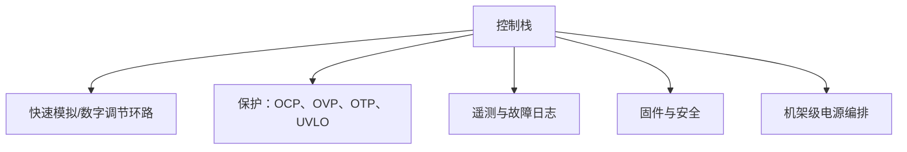

# 数字电源管理
> **最后更新：** 2026-11-12
> **状态：** 草稿
> **标签：** PMBus, 遥测, 固件, AVS, 安全

## 概述
数字电源为变换器和电压调节模块（VRM）增加了可编程控制、遥测、上电时序和故障历史记录功能。PMBus 是业界通行的管理接口，而 Redfish 则通过基板管理控制器（BMC）向北向（上层管理系统）提供系统级电源数据。

其价值不仅体现在电气层面，同样体现在运维层面：集群运营方可以检测参数漂移、实施功率封顶、关联分析故障，并根据工作负载调节电压。同样的可编程性也带来了固件、身份认证、回滚以及供应链安全方面的责任。

## 关键发现 / 要点
- [已确认] PMBus 基于 SMBus 构建，定义了标准化电源命令以及制造商扩展命令。
- [已确认] 遥测数据通常包括电压、电流、温度、功率、状态和故障日志。
- [已确认] 自适应电压调节（AVS）/动态电压频率调节（DVFS）在电压/频率与性能和能耗之间进行权衡。
- [已确认] Redfish 为服务器/设施电源遥测提供 RESTful 管理模型。
- [估计] 在 100 kW/机架以上，逐相遥测和预测性维护的价值更加凸显。
- [已确认，2026-10-12] 德州仪器（TI）推出 LMI800PS 800 V 隔离式热插拔控制器，支持 PMBus 和 5 kVrms 增强隔离（适用于 ±400 V 和 800 V 系统；配套 10 kW EVM），另推出一款 3 GSPS ADC，用于纳秒级电源轨遥测；上述器件均处于预量产阶段 [来源：TI，2026-10-12]。
- [已确认，2026] 控制器 IP 正在整合：英飞凌（Infineon）收购了 C2i Semiconductors（软件定义多相控制器和智能功率级；约于 2026-10 完成交割），而安森美（onsemi）、纳微半导体（Navitas）和亚德诺（ADI）则分别收购了集成电压调节器团队 Ferric、Claros 和 Empower。
- [已确认，2026-10-05] 微芯科技（Microchip）/纳微半导体 800 V 转 6 V 参考设计将 dsPIC33AK 数字控制器与 TA100 安全元件搭配使用，这是硬件信任根进入机架电源转换领域的一个例证。

## 图解

## 详细内容
### 控制器厂商

| 公司 | 产品系列 | 功能特性 | 协议 | 目标应用 |
|---|---|---|---|---|
| 英飞凌 | XDPE/TDA | 多相、遥测 | PMBus/AVSBus 变体 | CPU/GPU |
| 德州仪器 | UCD/TPS | 上电时序、数字 PWM | PMBus | 板级/机架 |
| 瑞萨电子（Renesas） | ISL/RAA | 多相、遥测 | PMBus/AVSBus | 服务器 VR |
| 微芯科技 | dsPIC DSC | 软件定义控制 | PMBus/自定义 | PSU/变换器 |
| 芯源系统（MPS） | MP/MPQ 数字系列 | 遥测/集成 | PMBus/I2C | 服务器/加速器 |
| 英飞凌（C2i，2026 年收购） | 软件定义多相 | 固件可配置控制、智能功率级 | PMBus | AI 加速器 VR |
| 德州仪器 | LMI800PS（预量产） | 800 V 隔离式热插拔、遥测 | PMBus | ±400/800 VDC 机架保护 |

### 控制与管理栈

| 层级 | 接口 | 功能 |
|---|---|---|
| 功率级 | PWM/栅极驱动 | 快速开关与保护 |
| 数字控制器 | ADC/DPWM | 调节、遥测、故障处理 |
| BMC | PMBus/SMBus/I2C | 资产清单、策略、日志 |
| 主机/加速器 | AVSBus/厂商接口 | 工作负载电压请求 |
| 集群管理器 | Redfish/API | 功率封顶、健康状态、优化 |

### 保护

数字化实现提升了过流保护（OCP）、过压保护（OVP）、欠压保护（UVP）、过温保护（OTP）、相电流均衡、黑匣子数据捕获以及上电时序的可配置性与日志记录能力。对于快于固件/控制环路响应速度的故障，仍需依靠硬件比较器。

### 安全基线

- 对固件和配置更新进行身份认证。
- 在量产环境中锁定可写 PMBus 命令或对其实施授权管理。
- 提供回滚保护和恢复镜像。
- 记录配置变更和故障清除操作。
- 针对 BMC 被攻破和共享总线访问进行威胁建模。

> 🔄 需要更新：高优先级。基于 PCIe VDM 的加速器电源遥测和 DC-SCM 接口仍在演进；实施前请确认已正式批准的规范。

相关：[主索引](README.md)。

## 数据表（如适用）
| 字段 | 数值 | 来源 | 日期 |
|---|---|---|---|
| PMBus 当前公开版本 | 1.4 系列 | PMBus | 2023-2025 |
| 物理层基础 | 兼容 SMBus/I2C | PMBus | 2025 |
| 常见遥测项 | V/I/T/P/故障 | 厂商数据手册 | 2025 |
| 北向模型 | DMTF Redfish | DMTF | 2025 |
| 快速故障路径 | 需要硬件比较器 | 工程实践 | 2025 |

## 待解决问题 / 数据缺口
- 确认 PCIe VDM 电源遥测的采用情况及公开规范。
- 收集已披露的电源控制器 CVE 及其缓解状态。
- 量化生产环境中 AVS 策略带来的节能效果，避免与 DVFS 重复计算。
- 定义 ±400/800 VDC 热插拔器件和固态断路器（SSCB）器件的遥测与保护接口。

## 参考文献
- PMBus | https://pmbus.org/ | 访问日期 2026-06-10
- DMTF Redfish | https://www.dmtf.org/standards/redfish | 访问日期 2026-06-10
- OCP DC-SCM | https://www.opencompute.org/projects/dc-scm | 访问日期 2026-06-10
- Microchip digital power | https://www.microchip.com/en-us/solutions/power-conversion/digital-power | 访问日期 2026-06-10
- TI LMI800 product page | https://www.ti.com/product/LMI800 | 检索日期 2026-11-12
- Infineon completes C2i acquisition | https://www.infineon.com/press-release/2026/infpr202610-002 | 检索日期 2026-11-12
- Microchip/Navitas 800 VDC reference design | https://www.microchip.com/en-us/about/news-releases/products/the-data-center-is-moving-to-800v-microchip-and-navitas-are-enabling-transition | 检索日期 2026-11-12
