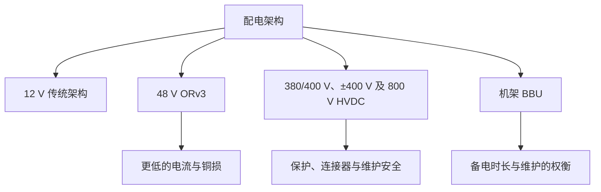

# 配电架构
> **最后更新：** 2026-11-12
> **状态：** 草稿
> **标签：** ORv3, HVDC, 电源架, 母排, BBU

## 概述
配电涵盖从电网接入到处理器封装的全过程。在机架级，不断提升的功率使电压、导体几何结构、故障能量、连接器温度和维护流程成为首要设计变量。

ORv3 规范了包括电源架、母排和电池备份单元（BBU）在内的 48 V 机架生态系统。高压直流（HVDC）可以减少转换级，但会提高对保护和人身安全的要求。没有任何单一架构能对所有存量改造和新建数据中心都做到最优。

## 关键发现 / 要点
- [已确认] ORv3 采用后置 48 V 母排和机架电源架。
- [已确认] 机架级 BBU 可替代或补充集中式不间断电源（UPS）设计。
- [已确认] 在大功率条件下，母排可降低线束电阻并改善电流分配。
- [估计] 在条件合适的设施中，400 V DC 架构可省去一个 AC/DC 级。
- [已确认，厂商路线图] 英伟达（NVIDIA）的目标是为 1 MW 及以上的 IT 机架实现 800 VDC 配电；其 2026-08 部署计划始于 2H 2026 推出由交流供电的 800 VDC 侧柜（电源柜），2027 年增加行级电源中心（每行最高 2 MW），最终在新建项目中推出由电网直接转换至 800 VDC 的“直流电源模块”（DC power blocks）。该方案尚未成为被广泛采用的行业标准。
- [已确认，2026-10-08] 开放计算项目（OCP）Mt. Diablo v1.0.0 规范了一种面向 100 kW-1 MW IT 机架的 ±400 VDC 分离式电源机架（侧柜）；OCP 固态变压器（SST）规范（v0.3）涵盖中压（MV）交流至 800 VDC 的转换，配合储能时可充当中压 UPS。
- [已确认，2026-10] OCP 全球峰会（Global Summit）展出的硬件包括：台达电子（Delta Electronics）的 660 kW 800 VDC 列间（in-row）电源机架，集成 480 kW BBU（不含 BBU 时为 800 kW），以及 90 kW 800 V 至 50 V DC/DC 电源架（效率最高 98.5% [厂商宣称]）；光宝科技（LITEON）面向 330 kW-1.2 MW 场景的 800 VDC 机架以及 ORv3 180 kW 电源架；维谛技术（Vertiv）PowerDirect 5000（400-900 kW 侧柜；据报道将于 2027 年初发布 [传闻]）。
- [已确认，2026-10] 微软（Microsoft）介绍了一种 SST 架构，将 13.8-34.5 kV 交流电转换为 800 VDC，并集成储能、固态断路器（SSCB）、800 VDC 配电盘和母线槽 [来源：Microsoft Azure]。
- [估计，2026] 集邦咨询（TrendForce）预计 800 V 电源机架在 Vera Rubin 上将为可选配置，在 Rubin Ultra（2H 2027）之后才会被采用，并可能于 2028 年实现广泛部署；Dell'Oro 指出，保护、绝缘和安全实践仍落后于硬件发展。
- [已确认，2026] 新兴 SST 厂商正瞄准由中压交流直接转换至 800 VDC 的方案，将转换、保护、控制及可选储能集于一体；在获得独立部署数据之前，已公布的性能数据仍属厂商自报。
- [已确认，2026-07-13] 英飞凌（Infineon）与 LS ELECTRIC 签署谅解备忘录（MoU），合作范围涵盖面向 AI 数据中心和下一代电网的储能功率转换、固态变压器和固态断路器；该公告属于合作路线图，而非部署披露。

## 图解

### 官方图示参考
| 组织 | 待查阅的图示资料 | 官方来源 |
|---|---|---|
| OCP | ORv3 机架母排、电源架及 HPR 示意图 | https://www.opencompute.org/wiki/Open_Rack/SpecsAndDesigns |
| 台达电子 | 机架电源、电源架及数据中心基础设施图示 | https://www.deltaww.com/en-US/solutions/Data-Center |
| 维谛技术 | 面向 AI 的电源与散热架构示意图 | https://www.vertiv.com/en-us/solutions/high-density-ai/ |
| 伊顿（Eaton） | 数据中心配电与 UPS 图示 | https://www.eaton.com/us/en-us/markets/data-centers.html |
| 施耐德电气（Schneider Electric） | 数据中心电源架构与可持续发展图示 | https://www.se.com/us/en/work/solutions/for-business/data-centers-and-networks/ |

## 详细内容
### 电源链

| 层级 | 组件 | 输入 | 输出 | 厂商 | 标准 |
|---|---|---:|---:|---|---|
| 电网 | 变压器/开关柜 | 市电中压 | 400/480 V AC | 伊顿、施耐德、西门子（Siemens） | NEC/IEC |
| 设施备份 | UPS | AC | 经调节的 AC/DC | 维谛技术、伊顿、施耐德 | IEC/UL |
| 配电 | PDU/母线槽 | AC/DC | 机架馈电 | 维谛技术、伊顿、台达电子 | IEC/IEEE |
| 机架 | 电源架 | AC/HVDC | 48 V | 台达电子、先进能源（AE）、光宝科技、伟创力（Flex） | ORv3 |
| 机架总线 | 铜母排 | 48 V | 48 V | 威图（Rittal）/生态伙伴 | ORv3 |
| 电路板 | 变换器/VRM | 48/12 V | 低于 1 V | Vicor、英飞凌、瑞萨电子（Renesas）、芯源系统（MPS） | 平台规范 |

### HVDC 方案

| 电压 | 效率提升机制 | 组件 | 推动方 | 时间线 |
|---:|---|---|---|---|
| 380 V DC | 减少转换次数 | 整流器、直流保护、隔离 DC/DC | 电信/数据中心运营商 | 已选择性部署 |
| 400 V DC | 与新兴 AI 概念相契合 | SiC/GaN 前端、DAB/LLC | 厂商/超大规模云厂商研究 | 2024+ 试点 |
| ±400 V DC（Mt. Diablo） | 分离式侧柜供电；沿袭 ORv3 | SiC/GaN PFC 及 DC/DC、三导体母排 | 微软、Meta、谷歌（Google）（OCP） | OCP v1.0.0 于 2026-10-08 发布 |
| 800 V DC | 在 MW 级机架功率下降低电流 | 1.2 kV SiC/GaN、隔离、直流保护、连接器、储能 | 英伟达生态系统 | 侧柜机架 2H 2026；行级电源中心 2027；原生机架 2027+ |
| MV AC 至 800 VDC SST | 省去工频变压器和整流级 | 中压 SiC 模块、高频变压器、储能、SSCB | ABB、伊顿、西门子/莱茵豪森（Reinhausen）、台达电子、Heron、Amperesand、DG Matrix | 2026 年试点；ABB 2H 2027 商用 |

### 电源架生态系统

| 公司 | 产品类别 | 功率 | 电压 | 效率 | 备注 |
|---|---|---:|---:|---|---|
| 台达电子 | ORv3/大功率电源架 | 数 kW 至 90 kW 级生态 | 48 V | 目标效率 90% 区间高位（high-90s） | OCP 贡献者 |
| 先进能源 | OCP 整流器/电源架 | 数 kW | 48 V | 钛金级（Titanium） | 服务器电源技术传承 |
| 村田制作所（Murata） | 机架/板级电源 | 数 kW | 48 V | 视产品而定 | 模块 + 电源架 |
| 伟创力 | 超大规模电源平台 | 定制 | 48 V | 定制 | ODM（原始设计制造商）/JDM |
| 光宝科技/康舒科技（Acbel） | 服务器 PSU/电源架 | 定制 | 12/48 V | 视产品而定 | ODM 供应商 |
| 伊顿/维谛技术 | 设施到机架系统 | kW-MW | AC/DC | 视产品而定 | 基础设施覆盖面广 |
| Heron Power | Heron Link SST + SuperBBU [厂商规格] | 4.2 MW | 34.5 kV AC-800 VDC | 宣称 98.5% | 800 VDC AI 机架基础设施 |
| Amperesand | 中压 SST [厂商规格] | 视产品而定 | MV AC-LV/800 VDC | 宣称 >98.5% | 首批商用设备目标 2026 年交付 |
| 台达电子 | 800 VDC 列间电源机架 [厂商规格] | 660 kW + 480 kW BBU；不含 BBU 时 800 kW | 800 VDC 输出；90 kW 800-50 V 电源架 | AC-DC 最高 98%；宣称 DC-DC 98.5% | Vera Rubin NVL72/MGX；OCP 2026 |
| 光宝科技 | 800 VDC 电源机架 + BBU；ORv3 180 kW 电源架 [厂商规格] | 330 kW-1.2 MW 场景 | 800 VDC；800-50 V 电源模块（brick） | 视产品而定 | 原型机 Q4 2026 出货；Q1 2027 后爬坡 [公司/行业媒体] |
| 维谛技术 | PowerDirect 5000 侧柜 [厂商规格] | 400-900 kW | 800 VDC 或 ±400 VDC | 视产品而定 | 据报道 2027 年初发布 [传闻] |
| 施耐德电气 | 800 VDC 侧柜 | 机架最高 1.2 MW | 800 VDC | 视产品而定 | 2026-06 于 Computex 展出 |
| 伊顿 | MVSST 2.0（英飞凌 SiC） | MW 级 | MV AC-800 VDC | 视产品而定 | 宣称为通过 IEC 认证的 MV SST；聚焦亚太地区 |
| ABB | Infinitus DC 产品组合（基于 SST） | MW 级 | MV AC-800 VDC | 宣称系统效率提升 >5% | SST 2H 2027 商用 |
| 英飞凌 | 12 kW 高压配电板（参考设计） | 12 kW | ±400 V/800 VDC 输入 | 视产品而定 | 计划 2026-11 供货 |

### BBU 与 UPS 对比

| 属性 | 机架 BBU | 集中式 UPS |
|---|---|---|
| 故障域 | 机架 | 机房/设施 |
| 配电损耗 | 备电路径距离更短 | 集中式 |
| 维护 | 大量分布式单元 | 少量大型系统 |
| 电池化学体系 | 通常为锂离子 | 锂离子或阀控式铅酸（VRLA） |
| 扩展方式 | 按机架逐步扩展 | 以设施为单位分块扩展 |

相关：[主索引](README.md)。

## 数据表（如适用）
| 字段 | 数值 | 来源 | 日期 |
|---|---|---|---|
| ORv3 母线 | 标称 48 V | OCP | 2024 |
| HPR 公开生态 | 92 kW+ | OCP | 2024 |
| 英伟达 800 VDC 路线图 | 1 MW 及以上 IT 机架，2027 年起 | 英伟达 | 2026 |
| 电信 HVDC 传统电压 | ~380 V DC | 行业部署 | 2025 |
| 同功率下 400 V 相对 48 V 的电流 | 降低 8.3x | P=VI 计算 | 2026 |
| 机架备电电池化学体系 | 锂离子占比上升 | OCP/厂商设计 | 2025 |
| Mt. Diablo v1.0.0 | ±400 VDC；100 kW-1 MW | OCP | 2026-10-08 |
| OCP SST 规范 | v0.3 | OCP | 2026-07 |
| 英伟达行级电源中心 | 每行最高 2 MW | 英伟达 | 2027 年路线图 |
| 台达电子列间电源机架 | 660 kW + 480 kW BBU [厂商规格] | 台达电子 | 2026-10-15 |
| 同功率下 800 V 相对 48 V 的电流 | 降低 16.7x | P=VI 计算 | 2026 |

## 待解决问题 / 数据缺口
- 补充 SKU 级电源架功率、效率曲线、尺寸和认证信息。
- 区分公开的 400 V DC 量产部署与演示项目。
- 补充故障电流、电弧闪络、连接器防触电安全及可维护性的比较。
- 跟踪首个投入运行的原生 800 VDC 数据机房（截至 2026-11-12 尚无公开确认）。
- 核实面向 800 VDC 的 SSCB 产品（德州仪器（TI）LMI800PS 热插拔、Ideal Power B-TRAN、SolarEdge/英飞凌 [传闻]）。

## 参考文献
- OCP Rack and Power | https://www.opencompute.org/projects/rack-and-power | 访问日期 2026-06-10
- OCP ORv3 design guide | https://www.opencompute.org/documents/ocp-orv3-it-gear-design-guide-rev-02-june032024-pdf | 访问日期 2026-06-10
- IEEE 519 | https://standards.ieee.org/standard/519-2022.html | 访问日期 2026-06-10
- NVIDIA 800 VDC architecture | https://www.nvidia.com/en-us/data-center/technologies/800-vdc-architecture/ | 访问日期 2026-07-28
- Heron Power data-center system | https://heronpower.com/product/data-centers | 访问日期 2026-07-28
- Amperesand SST platform | https://www.amperesand.io/ | 访问日期 2026-07-28
- Infineon/LS ELECTRIC MoU | https://www.infineon.com/press-release/2026/infpr202607-121 | 访问日期 2026-07-28
- NVIDIA 800 VDC rollout blog | https://blogs.nvidia.com/blog/800-vdc-power-architecture-ai-factory/ | 检索日期 2026-11-12
- OCP Mt. Diablo v1.0.0 | https://www.opencompute.org/wp-content/uploads/2026/10/OCP-Specification-Mt.-Diablo-Disaggregated-Power-Rack-Specification-v1.0.0.pdf | 检索日期 2026-11-12
- OCP LVDC/SST workstream | https://www.opencompute.org/news/powering-the-next-era-of-ai-how-google-microsoft-and-nvidia-are-standardizing-and-accelerating-the-industry-transition-to-lvdc/ | 检索日期 2026-11-12
- Delta OCP 2026 800 VDC | https://www.prnewswire.com/news-releases/delta-highlights-collaboration-with-nvidia-in-advancing-energy-efficient-800-vdc-power-and-cooling-solutions-for-ai-data-centers-at-ocp-global-summit-2026-302909912.html | 检索日期 2026-11-12
- LITEON OCP 2026 | https://www.liteon.com/en/news/press-center/content/liteon-ocp-2026 | 检索日期 2026-11-12
- Vertiv 800 VDC guide | https://www.vertiv.com/en-us/insights/articles/educational-articles/the-800-vdc-decision-a-practical-guide-for-ai-power-architecture/ | 检索日期 2026-11-12
- Microsoft Azure grid-to-chip power | https://techcommunity.microsoft.com/blog/azureinfrastructureblog/powering-azure-infrastructure-from-grid-to-chip/4563890 | 检索日期 2026-11-12
- Dell'Oro OCP 2026 analysis | https://www.delloro.com/inside-ocp-global-summit-2026-cold-plates-800-vdc-sidecars-and-a-buildout-at-full-steam/ | 检索日期 2026-11-12
- TrendForce 800 V power rack outlook | https://www.trendforce.com/presscenter/news/20260625-13121.html | 检索日期 2026-11-12
- Infineon 12 kW HV power distribution board | https://www.powersemiconductorsweekly.com/2026/10/27/infineon-introduces-12kw-high-voltage-power-distribution-board-for-800v-ai-data-centers/ | 检索日期 2026-11-12
