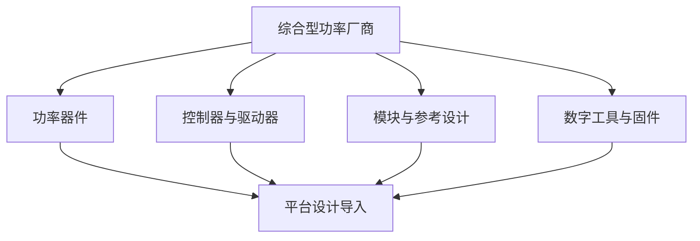
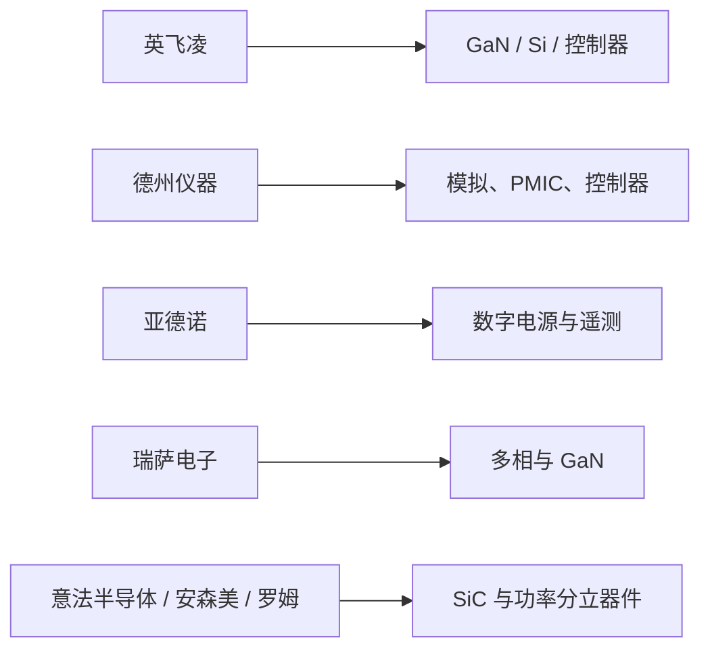

# 综合型功率半导体厂商
> **最后更新：** 2026-11-12
> **状态：** 草稿
> **标签：** 厂商, IDM, 财务数据, 英飞凌, 德州仪器, 瑞萨电子

## 概述
综合型厂商集模拟/控制芯片、功率器件、封装、制造与应用工程能力于一体。其优势在于平台广度与供应保障；其挑战在于如何在周期各异的汽车、工业、消费电子和数据中心市场之间分配产能与研发投入。

数据中心专项营收鲜有披露。因此，本数据库将公司报告营收与 [估计] 的数据中心业务敞口区分开来，并避免将功率业务总营收视为 AI 营收。

## 关键发现 / 要点
- [已确认] 英飞凌（Infineon）的产品覆盖硅基 MOSFET、SiC、GaN、栅极驱动器和数字控制器。
- [已确认] 德州仪器（TI）拥有 GaN 及广泛的电源管理产品，但没有商用 SiC 器件产品组合。
- [已确认] 瑞萨电子（Renesas）获得了 Intersil 的服务器电源业务，并于 2024 年收购了 GaN 厂商 Transphorm。
- [已确认] 意法半导体（ST）、安森美（onsemi）和罗姆（ROHM）均在 SiC 领域进行了垂直整合投资。
- [待核实] 英飞凌“每台 130 kW 机架 $12k-$15k 半导体价值量”的说法需要有可引用的一手披露来源。
- [已被取代，2026-11-10] 英飞凌此前提出的 FY2026 AI 电源解决方案营收约 €1.5B、FY2027 约 €2.5B 的目标作为历史记录保留；FY2026 实际数据见下文。
- [已确认，公司披露，2026-11-10] 英飞凌公布 FY2026 营收 €16.353B（+12%），Q4 营收创纪录，达 €4.706B；AI 电源营收为 ~€1.7B，数据中心电源总营收为 ~€2.2B（含 ~€0.5B 传统数据中心业务）。FY2027 业绩指引：集团营收 ~€20B，数据中心电源营收接近 €4B [来源：转载新闻稿及业绩电话会议报道；未审阅投资者关系演示材料]。
- [已确认，2026-11-02] 安森美披露：FY2025 AI 数据中心营收 >$250M，Q3 2026 为 $180M（同比 +175%），预计 2026 年为 ~$620M；同时，伴随尚待完成的 Ferric 收购，其 2030 年目标上调至 >$3B。
- [已确认，2026-10-21] 德州仪器数据中心营收同比增长 ~95%，占 Q3 2026 营收（$6.06B）的 ~13%，据此推算为 ~$0.79B [估计]；该数字涵盖 TI 全部产品线，而非仅限电源产品。
- [已确认，2026-08-19] 亚德诺（ADI）表示，数据中心约占其通信（Communications）业务板块的 ~80%，其中电源和光通信业务均实现同比 >100% 的增长；亚德诺已于 2026-07-07 完成以 ~$1.5B 收购 Empower Semiconductor（IVR）的交易。
- [已确认，2026-10-29] 芯源系统（MPS）Q3 2026 营收为 $1,202.4M（同比 +63.1%）；企业数据（Enterprise Data）业务营收为 $506.7M（占营收的 42.1%），其 2026 年增长下限上调至 ≥150%。
- [已确认，2026] 芯源系统公布 FY2025 营收 $2.790B，并披露正在送样一款 800 V 数据中心电源解决方案；其存储/计算及企业数据类别不得视为纯 AI 电源营收。
- [已确认，2026-07-13] 英飞凌与 LS ELECTRIC 签署谅解备忘录（MoU），共同开发涵盖储能、固态变压器（SST）和固态断路器（SSCB）的直流电源基础设施；未披露营收或部署价值。
- [已确认，2026-09/11] 英飞凌扩大了 800 VDC 领域的合作：为伊顿（Eaton）的 MVSST 2.0 提供 SiC（2026-09-29），与英伟达（NVIDIA）共同开发 GaN 高压中间总线转换器（IBC）（2026-10-21），推出 12 kW 高压配电参考板（2026-10-27），并与 SOLUM 扩大 HVDC 合作（2026-11-05）。
- [已确认，2026-10] 意法半导体目标 2026 年 AI 数据中心营收 ~$1.3B、2027 年 >$2B，主要来自硅光子和微控制器，而非功率器件；受 200 mm SiC 产线启动成本影响，其功率与分立器件（Power & Discrete）业务板块 Q3 2026 录得 $81M 经营亏损。

## 图解

### 官方图示参考
| 厂商 | 待查阅的图示材料 | 官方来源 |
|---|---|---|
| 英飞凌 | 数据中心电源架构、GaN、MOSFET 及控制器图示 | https://www.infineon.com/cms/en/applications/computing/data-center-and-servers/ |
| 德州仪器 | 服务器电源、PMIC、控制器及功率级示意图 | https://www.ti.com/applications/enterprise-systems/data-center-enterprise-computing/overview.html |
| 亚德诺 | 数据中心电源、遥测及数字电源示意图 | https://www.analog.com/en/solutions/data-center.html |
| 瑞萨电子 | 多相控制器、功率级及 GaN 产品图示 | https://www.renesas.com/en/applications/data-center-computing |
| 意法半导体 | 电源管理及 SiC 应用图示 | https://www.st.com/content/st_com/en/applications/power-and-energy.html |
| 安森美 | EliteSiC 及电源转换应用图示 | https://www.onsemi.com/applications/industrial-cloud-power/cloud-power |
| 罗姆 | SiC 及功率器件应用示意图 | https://www.rohm.com/products/sic-power-devices |

## 详细内容
### 厂商概况

**英飞凌（Infineon Technologies，IFX.DE）**
总部：德国 | FY2026 营收：€16.353B（FY2025：€14.662B）| 数据中心业务敞口：[已确认，公司披露] FY2026 AI 电源营收 ~€1.7B，数据中心电源总营收 ~€2.2B；FY2027 数据中心电源营收指引接近 €4B。产品：CoolMOS、OptiMOS、CoolSiC、CoolGaN、XDPE/XDP 控制器，以及 C2i 软件定义多相控制器（2026-10 收购）。制造：IDM，包括菲拉赫（Villach）/居林（Kulim）基地及已宣布的 300 mm GaN 开发计划；与 Wolfspeed 的 200 mm SiC 晶圆供应协议已延长（2026-10）。自 Q4 FY2026 起，公司按三大业务板块报告：汽车（Automotive）、电源系统（Power Systems）和边缘系统（Edge Systems），这使其与此前的板块数据失去可比性。优势：从电网到芯核的完整电源链。风险：资本密集度、类别边界可比性以及知识产权纠纷（英诺赛科（Innoscience）案在中国的裁决；Vicor 所提 ITC 案的被申请人）。

**德州仪器（Texas Instruments，TXN）**
总部：美国 | FY2025 营收：$17.682B；Q3 2026 营收 $6.06B（同比 +28%）| 数据中心业务敞口：数据中心占 Q3 2026 营收的 ~13%，同比 +~95% [公司披露；涵盖全部产品线]。产品：TPS/LM/UCD 控制器、LMG GaN、传感/隔离器件、LMI800PS 800 V 热插拔控制器（预量产，2026-10），以及已发布的 800 VDC 架构，其中包括一款 800 V 转 6 V GaN 母线转换器。制造：IDM，300 mm 模拟产能持续扩张。优势：产品目录广度与工艺成本。劣势：无 SiC 器件。

**亚德诺（Analog Devices，ADI）**  
总部：美国 | FY2025 营收：$11.020B；FQ3 FY2026 营收 $4.02B（同比 +40%）| 数据中心占通信业务板块的 ~80% [公司披露] | 产品：LTC/MAX 电源、遥测、隔离、信号链，以及 Empower IVR/硅电容（2026-07-07 收购，~$1.5B）。制造：自有产线与晶圆代工混合模式。优势：高性能控制/传感以及贴近封装的电压调节。劣势：功率分立器件有限。FQ4 FY2026 业绩将于 2026-11-24 发布 [即将举行]。

**瑞萨电子（Renesas Electronics，6723.T）**  
总部：日本 | FY2025 IFRS 营收：¥1.321T | 产品：RAA/ISL 多相产品、智能功率级、PMIC、Transphorm GaN。收购：Intersil（2017）、Dialog（2021）、Transphorm（2024）。优势：服务器 VR 设计经验积累深厚。

**意法半导体（STMicroelectronics，STM）**  
总部：瑞士 | FY2025 营收：$11.800B；Q3 2026 营收 $3.76B（+17.9%）| 产品：MDmesh、MasterGaN、STPOWER SiC、控制器。SiC：自有器件、Norstel 衬底资产、Soitec 供应、与三安光电（Sanan）的合资企业；200 mm SiC 产线启动成本导致其功率与分立器件业务 Q3 2026 录得 $81M 经营亏损。AI 数据中心营收目标（2026 年 ~$1.3B；2027 年 >$2B）主要来自光子/MCU，而非电源产品。
[更正] 由于种子数据中的相关说法缺乏数据中心电源方面的依据，本数据库未采用所谓的“Masimo 合作关系”。

**安森美（onsemi，ON）**
总部：美国 | FY2025 营收：$5.995B；Q3 2026 营收 ~$1.72B | AI 数据中心营收：FY2025 >$250M；Q3 2026 $180M；预计 2026 年 ~$620M；2030 年目标 >$3B [公司披露/公司目标]。产品：EliteSiC、SiC JFET、GaNEXUS 40-650 V 横向 GaN（2026 年推出）、700/1,200 V 垂直 GaN（送样/演示阶段；量产目标未经证实）、硅基 MOSFET/IGBT、驱动器；Ferric IVR 收购尚待完成（$600M + 最高 $175M）。已披露向谷歌（Google）平台批量出货（2026-11-02）。优势：制造能力与高压产品广度。注：Synaptics 收购案（2026）属于边缘 AI 交易，与数据中心电源无关。

**罗姆（ROHM Semiconductor，6963.T）**  
总部：日本 | 产品：SiC MOSFET/SBD/模块、硅基功率器件、驱动器。SiCrystal 为其提供内部衬底能力。优势：SiC 垂直整合，以及与日本/欧洲工业客户的合作关系。

**威世（Vishay Intertechnology，VSH）**  
总部：美国 | 产品：MOSFET、二极管、电阻器、电感器/电流检测器件。优势：无源器件/分立器件产品线广泛。劣势：自有宽禁带（WBG）技术布局有限。

**微芯科技（Microchip Technology，MCHP）**  
总部：美国 | FY2026 营收：$4.713B | 产品：dsPIC 数字电源、mSiC、时序/控制。对美高森美（Microsemi）的收购于 2018 年完成。
优势：高可靠性控制及 SiC 产品广度；在 AI VRM 领域的能见度较低。

**芯源系统（Monolithic Power Systems，MPWR）**
总部：美国 | FY2025 营收：$2.790B；Q3 2026 营收 $1,202.4M（同比 +63.1%）| 产品：多相控制器、功率级、模块、垂直供电及数据中心电源转换产品。FY2025 存储/计算营收为 $732.5M，企业数据营收为 $701.8M；Q3 2026 企业数据营收为 $506.7M（占营收的 42.1%）。上述类别包含非 AI 产品，不得加总视为 AI 电源营收。芯源系统披露正在送样一款 800 V 数据中心解决方案，称其具备 >$6B 的年营收产能，并且是 Vicor 所提 ITC 案 337-TA-1526 中被点名的被申请人。

### 对比表

| 公司 | Si | GaN | SiC | VRM/PMIC | 数字电源 | 制造模式 |
|---|---:|---:|---:|---:|---:|---|
| 英飞凌 | 高 | 高 | 高 | 高 | 高 | IDM |
| 德州仪器 | 高 | 高 | 无 | 高 | 高 | IDM |
| 亚德诺 | 低 | 低 | 无 | 高（含 Empower IVR） | 中 | 混合 |
| 瑞萨电子 | 中 | 高（通过 Transphorm） | 低 | 高 | 高 | 混合/IDM |
| 意法半导体 | 高 | 高 | 高 | 中 | 中 | IDM |
| 安森美 | 高 | 发展中（横向已推出；垂直送样中） | 高 | 中；IVR 通过 Ferric（待完成） | 中 | IDM |
| 罗姆 | 高 | 低 | 高 | 中 | 中 | IDM |
| 威世 | 高 | 低 | 低 | 低 | 低 | IDM |
| 微芯科技 | 中 | 低 | 中高 | 中 | 高 | 混合/IDM |
| 芯源系统 | 高 | 低/未单独披露 | 低 | 很高 | 高 | 无晶圆厂/混合 |

### 营收轨迹框架

| 公司 | 报告期 | 营收 | 数据中心/AI 披露 | 状态 |
|---|---|---:|---|---|
| 英飞凌 | 截至 2025-09-30 的财年 | €14.662B | FY2025 AI 电源营收 >€700M；FY2026 目标 ~€1.5B、FY2027 目标 ~€2.5B | [已确认 / 公司目标] |
| 德州仪器 | CY2025 | $17.682B | 未单独披露 | [已确认] |
| 亚德诺 | 截至 2025-11-01 的财年 | $11.020B | 未单独披露 | [已确认] |
| 瑞萨电子 | CY2025 | ¥1.321T IFRS | 未单独披露 | [已确认] |
| 意法半导体 | CY2025 | $11.800B | 未单独披露 | [已确认] |
| 安森美 | CY2025 | $5.995B | AI 数据中心营收 >$250M | [已确认] |
| 微芯科技 | 截至 2026-03-31 的财年 | $4.713B | 未单独披露 | [已确认] |
| 芯源系统 | CY2025 | $2.790B | 存储/计算 $732.5M；企业数据 $701.8M；并非纯 AI 营收 | [已确认] |
| 英飞凌 | 截至 2026-09-30 的财年 | €16.353B | AI 电源 ~€1.7B；数据中心电源 ~€2.2B；FY2027 数据中心电源指引 ~€4B | [已确认 / 公司业绩指引] |
| 德州仪器 | Q3 2026 | $6.06B | 数据中心占营收的 ~13%；同比 +~95% | [已确认] |
| 亚德诺 | FQ3 FY2026（截至 2026-08-01） | $4.02B | 数据中心占通信业务的 ~80% | [已确认] |
| 意法半导体 | Q3 2026 | $3.76B | 2026 年 AI 数据中心目标 ~$1.3B，大部分为非电源产品 | [已确认 / 公司目标] |
| 安森美 | Q3 2026 | ~$1.72B | AI 数据中心 $180M；2026E ~$620M | [已确认] |
| 芯源系统 | Q3 2026 | $1,202.4M | 企业数据 $506.7M | [已确认] |

> ⚠️ 注意：各公司的财年截止日和货币各不相同。本表为营收基线，并非估值比较；未进行货币换算，也未做过去十二个月（LTM）标准化处理。

相关：[主索引](README.md)。

## 数据表（如适用）
| 字段 | 数值 | 来源 | 日期 |
|---|---|---|---|
| 瑞萨电子/Intersil 收购完成 | 2017 | 瑞萨电子 | 2017 |
| 瑞萨电子/Dialog 收购完成 | 2021 | 瑞萨电子 | 2021 |
| 瑞萨电子/Transphorm 收购完成 | 2024 | 瑞萨电子 | 2024 |
| 微芯科技/美高森美收购完成 | 2018 | 微芯科技 | 2018 |
| 英飞凌/GaN Systems 交易金额 | 宣布金额 $830M | 英飞凌 | 2023 |
| 亚德诺/Empower | ~$1.5B 现金；已完成 | 亚德诺 | 2026-07-07 |
| 英飞凌/C2i | 未披露；已完成 | 英飞凌 | ~2026-10 |
| 安森美/Ferric | $600M + 最高 $175M；已宣布 | 安森美 | 2026-11-02 |

## 待解决问题 / 数据缺口
- 补充罗姆和威世的最新财年基线数据，并统一货币口径以便比较。
- 基于产品/客户证据而非工业业务总营收来估算数据中心营收。
- 核实客户关系；不得仅凭 OCP 成员身份推断其拥有超大规模云厂商客户。
- 查找英飞凌单机架半导体价值量表述的一手来源。
- 获取英飞凌 FY2026 投资者关系演示材料，以确认 AI/数据中心电源营收拆分及新的业务板块划分。
- 更新瑞萨电子、罗姆、微芯科技、恩智浦（NXP）、威世和东芝（Toshiba）的数据（2026-11 更新未涵盖）。

## 参考文献
- Infineon investor relations | https://www.infineon.com/cms/en/about-infineon/investor/ | 访问日期 2026-06-10
- TI investor relations | https://investor.ti.com/ | 访问日期 2026-06-10
- Renesas acquisitions | https://www.renesas.com/en/about/company/mergers-acquisitions | 访问日期 2026-06-10
- ST investor relations | https://investors.st.com/ | 访问日期 2026-06-10
- onsemi investor relations | https://investor.onsemi.com/ | 访问日期 2026-06-10
- Infineon FY2025 results | https://www.infineon.com/press-release/2025/infxx202511-021 | 访问日期 2026-07-28
- Infineon Dresden Smart Power Fab | https://www.infineon.com/press-release/2026/ifxpr202607-117 | 访问日期 2026-07-28
- TI FY2025 results | https://investor.ti.com/news-releases/news-release-details/ti-reports-q4-2025-and-2025-financial-results-and-shareholder | 访问日期 2026-07-28
- ADI FY2025 results | https://investor.analog.com/news-releases/news-release-details/analog-devices-reports-strong-fourth-quarter-and-fiscal-2025 | 访问日期 2026-07-28
- Renesas FY2025 results | https://www.renesas.com/en/about/newsroom/renesas-reports-financial-results-year-ended-december-31-2025 | 访问日期 2026-07-28
- ST 2025 financial baseline | https://investors.st.com/st-glance | 访问日期 2026-07-28
- onsemi 2025 annual report | https://investor.onsemi.com/static-files/8d674d4f-cc6b-44e5-8e31-e898ab0b4371 | 访问日期 2026-07-28
- Microchip FY2026 results | https://ir.microchip.com/sec-filings/all-sec-filings/content/0000827054-26-000012/exhibit991q4fy26.htm | 访问日期 2026-07-28
- MPS FY2025 Form 10-K | https://media.monolithicpower.com/mps_cms_document/2/0/2025_form_10-k_final.pdf | 访问日期 2026-07-28
- MPS Q4/FY2025 earnings commentary | https://www.monolithicpower.com/media/investor-relations/press-releases/Q4_2025_MPS_Earnings_Commentary.pdf | 访问日期 2026-07-28
- Infineon/LS ELECTRIC MoU | https://www.infineon.com/press-release/2026/infpr202607-121 | 访问日期 2026-07-28
- Infineon FY2026 results (syndicated) | https://news.europawire.eu/infineon-reports-e16-35-billion-fy-2026-revenue-and-forecasts-over-20-percent-growth-for-2027/eu-press-release/2026/11/10/16/27/06/187084/ | 检索日期 2026-11-12
- Infineon FY2026 call highlights | https://www.gurufocus.com/news/9193285/infineon-technologies-ag-ifnnf-q4-2026-earnings-call-highlights-record-revenue-ai-power-surge-and-a-20-billion-fy2027-outlook | 检索日期 2026-11-12
- Infineon Q3 FY2026 results | https://live.deutsche-boerse.com/news/EQS-News-Infineon-Technolgies-AG-Q3-FY-2026-concluded-with-record-sales-driven-by-strong-AI-business-further-significant-increase-in-revenue-and-margin-expected-in-Q4-FY-2026-5fd33ab1-1e11-4cd8-a8a6-8e06fb98cb0e | 检索日期 2026-11-12
- Infineon/Eaton MVSST 2.0 | https://www.infineon.com/press-release/2026/infpr202609-146 | 检索日期 2026-11-12
- Infineon C2i acquisition | https://www.infineon.com/press-release/2026/infpr202610-002 | 检索日期 2026-11-12
- SOLUM/Infineon HVDC collaboration | https://www.manilatimes.net/2026/11/05/tmt-newswire/pr-newswire/solum-and-infineon-expand-collaboration-on-hvdc-power-solutions-for-ai-data-centers/2463161 | 检索日期 2026-11-12
- TI Q3 2026 results | https://investor.ti.com/news-releases/news-release-details/ti-reports-third-quarter-2026-financial-results-and-shareholder | 检索日期 2026-11-12
- TI LMI800 | https://www.ti.com/product/LMI800 | 检索日期 2026-11-12
- ADI FQ3 FY2026 results | https://investor.analog.com/news-releases/news-release-details/analog-devices-reports-record-fiscal-third-quarter-2026 | 检索日期 2026-11-12
- ADI completes Empower acquisition | https://www.analog.com/en/newsroom/press-releases/2026/7-7-26-adi-completes-acquisition-of-empower-semiconductor.html | 检索日期 2026-11-12
- onsemi Q3 2026 results | https://investor.onsemi.com/news-releases/news-release-details/onsemi-reports-third-quarter-2026-results | 检索日期 2026-11-12
- onsemi to acquire Ferric | https://www.onsemi.com/company/newsroom/news-and-insights/onsemi-to-acquire-ferric-establishing-leadership-in-power-delivery-for-next-generation-ai-processors | 检索日期 2026-11-12
- MPS Q3 2026 results | https://www.sec.gov/Archives/edgar/data/0001280452/000162828026068202/mpwr-20260930xexx991.htm | 检索日期 2026-11-12
- ST Q3 2026 results (reprint) | https://www.generation-nt.com/communiques-presse/stmicroelectronics-reports-q3-2026-financial-results-2083619 | 检索日期 2026-11-12
