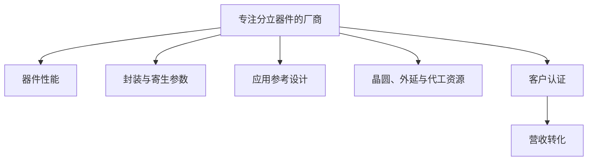
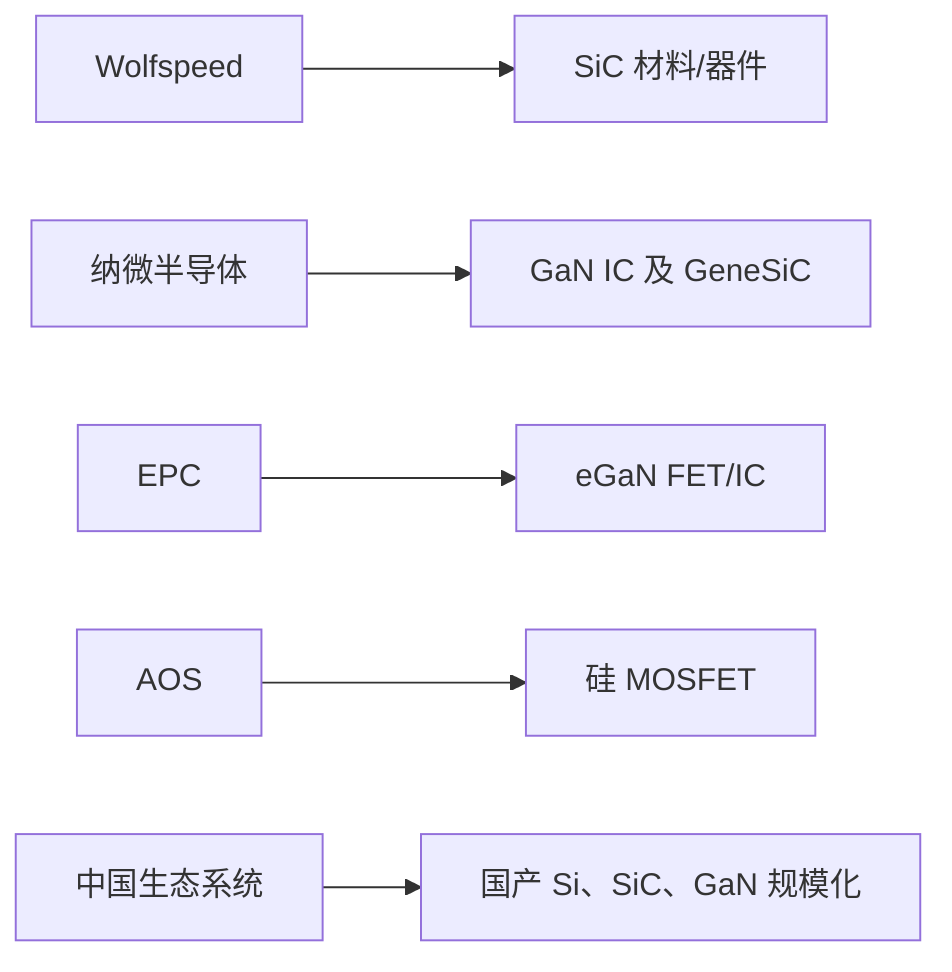

# 专注分立器件的功率半导体厂商
> **最后更新：** 2026-11-12
> **状态：** 草稿
> **标签：** 厂商, Wolfspeed, 纳微半导体, EPC, AOS, 中国

## 概述
专注分立器件的厂商依靠器件性能、工艺 IP、封装设计和应用专长展开竞争。较窄的产品组合有助于加快技术导入，但也使其面临单一市场周期、代工合作伙伴、资本密集度以及客户认证时点等方面的风险敞口。

收购状态至关重要：GaN Systems 隶属英飞凌（Infineon），Transphorm 隶属瑞萨电子（Renesas），UnitedSiC 隶属 Qorvo，IXYS 隶属 Littelfuse。本文将其作为技术谱系进行跟踪，而非视为独立的上市竞争对手。

## 关键发现 / 要点
- [已确认，2025] Wolfspeed 于 2025 年 6 月依据美国破产法第 11 章申请破产保护，随后完成了法院监督下的重组。
- [已确认，2022] 纳微半导体（Navitas）收购了 GeneSiC，因此业务横跨氮化镓（GaN）和碳化硅（SiC）。
- [已确认] 宜普电源转换（EPC）专注于采用芯片级封装的增强型 GaN FET/IC。
- [已确认，2024] Transphorm 被瑞萨电子收购。
- [已确认，2021] Qorvo 收购了 UnitedSiC。
- [估计] 中国 SiC 供应商的规模扩张速度快于其数据中心认证证据的积累速度。
- [已确认，2026-07-07] Wolfspeed 在美国联邦法院起诉纳微半导体，指控其 GaNFast、GaNSlim、GaNSafe、GeneSiC 和 SiCPAK 等指名产品线侵犯五项专利。该起诉状仅为指控；截至 2026-11-12，尚无实体裁决记录。起诉以来，Wolfspeed 修改了起诉状（2026-09-18），纳微半导体提出驳回动议（2026-10-09），向美国专利商标局（USPTO）针对全部五项专利提出再审查（reexamination）请求（2026-10-16/19），并提出中止诉讼动议（2026-10-27）。
- [已确认，2026-11] Wolfspeed：FY2026 营收 $665.1M；Q1 FY2027 营收 ~$155M，非 GAAP 毛利率为 (13)%；现金及短期投资 $995.1M；获得最高 $1.5B 的 OSC 有条件贷款承诺（2026-10-07）。
- [已确认，2026-11-03] 纳微半导体：Q3 2026 营收 $14.0M；Q4 业绩指引为 $15.5-16.5M，其中 AI 基础设施占 Q4 营收的 40% 以上；现金 $531.5M，无负债。公司于 2026-10-06 完成对垂直供电企业 Claros 的收购（对价最高 ~$232.8M），并与瑞萨电子新增两起纠纷（瑞萨电子于 2026-07-22 提起商业秘密诉讼；纳微半导体于 2026-08-10 对瑞萨电子提起专利诉讼）。以上均为指控。
- [已确认，2026-08-28] 英诺赛科（Innoscience）公布 H1 2026 营收 ~RMB 834M（+50.6%），毛利率 11.6%，其中来自 AI 数据中心、工业、储能和电动汽车应用的营收 ~RMB 532M（+70%）。

## 图解

### 官方图示参考
| 厂商 | 待查阅的视觉资料 | 官方来源 |
|---|---|---|
| Wolfspeed | SiC 晶圆、器件、封装及应用图示 | https://www.wolfspeed.com/ |
| 纳微半导体 | GaNFast、GaNSafe、GeneSiC 及 AI 电源架构图示 | https://navitassemi.com/ |
| EPC | eGaN 封装与应用示意图 | https://epc-co.com/epc/products/gan-fets-and-ics |
| 万国半导体（Alpha and Omega Semiconductor） | MOSFET 与功率级产品图示 | https://www.aosmd.com/ |
| Littelfuse / IXYS | 分立器件及模块类功率器件图示 | https://www.littelfuse.com/products/power-semiconductors.aspx |

## 详细内容
### 活跃厂商

**Wolfspeed（WOLF）**  
总部：美国 | 技术：SiC 材料/器件 | 资产：Mohawk Valley 200 mm 晶圆厂及北卡罗来纳州材料扩产项目。财务：因债务/产能压力于 2025 年完成重组；FY2026 营收 $665.1M；Q1 FY2027 营收 ~$155M，毛利率为负；获得美国战争部（Department of War）$1.5B OSC 有条件贷款承诺（2026-10-07）；英飞凌 200 mm 晶圆供应协议延期（2026-10）。优势：SiC IP/材料规模。Wolfspeed 于 2026 年 6 月在硅谷组建了专门的数据中心解决方案团队，并称 FY2026 AI 数据中心营收增长超过一倍。风险：产能利用率、定价、客户集中度，以及诉讼成本/不确定性。

**纳微半导体（Navitas Semiconductor，NVTS）**  
总部：美国/爱尔兰渊源 | 技术：GaNFast/GaNSafe GaN IC 及 GeneSiC，以及（自 2026-10 起）Claros 集成电压调节器。Q3 2026 营收 $14.0M；公司指引 AI 基础设施将占 Q4 2026 营收的 40% 以上，同时退出移动/低端消费类业务。与英伟达（NVIDIA）联合展示了 24 kW 800 V 转 12 V 电路板，并与微芯科技（Microchip）联合展示了 800 V 转 6 V 设计（2026-10）。机会规模数值（2030 年 SAM >$8B）属于 [公司目标]，并非市场共识。风险：营收基数小、设计导入转化、原生 800 V 量产不早于 2027 年底 [公司指引]，以及三起未决纠纷（Wolfspeed 专利；瑞萨电子商业秘密；纳微半导体诉瑞萨电子专利）。

**宜普电源转换（Efficient Power Conversion，非上市）**  
总部：美国 | 技术：eGaN，以 GaN-on-Si 为主的芯片级 FET/IC。优势：低压/高频性能；瑞萨电子获得其低压 eGaN 技术授权，作为经认证的第二供应来源（2026-02-12）；面向 AI 电源的 EPC2370 18 V GaN FET 已进入量产（2026-08-20）。风险：器件操作/封装的市场接受度，以及来自大型垂直整合制造商（IDM）的竞争。

**英诺赛科（2577.HK）**  
总部：中国 | 技术：8 英寸 GaN-on-Si IDM（InnoGaN） | H1 2026 营收 ~RMB 834M（+50.6%）；Yole 将其列为 2025 年功率 GaN 营收第一。风险：与英飞凌和 EPC 的多司法管辖区诉讼、低毛利率（H1 2026 为 11.6%），以及地缘政治带来的市场准入问题。

**帕沃英蒂格盛（Power Integrations，POWI）**  
总部：美国 | 技术：PowiGaN，包括面向 800 VDC 的 1,250 V 和 1,700 V 器件 | Q3 2026 营收 $125.5M。分析师目前预计 800 VDC 相关营收将于 2028-2029 年形成规模 [估计，中置信度]。

**万国半导体（AOSL）**  
总部：美国 | 技术：硅 MOSFET 和功率级。优势：计算/消费类出货量。风险：中国制造/地缘政治，以及周期性终端市场。

**比亚迪半导体（BYD Semiconductor）/ 三安集成（Sanan IC）/ 华润微（CR Micro）**  
总部位于中国的综合性供应商，正在扩大 Si、SiC 及模块业务规模。数据中心设计导入情况 [待核实]；国产替代和成本是其战略优势。

### 被收购的技术谱系

| 技术谱系 | 当前所有者 | 技术 | 收购年份 |
|---|---|---|---:|
| GaN Systems | 英飞凌 | GaN 分立器件/模块 | 2023 |
| Transphorm | 瑞萨电子 | 共源共栅（Cascode）GaN | 2024 |
| UnitedSiC | Qorvo | SiC FET/JFET 共源共栅 | 2021 |
| IXYS | Littelfuse | IGBT/SCR/模块 | 2018 |
| GeneSiC | 纳微半导体 | SiC MOSFET/SBD | 2022 |
| Empower Semiconductor | 亚德诺（ADI） | 集成电压调节器 | 2026 |
| Claros | 纳微半导体 | IVR / 垂直供电 | 2026 |
| C2i Semiconductors | 英飞凌 | 多相控制器 / 智能功率级 | 2026 |
| Ferric | 安森美（onsemi，待完成） | IVR / 磁性元件 | 2026（已宣布） |

### 中国生态系统

| 公司 | 业务重点 | 规模信号 | 数据中心进展 |
|---|---|---|---|
| 比亚迪半导体 | 自用/对外销售 SiC | 电动汽车出货量 | [待核实] |
| 三安集成 | SiC/GaN 晶圆厂 | 与意法半导体（ST）的合资企业及国内投资 | 早期/相邻领域 |
| 华润微 | Si MOSFET/IGBT/代工 | 国内 IDM | [待核实] |
| 天岳先进（SICC）/天科合达（TanKeBlue） | SiC 衬底 | 公开的产能扩张 | 上游 |
| 英诺赛科 | GaN-on-Si IDM | H1 2026 营收 ~RMB 834M | AI 数据中心营收在合并类别中披露 |

相关：[主索引](README.md)。

## 数据表（如适用）
| 字段 | 数值 | 来源 | 日期 |
|---|---|---|---|
| Wolfspeed 第 11 章破产申请 | 2025-06-30 | 公司/法院 | 2025 |
| Wolfspeed 债务削减计划 | 宣布 ~$4.6B | 公司 | 2025 |
| 纳微半导体/GeneSiC | $100M 股票 + 或有对价（earnout）结构 [待核实] | 纳微半导体 | 2022 |
| 英飞凌/GaN Systems | 宣布 $830M | 英飞凌 | 2023 |
| 瑞萨电子/Transphorm | 宣布股权价值 ~$339M | 瑞萨电子 | 2024 |
| Wolfspeed 诉纳微半导体案起诉 | 主张五项美国专利；实体问题尚未解决 | Wolfspeed 起诉状 | 2026-07-07 |
| Wolfspeed FY2026 营收 | $665.1M | Wolfspeed | 截至 2026-06-28 的财年 |
| 纳微半导体 Q3 2026 营收 | $14.0M | 纳微半导体 | 2026-11-03 |
| 纳微半导体/Claros | 最高 ~$232.8M | 纳微半导体 | 2026-10-06 完成交割 |
| 英诺赛科 H1 2026 营收 | ~RMB 834M | 英诺赛科 | 2026-08-28 |

## 待解决问题 / 数据缺口
- 更新 Wolfspeed 重组后的资本结构和工厂产能利用率。
- 将纳微半导体的 AI 营收/设计导入与其项目储备（pipeline）及 TAM 主张分开核实。
- 获取中国厂商的数据中心认证/设计导入证据。
- 补充当前产品及价格基准对比。
- 核对纳微半导体/Claros 对价的构成（已报道的各部分加总不等于公布的总价值）。

## 参考文献
- Wolfspeed investor relations | https://investor.wolfspeed.com/ | 访问日期 2026-06-10
- Navitas investor relations | https://ir.navitassemi.com/ | 访问日期 2026-06-10
- EPC | https://epc-co.com/ | 访问日期 2026-06-10
- Renesas/Transphorm | https://www.renesas.com/en/about/press-room/renesas-completes-acquisition-transphorm | 访问日期 2026-06-10
- Qorvo/UnitedSiC | https://www.qorvo.com/newsroom/news/2021/qorvo-acquires-unitedsic | 访问日期 2026-06-10
- Wolfspeed datacenter solutions team | https://www.wolfspeed.com/company/news-events/news/wolfspeed-launches-dedicated-data-center-solutions-team-in-silicon-valley/ | 访问日期 2026-07-28
- Wolfspeed v. Navitas announcement | https://www.wolfspeed.com/company/news-events/news/wolfspeed-files-patent-infringement-lawsuit-against-navitas-semiconductor/ | 访问日期 2026-07-28
- Wolfspeed Q1 FY2027 results | https://www.sec.gov/Archives/edgar/data/0000895419/000089541926000075/ex991q1-27.htm | 检索日期 2026-11-12
- Wolfspeed OSC loan commitment | https://www.sec.gov/Archives/edgar/data/0000895419/000119312526416987/d122407dex991.htm | 检索日期 2026-11-12
- Navitas Q3 2026 results | https://www.sec.gov/Archives/edgar/data/0001821769/000162828026069489/exhibit991-navitassemicond.htm | 检索日期 2026-11-12
- Navitas closes Claros | https://www.globenewswire.com/news-release/2026/10/06/3376021/0/en/navitas-closes-acquisition-of-claros-advancing-ai-infrastructure-with-grid-to-xpu-power-delivery.html | 检索日期 2026-11-12
- Renesas v. Navitas trade-secret suit | https://compoundsemiconductor.net/article/124896/Renesas_sues_Navitas_over_trade_secrets | 检索日期 2026-11-12
- Navitas v. Renesas patent suit | https://www.barchart.com/story/news/3762841/navitas-files-patent-infringement-lawsuit-against-renesas-electronics | 检索日期 2026-11-12
- Innoscience H1 2026 interim results | https://www1.hkexnews.hk/listedco/listconews/sehk/2026/0828/2026082803672.pdf | 检索日期 2026-11-12
- Power Integrations Q3 2026 results | https://s25.q4cdn.com/829851629/files/doc_news/Power-Integrations-Reports-Third-Quarter-Financial-Results-2026.pdf | 检索日期 2026-11-12
- EPC/Renesas licensing | https://www.businesswire.com/news/home/20260212384290/en/EPC-Announces-Strategic-GaN-Technology-Licensing-and-Second-Sourcing-Agreement-With-Renesas/ | 检索日期 2026-11-12
