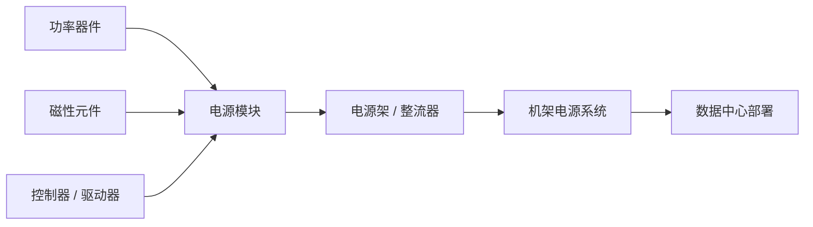
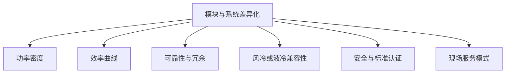

# 电源模块与系统厂商
> **最后更新：** 2026-11-12
> **状态：** 草稿
> **标签：** 厂商, 模块, 电源架, UPS, Vicor, 台达电子, 维谛技术

## 概述
模块与系统厂商将半导体、磁性元件、电容、固件、机械和热管理组件整合为经过验证的电源产品。它们通过系统集成、认证、定制工程以及与超大规模云厂商的供应关系获取价值。

各厂商的业务边界相互交叠：Vicor 和村田制作所（Murata）销售板级模块，台达电子（Delta）和伟创力（Flex）生产电源架，维谛技术（Vertiv）/伊顿（Eaton）的业务覆盖设施基础设施。ODM 代工营收可能规模可观，但产品能见度和客户归属仍然有限。

## 关键发现 / 要点
- [已确认] Vicor 的架构结合了 BCM/PRM/VTM 系列产品与 ChiP 封装。
- [已确认] 台达电子的业务覆盖元器件、PSU、电源架、UPS 和热管理系统。
- [已确认] 维谛技术和伊顿的业务从设施电源延伸至机架级基础设施。
- [已确认] 伟创力、光宝科技（Lite-On）和康舒科技（Acbel）是重要的定制制造/JDM（联合设计制造）供应商。
- [待核实] 英伟达（NVIDIA）/Vicor 在 GB200 中的具体价值量应以公开的平台证据为依据，而非推断。
- [已确认，2026] 英伟达列出了一个广泛的 800 VDC 生态系统，涵盖半导体、电源转换、开关柜、储能和基础设施合作伙伴；入选仅为生态系统层面的证据，并不能证明已获得量产设计导入。
- [已确认的产品宣称] Heron Power 和 Amperesand 正在推进面向 800 VDC AI 基础设施的 SiC 中压 SST 系统商业化，目标于 2026 年实现首批部署/首批交付。
- [已确认，2026-10-20] Vicor Q3 2026 营收为 $197.1M（同比 +78.5%），其中特许权使用费为 $66.6M（~34%），毛利率为 68.3%，订单积压为 $406M。该公司已将垂直供电（VPD）专利授权给一家未具名的 AI OEM（2026-09-16）；美国国际贸易委员会（USITC）已就其针对台达电子、英飞凌（Infineon）、芯源系统（MPS）、伟创力、Celestica、广达电脑（Quanta）和立讯精密（Luxshare）相关实体提出的申诉立案 337-TA-1526 调查（2026-10-09）。
- [已确认，2026-10-28] 维谛技术 Q3 2026 净销售额为 $4,313M（+61%），有机订单增长超过 100%；FY2026 业绩指引上调至 $14.45-14.85B。维谛技术已不再报告以美元计的订单积压金额，并已完成对 UtilityInnovation Group 的收购（2026-10-27）。
- [已确认，2026-11-03] 伊顿 Q3 2026 销售额创纪录，达 $8.9B（+28%）；美洲电气（Electrical Americas）业务订单积压为 ~$16.0B。伊顿已同意收购 COL Group（企业价值 €810M，中压开关柜），并已完成对 Boyd Thermal 的收购（$9.5B，2026-03-12）；其 MVSST 2.0 SST 采用英飞凌 SiC。
- [已确认，2026-10] 台达电子公布 Q3 2026 营收创纪录，达 ~NT$197.1B；数据中心/AI 产品占前九个月营收的 ~50%。台达电子在 OCP 上展示了一款配备 480 kW BBU 的 660 kW 800 VDC 列间电源机架，以及一款中压转 800 VDC 的 SST。光宝科技（LITEON）云端与 AIoT（Cloud & AIoT）业务板块 Q3 2026 增长 57%；其 800 VDC 电源机架原型机自 Q4 2026 起出货，且其董事会已批准分拆 LITEON Rack。
- [已确认，2026-08/09] 电气巨头进军 800 VDC：ABB 推出基于 SST 的 Infinitus DC 产品组合（SST 于 2H 2027 商用上市），西门子（Siemens）与莱茵豪森（Reinhausen）正在共同开发一款模块化 SST（输入最高 36 kV，输出 800 VDC），施耐德电气（Schneider）展示了一款适用于最高 1.2 MW 机架的 800 VDC 侧柜。

## 图解

### 官方图示参考
| 厂商 | 待查阅的图示材料 | 官方来源 |
|---|---|---|
| Vicor | 分比式电源架构及 48 V AI 供电示意图 | https://www.vicorpower.com/ |
| 台达电子 | 电源架、整流器及数据中心电源系统图示 | https://www.deltaww.com/en-US/solutions/Data-Center |
| 维谛技术 | 机架电源、散热及 AI 基础设施示意图 | https://www.vertiv.com/en-us/solutions/high-density-ai/ |
| 伊顿 | UPS 及数据中心配电图示 | https://www.eaton.com/us/en-us/markets/data-centers.html |
| 村田制作所 | 电源模块及数据中心 DC-DC 图示 | https://www.murata.com/en-us/products/power |
| Flex Power Modules | DC-DC 模块及数据中心电源图示 | https://flexpowermodules.com/ |

## 详细内容
### 厂商矩阵

| 公司 | 股票代码 | 产品 | 功率范围 | 输入/输出 | 客户 | 备注 |
|---|---|---|---|---|---|---|
| Vicor | VICR | BCM、PRM、VTM、ChiP | 板级 kW 级 | 48 V 至 POL/中间总线 | OEM | 高端分比式架构 |
| 村田制作所 | 6981.T | DC/DC 模块、POL、电源 | W-kW | 广泛 | OEM | 元器件 + 模块 |
| Bel Fuse/Bel Power | BELFA/BELFB | PSU/模块 | W-kW | AC/DC、DC/DC | OEM | Power Solutions 产品组合 |
| 伟创力 | FLEX | 定制 PSU/电源架 | kW-机架级 | AC 至 48/12 V | 超大规模云厂商 | ODM/JDM |
| 台达电子 | 2308.TW | PSU、电源架、UPS、PDU、热管理 | W-MW | 全链条 | 云厂商/OEM | 垂直系统产品栈最为完整 |
| 维谛技术 | VRT | UPS、PDU、母线槽、热管理 | kW-MW | 设施/机架 | 数据中心运营商 | AI 基础设施业务敞口高 |
| 伊顿 | ETN | 开关柜、UPS、母线槽/电源架 | kW-MW | 设施/机架 | 数据中心运营商 | 配电业务规模大 |
| 先进能源（Advanced Energy） | AEIS | 服务器 PSU/整流器 | W-kW | AC/DC | OEM | 源自 Artesyn |
| 光宝科技 | 2301.TW | 服务器 PSU/电源架 | kW | AC-48/12 V | OEM/云厂商 | ODM 规模 |
| 康舒科技 | 6282.TW | 服务器电源 | kW | AC-48/12 V | OEM/云厂商 | 中国台湾 ODM |
| 长城电源（Great Wall Power） | 非上市/国资关联 | PSU | kW | AC/DC | 中国云厂商/OEM | 国内生态系统 |
| Heron Power | 非上市 | Heron Link SST + SuperBBU | 4.2 MW [厂商规格] | 34.5 kV AC-800 VDC | AI 数据中心 | 宣称 98.5%；部署验证尚待完成 |
| Amperesand | 非上市 | 中压 SiC SST | 视具体产品而定 | MV AC-LV/800 VDC | 关键基础设施 | 目标 2026 年交付首批商用产品 |
| ABB | ABBN.SW | Infinitus DC 产品组合、中压 SST | MW 级 | MV AC-800 VDC | 数据中心开发商 | SST 于 2H 2027 商用上市 |
| 西门子 / 莱茵豪森 | SIE.DE / 非上市 | 模块化 SST（开发中） | MW 级 | 最高 36 kV AC-800 VDC | 数据中心 | 据报道测试系统运行 >200 h |
| 施耐德电气 | SU.PA | 800 VDC 侧柜 | 最高 1.2 MW 机架 | 800 VDC | 数据中心 | 于 Computex 2026-06 展出 |
| SOLUM | 248070.KS | PSU、BBU 转换器 | 26 kW 级 800 VDC BBU 转换器 | 800 VDC | AI 数据中心 | 与英飞凌扩大 HVDC 合作（2026-11-05） |
| DG Matrix | 非上市 | Interport 多端口 SST | 单台最高 2.4 MW | MV AC/DC 多端口 | 数据中心/微电网 | $60M A 轮融资（2026-02） |

### 集成层级

| 层级 | 利润率驱动因素 | 主要风险 |
|---|---|---|
| 板级模块 | 知识产权、功率密度、认证 | 单一供应来源与平均售价（ASP）压力 |
| 服务器 PSU | 出货量、效率、可靠性 | ODM 竞争 |
| 机架电源架 | 定制工程、标准 | 客户集中度 |
| UPS/PDU | 装机基数与服务 | 项目周期 |
| 完整基础设施 | 捆绑销售与全生命周期服务 | 资本/项目执行 |

相关：[主索引](README.md)。

## 数据表（如适用）
| 字段 | 数值 | 来源 | 日期 |
|---|---|---|---|
| ORv3 所服务母线 | 48 V | OCP/厂商产品 | 2025 |
| 维谛技术 2024 年营收 | ~$8.0B [已确认] | 维谛技术 10-K | FY2024 |
| Vicor 封装 | ChiP | Vicor | 2025 |
| 台达电子业务范围 | 从 PSU 到 UPS/热管理 | 台达电子 | 2025 |
| 先进能源历史渊源 | 2019 年收购 Artesyn Embedded Power | AE | 2019 |
| 英伟达 800 VDC 生态系统 | 列出 30+ 家电气/半导体合作伙伴 [已被取代：据英伟达，>80 家制造商，2026-08] | 英伟达 | 2026 |
| Vicor Q3 2026 营收 | $197.1M；特许权使用费 $66.6M；订单积压 $406M | Vicor 8-K | 2026-10-20 |
| 维谛技术 FY2026 销售额指引 | $14.45-14.85B | 维谛技术 | 2026-10-28 |
| 维谛技术 Q3 2026 净销售额 | $4,313M（+61%） | 维谛技术 | 2026-10-28 |
| 伊顿 Q3 2026 销售额 | $8.9B（+28%） | 伊顿 | 2026-11-03 |
| 台达电子 Q3 2026 营收 | ~NT$197.1B（创纪录） | Taipei Times | 2026-10-31 |
| 光宝科技 Q3 2026 营收 | NT$57.4B（同比 +28%） | 光宝科技 | 2026-10/11 |
| 维谛技术/UtilityInnovation Group | ~$1.45B 现金 + 最高 $1.15B 业绩对赌付款 | 维谛技术 | 2026-10-27 完成 |
| 伊顿/COL Group | 企业价值 €810M | 伊顿 | 2026-09-24 宣布 |

## 待解决问题 / 数据缺口
- 建立 SKU 级电源架追踪表，涵盖效率曲线及 OCP 认可产品（accepted product）状态。
- 利用公开申报文件或拆解分析验证超大规模云厂商客户关系。
- 将产品营收与代工制造的转手（pass-through）收入区分开来。
- 查明 Vicor VPD 未具名被许可方的身份，并跟踪 337-TA-1526 的进展节点。
- 更新伟创力、村田制作所、先进能源、Bel Fuse 和 nVent 的数据（2026-11 更新未涵盖）。

## 参考文献
- Vicor | https://www.vicorpower.com/ | 访问日期 2026-06-10
- Delta datacenter solutions | https://www.deltaww.com/en-US/solutions/Data-Center/ALL/ | 访问日期 2026-06-10
- Vertiv investor relations | https://investors.vertiv.com/ | 访问日期 2026-06-10
- Eaton datacenters | https://www.eaton.com/us/en-us/markets/data-centers.html | 访问日期 2026-06-10
- Advanced Energy | https://www.advancedenergy.com/ | 访问日期 2026-06-10
- NVIDIA 800 VDC ecosystem | https://www.nvidia.com/en-us/data-center/technologies/800-vdc-architecture/ | 访问日期 2026-07-28
- Heron Power datacenter system | https://heronpower.com/product/data-centers | 访问日期 2026-07-28
- Amperesand SST platform | https://www.amperesand.io/ | 访问日期 2026-07-28
- Vicor Q3 2026 results | https://www.sec.gov/Archives/edgar/data/0000751978/000119312526425697/d153882dex991.htm | 检索日期 2026-11-12
- Vicor VPD license | https://www.morningstar.com/news/globe-newswire/9828402/vicor-licenses-vpd-to-a-leading-ai-oem | 检索日期 2026-11-12
- USITC 337-TA-1526 | https://www.usitc.gov/press_room/news_release/2026/er1009_69342.htm | 检索日期 2026-11-12
- Vertiv Q3 2026 results | https://investors.vertiv.com/news/news-details/2026/Vertiv-Reports-Strong-Third-Quarter-2026-with-Net-Sales-Growth-of-61-Organic-Orders-Growth-over-100-and-Diluted-EPS-Growth-of-91-Adjusted-Diluted-EPS-Growth-of-78-Raises-Full-Year-2026-Guidance-Across-All-Key-Metrics/ | 检索日期 2026-11-12
- Vertiv completes UIG acquisition | https://www.vertiv.com/en-us/about/news-and-events/corporate-news/2026/vertiv-completes-acquisition-of-utilityinnovation-group/ | 检索日期 2026-11-12
- Eaton Q3 2026 results | https://www.eaton.com/us/en-us/company/news-insights/news-releases/2026/eaton-reports-record-third-quarter-2026-results.html | 检索日期 2026-11-12
- Eaton/COL Group | https://datacenterdynamics.com/en/news/eaton-to-acquire-col-group | 检索日期 2026-11-12
- Delta Q3 2026 results | https://www.taipeitimes.com/News/biz/archives/2026/10/31/2003866890 | 检索日期 2026-11-12
- LITEON Q3 2026 | https://finance.technews.tw/2026/10/09/ai-power-demand-remains-strong-liteon-q3-revenue-up-9-percent-acbel-hits-new-high/ | 检索日期 2026-11-12
- ABB Infinitus | https://www.globenewswire.com/news-release/2026/09/21/3365178/0/en/abb-s-new-direct-current-portfolio-aims-to-rewire-ai-data-center-energy-infrastructure.html | 检索日期 2026-11-12
- Siemens/Reinhausen SST | https://www.techzine.eu/news/infrastructure/143672/siemens-and-reinhausen-are-developing-an-sst-for-800v-dc-ai-data-centers/ | 检索日期 2026-11-12
- SOLUM/Infineon HVDC | https://www.manilatimes.net/2026/11/05/tmt-newswire/pr-newswire/solum-and-infineon-expand-collaboration-on-hvdc-power-solutions-for-ai-data-centers/2463161 | 检索日期 2026-11-12
