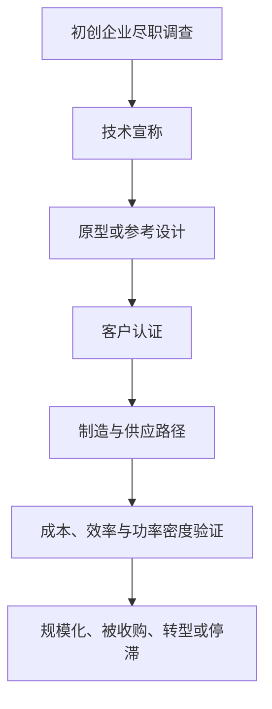
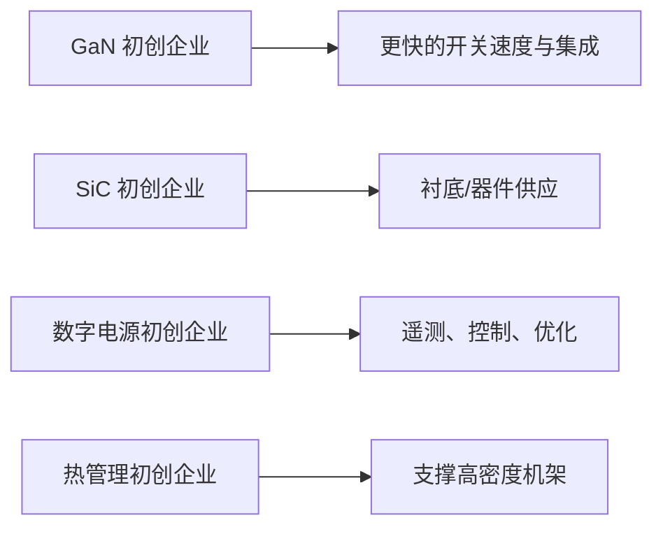

# 初创企业观察名单
> **最后更新：** 2026-11-12
> **状态：** 草稿
> **标签：** 初创企业, 风险投资, GaN, SiC, 磁性元件, 并购

## 概述
本观察名单跟踪非上市或新兴公司，其器件、封装、磁性元件、传感或控制技术可能对数据中心电源产生影响。种子名单中包含若干已被收购、已成熟上市或关联度较弱的公司；这些公司被保留在排除/更正登记表中，以防被错误归类为初创企业。

融资金额和设计导入信息尤其容易出现过时或带有宣传性质的报道。未经核实的数值已略去，并标注为需以一手来源确认。

## 关键发现 / 要点
- [已确认] Cambridge GaN Devices 开发 ICeGaN 增强型功率器件。
- [已确认] Ideal Power 为上市公司而非初创企业，开发 B-TRAN 双向开关。
- [已确认] Exagan 于 2020 年被意法半导体（ST）收购；UnitedSiC 于 2021 年被 Qorvo 收购。
- [已确认] Enpirion 资产于 2020 年由英特尔（Intel）转至芯源系统（MPS）。
- [更正] Heliogen、Nextracker 和 Movella 并非直接的数据中心功率半导体初创企业。
- [已确认，2026] Cambridge GaN Devices 与恩智浦（NXP）宣布开展长期合作，提供面向数据中心、汽车和工业电源的 GaN 系统解决方案。
- [已确认，公司披露] Amperesand 报告其累计融资总额超过 $100M，目标于 2026 年交付首批商用中压 SiC SST 产品。
- [已确认的产品宣称] Heron Power 公布了一款 4.2 MW、34.5 kV AC 转 800 VDC 的 Heron Link SST 规格，集成电池缓冲功能；独立部署验证尚待完成。
- [已确认，2026-02-18] Heron Power 完成 $140M B 轮融资，由 a16z American Dynamism 和 Breakthrough Energy Ventures 领投，用于在美国建设一座规模可支持 40 GW Heron Link SST 的工厂；DG Matrix 完成 $60M A 轮融资（Engine Ventures 领投），用于其 Interport 多端口 SST（最高 2.4 MW）。
- [已确认，2026] 四家处理器供电初创企业已被收购或已同意被收购：Empower 被亚德诺（ADI）收购（~$1.5B，2026-07-07 完成），Claros 被纳微半导体（Navitas）收购（2026-10-06 完成），C2i Semiconductors 被英飞凌（Infineon）收购（~2026-10 完成），Ferric 被安森美（onsemi）收购（最高 $775M，尚待完成）。
- [已确认，意向书，2026-10] Vertical Semiconductor（垂直 GaN）获得一份 CHIPS 研发意向书，金额最高 $73M，政府将持有少数无投票权股份。
- [已确认，2026-08-13] Ideal Power 表示，一家客户基于 B-TRAN、面向 800 V AI 数据中心的 SSCB 原型机将于 Q4 2026 交付。
- [估计，低置信度] 据报道，截至 2026 年 3 月的 12 个月内，SST 初创企业融资额超过 $320M（转引自 SemiAnalysis）。

## 图解

## 详细内容
### 活跃观察名单

| 公司 | 成立年份/总部 | 阶段/融资 | 技术 | 数据中心目标应用 | 并购观点 | 风险 |
|---|---|---|---|---|---|---|
| Cambridge GaN Devices | 2016/英国 | 非上市；$32M C 轮融资（2025-02，British Patient Capital 领投） | ICeGaN 增强型 GaN；与恩智浦合作 | PSU/PFC | 可能 | 规模化/竞争；据报道 CEO 变更 [中置信度] |
| Ideal Power | 美国/上市 | Nasdaq: IPWR | B-TRAN 双向开关；面向 800 V 的 SSCB | UPS/BDC/SSCB | 可能 | 商业化采用；原型机将于 Q4 2026 交付 |
| Tagore Technology | 美国/印度 | 非上市；[待核实] | GaN 射频/功率 | 电源转换相关领域 | 可能 | 数据中心证据有限 |
| Odyssey Semiconductor | 美国 | 非上市；[待核实] | 垂直 GaN | 高压转换 | 可能 | 工艺规模化 |
| Silanna Semiconductor | 澳大利亚/美国 | 非上市；[待核实] | 电源 IC/控制器 | 高密度 AC/DC | 可能 | 产品能见度 |
| SemiQ | 美国/非上市 | 非上市；未发现 2026 年融资轮次 | SiC 器件/模块；1,700 V QSiC Dual3（2026-06） | AI AC-DC/SST/PFC/UPS | 是/可能 | 规模 |
| Halo Microelectronics | 中国/美国关联 | 非上市；[待核实] | 模拟/电源 IC | 服务器/消费电子 | 可能 | 信息披露 |
| Celtonn/Celonics [名称待核实] | [待核实] | [待核实] | GaN/模块宣称 | [待核实] | 未知 | 实体身份不明确 |
| Amperesand | 美国/新加坡 | 非上市；累计融资 >$100M [公司披露]；$80M A 轮融资（2025-11，Walden Catalyst/淡马锡（Temasek））；+$30M（2026-06）[传闻] | SiC 中压 SST；内华达州里诺（Reno, NV）制造 | MV AC 转 800 VDC AI 基础设施 | 可能 | 首批商用产品/认证 |
| Heron Power | 美国/非上市 | 非上市；$140M B 轮融资（2026-02-18）；累计 ~$178M [估计，中置信度] | SST、直流保护、控制、SuperBBU | 34.5 kV AC 转 800 VDC | 可能 | 厂商宣称/部署验证 |
| DG Matrix | 美国/非上市 | 非上市；$60M A 轮融资（2026-02-18） | Interport 多端口 SST，最高 2.4 MW | MV AC/储能/发电转直流 | 可能 | 规模化；融资总额说法相互矛盾 |
| Vertical Semiconductor | 美国/非上市 | $11M 种子轮（2025-10）；CHIPS 研发意向书最高 $73M（2026-10） | 垂直 GaN 器件 | 800 V 级转换；2.5 MW AI 机架目标 | 可能 | 尚未商业化 |

### 已被收购或已成熟的公司

| 种子名单名称 | 正确状态 | 所有者/年份 | 相关性 |
|---|---|---|---|
| Exagan | 已被收购 | 意法半导体，2020 | GaN 工艺/知识产权 |
| UnitedSiC | 已被收购 | Qorvo，2021 | SiC 器件 |
| Enpirion | 资产已被收购 | 芯源系统，2020 | 电源模块 |
| pSemi/Peregrine | 子公司 | 村田制作所（Murata），2014 | 射频/电源 IC 相关领域 |
| Nitronex | 收购沿革 | MACOM（经由 GaN 资产/历史沿革） | GaN 知识产权 |
| 帕沃英蒂格盛（Power Integrations） | 成熟上市公司 | POWI | 离线式电源 IC |
| Empower Semiconductor | 已被收购 | 亚德诺，2026（~$1.5B） | IVR / 硅电容 |
| Claros | 已被收购 | 纳微半导体，2026（最高 ~$232.8M） | IVR / 垂直供电 |
| C2i Semiconductors | 已被收购 | 英飞凌，2026（未披露） | 多相控制器 / 智能功率级 |
| Ferric | 收购进行中 | 安森美，2026-11-02 宣布（最高 $775M） | IVR / 磁性元件 |
| 华润微（CR Micro） | 成熟上市 IDM | 688396.SS | 中国功率半导体 |

### 排除 / 低相关性登记表

| 公司 | 原因 |
|---|---|
| Heliogen | 光热发电开发商，并非功率半导体初创企业 |
| Nextracker | 太阳能跟踪系统企业，并非数据中心功率半导体初创企业 |
| Movella | 运动传感公司；直接功率传感的投资逻辑缺乏依据 |
| Magnetics International | 实体及数据中心产品范围有待核实 |
| Starkpower | 实体/产品身份有待核实 |

> 🔄 需要更新：高优先级。应每季度对照公司注册登记信息和一手公告，核查融资、所有权及运营状态。

相关：[主索引](README.md)。

## 数据表（如适用）
| 字段 | 数值 | 来源 | 日期 |
|---|---|---|---|
| 意法半导体/Exagan | 收购 | 意法半导体 | 2020 |
| Qorvo/UnitedSiC | 收购 | Qorvo | 2021 |
| 芯源系统/Enpirion 资产 | 收购 | 芯源系统/英特尔 | 2020 |
| 村田制作所/Peregrine | 收购 | 村田制作所 | 2014 |
| CGD 技术 | ICeGaN | CGD | 2025 |
| CGD/恩智浦合作 | 长期 GaN 系统解决方案合作 | CGD | 2026-06-09 |
| Amperesand 融资 | 累计 >$100M [公司披露] | Amperesand | 2026 |
| Heron Power B 轮融资 | $140M | Heron Power | 2026-02-18 |
| DG Matrix A 轮融资 | $60M | DG Matrix | 2026-02-18 |
| Vertical Semiconductor CHIPS 意向书 | 最高 $73M | NIST | 2026-10 |
| 亚德诺/Empower | ~$1.5B | 亚德诺 | 2026-07-07 |

## 待解决问题 / 数据缺口
- 核实每家活跃非上市公司的法律实体、融资总额及最新融资轮次。
- 为纳入名单的每家初创企业补充至少一项公开的数据中心设计导入或认证里程碑。
- 在得出投资结论之前，先厘清 Celonics 和 Starkpower 这两个含义不明的种子名单名称。
- 核查 Odyssey Semiconductor、Tagore 和 Silanna 的状态（2026-11 更新未涵盖）。

## 参考文献
- Cambridge GaN Devices | https://camgandevices.com/ | 访问日期 2026-06-10
- Ideal Power | https://ir.idealpower.com/ | 访问日期 2026-06-10
- ST acquires Exagan | https://newsroom.st.com/media-center/press-item.html/t4261.html | 访问日期 2026-06-10
- MPS acquires Enpirion assets | https://www.monolithicpower.com/en/about-mps/newsroom.html | 访问日期 2026-06-10
- CGD/NXP collaboration | https://camgandevices.com/en/p/cgd-joins-forces-with-nxp-semiconductors-to-accelerate-time-to-market/ | 访问日期 2026-07-28
- Amperesand | https://www.amperesand.io/about | 访问日期 2026-07-28
- Heron Power datacenter system | https://heronpower.com/product/data-centers | 访问日期 2026-07-28
- Heron Power Series B | https://techcrunch.com/2026/02/18/heron-power-raises-140m-to-ramp-production-of-grid-altering-tech/ | 检索日期 2026-11-12
- DG Matrix Series A | https://techcrunch.com/2026/02/18/dg-matrix-raises-60m-to-make-data-center-power-smarter | 检索日期 2026-11-12
- Amperesand Series A | https://www.businesswire.com/news/home/20251118244299/en/ | 检索日期 2026-11-12
- NIST CHIPS R&D letters of intent | https://nist.gov/news-events/news/2026/10/department-commerce-announces-letters-intent-4-companies-389-million-rd | 检索日期 2026-11-12
- Ideal Power Q2 2026 | https://www.barchart.com/story/news/3829814/ideal-power-reports-second-quarter-2026-financial-results | 检索日期 2026-11-12
- SemiQ 1,700 V modules | https://www.semiconductor-today.com/news_items/2026/jun/semiq-100626.shtml | 检索日期 2026-11-12
- CGD Series C | https://www.businesswire.com/news/home/20250218968474/en | 检索日期 2026-11-12
- ADI completes Empower acquisition | https://www.analog.com/en/newsroom/press-releases/2026/7-7-26-adi-completes-acquisition-of-empower-semiconductor.html | 检索日期 2026-11-12
