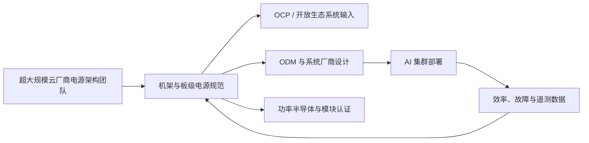
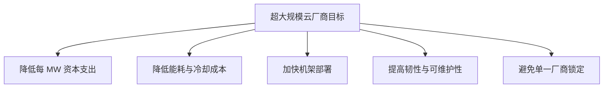

# 超大规模云厂商电源战略
> **最后更新：** 2026-11-12
> **状态：** 草稿
> **标签：** 超大规模云厂商, 英伟达, 谷歌, Meta, 微软, AWS

## 概述
超大规模云厂商通过机架规范、定制加速器、集群遥测、认证和采购规模影响功率半导体。公开证据最充分的是开放式机架/电源架设计和系统级可持续发展；定制电压调节模块（VRM）ASIC 以及与商用供应商的合作关系通常处于保密状态。

其战略模式是选择性垂直整合：运营商定义架构，有时还自研定制控制芯片，同时继续从商用供应商采购功率级、分立器件、磁性元件、电源架和设施设备。

## 关键发现 / 要点
- [已确认] Meta 是 ORv3 48 V 机架和电池备份单元（BBU）规范的主要贡献者。
- [已确认] 谷歌（Google）已发表 48 V 及开关谐振腔（STC）变换器方面的研究成果。
- [部分确认] 微软（Microsoft）公开了定制 Maia 基础设施，但功率芯片的详细信息有限。
- [传闻] AWS 定制电源管理芯片及其供应商归属缺乏足够的公开证据。
- [已确认] GB200 NVL72 在液冷机架级系统中集成了 72 个 Blackwell GPU。
- [已确认，2026] 英伟达（NVIDIA）已将 MGX 扩展为面向 Vera Rubin 的第三代机架设计，并发布了面向 MW 级 IT 机架的 800 VDC 迁移路径，自 2027 年的 Kyber 开始。
- [已确认] 英伟达公开列出了 800 VDC 生态系统参与者，但徽标/名单并不能证明营收、出货量或独家设计导入。
- [已确认，2026-10-08] 微软、Meta 和谷歌联合撰写了开放计算项目（OCP）Mt. Diablo v1.0.0，这是一种适用于 100 kW-1 MW IT 机架的 ±400 VDC 侧柜式电源柜；谷歌此前已在 OCP EMEA 2025 上承诺采用 ±400 VDC。
- [已确认，2026] 谷歌、微软和英伟达牵头一个 OCP 工作流，制定中压（MV）交流转 800 VDC 固态变压器（SST）规范（v0.3）；微软正在开发并验证集成储能、面向 800 VDC 的 SST。
- [已确认，2026-10] 谷歌、Meta、微软和英伟达发布了 OCP 电网韧性规范（Grid Resilience Specification），目标是实现故障穿越（ride-through），并在约 2 s 内恢复至接近满载。
- [已确认，2026] Vera Rubin 已全面投产（2026-05-31），NVL72 机架开始通过 OEM（原始设备制造商）出货（2026-09），英伟达向 OCP 贡献了 Vera Rubin 机架/托盘设计（2026-10-12），并推出了集装箱式 DSX POD 参考设计（2027 年初上市）。
- [已确认，2026-11-02] 安森美（onsemi）报告称，其 SiC 和硅 MOSFET 已批量出货至包括谷歌在内的多个 AI 平台（用于电源供应器（PSU）和 54 V 转 12 V 转换），这是罕见的公开点名超大规模云厂商的供货披露。

## 图解

### 官方图示参考
| 组织 | 待查阅的视觉资料 | 官方来源 |
|---|---|---|
| 开放计算项目 | ORv3 及更高功率机架生态系统图示 | https://www.opencompute.org/wiki/Open_Rack/SpecsAndDesigns |
| Meta Engineering | 开放基础设施与机架供电背景资料 | https://engineering.fb.com/category/data-center-engineering/ |
| 微软 Azure | 数据中心基础设施及供电/冷却图示 | https://azure.microsoft.com/en-us/explore/global-infrastructure |
| 谷歌数据中心 | 能效与基础设施图示 | https://www.google.com/about/datacenters/ |
| 英伟达 | 驱动超大规模云厂商电源需求的 AI 机架系统图示 | https://www.nvidia.com/en-us/data-center/gb200-nvl72/ |

## 详细内容
### 战略矩阵

| 组织 | 架构 | 电压目标 | 公开供应商 | 定制芯片证据 | 项目 |
|---|---|---|---|---|---|
| 谷歌 | 48 V、STC 研究；±400 VDC Mt. Diablo；中压转 800 VDC SST 工作流 | 当前 48 V；±400 VDC / 800 VDC | 与村田制作所（Murata）的研究合作；安森美 MOSFET 出货 | [待核实：定制 VRM ASIC] | TPU、集群优化 |
| Meta | ORv3 机架/电源架/BBU；Mt. Diablo 联合作者 | 48 V；±400 VDC 侧柜 | OCP 生态系统 | 电源架/系统设计已确认 | Open Rack |
| 微软 | Mt. Diablo v0.7/v1.0 贡献者；SST + 储能至 800 VDC | ±400 VDC / 800 VDC | 伊顿（Eaton）/OCP 生态系统 [待核实 SKU] | Maia 电源细节有限 | Maia/Azure |
| AWS | 定制服务器/加速器 | 未披露 | 未披露 | [传闻] | Trainium、Inferentia、Graviton |
| 英伟达 | 机架级 GPU 及 AI 工厂参考架构 | 机架内 54 V；800 VDC 侧柜 2H 2026，行级电源中心 2027 | 公开的 800 VDC 生态系统名单（>80 家制造商） | 平台规范；MGX/Vera Rubin 设计已贡献给 OCP | GB200/GB300；Vera Rubin（出货中）；Kyber；DSX POD |
| AMD | OAM/机架平台 | 12/48 V 生态系统 | OEM 生态系统 | 平台规范 | Instinct |
| 英特尔（Intel） | 服务器/加速器 | 12/48 V 生态系统 | VRM 生态系统 | VR 规范 | Xeon/Gaudi |
| 阿里巴巴（Alibaba）/百度（Baidu）/字节跳动（ByteDance） | 中国云/AI | 48 V/国产化趋势 | [待核实] | [待核实] | 国产替代 |

### 证据等级

| 主张 | 状态 | 依据 |
|---|---|---|
| Meta 定制电源架 | [已确认] | OCP 规范/贡献 |
| 谷歌 STC 合作 | [已确认] | 已发表的研究/演讲 |
| 谷歌定制 VRM ASIC | [待核实] | 需要一手出版物/专利与产品的对应关系 |
| 微软 Maia 定制供电 | [部分确认] | 平台已公开；电路供应商未公开 |
| AWS 定制 PMIC | [传闻] | 一手披露不足 |
| 谷歌/Meta/微软 ±400 VDC | [已确认] | 联合撰写 OCP Mt. Diablo v1.0.0 |
| 微软 SST + 储能至 800 VDC | [已确认，开发阶段] | Azure 基础设施博客，2026-10 |
| 安森美向谷歌平台供货 | [已确认，供应商披露] | 安森美 Q3 2026 业绩 |

### 对供应商的影响

- 开放规范扩大了合格供应商生态，但也加剧了价格竞争。
- 定制控制器可减少商用控制 IC 的价值量，但不会消除对功率级的需求。
- 高机架功率有利于能够协同设计电气、热、机械和固件的供应商。
- 中国云运营商可能加快国产器件/控制器的认证。

相关：[主索引](README.md)。

## 数据表（如适用）
| 字段 | 数值 | 来源 | 日期 |
|---|---|---|---|
| GB200 NVL72 GPU 数量 | 72 | 英伟达 | 2024 |
| GB200 NVL72 CPU 数量 | 36 个 Grace CPU | 英伟达 | 2024 |
| ORv3 标称母线电压 | 48 V | OCP | 2024 |
| Meta HPR 公开目标 | 92 kW+ 生态系统 | OCP | 2024 |
| 英伟达 800 VDC 目标 | 1 MW 及以上 IT 机架，自 2027 年起 | 英伟达 | 2026 路线图 |
| 谷歌 24/7 无碳能源（CFE）目标 | 2030 | 谷歌 | 2020/当前 |
| Mt. Diablo v1.0.0 作者 | 微软、Meta、谷歌 | OCP | 2026-10-08 |
| Vera Rubin NVL72 电源架 | 每机架 4 × 110 kW | 超微电脑（Supermicro）/思科（Cisco） | 2026-09 |
| OCP 电网韧性恢复目标 | ~2 s 恢复至接近满载 | OCP（经由英伟达） | 2026-10 |

## 待解决问题 / 数据缺口
- 通过拆解分析和供应商披露核实商用功率半导体物料清单（BOM）。
- 将运营商主导编写的标准与实际集群部署比例区分开来。
- 为定制 VRM ASIC 相关说法寻找一手证据。
- 补充 GB300 电气规格；Vera Rubin NVL72 电源架配置现已公开，但英伟达尚未公布机架级 kW 及供电轨规格。
- 研究 AWS、甲骨文（Oracle）、OpenAI（Stargate）和 xAI 的电源架构（因搜索限制，2026-11 更新未涵盖）。

## 参考文献
- Meta/OCP Open Rack | https://www.opencompute.org/wiki/Open_Rack/SpecsAndDesigns | 访问日期 2026-06-10
- NVIDIA GB200 NVL72 | https://www.nvidia.com/en-us/data-center/gb200-nvl72/ | 访问日期 2026-06-10
- Google data center efficiency | https://datacenters.google/efficiency/ | 访问日期 2026-06-10
- Microsoft Maia | https://azure.microsoft.com/en-us/blog/azure-maia-for-the-era-of-ai-from-silicon-to-software-to-systems/ | 访问日期 2026-06-10
- AWS Trainium | https://aws.amazon.com/machine-learning/trainium/ | 访问日期 2026-06-10
- NVIDIA 800 VDC architecture | https://www.nvidia.com/en-us/data-center/technologies/800-vdc-architecture/ | 访问日期 2026-07-28
- NVIDIA MGX third-generation rack roadmap | https://www.nvidia.com/en-us/data-center/products/mgx/ | 访问日期 2026-07-28
- Microsoft Azure OCP 2026 blog | https://azure.microsoft.com/en-us/blog/infrastructure-for-the-frontier-era-scaling-intelligence-through-open-industry-collaboration/ | 检索日期 2026-11-12
- Microsoft Azure grid-to-chip power | https://techcommunity.microsoft.com/blog/azureinfrastructureblog/powering-azure-infrastructure-from-grid-to-chip/4563890 | 检索日期 2026-11-12
- Google ±400 VDC at OCP EMEA 2025 | https://cloud.google.com/blog/topics/systems/enabling-1-mw-it-racks-and-liquid-cooling-at-ocp-emea-summit | 检索日期 2026-11-12
- NVIDIA Vera Rubin full production | https://nvidianews.nvidia.com/news/vera-rubin-full-production-agentic-ai-factory | 检索日期 2026-11-12
- NVIDIA OCP 2026 blog | https://blogs.nvidia.com/blog/ocp-global-summit-vera-rubin-scale-ai-factories/ | 检索日期 2026-11-12
- NVIDIA DSX POD | https://nvidianews.nvidia.com/news/nvidia-introduces-dsx-pod-ai-factories-to-accelerate-europes-infrastructure-deployment | 检索日期 2026-11-12
- Meta OCP 2026 engineering post | https://engineering.fb.com/2026/10/12/open-source/ocp-summit-2026-powering-ai-with-open-innovations-in-scale-up-scale-out-and-scale-across-networks/ | 检索日期 2026-11-12
- onsemi Q3 2026 results | https://www.onsemi.com/company/newsroom/news-and-insights/onsemi-reports-third-quarter-2026-results | 检索日期 2026-11-12
