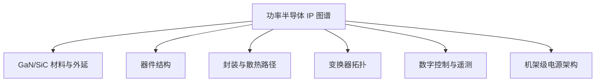

# 专利与知识产权格局
> **最后更新：** 2026-11-12
> **状态：** 草稿
> **标签：** 专利, 知识产权, FTO, GaN, SiC, 拓扑

## 概述
功率半导体知识产权（IP）涵盖晶体生长、外延、器件结构、栅极叠层、工艺集成、封装、控制算法、保护以及变换器拓扑。除非将专利归并为专利族、按法律状态筛选，并与商业产品及司法管辖区相对应，否则原始专利数量难以有效衡量竞争力。

自由实施（FTO）分析针对具体产品，需要律师参与。本研究文件识别权利要求高度密集的领域和收购谱系，不提供法律意见。

## 关键发现 / 要点
- [已确认] Wolfspeed/Cree 拥有奠基性的 SiC 材料与器件专利积累。
- [已确认] Vicor 拥有大量分比式电源、SAC/ZVS 及封装相关 IP。
- [已确认] 宜普电源转换（EPC）、英飞凌（Infineon）、德州仪器（TI）、纳微半导体（Navitas）和瑞萨电子（Renesas）/Transphorm 持有相互重叠的 GaN 专利组合。
- [估计] FTO 风险密度最高的领域集中在增强型结构、沟槽 SiC、集成驱动/保护以及软开关控制。
- [待核实] 营销宣传中的专利数量须换算为有效的简单专利族数量。
- [已确认，2026-07] 英飞凌/英诺赛科（Innoscience）纠纷在经过总统审查（Presidential Review）后产生了最终的美国进口/销售救济措施，德国另有新的侵权裁决；其范围限于特定专利和特定产品。
- [已确认，仅为指控，2026-07-07] Wolfspeed 起诉纳微半导体，主张其指名的 GaN 和 SiC 产品系列侵犯五项美国专利；截至 2026-11-12，尚无实体裁决记录。纳微半导体已请求美国专利商标局（USPTO）对全部五项专利进行再审查（reexamination），并提出中止诉讼动议。
- [已确认，2026-10-09] 美国国际贸易委员会（USITC）就 Vicor 的垂直供电投诉（US 10,903,734）立案 337-TA-1526 调查，被点名的包括台达电子（Delta）、英飞凌、芯源系统（MPS）、伟创力（Flex）、天弘（Celestica）、广达（Quanta）和立讯精密（Luxshare）旗下实体；Vicor 另向一家未具名的 AI OEM 授权了 VPD 专利（2026-09-16）。
- [已确认，仅为指控，2026-07/08] GaN 纠纷不断增加：瑞萨电子起诉纳微半导体盗用商业秘密（2026-07-22），纳微半导体则起诉瑞萨电子专利侵权，涉及 SuperGaN 等产品线（2026-08-10）。
- [已确认，据英诺赛科称，2026-05/06] 中国法院裁定英飞凌 GaN 产品侵犯英诺赛科两项专利（苏州，2026-05-27；最高人民法院于 2026-06-12 维持禁令）；未找到英飞凌的相关声明。

## 图解

## 详细内容
### 权利人分布图

| 公司 | GaN | SiC | 拓扑 | 功率 IC/控制 | 趋势 |
|---|---|---|---|---|---|
| 英飞凌 | 高 | 高 | 中 | 高 | 活跃 |
| Wolfspeed/Cree | 中/射频 | 极高 | 中 | 低 | 以材料/器件为主 |
| 纳微半导体 | 高，侧重集成 | 中，经由 GeneSiC | 中 | 高 | 活跃 |
| EPC | 高，增强型/封装 | 低 | 中 | 中 | 活跃 |
| 德州仪器 | 高，驱动器/功率级 | 低 | 中 | 极高 | 活跃 |
| Vicor | 低 | 低 | 极高 | 高 | 活跃；通过 ITC（2026）和许可进行维权 |
| 瑞萨电子/Intersil/Transphorm | 高 | 低 | 中 | 极高 | 已整合 |
| 谷歌（Google） | 低 | 低 | 中 | 系统/优化 | 选择性布局 |

### 重点专利族 / 主题

| 权利人 | 主题 | 商业相关性 |
|---|---|---|
| 英飞凌 | CoolGaN 增强型、CoolSiC 沟槽、数字控制 | 跨层级专利组合 |
| 纳微半导体 | 单片 GaN 功率 IC、传感/保护 | 集成式 GaN |
| EPC | 增强型 GaN 工艺及芯片级 LGA | 低压/高频 |
| Wolfspeed/Cree | SiC 晶锭/外延/MOSFET/接触 | 上游及器件 |
| 德州仪器 | GaN 驱动器/功率级及 UCD 数字电源 | 集成功率级/控制 |
| Vicor | FPA、SAC、ZVS 及 ChiP | 48 V 模块 |
| 瑞萨电子/Intersil | 多相控制与功率级 | 服务器 VRM |

### FTO 风险矩阵

| 领域 | 密度 | 缓解措施 |
|---|---|---|
| GaN 增强型/场板 | 高 | 按工艺和地区制作权利要求对照表 |
| SiC 沟槽栅/氧化层 | 高 | 结构/工艺规避设计 |
| 驱动器 + FET 集成 | 高 | 功能划分与许可审查 |
| 多相数字控制 | 高 | 算法与实现分析 |
| 低电感封装 | 中高 | 机械/封装权利要求审查 |

### 诉讼与标准

专利纠纷常涉及器件结构、工艺和封装；在得出竞争结论之前，应先汇总法院/ITC 案卷。应审查 PMBus 和 OCP 规范中明确规定的 IP 政策。连接器规范并不自动构成标准必要专利（SEP）池。

| 日期 | 案件 | 司法管辖区/状态 | 范围 | 研究处理方式 |
|---|---|---|---|---|
| 2026-07-07 | 英飞凌诉英诺赛科 | 经总统审查后，美国 ITC 救济措施成为终局 | 对被认定侵犯已裁决专利的产品实施进口/销售禁令 | [已确认结果]；不应推及英诺赛科全部 GaN 产品 |
| 2026-06-18 | 英飞凌诉英诺赛科 | 慕尼黑作出有利于英飞凌的裁决（两起案件：专利和实用新型） | GaN 侵权；德国境内救济 | [已确认结果]；上诉情况待跟踪 |
| 2026-07-03 | 英飞凌诉英诺赛科 | 慕尼黑地区法院作出有利于英飞凌的裁决 | 另一项 GaN 专利侵权；德国境内进口/销售/营销救济及损害赔偿 | [已确认结果]；上诉/状态待跟踪 |
| 2026-05-27 / 2026-06-12 | 英诺赛科诉英飞凌 | 苏州市中级人民法院；最高人民法院维持禁令 | 英诺赛科两项发明专利；RMB 10M 损害赔偿 | [已确认，据英诺赛科]；未找到英飞凌的回应 |
| 2026-05 | 英飞凌诉英诺赛科（337-TA-1414）范围 | 双方对仍然有效的权利要求存在争议 | 英诺赛科称仅涉及旧款产品 | [存在争议] |
| 2026-02-20 | EPC 诉英诺赛科 | 美国海关与边境保护局（CBP）裁定英诺赛科重新设计的芯片不在 2024 年 ITC 排除令范围内；专利审判和上诉委员会（PTAB）此前已认定受质疑的 '294 专利权利要求无效（2025-03-18） | 低压 GaN | [已确认，据英诺赛科律师]；联邦巡回上诉法院上诉待决 |
| 2026-07-07 | Wolfspeed 诉纳微半导体 | 特拉华州联邦地区法院（D. Del.）1:26-cv-00818；2026-09-18 修改起诉状；2026-10-09 提出驳回动议；2026-10-16/19 提出再审查请求；2026-10-27 提出中止诉讼动议 | 主张五项专利；被控产品为 GaNFast/GaNSlim/GaNSafe 及 GeneSiC/SiCPAK | [指控]；尚无侵权认定 |
| 2026-07-22 | 瑞萨电子诉纳微半导体 | 加利福尼亚北区联邦地区法院（N.D. Cal.）商业秘密起诉 | 数据中心 GaN 机密信息 | [指控] |
| 2026-08-10 | 纳微半导体诉瑞萨电子 | 得克萨斯东区联邦地区法院（E.D. Tex.）2:26-cv-00676 | 针对瑞萨电子 GaN（含 SuperGaN）的四项美国专利 | [指控] |
| 2026-10-09 | Vicor（VPD） | USITC 337-TA-1526 已立案 | US 10,903,734；垂直供电模块 | [调查进行中]；最终裁定可能在 2027 年或之后 |

> ⚠️ 注意：本文件仅用于研究初筛，不构成法律意见。

相关：[主索引](README.md)。

## 数据表（如适用）
| 字段 | 数值 | 来源 | 日期 |
|---|---|---|---|
| 专利比较单位 | INPADOC/简单专利族 | 研究惯例 | 2026 |
| 法律状态筛选 | 有效/审查中 | 研究惯例 | 2026 |
| 优先司法管辖区 | US/EP/CN/JP/KR/TW | 市场覆盖范围 | 2026 |
| 纳微半导体专利数量声明 | “300+”营销宣传数量 [待归一化] | 公司材料 | 2025 |
| 英飞凌 GaN 专利数量声明 | ~450 个专利族 [权利人自报；待归一化] | 英飞凌 | 2026-07 |
| Wolfspeed 诉纳微半导体案所主张专利 | US 8,169,005; 10,998,418; 10,886,396; 10,749,443; 11,888,392 | Wolfspeed 起诉公告 | 2026-07-07 |
| Vicor 337-TA-1526 所主张专利 | US 10,903,734 | USITC | 2026-10-09 |
| 纳微半导体诉瑞萨电子案所主张专利 | US 9,929,079; 11,545,838; 11,770,010; 11,862,996 | 纳微半导体 | 2026-08-10 |
| FTO 结论 | 须由律师出具 | 法律实务 | 2026 |

## 待解决问题 / 数据缺口
- 运行可复现的 Lens/Google Patents 检索，并导出专利族层级的数据集。
- 针对收购和更名情况补充受让人名称规范化处理。
- 建立诉讼案卷数据库，涵盖权利要求、司法管辖区、结果及仍然有效的专利。
- 审查 PMBus/OCP IP 政策中的实际许可费义务。
- 确认 337-TA-1526 的正式被申请人（鸿海（Hon Hai）/QCT 出现在投诉通知中）。
- 跟踪 EPC 诉英诺赛科案在联邦巡回上诉法院的结果，以及德国/中国案件的上诉情况。

## 参考文献
- Google Patents | https://patents.google.com/ | 访问日期 2026-06-10
- USPTO Patent Center | https://patentcenter.uspto.gov/ | 访问日期 2026-06-10
- EPO Espacenet | https://worldwide.espacenet.com/ | 访问日期 2026-06-10
- OCP IP policy | https://www.opencompute.org/about/ocp-policies | 访问日期 2026-06-10
- PMBus | https://pmbus.org/ | 访问日期 2026-06-10
- Infineon US ITC final determination | https://www.infineon.com/press-release/2026/ifxpr202607-118 | 访问日期 2026-07-28
- Infineon Munich ruling | https://www.infineon.com/press-release/2026/infxx202606-115 | 访问日期 2026-07-28
- Wolfspeed v. Navitas filing announcement | https://www.wolfspeed.com/company/news-events/news/wolfspeed-files-patent-infringement-lawsuit-against-navitas-semiconductor/ | 访问日期 2026-07-28
- Wolfspeed v. Navitas docket | https://dockets.justia.com/docket/delaware/dedce/1:2026cv00818/93782 | 检索日期 2026-11-12
- USITC 337-TA-1526 | https://www.usitc.gov/press_room/news_release/2026/er1009_69342.htm | 检索日期 2026-11-12
- Vicor VPD license | https://www.morningstar.com/news/globe-newswire/9828402/vicor-licenses-vpd-to-a-leading-ai-oem | 检索日期 2026-11-12
- Renesas v. Navitas | https://compoundsemiconductor.net/article/124896/Renesas_sues_Navitas_over_trade_secrets | 检索日期 2026-11-12
- Navitas v. Renesas docket | https://ipverse.greyb.com/litigations/navitas-semiconductor-ireland-llc-v-renesas-electr--txed--2-26-cv-00676 | 检索日期 2026-11-12
- Innoscience China rulings | https://www.tomshardware.com/tech-industry/chinas-top-court-bars-infineon-from-selling-gan-power-chips-in-china | 检索日期 2026-11-12
- Innoscience ITC scope claim | https://www.trendforce.com/news/2026/05/09/news-innoscience-claims-itc-ruling-victory-confirms-no-infringement-for-current-gan-devices-u-s-shipments-uninterrupted/ | 检索日期 2026-11-12
- EPC v. Innoscience CBP ruling | https://www.finnegan.com/en/firm/news/cbp-clears-redesigned-innoscience-chips-after-itc-case.html | 检索日期 2026-11-12
- Infineon June 2026 Munich rulings | https://evertiq.com/design/2026-06-23-infineon-wins-two-more-patent-cases-against-innoscience-in-germany | 检索日期 2026-11-12
