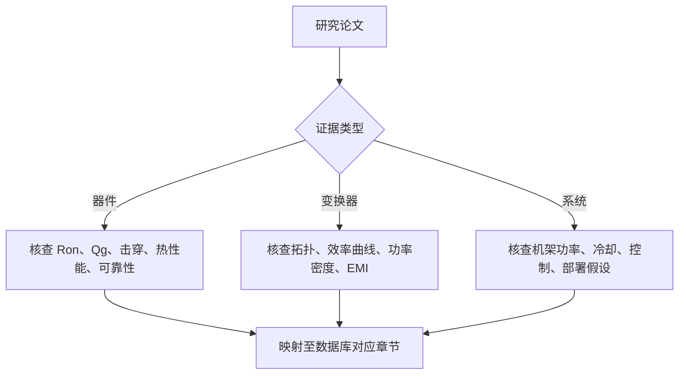
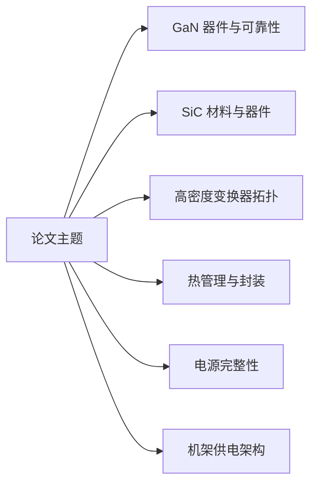

# 重点研究论文
> **最后更新：** 2026-11-12
> **状态：** 草稿
> **标签：** 论文, 文献目录, IEEE, APEC, 可靠性

## 概述
本精选文献目录按照数据库所涉及的工程问题组织基础性与应用性文献。优先收录同行评审论文、标准以及测量结果可复现的会议论文集。

文献元数据和 DOI 链接需要定期核验。厂商白皮书可作为有价值的应用佐证，但不应取代独立的可靠性或效率研究。

## 关键发现 / 要点
- [已确认] APEC、ECCE、COMPEL、ISPSD、IEDM、TPEL、TED、JSSC 和 PCIM 是核心会议与期刊。
- [已确认] 动态导通电阻（RDS(on)）测量是氮化镓（GaN）文献的核心主题。
- [已确认] 碳化硅（SiC）栅氧化层/界面可靠性仍是研究热点。
- [已确认] 48 V 至负载点（POL）的研究涵盖开关谐振腔（STC）变换器和混合变换器。
- [已确认] 高压直流（HVDC）研究必须明确架构边界，才能进行效率比较。
- [已确认，2026] ISPSD 2026（拉斯维加斯，2026-05-24 至 28）设有垂直 GaN 专场；IEDM 2026（旧金山，2026-12-12 至 16）在其功率与模拟方向中明确列入数据中心电源转换。
- [已确认，2026] 2026 年值得关注的器件成果包括一款 2,334 V 蓝宝石基 AlGaN 高电子迁移率晶体管（HEMT），以及一款比导通电阻为 1.46 mΩ·cm² 的垂直 GaN-on-GaN 沟槽 MOSFET；二者均为研究成果，并非产品。

## 图解

## 详细内容
### 精选入门文献

| 主题 | 标题 / 检索锚点 | 作者 | 年份 | 发表平台 | 关键发现 | DOI/链接 |
|---|---|---|---:|---|---|---|
| GaN 可靠性 | Dynamic on-resistance in GaN HEMTs | Meneghini 等及相关作者 | 2010 年代 | IEEE TED/TDMR | 陷阱效应使瞬态电阻升高 | https://ieeexplore.ieee.org/ |
| GaN 认证 | JEP173 dynamic RON procedure | JEDEC | 2019+ | JEDEC | 标准化测量指南 | https://www.jedec.org/standards-documents/docs/jep173 |
| SiC 氧化层 | SiO2/SiC interface and MOS reliability reviews | Kimoto 及合著者 | 2010 年代 | IEEE TED | 界面陷阱限制沟道迁移率 | https://ieeexplore.ieee.org/ |
| 图腾柱 PFC | Bridgeless totem-pole PFC with GaN | 多位作者 | 2010-2020 年代 | APEC/TPEL | 借助快速换流实现高效率 | https://ieeexplore.ieee.org/ |
| 48 V 转换 | Switched-tank converter for data centers | 谷歌（Google）/村田制作所（Murata）研究人员 | 2010 年代 | APEC/COMPEL | 高密度固定变比转换 | https://ieeexplore.ieee.org/ |
| VRM 控制 | Multiphase buck current sharing/transients | 多位作者 | 2000-2020 年代 | TPEL/APEC | 交错并联可降低纹波 | https://ieeexplore.ieee.org/ |
| 数字电源 | Digital PWM/control quantization | 多位作者 | 2000-2020 年代 | COMPEL/TPEL | 极限环与分辨率至关重要 | https://ieeexplore.ieee.org/ |
| 电源完整性 | Target impedance methodology | Smith/Bogatin 学派 | 1990-2020 年代 | IEEE/业界 | PDN 阻抗约束电压跌落上限 | https://ieeexplore.ieee.org/ |
| 封装 | WBG parasitic-aware packaging reviews | 多位作者 | 2015-2025 | CPMT/TPEL | 回路电感限制开关性能优势的发挥 | https://ieeexplore.ieee.org/ |
| HVDC | DC distribution in data centers | 多位作者 | 2010 年代 | ECCE/TPEL | 收益取决于变换级边界/负载 | https://ieeexplore.ieee.org/ |
| AI 优化 | Data center cooling/power ML control | 谷歌/DeepMind | 2016+ | 应用报告 | 机器学习可优化监督控制 | https://deepmind.google/discover/blog/deepmind-ai-reduces-google-data-centre-cooling-bill-by-40/ |
| Ga2O3 | Ultra-wide-bandgap beta-Ga2O3 reviews | Higashiwaki 等 | 2010 年代 | APL/IEEE | 临界场强高，但热导率差 | https://doi.org/10.1063/1.5059067 |
| 横向 GaN 高压 | AlGaN-on-sapphire HEMT with 2,334 V breakdown | 威斯康星大学麦迪逊分校（UW-Madison）团队 | 2026 | Appl. Phys. Express 19, 066502 | 蓝宝石衬底可提升横向 GaN 耐压 | https://compoundsemiconductor.net/article/125373/A_new_benchmark_for_AlGaN-on-sapphire_HEMTs |
| 垂直 GaN | Vertical GaN-on-GaN trench MOSFET, 1.46 mΩ·cm², BFOM 438 MW/cm² | 华南理工大学（SCUT）/香港科技大学（HKUST） | 2026 | Applied Physics Letters | 垂直 GaN 在 800 V 级转换方面取得进展 | https://ptc.home.ece.ust.hk/Papers/2026/Xuancong%20APL%202026.pdf |

### 重点关注会议与期刊

| 会议/期刊 | 周期 | 优势主题 |
|---|---|---|
| APEC | 每年一届 | 应用型变换器、功率密度 |
| ECCE | 每年一届 | 系统/拓扑/控制 |
| COMPEL | 每年一届 | 控制/建模 |
| ISPSD | 每年一届 | 功率器件与可靠性 |
| IEDM | 每年一届 | 前沿器件工艺 |
| IEEE TPEL | 持续出版 | 变换器研究 |
| IEEE TED | 持续出版 | 器件物理/可靠性 |
| PCIM Europe | 每年一届 | 商用器件/系统 |
| ICSCRM | 每两年一届 | SiC 材料/器件（2026：横滨，2026-09-27 至 10-02） |
| OCP 全球峰会 | 每年一届 | 机架/设施供电规范（2026：2026-10-12 至 15） |

| 2026 年会议 | 日期 | 与数据中心电源的相关性 |
|---|---|---|
| ISPSD 2026 | 2026-05-24 至 28，拉斯维加斯 | 垂直 GaN 专场；SiC 栅极可靠性 |
| ECCE Europe 2026 | 2026-09-14 至 18，巴伦西亚 | 变换器/系统研究 |
| ICSCRM 2026 | 2026-09-27 至 10-02，横滨 | 200/300 mm SiC、厚外延 |
| ECCE 2026 | 2026-10-04 至 08，温哥华 | 拓扑与控制 |
| IEDM 2026 | 2026-12-12 至 16，旧金山 | 功率/模拟方向涵盖数据中心电源转换 [即将举行] |

> 🔄 需要更新：请从文献数据库补充准确的文章标题、作者、DOI 和开放获取链接；当前元数据不完整的条目仅为检索锚点。

相关：[主索引](README.md)。

## 数据表（如适用）
| 字段 | 数值 | 来源 | 日期 |
|---|---|---|---|
| 主题章节数 | 12 | 项目范围 | 2026 |
| 核心年度会议 | 7+ | IEEE/PCIM | 2026 |
| 标准锚点 | JEDEC JEP173 | JEDEC | 2019+ |
| Ga2O3 综述 DOI | 10.1063/1.5059067 | APL | 2018 |
| 更新周期 | 每年 APEC/PCIM/ISPSD 之后 | 数据库政策 | 2026 |

## 待解决问题 / 数据缺口
- 用完整的 BibTeX 级元数据替换检索锚点。
- 补充商用参考设计的独立效率测量结果。
- 补充开放获取状态以及研究制品/数据的可获得性。
- 按引用次数和对数据中心的直接适用性对论文进行排序。

## 参考文献
- IEEE Xplore | https://ieeexplore.ieee.org/ | 访问日期 2026-06-10
- APEC | https://apec-conf.org/ | 访问日期 2026-06-10
- ISPSD | https://ispsd2026.com/ | 访问日期 2026-06-10 [待核实：2026-11 更新中未再次确认该 URL]
- ISPSD 2026 session index | https://epapers2.org/ispsd2026/ESR/session_index.php | 检索日期 2026-11-12
- IEDM 2026 call for papers | https://ieee-iedm.org/wp-content/uploads/2026/07/IEDM-2026-Call-for-Papers-FINAL.pdf | 检索日期 2026-11-12
- ICSCRM 2026 | https://www.iisb.fraunhofer.de/en/events/2026/2026-09-27-to-10-02-icscrm-2026.html | 检索日期 2026-11-12
- PCIM Europe | https://pcim.mesago.com/ | 访问日期 2026-06-10
- JEDEC JEP173 | https://www.jedec.org/standards-documents/docs/jep173 | 访问日期 2026-06-10
