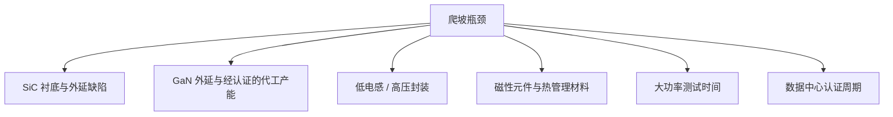

# 量产爬坡与供应链
> **最后更新：** 2026-11-12
> **状态：** 草稿
> **标签：** 供应链, 衬底, 晶圆代工, 封装, 产能

## 概述
数据中心电源供应链将特种材料与成熟的模拟晶圆代工厂以及大规模封装组装相结合。SiC 衬底仍是战略瓶颈，而 GaN 功率器件则依赖外延质量、代工厂工艺控制以及先进的低电感封装。

产能声明难以相互比较，因为各供应商分别以晶圆数、晶圆投片量、营收产能、厂房面积或 150 mm 等效晶圆为单位进行报告。在单位和良率完成归一化之前，本数据库避免给出虚假的精确数值。

## 关键发现 / 要点
- [已确认] 与硅相比，SiC 晶锭生长周期更长，对缺陷也更为敏感。
- [已确认] 200 mm SiC 器件生产正在爬坡，而大部分衬底供应仍为 150 mm。
- [已确认] GaN 功率器件生产涵盖 150、200 及已宣布的 300 mm 产线。
- [更正] SK 矽德荣（SK Siltron）是 SK 集团旗下公司。
- [已确认] 台积电（TSMC）、格芯（GlobalFoundries）、Tower、X-Fab 和 SSMC 服务于模拟/功率 IC 生态系统。
- [已确认，2026-07-02] 英飞凌（Infineon）提前启用投资 €5B 的德累斯顿智能功率晶圆厂（Smart Power Fab），使其在德累斯顿的功率及模拟/混合信号产品产能翻倍，并新增 1,000 个工作岗位。
- [已确认，2026] 安森美（onsemi）正在基于格芯 200 mm 增强型 GaN-on-Si 工艺开发 650 V 横向 GaN 产品，并另行送样 700/1,200 V 垂直 GaN。
- [已确认，2026] Wolfspeed 称已展示 300 mm SiC 晶圆能力；其器件量产基线仍为 Mohawk Valley 200 mm 产能爬坡。力森诺科（Resonac）和住友金属矿山（Sumitomo Metal Mining）于 2026-09 开始送样 300 mm SiC 衬底；目前尚无供应商实现 300 mm SiC 大规模量产（HVM）。
- [已确认，公司披露（二手来源），2026-11-10] 英飞凌表示，其与数据中心客户签订的多年期供应及产能预留协议合计营收规模超过 €10B（包括已签署和正在谈判的协议）；未披露客户名称。
- [已确认，2026-10] 芯源系统（MPS）称其年营收产能已超过 $6B，预计到 2H 2027 达到 $8B；Vicor 计划于 Q2 2027 为 Fab-2 引入首批设备。
- [已确认，2026] 台积电将于 2027-07-31 前退出 GaN 代工生产；格芯已获得台积电 650 V/80 V GaN 技术授权，用于其位于佛蒙特州伯灵顿（Burlington, VT）的工厂（生产状态 [待核实]）。
- [已确认，2026-10-07] Wolfspeed 的联邦支持途径已转为美国战争部（Department of War）OSC 提供的最高 $1.5B 有条件贷款；其 ~$750M 的 CHIPS 初步资助（2024）从未最终落实 [待核实：GAO 报告]。
- [估计，中置信度，2026] SiC 衬底供过于求导致 Q1 2026 6 英寸衬底价格同比下降 >30%；台达电子（Delta）在其 Q3 2026 毛利率说明中提及元器件短缺和客户建设延期。
- [已确认，2026-11] 政策观察：中国暂停实施针对美国的镓/锗出口禁令（商务部公告 2025 年第 72 号），暂停期至 2026-11-27，目前未发现延期消息；美国 232 条款关税（2026-01-14）仅涵盖少数先进计算芯片，截至 2026-11-12 尚未出台广泛针对功率半导体的关税。

## 图解

## 详细内容
### 端到端图谱

外延晶圆 -> 器件制造 -> 晶圆探针测试 -> 封装/测试 -> 模块/电源架组装 -> OEM/ODM 认证 -> 超大规模云厂商部署。

### SiC 衬底

| 公司 | 直径 | 产能披露 | 2026 年方向 | 客户 | 备注 |
|---|---:|---|---|---|---|
| Wolfspeed | 150/200 mm | 公开指标不可比 | 200 mm 爬坡 | 内部/对外销售 | 2025 年完成重组 |
| Coherent | 150/200 mm | [待归一化] | 200 mm 爬坡 | 对外销售 | 源自 II-VI |
| SiCrystal/罗姆（ROHM） | 150/200 mm 路线 | [待归一化] | 垂直整合 | 罗姆/对外销售 | 德国 |
| SK Siltron CSS | 150/200 mm 路线 | [待归一化] | 扩产 | 对外销售 | SK 集团 |
| 天岳先进（SICC） | 150/200 mm | [待归一化] | 扩产 | 中国/对外销售 | 中国上市供应商 |
| 天科合达（TanKeBlue） | 150/200 mm | [待归一化] | 扩产 | 中国 | 国内生态系统 |
| 力森诺科 | 300 mm（样品） | 可按需提供样品（2026-09） | 开发中 | 对外销售 | 尚未宣布 300 mm 外延片计划 |
| 住友金属矿山 | 300 mm 键合（样品） | “SiCkrest”样品（2026-09） | 开发中 | 对外销售 | 量产时间未披露 |

### GaN 外延 / 平台供应

| 公司 | 平台 | 直径 | 角色 | 客户 |
|---|---|---:|---|---|
| IQE | GaN-on-Si/SiC | 150/200 mm 级 | 外延代工 | 多家 |
| 晶湛半导体（Enkris） | GaN-on-Si | 150/200 mm | 外延片 | 功率/射频 |
| DOWA | GaN 衬底/外延 | 视产品而定 | 材料 | 多家 |
| NTT-AT | GaN 衬底/材料 | 视产品而定 | 特种材料 | 研发/器件 |
| Wolfspeed | GaN-on-SiC | 150 mm 级 | 射频材料 | 射频生态系统 |

### 控制器/驱动器代工厂

| 代工厂 | 工艺节点 | 与功率 IC 的相关性 | 备注 |
|---|---|---|---|
| 台积电 | 成熟 BCD/模拟节点 | 无晶圆厂控制器/驱动 IC | 规模 |
| 格芯 | BCD/模拟/射频 | 电源管理 | 美国/欧盟布局 |
| Tower | 模拟/BCD | 功率 IC | 专注特色工艺 |
| X-Fab | 高压/BCD | 驱动器/控制器 | 汽车/工业 |
| SSMC | 特色模拟 | 功率/汽车 | 源自与恩智浦（NXP）相关的合资企业 |
| 格芯/安森美 | 200 mm 增强型 GaN-on-Si | 650 V 横向 GaN 器件 | 目标 H1 2026 送样；量产状态待核实 |
| 格芯（台积电授权 GaN） | 650 V/80 V GaN | 台积电退出后的第二供应来源 | 2025-11-10 获得授权；生产 [待核实] |
| 台积电 | GaN-on-Si 代工 | 2027-07-31 前退出 | 需要转移客户（例如纳微半导体（Navitas）转至力积电（PSMC）） |

### 封装

| 封装 | 器件 | 优势 |
|---|---|---|
| TO-247-4L / 开尔文源极 | SiC | 共源电感更低 |
| D2PAK-7L/TOLL/TOLT | Si/SiC/GaN | 表面贴装且电感低 |
| LGA/BGA/芯片级 | GaN/DrMOS | 回路小/占板面积小 |
| DBC/AMB 模块 | SiC/IGBT | 绝缘与均热 |
| Vicor ChiP/EPC LGA | 模块/GaN | 专有高密度 |

### 交期基线

| 元器件 | 2025 年区间 | 制约因素 | 趋势 |
|---|---|---|---|
| SiC MOSFET | [估计] 12-30 周 | 认证/产能利用率 | 改善/波动 |
| GaN IC | [估计] 12-26 周 | 代工/封装 | 改善 |
| 功率模块 | [估计] 16-40 周 | 定制材料/测试 | 好坏参半 |
| 控制器 IC | [估计] 8-24 周 | 成熟节点产能分配 | 已恢复正常 |
| 栅极驱动器 | [估计] 8-20 周 | 隔离/封装 | 已恢复正常 |

相关：[主索引](README.md)。

## 数据表（如适用）
| 字段 | 数值 | 来源 | 日期 |
|---|---|---|---|
| SiC 生产转换 | 150 至 200 mm | 供应商披露 | 2025 |
| GaN 已宣布的最大晶圆尺寸 | 300 mm | 英飞凌 | 2024 |
| 英飞凌德累斯顿智能功率晶圆厂 | 投资 €5B；2026-07-02 启用；德累斯顿产能翻倍 | 英飞凌 | 2026 |
| 安森美垂直 GaN | 700/1,200 V 早期送样；目标 2026 年底量产 | 安森美 | 2026 |
| Wolfspeed 300 mm SiC | 已展示晶圆能力；未实现大规模量产 | Wolfspeed | 2026 |
| 美国 SiC 器件基地 | Mohawk Valley（纽约州） | Wolfspeed | 2025 |
| 美国 SiC 材料基地 | Siler City（北卡罗来纳州） | Wolfspeed | 2025 |
| CHIPS 支持相关性 | 宽禁带/国内产能符合资格 | 美国商务部 | 2024-2025 |
| Wolfspeed OSC 贷款 | 最高 $1.5B，附条件 | Wolfspeed 8-K | 2026-10-07 |
| 英飞凌数据中心产能协议 | >€10B（已签署 + 谈判中）[二手来源] | 英飞凌业绩电话会 | 2026-11-10 |
| MPS 营收产能 | 目前 >$6B；2H 2027 达到 $8B | MPS | 2026-10-29 |
| 台积电 GaN 代工退出 | 2027-07-31 | 纳微半导体 8-K / 行业媒体 | 2025 |
| 中国对美镓/锗禁令暂停期满 | 2026-11-27 | 商务部公告 2025 年第 72 号 | 2025-11 |
| CHIPS 研发意向书（Vertical Semiconductor） | 最高 $73M | 美国国家标准与技术研究院（NIST） | 2026-10 |

## 待解决问题 / 数据缺口
- 按良品裸片等效产出对产能和良率进行归一化。
- 补充外包封测（OSAT）依赖关系以及封装基板/陶瓷供应商图谱。
- 通过分销商及 OEM 直接调研更新交期数据。
- 跟踪供应商重组后 CHIPS 资助的调整情况。
- 核查中国是否将镓/锗暂停措施延长至 2026-11-27 之后。
- 在台积电退出之前，确认格芯 GaN 投产情况以及纳微半导体向力积电的转移情况。

## 参考文献
- US CHIPS for America | https://www.nist.gov/chips | 访问日期 2026-06-10
- Wolfspeed manufacturing | https://www.wolfspeed.com/company/manufacturing/ | 访问日期 2026-06-10
- GlobalFoundries power technologies | https://gf.com/technology-platforms/ | 访问日期 2026-06-10
- X-Fab technologies | https://www.xfab.com/technology | 访问日期 2026-06-10
- Infineon Dresden Smart Power Fab | https://www.infineon.com/press-release/2026/ifxpr202607-117 | 访问日期 2026-07-28
- onsemi/GlobalFoundries GaN collaboration | https://investor.onsemi.com/news-releases/news-release-details/onsemi-develop-next-generation-gan-power-devices-globalfoundries | 访问日期 2026-07-28
- onsemi Q1 2026 investor presentation | https://investor.onsemi.com/static-files/47c2ca2d-07d7-4d18-aa0b-87cc657b1ef4 | 访问日期 2026-07-28
- Wolfspeed Q2 FY2026 results | https://assets.wolfspeed.com/uploads/2026/02/Wolfspeed_Q2_2026_Earnings_Release.pdf | 访问日期 2026-07-28
- Wolfspeed OSC loan commitment | https://www.sec.gov/Archives/edgar/data/0000895419/000119312526416987/d122407dex991.htm | 检索日期 2026-11-12
- GAO CHIPS report | https://www.gao.gov/assets/gao-26-109121.pdf | 检索日期 2026-11-12
- Infineon FY2026 earnings call highlights | https://www.gurufocus.com/news/9193285/infineon-technologies-ag-ifnnf-q4-2026-earnings-call-highlights-record-revenue-ai-power-surge-and-a-20-billion-fy2027-outlook | 检索日期 2026-11-12
- MPS Q3 2026 earnings call | https://www.fool.com/earnings/call-transcripts/2026/10/30/monolithic-power-systems-mpwr-q3-2026-earnings-call-transcript/ | 检索日期 2026-11-12
- GlobalFoundries/TSMC GaN license | https://semiconductor-today.com/news_items/2025/nov/globalfoundries-tsmc-101125.shtml | 检索日期 2026-11-12
- Resonac/Sumitomo Metal Mining 300 mm SiC | https://monoist.itmedia.co.jp/mn/articles/2609/25/news034.html | 检索日期 2026-11-12
- China Ga/Ge suspension | https://www.fastmarkets.com/insights/china-suspends-export-prohibition-on-superhard-materials-us/ | 检索日期 2026-11-12
- Section 232 advanced-chip tariff | https://www.whitecase.com/insight-alert/president-trump-orders-narrowly-targeted-25-section-232-tariff-certain-advanced | 检索日期 2026-11-12
- NIST CHIPS R&D letters of intent | https://nist.gov/news-events/news/2026/10/department-commerce-announces-letters-intent-4-companies-389-million-rd | 检索日期 2026-11-12
