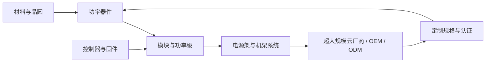
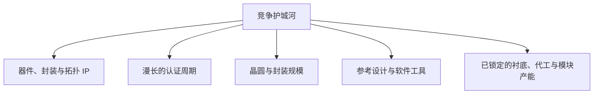

# 竞争格局
> **最后更新：** 2026-11-12
> **状态：** 草稿
> **标签：** 竞争, 波特五力, 利润率, 市场定位, 并购

## 概述
竞争发生在多个层级，各层级的护城河各不相同。衬底和器件企业依赖工艺良率和资本规模；控制器 IC 企业依赖算法、认证、软件和客户设计席位（socket）；模块/系统企业依赖集成能力和服务。

AI 数据中心扩大了市场机会，但也增强了客户的议价能力。超大规模云厂商可以指定开放式电源架或定制控制器，同时继续采用商用器件供应商和制造供应商。

## 关键发现 / 要点
- [已确认] 在大型垂直整合制造商（IDM）中，英飞凌（Infineon）拥有最广泛的“宽禁带（WBG）+ 控制器”产品组合。
- [已确认] 德州仪器（TI）、瑞萨电子（Renesas）、芯源系统（MPS）和英飞凌在服务器电源控制/功率级领域竞争激烈。
- [已确认] Vicor 在架构层面与传统多相/中间总线设计展开竞争。
- [估计] 直至 2020 年代中期，碳化硅（SiC）供过于求削弱了衬底/器件的定价能力。
- [已确认] 近期的并购将氮化镓（GaN）和 SiC 专业厂商整合进更大的产品组合。
- [已确认，2026] 公开财务披露使 AI 电源业务的比较更加清晰：英飞凌公布 FY2026 AI 电源营收 ~€1.7B、数据中心电源总营收 ~€2.2B（FY2027 数据中心电源业绩指引接近 €4B）；安森美（onsemi）预计 2026 年 AI 数据中心营收 ~$620M；芯源系统企业数据（Enterprise Data）业务仅 Q3 2026 单季营收即达 $506.7M；德州仪器表示数据中心占 Q3 2026 营收的 ~13%。各公司口径不同，均非纯粹的 AI 电源指标。
- [已确认，2026] 处理器级电源领域正在整合：亚德诺（ADI）/Empower、纳微半导体（Navitas）/Claros、英飞凌/C2i 以及安森美/Ferric（待完成）在六个月内将集成电压调节器（IVR）和控制器 IP 纳入更大的产品组合；与此同时，维谛技术（Vertiv）通过收购 UtilityInnovation Group、伊顿（Eaton）通过收购 Boyd Thermal 和 COL Group，在设施电源和热管理领域获取了规模。
- [已确认，2026] 知识产权维权已从 GaN/SiC 器件扩展至架构层面：Vicor 向美国国际贸易委员会（ITC）提起的案件（337-TA-1526）将台达电子（Delta）、英飞凌、芯源系统、伟创力（Flex）、天弘（Celestica）、广达（Quanta）和立讯精密（Luxshare）旗下实体列为被诉方，且特许权使用费占 Vicor Q3 2026 营收的 ~34%。器件层面的纠纷也明显增多（英飞凌/英诺赛科（Innoscience）在美国、德国和中国的诉讼；Wolfspeed（原 Cree）诉纳微半导体；瑞萨电子/纳微半导体）。

## 图解

## 详细内容
### 市场结构

| 层级 | 公司 | 营收规模 | 竞争基础 | 电源业务占比 |
|---|---|---|---|---|
| 第 1 梯队 IDM | 英飞凌、德州仪器、意法半导体（ST）、安森美、罗姆（ROHM） | 数十亿美元级 | 规模/产品组合/晶圆厂 | 高，因公司而异 |
| 第 2 梯队/专业厂商 | Wolfspeed、威世（Vishay）、微芯科技（Microchip）、万国半导体（AOS） | $0.5B 至数十亿美元 | 细分市场/工艺 | 中-高 |
| 无晶圆厂/轻晶圆厂 | 纳微半导体、宜普电源转换（EPC）、芯源系统 | 不足十亿美元至数十亿美元 | IP/集成 | 高 |
| 模块/系统 | Vicor、台达电子、维谛技术、村田制作所（Murata） | 不一 | 集成/服务 | 视产品而定 |

### 波特五力

| 竞争力量 | 强度 | 影响因素 | 五年趋势 |
|---|---|---|---|
| 同业竞争 | 高 | 技术路线和产能众多 | 上升 |
| 买方议价能力 | 高 | 超大规模云厂商集中度/认证要求 | 上升 |
| 供应商议价能力 | 中-高 | SiC 衬底、特种封装 | SiC 方面趋缓 |
| 新进入者威胁 | 中 | 可获得代工资源，但存在认证/IP 壁垒 | 分化 |
| 替代品威胁 | 高 | Si/GaN/SiC/拓扑之间的权衡取舍 | 上升 |

### 价值链经济性

| 层级 | 示例 | 毛利率区间 | 研发强度 | 护城河 |
|---|---|---:|---:|---|
| SiC 衬底 | Wolfspeed/Coherent（原 II-VI） | [估计] 20-50%，视周期而定 | 高 | 晶体良率 |
| 器件 IDM | 英飞凌/意法半导体/安森美 | [估计] 35-50%，公司整体口径 | 高 | 工艺/规模 |
| 控制器 IC | 德州仪器/瑞萨电子/芯源系统 | [估计] 45-65%，公司整体口径 | 高 | 设计席位 |
| 模块 | Vicor/村田制作所 | [估计] 35-55% | 高 | 封装/拓扑 |
| 系统 | 台达电子/维谛技术 | [估计] 25-40% | 中 | 集成/服务 |

### 市场定位

| 公司 | 数据中心敞口 | WBG | VRM/PMIC | 模块 | 系统 | 定位 |
|---|---|---|---|---|---|---|
| 英飞凌 | 中-高（估计） | GaN+SiC | 高 | 高 | 低 | 全面领先者 |
| 德州仪器 | 中-高（估计） | GaN | 高 | 中 | 低 | 控制/模拟领域领先者 |
| 瑞萨电子 | 中-高（估计） | GaN | 高 | 中 | 低 | 服务器 VR 专业厂商 |
| 芯源系统 | 高（估计） | 器件级 WBG 有限 | 高 | 高 | 低 | 一体化挑战者 |
| Wolfspeed | 目前数据中心敞口低（估计） | SiC | 低 | 中 | 低 | 上游期权 |
| 纳微半导体 | 目前低/目标高 | GaN+SiC | 中 | 低 | 低 | 挑战者 |
| Vicor | 高 | 器件无关型模块 | 低 | 极高 | 低 | 架构专业厂商；授权许可/ITC 维权 |
| 安森美 | 中（估计；2026E AI 数据中心 ~$620M） | SiC+GaN | 中；通过 Ferric 布局 IVR（待完成） | 中 | 低 | 进军 VR 领域的高压 IDM |
| 台达电子/维谛技术 | 高 | 外购 | 低 | 高 | 极高 | 系统集成商 |

> ⚠️ 注意：英飞凌、安森美和芯源系统采用不同的报告口径。AI 电源、AI 数据中心、存储/计算和企业数据四类口径不可相互替代；在缺乏产品级口径桥接的情况下，不应据此计算市场份额。

### 并购历史

| 年份 | 收购方 | 标的 | 交易价值 | 收购逻辑 | 对数据中心的影响 |
|---:|---|---|---:|---|---|
| 2024 | 瑞萨电子 | Transphorm | 股权价值 ~$339M | GaN | 增加高压 GaN |
| 2023 | 英飞凌 | GaN Systems | $830M | GaN 规模 | 整合 GaN |
| 2022 | 纳微半导体 | GeneSiC | ~$100M + 业绩对赌付款 [待核实] | 增加 SiC | 扩大 WBG 覆盖面 |
| 2021 | Qorvo | UnitedSiC | 未披露 | 增加 SiC | 易主 |
| 2021 | 亚德诺 | 美信（Maxim） | 宣布价 ~$20.8B | 模拟/PMIC 规模 | 控制器整合 |
| 2021 | 瑞萨电子 | Dialog | 股权价值 EUR4.9B | PMIC/连接 | 电源业务更全面 |
| 2018 | 微芯科技 | 美高森美（Microsemi） | 企业价值 ~$8.35B | 高可靠性半导体 | 增加电源/SiC |
| 2017 | 亚德诺 | 凌力尔特（Linear Technology） | ~$14.8B | 电源/模拟 | 重大 PMIC 整合 |
| 2017 | 瑞萨电子 | Intersil | ~$3.2B | 电源管理 | 增强服务器 VR 实力 |
| 2016 | 安森美 | 仙童半导体（Fairchild） | ~$2.4B | 功率分立器件 | 规模 |
| 2026 | 安森美 | Ferric（2026-11-02 宣布） | $600M + 最高 $175M 或有付款 | IVR/磁性元件 | 处理器级电源 |
| 2026 | 纳微半导体 | Claros（2026-10-06 完成交割） | 最高 ~$232.8M | IVR/垂直供电 | 从电网到 XPU 的产品组合 |
| 2026 | 英飞凌 | C2i Semiconductors（~2026-10 完成交割） | 未披露 | 多相控制器/功率级 | AI VR 控制 |
| 2026 | 维谛技术 | UtilityInnovation Group（2026-10-27 完成交割） | ~$1.45B + 最高 $1.15B 业绩对赌付款 | 现场电源/微电网 | 缩短供电就绪时间 |
| 2026 | 伊顿 | COL Group（2026-09-24 宣布） | 企业价值 €810M | 中压开关柜 | 设施电源 |
| 2026 | 亚德诺 | Empower Semiconductor（2026-07-07 完成交割） | ~$1.5B | IVR/硅电容 | 处理器级电源 |
| 2026 | 伊顿 | Boyd Thermal（2026-03-12 完成交割） | $9.5B | 液冷 | 热/电协同设计 |

相关：[主索引](README.md)。

## 数据表（如适用）
| 字段 | 数值 | 来源 | 日期 |
|---|---|---|---|
| 英飞凌/GaN Systems | $830M | 英飞凌 | 2023 |
| 瑞萨电子/Transphorm | 股权价值 ~$339M | 瑞萨电子 | 2024 |
| 亚德诺/美信 | 宣布价 ~$20.8B | 亚德诺 | 2020/2021 完成交割 |
| 瑞萨电子/Dialog | 股权价值 EUR4.9B | 瑞萨电子 | 2021 |
| 安森美/仙童半导体 | ~$2.4B | 安森美 | 2016 |
| 亚德诺/Empower | ~$1.5B | 亚德诺 | 2026 |
| 安森美/Ferric | 最高 $775M | 安森美 | 2026（待完成） |
| Vicor 特许权使用费占比 | Q3 2026 营收的 ~34% | Vicor | 2026-10-20 |

## 待解决问题 / 数据缺口
- 以分部层面的经济性数据替代公司整体层面的利润率区间。
- 利用已披露的终端市场和产品数据，量化数据中心营收敞口。
- 按层级补充设计导入流失情况和认证周期时长。
- 对超大规模云厂商定制控制 IC 替代商用芯片的情形进行建模。
- 评估 337-TA-1526 案对垂直供电（VPD）模块采购的竞争影响。

## 参考文献
- Company transaction announcements | 各公司投资者关系网站 | 访问日期 2026-06-10
- Infineon/GaN Systems | https://www.infineon.com/cms/en/about-infineon/press/press-releases/2023/INFXX202303-074.html | 访问日期 2026-06-10
- Renesas/Transphorm | https://www.renesas.com/en/about/press-room/renesas-completes-acquisition-transphorm | 访问日期 2026-06-10
- Infineon FY2026 AGM CEO speech | https://www.infineon.com/assets/row/public/documents/corporate/investors/annual-general-meeting/2026/agm2026-key-points-speech-jochen-hanebeck-chief-executive-officer-v01-00-en.pdf | 访问日期 2026-07-28
- onsemi 2025 annual report | https://investor.onsemi.com/static-files/8d674d4f-cc6b-44e5-8e31-e898ab0b4371 | 访问日期 2026-07-28
- MPS 2025 Form 10-K | https://media.monolithicpower.com/mps_cms_document/2/0/2025_form_10-k_final.pdf | 访问日期 2026-07-28
- Infineon US ITC final determination | https://www.infineon.com/press-release/2026/ifxpr202607-118 | 访问日期 2026-07-28
- Wolfspeed v. Navitas announcement | https://www.wolfspeed.com/company/news-events/news/wolfspeed-files-patent-infringement-lawsuit-against-navitas-semiconductor/ | 访问日期 2026-07-28
- Infineon FY2026 call highlights | https://www.gurufocus.com/news/9193285/infineon-technologies-ag-ifnnf-q4-2026-earnings-call-highlights-record-revenue-ai-power-surge-and-a-20-billion-fy2027-outlook | 检索日期 2026-11-12
- USITC 337-TA-1526 | https://www.usitc.gov/press_room/news_release/2026/er1009_69342.htm | 检索日期 2026-11-12
- Vicor Q3 2026 results | https://www.sec.gov/Archives/edgar/data/0000751978/000119312526425697/d153882dex991.htm | 检索日期 2026-11-12
- Vertiv completes UIG acquisition | https://www.vertiv.com/en-us/about/news-and-events/corporate-news/2026/vertiv-completes-acquisition-of-utilityinnovation-group/ | 检索日期 2026-11-12
- Eaton/Boyd Thermal completion | https://www.businesswire.com/news/home/20260312582488/en | 检索日期 2026-11-12
- ADI completes Empower acquisition | https://www.analog.com/en/newsroom/press-releases/2026/7-7-26-adi-completes-acquisition-of-empower-semiconductor.html | 检索日期 2026-11-12
