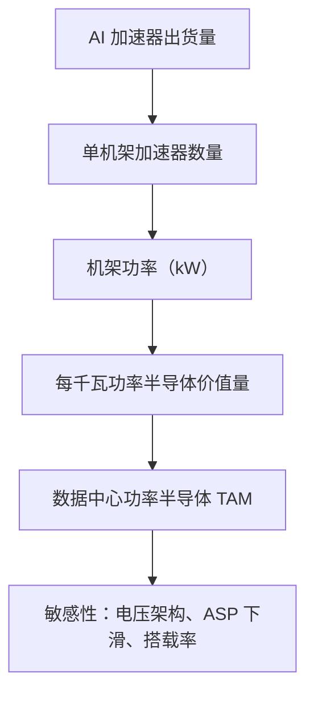
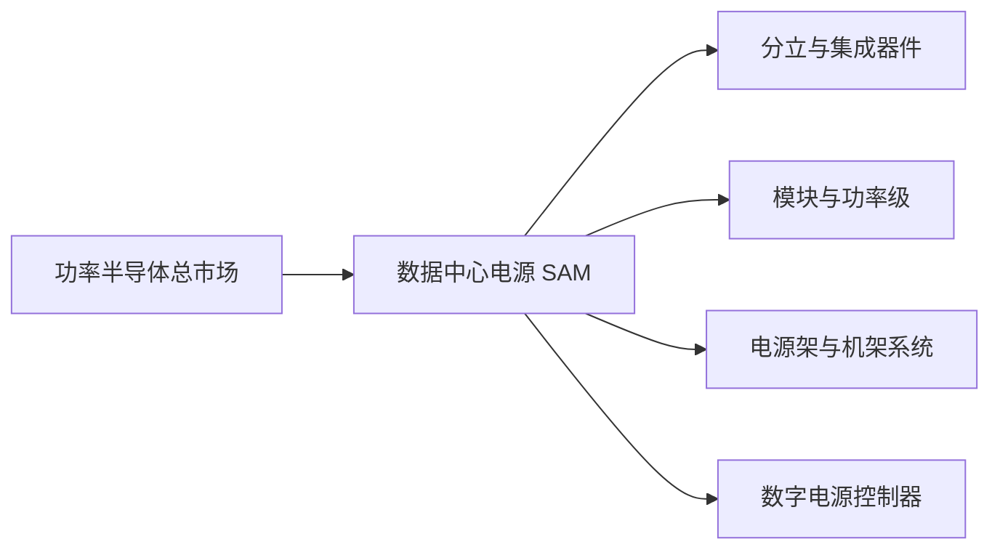

# 市场规模测算
> **最后更新：** 2026-11-12
> **状态：** 草稿
> **标签：** TAM, 预测, 情景, 每千瓦价值量

## 概述
市场规模基于机架出货量、单机架功率、每千瓦半导体价值量以及宽禁带（WBG）/控制器渗透率进行建模。已发表的研究往往将电源、模块、电源 IC 和设施设备混为一谈，因此自上而下得出的数据不可直接比较。

下文基线为分析师框架，并非外购的市场研究数据集。各数值均为 [估计]，用于投资决策前应以可审计的自下而上输入数据替代。

## 关键发现 / 要点
- [已被取代，2026-11-12] 2026 年 6 月基线中 2026 年数据中心功率半导体总规模约 $4B 的估算仅作为历史记录保留。厂商披露数据现已超过该数值，仅以下三家合计即约 $4.9B：英飞凌（Infineon）FY2026 数据中心电源 ~€2.2B；芯源系统（MPS）企业数据（Enterprise Data）业务以 $701.8M 为基数、增长下限 ≥150%，即 2026 年 ≥$1.75B；安森美（onsemi）2026 年 AI 数据中心 ~$620M。
- [估计，低-中置信度，2026-11] 修订后的基准情景：2026 年 ~$9B（区间 $8-10.5B），2027 年 ~$13B，2030 年 ~$20B（区间 $14-28B），2026-2030 年复合年增长率（CAGR）~22%。详见下文“修订预测”。
- [估计，中置信度] 电压调节模块（VRM）/电源管理芯片（PMIC）/控制是最大的半导体价值池；机架系统单独追踪。
- [估计，高置信度] 随着加速器 TDP 和转换级数增加，单机架半导体价值量的增速快于机架数量的增速。
- [估计，中置信度] WBG 的平均售价（ASP）溢价下降而渗透率上升，使其对营收的影响呈非线性。
- [待核实] 130 kW 机架的半导体价值量为 $12k-$15k，该数据需一手来源确认。
- [已确认，2026] 英飞凌的 AI 电源解决方案类别营收在 FY2025 超过 €700M，目标为 FY2026 ~€1.5B、FY2027 ~€2.5B；该类别口径宽于本数据库仅涵盖器件的边界，可作为有用的上限交叉校验，而非市场份额数据。
- [已确认，2025] 安森美披露 AI 数据中心营收 >$250M；芯源系统披露存储/计算营收 $732.5M、企业数据营收 $701.8M，二者均非纯粹的数据中心功率半导体指标。
- [已确认，2026-08] Yole 预测：到 2031 年功率 GaN 器件市场达 $3.5B（CAGR 35%），其中包括 AI 数据中心在内的电信/基础设施领域为 $750M（CAGR 45%）；到 2031 年功率 SiC 市场达 ~$11B（CAGR ~20%）；到 2030 年数据中心电源市场（系统而非芯片）>$14B。
- [已确认，2026-07] Dell'Oro 将其数据中心物理基础设施预测上调至 2030 年 $120B（2025-2030 年 CAGR 22%）；该口径不属于半导体范畴，但可勾勒系统级需求。
- [估计，2026-06] TrendForce 预计 800 V 电源机架在 Vera Rubin 上为可选配置，将在 Rubin Ultra（2H 2027）之后开始采用，并可能于 2028 年大规模部署。

## 图解

## 详细内容
### 修订预测（2026 年 11 月）

| 情景 | 2026E $B | 2027E $B | 2030E $B | CAGR 26-30 | 假设 |
|---|---:|---:|---:|---:|---|
| 悲观 | 8.0 | 11.0 | 14.0 | ~15% | AI 资本开支暂停；800 VDC 推迟至 2028+；ASP 压缩 |
| 基准 | 9.0 | 13.0 | 20.0 | ~22% | 厂商数据中心电源业绩指引兑现；800 VDC 于 2027-2028 年放量 |
| 乐观 | 10.5 | 15.0 | 28.0 | ~28% | 200 kW-1 MW 机架、IVR/SST 快速采用、每千瓦价值量上升 |

2026 年三角验证（美元口径，~$1.15/€；各类别由厂商自行定义，且部分重叠）：

| 输入项 | 2026 年数值 | 依据 |
|---|---:|---|
| 英飞凌数据中心电源 | ~$2.5B（~€2.2B，截至 2026-09 的财年） | 公司披露 |
| 芯源系统企业数据 | ≥$1.75B | 以 FY2025 $701.8M 为基数、≥150% 的增长下限 |
| 安森美 AI 数据中心 | ~$0.62B | 公司预期 |
| 小计（三家披露厂商） | ~$4.9B | 加总 |
| 德州仪器（TI）、瑞萨电子（Renesas）、亚德诺（ADI）、Vicor、万国半导体（AOS）、威世（Vishay）、意法半导体（ST）、东芝（Toshiba）、纳微半导体（Navitas）、宜普电源转换（EPC）、英诺赛科（Innoscience）、中国厂商及其他 | ~$3-6B [估计，低置信度] | 未单独披露；德州仪器数据中心业务（占营收 ~13%）涵盖非电源产品 |
| 合计（基准） | ~$9B | 分析师估计 |

> ⚠️ 注意：修订后的合计值沿用原有的“器件 + 控制器”边界（分立器件、WBG 器件、控制器、智能功率级、栅极驱动器、IVR 以及模块内的半导体价值）。厂商口径可能包含模块或非 AI 数据中心内容；在建立自下而上的出货量模型之前，应将此次修订视为方向性参考。

### 分部预测（2026 年 6 月基线，[已被取代] 2026-11-12）

| 细分市场 | 2024A $B | 2025E | 2026E | 2028E | 2030E | CAGR 24-30 | 置信度 |
|---|---:|---:|---:|---:|---:|---:|---|
| 数据中心功率半导体合计 | 3.0 | 3.5 | 4.0 | 5.5 | 7.2 | ~16% | 中 |
| 数据中心用 GaN 器件/IC | 0.15 | 0.23 | 0.34 | 0.75 | 1.25 | ~42% | 低-中 |
| 数据中心用 SiC 器件 | 0.12 | 0.18 | 0.26 | 0.60 | 1.00 | ~42% | 低 |
| 硅功率分立器件 | 0.85 | 0.93 | 1.02 | 1.25 | 1.45 | ~9% | 中 |
| VRM/PMIC/控制器 | 1.35 | 1.55 | 1.75 | 2.30 | 2.85 | ~13% | 中 |
| 栅极驱动器/传感 | 0.28 | 0.32 | 0.37 | 0.50 | 0.65 | ~15% | 低-中 |
| 功率模块（半导体价值） | 0.25 | 0.29 | 0.34 | 0.50 | 0.70 | ~19% | 低 |

> ⚠️ 注意：若控制器/驱动器价值量嵌入 GaN IC 或模块中，各行之间会存在重叠。未经重叠调整，请勿将各子分部相加。GaN 一行 2030E 的 $1.25B 高于 Yole 对 2031 年全部电信/基础设施 GaN 所预测的 $750M；除非 800 V 至 12/6 V 的 GaN 节点级转换的采用速度快于 Yole 的假设，否则应将该值视为上限。

### 单机架价值量

| 机架类型 | kW | 半导体价值量 | $/kW | 状态/来源 |
|---|---:|---:|---:|---|
| 传统服务器 | 12 | $500-1,200 | $42-100 | [估计，低置信度] |
| AI 机架 | 30 | $2,000-4,000 | $67-133 | [估计，低置信度] |
| 高密度 AI | 80 | $6,000-10,000 | $75-125 | [估计，低置信度] |
| 未来机架 | 130 | $12,000-15,000 | $92-115 | [待核实：英飞凌宣称值] |

### 情景分析（2026 年 6 月基线，[已被取代] 2026-11-12）

| 情景 | 2025 $B | 2027 $B | 2030 $B | 假设 |
|---|---:|---:|---:|---|
| 悲观 | 3.3 | 4.0 | 5.2 | AI 建设放缓、ASP 压缩 |
| 基准 | 3.5 | 4.7 | 7.2 | AI 需求强劲，WBG 渐进渗透 |
| 乐观 | 3.7 | 5.5 | 9.5 | 200 kW 机架以及 WBG/HVDC 快速普及 |

### 驱动因素方程

半导体营收 = AI 机架出货量 x 平均机架功率（kW）x 每千瓦半导体金额（$/kW），并针对非 AI 服务器、替换需求、ASP 下滑、定制芯片和渠道库存进行调整。参见 [25_investment_and_ma_tracker.md](25_investment_and_ma_tracker.md)。

### 公开披露交叉校验

| 公司 | 期间 | 披露数据 | 口径说明 |
|---|---|---:|---|
| 英飞凌 | FY2025 实际 | AI 电源解决方案 >€700M | 厂商自定义的“电网到核心”（grid-to-core）类别 |
| 英飞凌 | FY2026/FY2027 目标 | ~€1.5B / ~€2.5B | 公司前瞻性目标 |
| 安森美 | FY2025 实际 | AI 数据中心营收 >$250M | 公司口径；产品组合未完全披露 |
| 芯源系统 | FY2025 实际 | 存储/计算 $732.5M + 企业数据 $701.8M | 包含存储器、存储、笔记本电脑、图形及其他非 AI 内容 |
| 英飞凌 | FY2026 实际 | AI 电源 ~€1.7B；数据中心电源合计 ~€2.2B | 厂商自定义；包含 ~€0.5B 传统数据中心业务 |
| 英飞凌 | FY2027 业绩指引 | 数据中心电源接近 €4B | 公司前瞻性业绩指引 |
| 安森美 | 2026 年预期 | AI 数据中心 ~$620M；2030 年目标 >$3B | 公司预期/目标 |
| 芯源系统 | Q3 2026 实际 | 企业数据 $506.7M | 单季数据；非纯 AI |
| 德州仪器 | Q3 2026 实际 | 数据中心占 $6.06B 营收的 ~13% | 涵盖德州仪器全部产品线 |

### 第三方预测

| 发布机构 | 范围 | 预测值 | 预测期 | 日期 |
|---|---|---|---|---|
| Yole | 功率 GaN 器件（全部市场） | $3.5B；CAGR 35% | 2031 | 2026-08 |
| Yole | 电信/基础设施 GaN（含 AI 数据中心） | $750M；CAGR 45% | 2031 | 2026-08 |
| Yole | 功率 SiC 器件（全部市场） | ~$11B；CAGR ~20% | 2031 | 2026-06 |
| Yole | 数据中心电源（系统） | >$14B；自 2024 年起 CAGR 15.5% | 2030 | 2025-07 |
| Dell'Oro | 数据中心物理基础设施 | $120B；2025-2030 年 CAGR 22% | 2030 | 2026-07 |
| SemiAnalysis（二手转述） | 电源机架/侧柜 | 峰值 ~$11B [估计，低置信度] | 2028 | 2026 |
| ABB | 新增数据中心容量中采用直流配电的比例 | 25-40% [厂商估计] | 2030 | 2026-09 |

> ⚠️ 注意：未经口径调整，这些披露数据既不能相加，也不能与已被取代的 $4.0B 模型直接比较。它们说明了为何 TAM 边界必须明确是否包含控制器、模块、传感、保护以及非半导体类电源内容。

## 数据表（如适用）
| 字段 | 数值 | 来源 | 日期 |
|---|---|---|---|
| 基准 TAM（2026 年 6 月基线） | [已被取代] $4.0B | 分析师模型 | 2026E |
| 基准 2030 TAM（2026 年 6 月基线） | [已被取代] $7.2B | 分析师模型 | 2030E |
| 修订后基准 TAM | [估计，低-中置信度] ~$9B | 厂商披露数据三角验证 | 2026E |
| 修订后基准 2027 | [估计，低置信度] ~$13B | 情景模型 | 2027E |
| 修订后基准 2030 | [估计，低置信度] ~$20B | 情景模型 | 2030E |
| 修订后基准 CAGR | ~22% | 计算 | 2026-2030 |
| 修订后乐观 / 悲观 2030 | [估计，低置信度] ~$28B / ~$14B | 情景模型 | 2030E |

## 待解决问题 / 数据缺口
- 建立按超大规模云厂商、加速器代际、机架类型和地区划分的出货量模型。
- 获取授权或取得可比的 Omdia、Yole、TechInsights 及公司数据集。
- 消除集成 GaN IC、驱动器、控制器和模块之间的重叠。
- 通过拆解分析和供应商营收桥接验证每千瓦价值量。
- 在修订后的合计值基础上重建分部拆分；补充每 MW 的固态变压器（SST）、固态断路器（SSCB）和 IVR 价值量。
- 补充 Omdia、IDC、Gartner 和 Sightline 的预测（2026-11 更新未涵盖）。

## 参考文献
- Yole Group power electronics | https://www.yolegroup.com/ | 访问日期 2026-06-10
- Omdia datacenter research | https://omdia.tech.informa.com/ | 访问日期 2026-06-10
- TechInsights power semiconductor analysis | https://www.techinsights.com/ | 访问日期 2026-06-10
- Company investor-day disclosures | 各公司 IR 网站 | 访问日期 2026-06-10
- Infineon FY2026 AGM CEO speech | https://www.infineon.com/assets/row/public/documents/corporate/investors/annual-general-meeting/2026/agm2026-key-points-speech-jochen-hanebeck-chief-executive-officer-v01-00-en.pdf | 访问日期 2026-07-28
- onsemi 2025 annual report | https://investor.onsemi.com/static-files/8d674d4f-cc6b-44e5-8e31-e898ab0b4371 | 访问日期 2026-07-28
- MPS 2025 Form 10-K | https://media.monolithicpower.com/mps_cms_document/2/0/2025_form_10-k_final.pdf | 访问日期 2026-07-28
- Infineon FY2026 call highlights | https://www.gurufocus.com/news/9193285/infineon-technologies-ag-ifnnf-q4-2026-earnings-call-highlights-record-revenue-ai-power-surge-and-a-20-billion-fy2027-outlook | 检索日期 2026-11-12
- Infineon datacenter power outlook | https://convergedigest.com/infineon-data-center-power-revenue-4-billion-fy2027/ | 检索日期 2026-11-12
- onsemi Q3 2026 results | https://www.globenewswire.com/news-release/2026/11/02/3393744/0/en/onsemi-reports-third-quarter-2026-results.html | 检索日期 2026-11-12
- MPS Q3 2026 results | https://www.sec.gov/Archives/edgar/data/0001280452/000162828026068202/mpwr-20260930xexx991.htm | 检索日期 2026-11-12
- TI Q3 2026 results | https://investor.ti.com/news-releases/news-release-details/ti-reports-third-quarter-2026-financial-results-and-shareholder | 检索日期 2026-11-12
- Yole Power GaN 2026 | https://semiconductor-today.com/news_items/2026/aug/yole-200826.shtml | 检索日期 2026-11-12
- Yole Power SiC 2026 | https://www.yolegroup.com/press-release/power-sic-enters-the-ai-age/ | 检索日期 2026-11-12
- Yole Power Electronics for Data Centers 2025 | https://www.yolegroup.com/product/report/power-electronics-for-datacenters-2025/ | 检索日期 2026-11-12
- Dell'Oro DCPI forecast | https://www.delloro.com/news/data-center-physical-infrastructure-market-forecast-to-reach-120-billion-by-2030/ | 检索日期 2026-11-12
- TrendForce 800 V power rack outlook | https://www.trendforce.com/presscenter/news/20260625-13121.html | 检索日期 2026-11-12
