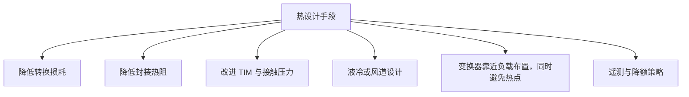

# 热管理
> **最后更新：** 2026-11-12
> **状态：** 草稿
> **标签：** 热管理, 冷却, TIM, 液冷, 仿真

## 概述
半导体损耗通过串联热阻网络转化为结温。更高的开关密度可以缩小电气元件的尺寸，但同时也使热流密度和界面质量更加难以管控。

AI 机架越来越多地对处理器采用直接液冷；电源架、电压调节模块（VRM）、连接器和母排同样需要协同设计。仅凭材料热导率并不能决定器件温度，因为芯片厚度、封装、热界面材料（TIM）、接触压力和冷却液才起主导作用。

## 关键发现 / 要点
- [已确认] Tj = Ta + Ploss x 总热阻，是基本的稳态模型。
- [已确认] 碳化硅（SiC）的体材料热导率约为硅的 2-3 倍，具体取决于材料等级/温度。
- [已确认] 许多商用硅（Si）/氮化镓（GaN）器件的额定结温在 150 C 左右；SiC 通常为 175 C 或更高。
- [估计] 若无大风量/大型散热器，约 30 W+ 的集中式封装耗散难以依靠风冷解决。
- [已确认] 双面冷却和直接基板冷却可缓解封装的热瓶颈。
- [已确认，2026-10] 液冷正在延伸至电源路径：2026 年开放计算项目（OCP）全球峰会设有麦格米特（Megmeet）/英伟达（NVIDIA）液冷电源架专场；台达电子（Delta）展示了一款 800 VDC 液-液冷却液分配单元（CDU）（OCP 新闻稿中为 2.5 MW，展前新闻稿中为 3.6 MW，二者差异尚未厘清）；超微电脑（Supermicro）已开始出货配备 1.8 MW 列间 CDU 的 Vera Rubin NVL72 机架。
- [传闻，2026-10] 行业媒体报道称，NVIDIA MGX 1.2 中包含液冷 5,000 A 机架母排以及无风扇液冷计算托盘；需对照规范原文确认。

## 图解

## 详细内容
### 热传导链

| 层级 | 典型 Rth | 材料 | 创新方向 |
|---|---:|---|---|
| 结到壳 | 0.05-5 C/W | 芯片贴装、铜夹片、塑封料 | 双面冷却 |
| 壳到散热器 | 0.05-1 C/W | TIM、压接界面 | 相变材料/石墨 |
| 散热器到流体 | 0.01-1+ C/W | 铝/铜冷板/鳍片 | 微通道 |
| PCB 热扩散 | 视设计而定 | 铜平面/过孔 | 嵌入式铜/基板 |

### 结温限值

| 技术 | 常见额定 Tj max | 注意事项 |
|---|---:|---|
| 硅 MOSFET/IC | 125-175 C | 因产品而异 |
| SiC MOSFET | 175-200 C 级 | 可能受封装限制 |
| GaN 功率器件 | 常见 150-175 C | 器件层温度可能与壳温模型不同 |

### 机架冷却

| 方式 | 适用功率密度 | 对功率器件的影响 |
|---|---|---|
| 强制风冷 | 低-中 | 大型散热器、风道压力 |
| 背门换热器 | 中-高 | 保留风冷电子设备 |
| 直接液冷冷板 | 高 | 防漏/材料/维护设计 |
| 浸没式冷却 | 高 | 流体兼容性与认证 |
| 嵌入式微流道 | 未来/极端场景 | 制造/可靠性挑战 |
| 液冷电源架/母排 | 2026 年新兴（OCP/MGX 生态） | 邻近冷却液的高压绝缘、凝露及可维护性 |

### 热界面材料

| 类型 | 热导率 | 应用 | 厂商/示例 |
|---|---:|---|---|
| 导热膏/凝胶 | ~1-10 W/mK | 可维护界面 | 汉高（Henkel）、陶氏（Dow）、信越化学（Shin-Etsu） |
| 相变材料 | ~1-8 W/mK | 可控粘结层厚度 | 霍尼韦尔（Honeywell）、汉高 |
| 石墨垫片 | 各向异性，面内热导率高 | 均热 | 松下（Panasonic）、NeoGraf |
| 导热间隙垫 | ~1-15 W/mK | 公差填充 | Bergquist/汉高、Laird |
| 铟/液态金属 | 高 | 高端界面 | Indium Corp.；存在兼容性限制 |

### 工具

ANSYS Icepak、西门子（Siemens）FloTHERM 和 Future Facilities 6SigmaET 可用于电子设备/机架热仿真。当 RDS(on)、开关损耗和控制模式随温度变化时，需要进行电-热联合仿真。

相关：[主索引](README.md)。

## 数据表（如适用）
| 字段 | 数值 | 来源 | 日期 |
|---|---|---|---|
| 硅 k | ~150 W/mK | 材料参考资料 | 2025 |
| 4H-SiC k | ~370-490 W/mK | 材料参考资料 | 2025 |
| 常见 SiC Tj max | 175-200 C 级 | 数据手册 | 2025 |
| 常见 GaN Tj max | 150-175 C | 数据手册 | 2025 |
| AI 机架冷却趋势 | 直接液冷持续扩大 | OEM 平台 | 2025-2026 |
| 超微电脑 Vera Rubin CDU | 1.8 MW 列间，N+1 | 超微电脑 | 2026-09-23 |
| 台达电子 800 VDC L2L CDU | 最高 2.5 MW（OCP 新闻稿） | 台达电子 | 2026-10-15 |

## 待解决问题 / 数据缺口
- 补充代表性器件/模块的瞬态热阻抗曲线。
- 收集机架电源架液冷产品及现场部署案例（2026 年 OCP 相关专场提供了首批产品级候选方案）。
- 测试浸没冷却液与灌封材料、TIM、连接器和电容器的兼容性。
- 建立每 kW 热管理成本对比。

## 参考文献
- ANSYS Icepak | https://www.ansys.com/products/electronics/ansys-icepak | 访问日期 2026-06-10
- Siemens FloTHERM | https://plm.sw.siemens.com/en-US/simcenter/fluids-thermal-simulation/flotherm/ | 访问日期 2026-06-10
- 6SigmaET | https://www.6sigmaet.info/ | 访问日期 2026-06-10
- OCP Global Summit 2026 recorded content | https://www.opencompute.org/events/ocp-summit/2026-ocp-global-summit/recorded-content/ | 检索日期 2026-11-12
- Delta OCP 2026 announcements | https://www.prnewswire.com/news-releases/delta-highlights-collaboration-with-nvidia-in-advancing-energy-efficient-800-vdc-power-and-cooling-solutions-for-ai-data-centers-at-ocp-global-summit-2026-302909912.html | 检索日期 2026-11-12
- Supermicro Vera Rubin NVL72 shipping | https://ir.supermicro.com/news/news-details/2026/Supermicro-Now-Shipping-NVIDIA-Vera-Rubin-NVL72-Racks/default.aspx | 检索日期 2026-11-12
