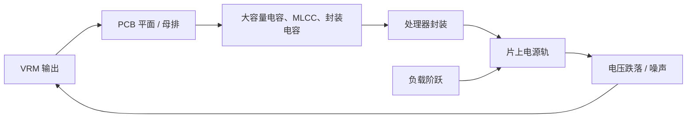
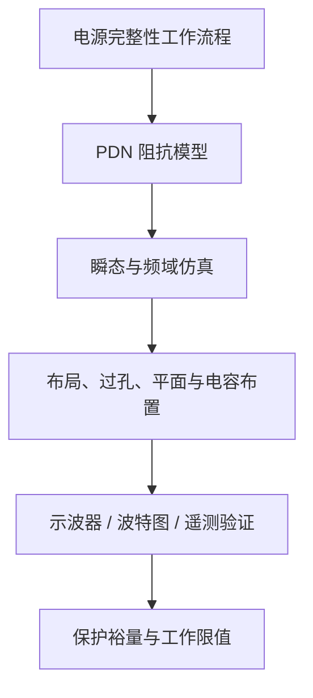

# 电源完整性与信号
> **最后更新：** 2026-11-12
> **状态：** 草稿
> **标签：** 电源完整性, PDN, 瞬态, 电容器, 磁性元件

## 概述
电源完整性（PI）确保处理器电压在稳态和瞬态工况下均保持在容差窗口之内。目标阻抗法将允许的电压跌落和负载阶跃转换为与频率相关的供电网络（PDN）要求。

在千安级电源轨上，毫欧和纳亨量级的参数都至关重要。封装、PCB 平面、过孔、连接器、线缆、电容器、电感器和控制环路必须统一建模。

## 关键发现 / 要点
- [已确认] 目标阻抗 Ztarget = 允许电压偏差 / 负载电流阶跃。
- [已确认] 在 1 A/ns 的电流变化率下，1 nH 电感会产生 1 V 电压。
- [已确认] MLCC 电容量随直流偏压升高而下降，高容值 II 类介质尤为明显。
- [已确认] 交错/耦合电感可改善纹波和瞬态性能。
- [估计] 仅凭公开的 GPU TDP 无法确定实际电源轨的 di/dt 或电压跌落预算。
- [已确认，2026-10] 新型节点架构由 800 VDC 直接为 12 V 或 6 V 中间电源轨供电（纳微半导体（Navitas）/英伟达（NVIDIA）、英飞凌（Infineon）/英伟达、德州仪器（TI）、微芯科技（Microchip）/纳微半导体），使 PDN 设计转向更低电压、更大电流的板级配电，且必须与 PI 预算协同设计。
- [已确认，2026] 集成式与垂直电压调节成为并购焦点：亚德诺（ADI）/Empower（2026-07-07 完成交割）、纳微半导体/Claros（2026-10-06 完成交割）、英飞凌/C2i（约 2026-10 完成交割）以及安森美（onsemi）/Ferric（2026-11-02 宣布）。Vicor 向美国国际贸易委员会（ITC）提起的投诉（337-TA-1526）针对的是垂直供电供应链。

## 图解

## 详细内容
### 加速器 PI 概览

| 平台 | 公开功耗 | VCC | 最大电源轨电流 | di/dt | 连接器/路径 |
|---|---:|---:|---:|---:|---|
| H100 SXM | 最高 700 W | [待核实] | [待核实] | [待核实] | SXM/基板 |
| H200 SXM | 700 W 级 | [待核实] | [待核实] | [待核实] | SXM/基板 |
| B200 SXM | 最高 ~1,000 W | [待核实] | [待核实] | [待核实] | SXM/基板 |
| GB200 NVL72 | 机架级 | 多路电源轨 | [待核实] | [待核实] | 48 V 机架生态 |
| Vera Rubin NVL72 | 机架 ~190-230 kW [估计，中置信度]；GPU ~1.8-2.3 kW [估计] | 多路电源轨 | [待核实] | [待核实] | 机架内 54 V；可选 800 VDC 侧柜（电源柜） |

### PDN 组成元素

| 元素 | 主要寄生参数 | 缓解措施 |
|---|---|---|
| VRM | 控制环路输出阻抗 | 带宽/前馈 |
| 大容量电容 | ESR/ESL | 技术组合与布置 |
| MLCC | 直流偏压下的容量衰减/ESL | 降额使用并就近布置 |
| PCB 平面/过孔 | 扩散电感/过孔电感 | 宽平面、过孔阵列 |
| 封装/RDL | 电阻/电感 | 垂直供电、高密度凸点 |
| 连接器/线缆 | 电阻/回路电感 | 48 V 配电、母排 |
| 800 V 转 12/6 V 节点变换器 | 变压器漏感、6-12 V 输出纹波 | 靠近负载的高变比谐振级 |
| 集成式/垂直 VR | 封装/基板寄生参数 | IVR、基板集成稳压器、垂直供电 |

### 测量与仿真

- 使用合适的测试夹具并经校准，采用矢量网络分析仪（VNA）进行阻抗测量。
- 采用低电感探测方式，用示波器测量负载阶跃响应。
- 采用时域反射计（TDR）检测互连不连续点。
- 使用 Cadence Sigrity、Ansys SIwave 和西门子（Siemens）HyperLynx PI 进行参数提取/仿真。

### 电容器

| 供应商 | 优势 | 相关应用 |
|---|---|---|
| 村田制作所（Murata） | MLCC/聚合物电容生态 | 板级去耦 |
| TDK | MLCC/薄膜/电解电容 | 板级与机架级 |
| 三星电机（Samsung Electro-Mechanics） | 大批量 MLCC | 板级 |
| 国巨（Yageo）/KEMET | MLCC/聚合物/薄膜电容 | 覆盖面广 |

### 磁性元件

铁氧体在高频下磁芯损耗较低；铁粉芯/复合材料支持高饱和磁通/大电流；纳米晶材料适用于高频共模及较大尺寸的磁性元件。主要供应商包括威世（Vishay）、Bourns、Coilcraft、TDK、伍尔特（Wuerth）和乾坤科技（Cyntec）。

相关：[主索引](README.md)。

## 数据表（如适用）
| 字段 | 数值 | 来源 | 日期 |
|---|---|---|---|
| 感应电压 | V=L di/dt | 电路定律 | 2026 |
| 1 A/ns 下的 1 nH | 1 V | 计算 | 2026 |
| H100 功耗 | 最高 700 W | 英伟达 | 2023 |
| B200 功耗 | 最高 ~1,000 W | 英伟达 | 2024 |
| MLCC 问题 | 直流偏压降额 | 供应商数据手册 | 2025 |

## 待解决问题 / 数据缺口
- 获取平台设计指南，以明确各电源轨的负载阶跃和电压跌落预算。
- 补充实测阻抗曲线及参考夹具定义。
- 建立面向 48 V 的高 CV 值 MLCC 供应/价格/容量密度追踪表。
- 量化封装级垂直供电路线图，包括 2026 年被收购的 IVR 初创公司。

## 参考文献
- Cadence Sigrity | https://www.cadence.com/en_US/home/tools/system-analysis/sigrity-x-platform.html | 访问日期 2026-06-10
- Ansys SIwave | https://www.ansys.com/products/electronics/ansys-si-wave | 访问日期 2026-06-10
- Siemens HyperLynx | https://eda.sw.siemens.com/en-US/pcb/hyperlynx/ | 访问日期 2026-06-10
- NVIDIA data center GPUs | https://www.nvidia.com/en-us/data-center/ | 访问日期 2026-06-10
- Navitas/NVIDIA 24 kW 800 V-to-12 V board | https://www.powerelectronicsnews.com/navitas-nvidia-develop-24-kw-800v-to-12v-power-board/ | 检索日期 2026-11-12
- Infineon/NVIDIA GaN IBCs | https://www.semiconductor-today.com/news_items/2026/oct/infineon-211026.shtml | 检索日期 2026-11-12
- ADI completes Empower acquisition | https://www.analog.com/en/newsroom/press-releases/2026/7-7-26-adi-completes-acquisition-of-empower-semiconductor.html | 检索日期 2026-11-12
- onsemi to acquire Ferric | https://www.globenewswire.com/news-release/2026/11/02/3393726/0/en/onsemi-to-acquire-ferric-establishing-leadership-in-power-delivery-for-next-generation-ai-processors.html | 检索日期 2026-11-12
