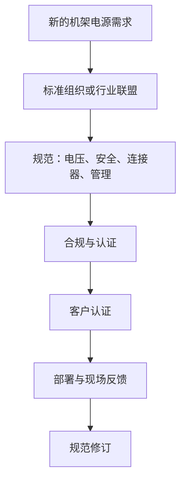
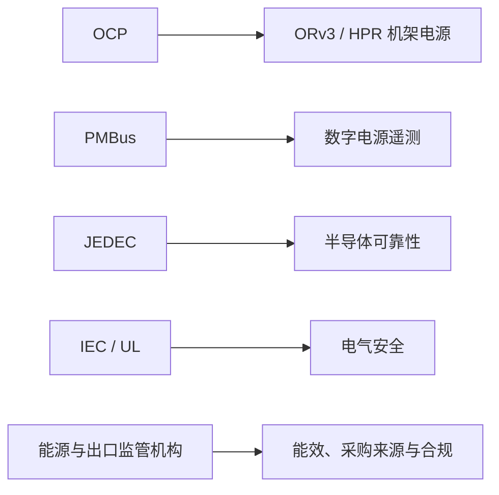

# 标准与监管
> **最后更新：** 2026-11-12
> **状态：** 草稿
> **标签：** 标准, OCP, PMBus, IEC, IEEE, 监管

## 概述
数据中心电源产品必须满足电气安全、电磁兼容（EMC）、电网电能质量、能效、环境以及管理接口等方面的要求。各项标准适用于不同的边界：元器件认证、电源供应器（PSU）、机架、服务器、设施以及公用电网互联。

部分种子数据标签需要谨慎对待。英特尔（Intel）VR 规范可能属于平台保密信息，ATX/PCIe 连接器规则并不普遍适用于机架级加速器，而已过时的 UL 60950 引用已基本过渡到基于危险源的 IEC/UL 62368-1。

## 关键发现 / 要点
- [已确认] ORv3 是开放计算项目（OCP）以 48 V 为核心的机架/电源规范。
- [已确认] PMBus 1.4 定义了数字电源管理命令。
- [已确认] IEEE 519 规定了公共连接点（PCC）的谐波控制要求。
- [已确认] 对于许多信息通信技术（ICT）产品，IEC/UL 62368-1 已取代旧版 60950-1。
- [已确认] JEDEC JEP173 针对 GaN 动态导通电阻测量，并非完整的产品认证标准。
- [已确认，2026] 英伟达（NVIDIA）的 800 VDC 发布内容是架构与合作伙伴路线图，而非 OCP/IEC/UL 机架电源标准。应将 2027 年量产时间与标准成熟度分开看待。
- [已确认，2026-07-28] OCP 数据中心设施电源（Data Center Facility Power）子项目显示，其直流电源白皮书 v1.0 已于 2026 年 3 月发布，v1.1 计划于 2026 年 7 月发布；项目页面尚未确认 v1.1 已发布。OCP 2026 年 10 月峰会回顾引用了一份直流配电白皮书，内容涵盖当前的 800 VDC 计划以及后续向 1,500 VDC 的过渡 [v1.1 状态待核实]。
- [已确认，2026-10-08] OCP 发布了 Mt. Diablo 分离式电源机架规范（Disaggregated Power Rack Specification）v1.0.0（微软（Microsoft）、Meta、谷歌（Google））：±400 VDC（+400 V/−400 V/公共母排），适用于 100 kW-1 MW IT 机架，取代 Diablo 400 v0.7.0（2026-03-01）。原生 800 V 的“Mt. Diablo 2.0”属于 [传闻]。
- [已确认，2026-07/08] OCP 发布了固态变压器（SST）规范 v0.3（谷歌、微软、英伟达），用于 MW 级中压（MV）交流转 800 VDC 转换，并将 800 VDC 界定为“LVDC”。
- [已确认，2026-10] 谷歌、Meta、微软和英伟达发布了 OCP 电网韧性规范（Grid Resilience Specification）（故障穿越；~2 s 恢复目标），同时发布了开放数据中心规范（Open Data Center Specification）v0.7。
- [已确认，2026] 针对功率器件的贸易政策仍然范围有限：232 条款关税（2026-01-15 生效）针对特定先进计算芯片，并对美国数据中心用途给予豁免；除非延期，中国暂停对美镓/锗出口禁令的措施将于 2026-11-27 到期。

## 图解

## 详细内容
### 标准跟踪表

| 标准 | 制定机构 | 说明 | 边界 | 状态/影响 |
|---|---|---|---|---|
| ORv3 | OCP | 48 V 机架、电源架、BBU | 机架 | 现行 |
| ATX 3.x / PCIe CEM | 英特尔/PCI-SIG | PC 电源/连接器 | 服务器/主板 | 对机架级的适用性有限 |
| VR12/13/14 系列 | 英特尔/平台所有者 | 处理器电压调节 | 主板 | 因平台而异 |
| PMBus 1.4 | PMBus/SBS | 数字电源命令 | IC/系统 | 现行 |
| Redfish | DMTF | 管理 API/模型 | 服务器/集群 | 现行 |
| IEEE 519-2022 | IEEE | 谐波控制 | 设施 PCC | 现行 |
| IEC 61000 系列 | IEC | EMC/抗扰度/谐波 | 产品/设施 | 现行 |
| JEDEC JEP173 | JEDEC | GaN 动态 RON 测试 | 器件 | 现行 |
| AEC-Q101 | AEC | 分立器件认证 | 器件/汽车 | 替代参考，非数据中心专用 |
| IEC/UL 62368-1 | IEC/UL | 基于危险源的 ICT 安全 | PSU/系统 | 现行 |
| 80 PLUS | CLEAResult | PSU 能效认证 | PSU | 现行 |
| OCP DCF 配电白皮书 | OCP | 设施直流架构工作流 | 设施 | v1.0 于 2026-03 发布；v1.1 列为计划于 2026-07 发布 |
| 英伟达 800 VDC 架构 | 厂商生态系统 | 800 VDC AI 工厂/机架迁移 | 设施/机架 | 路线图，并非共识标准；侧柜式机架 2H 2026 |
| Mt. Diablo 分离式电源机架 v1.0.0 | OCP | ±400 VDC 侧柜式电源柜 | 机架/行 | 2026-10-08 发布 |
| Diablo 400 v0.7.0 | OCP | ±400 VDC 草案 | 机架/行 | 2026-03-01；已被 Mt. Diablo v1.0.0 取代 |
| 固态变压器规范 v0.3 | OCP | 中压交流转 800 VDC SST | 设施 | 草案，2026-07 |
| 电网韧性规范 | OCP | 面向 AI 负载的故障穿越与恢复 | 设施/电网 | 2026-10 发布 |
| 开放数据中心规范 v0.7 | OCP | 设施电源、冷却、布局 | 设施 | 草案，2026-10 |

### 美国

| 政策 | 相关性 | 状态 |
|---|---|---|
| 美国能源部（DOE）节能法规 | 特定电源/设备 | 视产品类别而定 |
| ENERGY STAR 服务器 | 服务器能效/报告 | 项目规范 |
| 加利福尼亚州 Title 24 | 建筑/数据中心能耗 | 视版本/场地而定 |
| CHIPS 法案 | 国内半导体产能 | 资助/条件持续变化；附带股权安排的研发意向书（2026-10） |
| 美国商务部工业与安全局（BIS）出口管制 | 半导体设备/技术 | 快速变化 |
| 232 条款半导体措施 | 进口芯片关税 | 自 2026-01-15 起对少数先进计算芯片征收 25%；美国数据中心用途豁免；截至 2026-11-12，更广泛的措施已宣布，但尚未对功率器件实施 |

### 欧盟

《能源效率指令》（EED）数据中心报告、生态设计（Ecodesign）/产品规则、CE 标志、RoHS 以及 REACH 可能影响设施报告和产品材料。欧盟并不存在统一适用于所有数据中心的单一 PUE 上限；须核查各成员国的实施情况及授权法案。

### 中国

GB 标准、CCC（如适用）、工业和信息化部（MIIT）政策以及中国赛宝实验室（CEPREI）检测会影响市场准入和本地化。“国产替代目标”应引用具体政策文件，而不应笼统地以百分比形式复述。镓和锗出口许可制度仍然有效；针对美国的禁令已由商务部公告 2025 年第 72 号暂停实施，至 2026-11-27 止。

> 🔄 需要更新：高优先级。出口管制、欧盟报告规则和中国产业政策每年可能变化数次。

相关：[主索引](README.md)。

## 数据表（如适用）
| 字段 | 数值 | 来源 | 日期 |
|---|---|---|---|
| IEEE 谐波标准 | IEEE 519-2022 | IEEE | 2022 |
| ICT 安全标准 | IEC/UL 62368-1 | IEC/UL | 现行 |
| PMBus 系列 | 修订版 1.4 | PMBus | 2023+ |
| ORv3 母线 | 48 V | OCP | 2024 |
| GaN 动态 RON 指南 | JEP173 | JEDEC | 现行 |
| OCP DCF 电源白皮书 | v1.0 已发布；v1.1 计划中 | OCP 项目页面 | 2026-07-28 状态 |
| Mt. Diablo v1.0.0 | ±400 VDC；100 kW-1 MW | OCP | 2026-10-08 |
| OCP SST 规范 | v0.3 | OCP | 2026-07 |
| 232 条款芯片关税 | 25%，范围有限 | 美国总统公告 | 2026-01-14 |
| 中国对美镓/锗禁令暂停 | 至 2026-11-27 | 商务部 | 2025-11 |

## 待解决问题 / 数据缺口
- 关联适用于各产品边界的具体条款和版本。
- 跟踪 BIS 规则的生效日期、出口管制分类编号（ECCN）及受影响设备。
- 梳理欧盟各成员国的 EED 报告实施情况。
- 确认当前 80 PLUS 数据中心 PSU 测试规程。
- 欧盟 EED 评级方案/授权法案状态、中国 PUE 政策、FERC/州级大负荷并网规则，以及 IEC/UL/IEEE 直流配电相关工作，均未在 2026-11 更新中刷新（受搜索限制）。

## 参考文献
- OCP specifications | https://www.opencompute.org/wiki/Open_Rack/SpecsAndDesigns | 访问日期 2026-06-10
- PMBus | https://pmbus.org/ | 访问日期 2026-06-10
- IEEE 519-2022 | https://standards.ieee.org/standard/519-2022.html | 访问日期 2026-06-10
- IEC 62368-1 | https://webstore.iec.ch/en/publication/27412 | 访问日期 2026-06-10
- US BIS | https://www.bis.gov/ | 访问日期 2026-06-10
- OCP Data Center Facility Power | https://www.opencompute.org/wiki/Data_Center_Facility/Power | 访问日期 2026-07-28
- NVIDIA 800 VDC architecture | https://www.nvidia.com/en-us/data-center/technologies/800-vdc-architecture/ | 访问日期 2026-07-28
- OCP Mt. Diablo v1.0.0 | https://www.opencompute.org/wp-content/uploads/2026/10/OCP-Specification-Mt.-Diablo-Disaggregated-Power-Rack-Specification-v1.0.0.pdf | 检索日期 2026-11-12
- OCP Diablo 400 v0.7.0 | https://www.opencompute.org/documents/ocp-specification-diablo-400-v0-7-0-final-pdf/ | 检索日期 2026-11-12
- OCP LVDC/SST announcement | https://www.opencompute.org/news/powering-the-next-era-of-ai-how-google-microsoft-and-nvidia-are-standardizing-and-accelerating-the-industry-transition-to-lvdc/ | 检索日期 2026-11-12
- OCP 2026 summit recap | https://www.opencompute.org/blog/realizing-the-open-data-center-ecosystem-vision | 检索日期 2026-11-12
- NVIDIA OCP 2026 blog (Grid Resilience) | https://blogs.nvidia.com/blog/ocp-global-summit-vera-rubin-scale-ai-factories/ | 检索日期 2026-11-12
- Section 232 advanced-chip tariff | https://www.whitecase.com/insight-alert/president-trump-orders-narrowly-targeted-25-section-232-tariff-certain-advanced | 检索日期 2026-11-12
- China Ga/Ge suspension | https://www.fastmarkets.com/insights/china-suspends-export-prohibition-on-superhard-materials-us/ | 检索日期 2026-11-12
