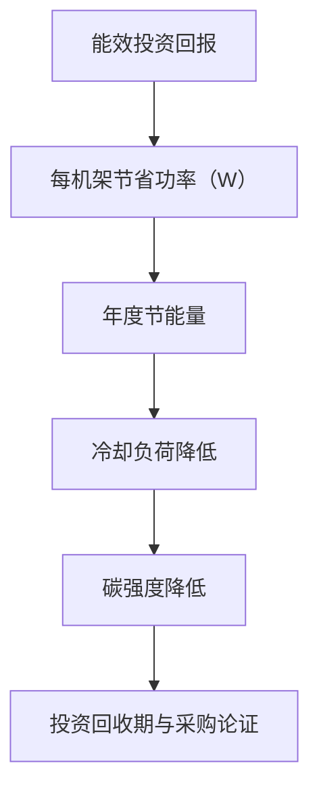

# 可持续性与能效
> **最后更新：** 2026-11-12
> **状态：** 草稿
> **标签：** PUE, 能效, 碳排放, 能源, WUE

## 概述
转换效率影响电费、冷却负荷、容量利用率和碳排放。PUE 衡量的是设施总能耗与 IT 能耗之比；它并不能直接单独反映半导体效率，且会随气候、利用率和核算方式的不同而改善或恶化。

宽禁带（WBG）器件可以降低转换损耗，但全生命周期影响取决于隐含碳（embodied carbon）、制造良率、冷却、工作负载利用率和电网碳强度。架构比较必须采用相同的负载曲线和系统边界。

## 关键发现 / 要点
- [已确认] 在 100 MW 持续负载下，效率每提升 1 个百分点，每年可节省 8.76 GWh。
- [估计] 按 $0.10/kWh 计算，这部分电能每年价值约 $876k，并不总是恰好 $1M。
- [已确认] 在条件有利的站点，最优秀的超大规模云厂商年度 PUE 接近约 1.1；谷歌（Google）报告其 2025 年全集群 PUE 为 1.09 [来源：Google 2026 Environmental Report，2026-06-30]。
- [估计] 与传统硅基设计相比，氮化镓（GaN）图腾柱 PFC 可将单级效率提升约 0.5-1.5 个百分点。
- [已确认] WUE 通过追踪用水量对 PUE 形成补充。
- [已确认，2026-06] 谷歌 2025 年用电量增长 37%，为其有记录以来最大的年度增幅，而运营排放下降 2% [来源：Google，2026-06-30]。
- [已确认，2026-06] 劳伦斯伯克利国家实验室（LBNL）2025 年更新报告预测，在基准情景下，2030 年美国数据中心用电量为 649 TWh（区间 521-843 TWh，约占美国用电量的 9.5-15.3%）[来源：LBNL/DOE]。
- [已确认，2026] 国际能源署（IEA）估计，2025 年全球数据中心电力需求约为 485 TWh，到 2030 年将升至约 950 TWh [来源：IEA，Key Questions on Energy and AI]。
- [估计，厂商宣称，2026-09] ABB 宣称直流配电可将端到端效率提升 5% 以上，并预测到 2030 年，25-40% 的新增数据中心容量将采用直流配电。

## 图解

## 详细内容
### PUE 解读

| PUE | 分类 | 半导体贡献 | 实现手段 |
|---:|---|---|---|
| >2.0 | 老旧/低效 | 相对冷却/设施而言较小 | 对整个设施进行现代化改造 |
| 1.4-1.6 | 现有设施群典型区间 | 转换效率提升效果可见 | 改进冷却/UPS |
| 1.1-1.2 | 领先的超大规模数据中心 | 每个损耗点都很重要 | 高效供电 + 气候/冷却条件 |
| 1.03-1.05 | 卓越/接近理论值 | 对边界划定敏感 | 自然冷却/直接供电 |

### 架构损耗模型

| 架构 | AC/DC 损耗 | DC/DC 损耗 | VRM 损耗 | 合计 | 1 MW、$0.10/kWh 条件下的年度损耗成本 |
|---|---:|---:|---:|---:|---:|
| 传统 12 V | 3% | 3% | 8% | ~13.5%（复合计算） | ~$118k |
| 48 V ORv3 | 2.5% | 2.5% | 6% | ~10.6% | ~$93k |
| 400 V HVDC | 2% | 2% | 6% | ~9.7% | ~$85k |
| 800 V（预测） | 1.5% | 1.5% | 5% | ~7.8% | ~$68k |

> ⚠️ 注意：示意性 [估计，低置信度] 满载模型。实际年度成本需结合负载曲线、冗余、冷却交互影响以及特定架构的实测数据。

### WBG 效率提升

| 变化 | 效率提升 | 置信度 |
|---|---:|---|
| GaN 图腾柱 PFC 相比桥式 PFC | 0.5-1.5 个百分点 | 中 |
| SiC/谐振相比传统硬开关 | 0.3-0.8 个百分点 | 低-中 |
| 48 V GaN 母线/POL 相比传统路径 | 系统层面 1-2 个百分点 | 低 |

### 超大规模云厂商承诺

| 公司 | 公开目标 | 年份 | 对电源的影响 |
|---|---|---:|---|
| 谷歌 | 24/7 无碳能源 | 2030 | 工作负载与能源在时间维度上的匹配 |
| 微软（Microsoft） | 碳负排放 | 2030 | 能效与清洁电力采购 |
| Meta | 价值链净零排放 | 2030 年目标框架 | 高效的开放式基础设施 |
| 亚马逊（Amazon） | 净零碳排放 | 2040 | 可再生能源与能效投资 |

### 能源需求基准

| 范围 | 指标 | 数值 | 来源 | 日期 |
|---|---|---:|---|---|
| 谷歌全集群 | 年度 PUE | 1.09 | 谷歌环境报告 | 2025 年数据 |
| 美国数据中心 | 2030 年基准情景用电量 | 649 TWh（区间 521-843） | LBNL/DOE | 2025 年更新 |
| 全球数据中心 | 电力需求 | ~485 TWh（2025）至 ~950 TWh（2030） | IEA | 2026 年发布 |

### 投资回报计算

100 MW x 1% x 8,760 h = 8.76 GWh。按 $0.10/kWh 计算，每年节省的能源费用（毛额）为 $876,000。避免的冷却能耗和容量可能进一步提升该价值；冗余配置和部分负载特性则可能使其降低。

相关：[主索引](README.md)。

## 数据表（如适用）
| 字段 | 数值 | 来源 | 日期 |
|---|---|---|---|
| 100 MW 的 1% | 1 MW | 计算 | 2026 |
| 年度电能 | 8.76 GWh | 计算 | 2026 |
| 按 $0.10/kWh 计算的价值 | $876,000/年 | 计算 | 2026 |
| 谷歌 CFE 目标 | 2030 年前实现 24/7 | 谷歌 | 现行 |
| 亚马逊净零目标 | 2040 | 亚马逊 | 现行 |
| 谷歌 2025 年全集群 PUE | 1.09 | 谷歌 | 2026-06-30 |
| LBNL 2030 年美国数据中心基准值 | 649 TWh | LBNL | 2025 年更新 |

## 待解决问题 / 数据缺口
- 用实测的部分负载效率曲线替换示意性损耗模型。
- 补充基于地理位置和基于市场的碳核算。
- 按全生命周期内交付的每 kWh 电能，量化 Si、SiC 和 GaN 器件的隐含碳。
- 每年根据可持续发展报告跟踪目标变化及进展。

## 参考文献
- The Green Grid PUE | https://www.thegreengrid.org/ | 访问日期 2026-06-10
- Google 24/7 carbon-free energy | https://sustainability.google/operating-sustainably/energy/ | 访问日期 2026-06-10
- Microsoft sustainability | https://www.microsoft.com/en-us/corporate-responsibility/sustainability | 访问日期 2026-06-10
- Meta sustainability | https://sustainability.atmeta.com/ | 访问日期 2026-06-10
- Amazon sustainability | https://sustainability.aboutamazon.com/ | 访问日期 2026-06-10
- Google 2026 Environmental Report | https://sustainability.google/files/google-2026-environmental-report.pdf | 检索日期 2026-11-12
- LBNL US Data Center Energy Usage Report 2025 | https://eta-publications.lbl.gov/publications/united-states-data-center-energy-2025 | 检索日期 2026-11-12
- IEA Key Questions on Energy and AI | https://iea.blob.core.windows.net/assets/3179f7f8-01f6-4dd6-bffa-c9f7b73f1dc9/KeyQuestionsonEnergyandAI.pdf | 检索日期 2026-11-12
- ABB Infinitus DC portfolio | https://www.globenewswire.com/news-release/2026/09/21/3365178/0/en/abb-s-new-direct-current-portfolio-aims-to-rewire-ai-data-center-energy-infrastructure.html | 检索日期 2026-11-12
