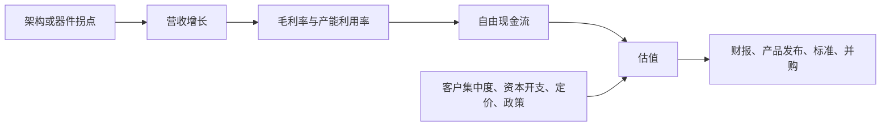
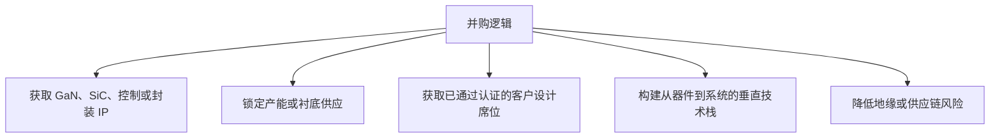

# 投资与并购追踪
> **最后更新：** 2026-11-12
> **状态：** 草稿
> **标签：** 投资, 估值, 并购, 催化剂, 财务数据

## 概述
本投资框架将 AI 机架增长与半导体价值量、技术组合、供应商份额、利润率和资本密集度联系起来。上市公司估值每日变化，且各公司的财务期间不同，因此本文件提供的是数据框架和注明日期的交易事实，而非未注明日期的单点估计。

数据中心业务敞口通常依靠推断得出。在缺乏产品/客户证据的情况下，不得将汽车 SiC 营收、消费类 GaN 适配器营收和通用模拟营收计为数据中心营收。

## 关键发现 / 要点
- [已确认] 2021-2024 年间，并购整合了 GaN Systems、Transphorm、GeneSiC 和 UnitedSiC。
- [已确认，2025] Wolfspeed（原 Cree）的重组凸显了以债务融资推动产能扩张式增长的风险。
- [估计] 与单纯的服务器出货量增长相比，单机架半导体价值量是更强劲的 AI 电源业务驱动因素。
- [估计] 超大规模云厂商的定制控制器对部分商用 IC 价值量构成威胁，但可扩大对已通过认证的功率级的需求。
- [已确认] 市值、企业价值（EV）、空头持仓和一致预期需要使用当日市场数据更新。
- [已确认，2026] 英飞凌（Infineon）的 AI 电源营收目标为 FY2026 ~€1.5B、FY2027 ~€2.5B；安森美（onsemi）披露 FY2025 AI 数据中心营收 >$250M；芯源系统（MPS）披露一款 800 V 解决方案正在送样。以上均为各公司特定口径，并非可直接比较的市场份额数据。[已被取代 2026-11：英飞凌公布 FY2026 AI 电源营收 ~€1.7B、数据中心电源营收 ~€2.2B，并给出 FY2027 数据中心电源接近 €4B 的业绩指引；安森美预计 2026 年 AI 数据中心营收 ~$620M，2030 年 >$3B。]
- [已确认，2026] 处理器电源并购潮：亚德诺（ADI）/Empower（~$1.5B，2026-07-07 完成交割）、纳微半导体（Navitas）/Claros（最高 ~$232.8M，2026-10-06 完成交割）、英飞凌/C2i（金额未披露，~2026-10 完成交割）以及安森美/Ferric（$600M + 最高 $175M，2026-11-02 宣布）。基础设施交易：维谛技术（Vertiv）/UIG（~$1.45B + 最高 $1.15B 业绩对赌付款，据维谛技术口径为 2027E EBITDA 的 ~13x）、伊顿（Eaton）/COL（企业价值 €810M）以及伊顿/Boyd Thermal（$9.5B，2026-03-12 完成交割）。
- [已确认，2026-10] Vicor 的特许权使用费收入（占 Q3 2026 营收的 ~34%）以及美国国际贸易委员会（ITC）337-TA-1526 案，既带来上行空间（授权许可），也给被点名的被诉方带来供应链风险。
- [已确认，2026-10-07] Wolfspeed 获得的最高 $1.5B 附条件 OSC 贷款（附带最高相当于完全稀释后股本 7.5% 的认股权证）是这家 SiC 专业厂商资产负债表方面的关键催化剂。
- [已确认，2026-07] WBG 诉讼现已成为明确的投资风险：英飞凌/英诺赛科（Innoscience）案在美国已有最终救济措施，而 Wolfspeed/纳微半导体案仅停留在指控阶段，二者形成对比。

## 图解

## 详细内容
> 🔄 需要更新：高优先级。填充市场数据时须明确标注截至时间戳、稀释后股数、净债务定义、财务期间和币种。2026-11-12 更新时未能获取当日市场数据，因此改为更新下方的最新报告期数据表。

### 上市公司追踪

| 公司 | 股票代码 | 市值 | 企业价值 | LTM 营收 | 同比 | 毛利率 | EV/营收 | 市盈率 | 数据中心电源营收 | 数据中心占比 | 一致预期 |
|---|---|---:|---:|---:|---:|---:|---:|---:|---:|---:|---|
| 英飞凌 | IFX.DE | [待更新] | [待更新] | [财年/LTM 待更新] | | | | | [估计] | [估计] | |
| 德州仪器（TI） | TXN | [待更新] | [待更新] | [财年/LTM 待更新] | | | | | [估计] | [估计] | |
| 瑞萨电子（Renesas） | 6723.T | [待更新] | [待更新] | [财年/LTM 待更新] | | | | | [估计] | [估计] | |
| 芯源系统 | MPWR | [待更新] | [待更新] | [财年/LTM 待更新] | | | | | [估计] | [估计] | |
| 纳微半导体 | NVTS | [待更新] | [待更新] | [财年/LTM 待更新] | | | | | [估计] | [估计] | |
| Vicor | VICR | [待更新] | [待更新] | [财年/LTM 待更新] | | | | | [估计] | [估计] | |
| 维谛技术 | VRT | [待更新] | [待更新] | [财年/LTM 待更新] | | | | | [估计] | [估计] | |

### 最新报告期营收基线

| 公司 | 期间 | 营收 | AI/数据中心相关披露 |
|---|---|---:|---|
| 英飞凌 | FY2025 | €14.662B | FY2025 AI 电源 >€700M；FY2026 目标 ~€1.5B，FY2027 目标 ~€2.5B |
| 德州仪器 | CY2025 | $17.682B | 未单独披露 |
| 瑞萨电子 | CY2025 | ¥1.321T IFRS | 未单独披露 |
| 芯源系统 | CY2025 | $2.790B | 存储/计算 $732.5M；企业数据 $701.8M；口径并非纯 AI |
| 安森美 | CY2025 | $5.995B | AI 数据中心营收 >$250M |
| 微芯科技（Microchip） | FY2026 | $4.713B | 未单独披露 |
| 英飞凌 | FY2026（截至 2026-09-30） | €16.353B | AI 电源 ~€1.7B；数据中心电源 ~€2.2B；FY2027 集团营收指引 ~€20B，数据中心电源指引 ~€4B |
| 德州仪器 | Q3 2026 | $6.06B | 数据中心占营收 ~13%（同比 +~95%） |
| 亚德诺 | FQ3 FY2026 | $4.02B | 数据中心占通信业务的 ~80% |
| 安森美 | Q3 2026 | ~$1.72B | AI 数据中心 $180M；2026E ~$620M |
| 芯源系统 | Q3 2026 | $1,202.4M | 企业数据 $506.7M |
| Vicor | Q3 2026 | $197.1M | 特许权使用费 $66.6M；订单积压 $406M |
| 维谛技术 | Q3 2026 | $4,313M | FY2026 业绩指引 $14.45-14.85B |
| 伊顿 | Q3 2026 | $8.9B | 美洲电气业务（Electrical Americas）订单积压 ~$16.0B |
| 纳微半导体 | Q3 2026 | $14.0M | AI 基础设施占 Q4 2026 指引的 >40% |
| Wolfspeed | Q1 FY2027 | ~$155M | FY2026 AI 数据中心营收增长至 >2x |

### 估值基准

| 公司 | EV/营收 | EV/EBITDA | 市盈率 | EV/毛利 | 溢价 | 依据 |
|---|---:|---:|---:|---:|---:|---|
| [可比公司组待更新] | | | | | | 增长、利润率、资本密集度、数据中心敞口 |

### SiC 追踪

| 公司 | SiC 营收 | 增长 | 占总营收比例 | 200 mm 产能 | 赢单/失单 |
|---|---:|---:|---:|---|---|
| Wolfspeed | FY2026 $665.1M（FY2025 $757.6M） | -12% | 高 | Mohawk Valley/材料 | 产能利用率是关键；毛利率为负 |
| 意法半导体（ST）/安森美/英飞凌/罗姆（ROHM） | [分部估计] | | | [待归一化] | 从汽车向数据中心跨界 |
| 意法半导体功率与分立器件业务（含 SiC） | Q3 2026 $477M | +11.3% | 不适用 | 卡塔尼亚/重庆 200 mm 产线启动 | 营业亏损 $81M |
| 天岳先进（SICC；衬底） | H1 2026 ~RMB 914M | +15.1% | 高 | 8 英寸占 Q3 营收 >50% | 价格压力 |

### GaN 追踪

| 公司 | GaN 营收 | 增长 | 数据中心 GaN 占比 | 设计导入 |
|---|---:|---:|---:|---|
| 英飞凌 | [未披露] | | [估计] | PSU/消费/工业 |
| 纳微半导体 | Q3 2026 $14.0M（Q4 指引 $15.5-16.5M） | 同比 +39% | 占 Q4 指引 >40%（AI 基础设施） | 英伟达（NVIDIA）800 V 电路板；微芯科技参考设计 |
| 英诺赛科 | H1 2026 ~RMB 834M | +50.6% | 包含在 AI 数据中心/工业/储能/电动汽车合计 ~RMB 532M 之内 | 2025 年功率 GaN 第 1 名（Yole） |
| 瑞萨电子/Transphorm | [未披露] | | [估计] | 高压 GaN |
| 宜普电源转换（EPC） | 非上市 | | [估计] | 机器人/数据中心电源转换 |

### 近期交易

| 日期 | 收购方 | 标的 | 交易价值 | 估值倍数 | 收购逻辑 | 对数据中心的影响 |
|---|---|---|---:|---:|---|---|
| 2026-11-02 | 安森美 | Ferric | $600M + 最高 $175M | 不适用 | IVR/磁性元件 | 处理器级电源（待完成） |
| 2026-10-27 | 维谛技术 | UtilityInnovation Group | ~$1.45B + 最高 $1.15B 业绩对赌付款 | 2027E EBITDA 的 ~13x [公司口径] | 现场电源 | 缩短供电就绪时间 |
| 2026-10-06 | 纳微半导体 | Claros | 最高 ~$232.8M | 不适用 | IVR/垂直供电 | 从电网到 XPU 的产品组合 |
| ~2026-10 | 英飞凌 | C2i Semiconductors | 未披露 | 不适用 | 多相控制/功率级 | AI VR 控制 |
| 2026-09-24 | 伊顿 | COL Group | 企业价值 €810M | 2027E 销售额的 ~3.2x [推算] | 中压开关柜 | 设施电源（预计 Q1 2027 完成交割） |
| 2026-07-07 | 亚德诺 | Empower Semiconductor | ~$1.5B 现金 | 不适用 | IVR/硅电容 | 处理器级电源 |
| 2026-03-12 | 伊顿 | Boyd Thermal | $9.5B | [待计算] | 液冷 | 热/电协同设计 |
| 2024 | 瑞萨电子 | Transphorm | 股权价值 ~$339M | [待计算] | GaN | 增加高压 GaN |
| 2023 | 英飞凌 | GaN Systems | $830M | [待计算] | GaN 规模 | 整合 |
| 2022 | 纳微半导体 | GeneSiC | ~$100M + 业绩对赌付款 [待核实] | [待计算] | 增加 SiC | 扩大 WBG 覆盖面 |
| 2021 | Qorvo | UnitedSiC | 未披露 | 不适用 | 增加 SiC | 产品组合期权 |

### 风险投资追踪

| 公司 | 阶段 | 金额 | 日期 | 领投方 | 估值 | 备注 |
|---|---|---:|---|---|---:|---|
| Cambridge GaN Devices | C 轮 | $32M | 2025-02-18 | British Patient Capital | 非上市 | 参见 [14](14_startups_watchlist.md) |
| SemiQ | 非上市 | 未发现 2026 年融资轮次 | 2026 年状态 | 不适用 | 非上市 | SiC |
| Amperesand | A 轮 / 非上市 | 累计 >$100M [公司披露] | 2026 年状态 | 已披露的投资方包括 Walden Catalyst/淡马锡（Temasek） | 非上市 | SiC SST；首批商用产品目标 2026 年推出 |
| Heron Power | B 轮 | $140M | 2026-02-18 | a16z American Dynamism；Breakthrough Energy Ventures | 非上市 | 4.2 MW 800 VDC SST + SuperBBU 厂商规格 |
| DG Matrix | A 轮 | $60M | 2026-02-18 | Engine Ventures | 非上市 | Interport 多端口 SST |
| Vertical Semiconductor | 种子轮 + CHIPS 研发意向书 | 种子轮 $11M；意向书最高 $73M | 2025-10 / 2026-10 | Playground Global；美国商务部 | 非上市 | 垂直 GaN |

### 风险提示

| 公司/主题 | 空头持仓 | 看空逻辑 | 看多反驳 |
|---|---:|---|---|
| WBG 专业厂商 | [待更新] | ASP 压力/现金消耗 | AI/HVDC 设计导入 |
| SiC 产能 | 不适用 | 供过于求/产能利用率 | 新增基础设施需求 |
| 商用控制器 | 不适用 | 定制芯片 | 供电轨数量/复杂度增加 |
| VPD 模块供应链 | 不适用 | ITC 337-TA-1526 排除令风险 | 授权许可和解 |
| 纳微半导体 | [待更新] | 三线诉讼缠身；营收规模小 | AI 业务占比提升；现金 $531.5M，无负债 |
| Wolfspeed | [待更新] | 毛利率为负；产能利用率 | OSC 贷款；AI 数据中心营收增长 |

### 催化剂日历

| 时间 | 事件 | 催化剂 | 乐观情景 | 悲观情景 |
|---|---|---|---|---|
| 3 月 | APEC / 英伟达 GTC | 拓扑与机架功率 | 新的 WBG 设计 | 认证进展缓慢 |
| 5 月/6 月 | PCIM Europe | 器件/产能发布 | 成本/性能提升 | 价格压力 |
| 10 月 | OCP 全球峰会（OCP Global Summit） | 机架标准 | 48 V/HVDC 采用 | 标准碎片化 |
| 每季度 | 财报 | 数据中心营收/利润率 | 价值量增长 | 库存/资本开支 |
| 2026 H2 | 安森美垂直 GaN 目标 | 700/1,200 V 量产爬坡 | 新的 800 V 转换选项 | 认证/良率延误 [截至 2026-11-12 尚未确认量产] |
| 2026-11-24 | 亚德诺 FQ4 FY2026 业绩 | 电源/数据中心业务评论 | Empower 整合 | 通信业务周期性 |
| 2026-11-27 | 中国暂停对美镓/锗出口禁令的期限届满 | 镓供应政策 | 延期 | 禁令恢复 |
| 2026-12-12 至 16 | IEDM 2026 | 功率/模拟器件论文 | 垂直 GaN/SiC 进展 | 仅限研究阶段 |
| 2026 年底 | 安森美/Ferric 交割 | IVR 整合 | 处理器电源份额 | 监管审批延误 |
| Q1 2027 | 伊顿/COL 交割 | 中压开关柜产能 | 设施电源份额 | 整合 |
| Q2 2027 | Vicor Fab-2 首批设备 | 模块产能 | 特许权使用费 + 产品增长 | 执行 |
| 2027-07-31 | 台积电（TSMC）退出 GaN 代工 | 无晶圆厂 GaN 客户转移 | 第二供应源准备就绪 | 供应缺口 |
| 2H 2027 | ABB SST 商用上市；Rubin Ultra 800 V 电源机架 | 中压 SST 与 800 VDC 放量 | SiC/GaN/保护器件价值量提升 | 推迟至 2028 |
| 2027+ | 英伟达 Kyber/800 VDC | MW 级机架转型 | WBG/保护器件价值量提升 | 标准/部署延误 |
| 2027+ | 337-TA-1526 裁决 | VPD 排除令/授权许可 | Vicor 特许权使用费 | 被诉方规避设计 |

## 数据表（如适用）
| 字段 | 数值 | 来源 | 日期 |
|---|---|---|---|
| 英飞凌/GaN Systems | $830M | 英飞凌 | 2023 |
| 瑞萨电子/Transphorm | 股权价值 ~$339M | 瑞萨电子 | 2024 |
| Wolfspeed 债务削减 | 宣布 ~$4.6B | Wolfspeed | 2025 |
| 维谛技术 FY2024 营收 | ~$8.0B | 维谛技术 10-K | FY2024 |
| 维谛技术 FY2026 销售额指引 | $14.45-14.85B | 维谛技术 | 2026-10-28 |
| 亚德诺/Empower | ~$1.5B | 亚德诺 | 2026-07-07 |
| 安森美/Ferric | 最高 $775M | 安森美 | 2026-11-02 |
| Wolfspeed OSC 融资 | 最高 $1.5B，附条件 | Wolfspeed | 2026-10-07 |
| 市场数据更新 | 须为当日数据 | 数据库惯例 | 2026 |

## 待解决问题 / 数据缺口
- 填充当日市场数据及最新财年/LTM 指标。
- 在计入租赁、可转债、养老金和重组因素后核对企业价值。
- 按公司建立经审计的数据中心营收桥接。
- 根据标的公司文件补充交易营收倍数。
- 根据一手公告和监管文件补充融资轮次。
- 核实安森美/Synaptics 交易条款变更（因不属于数据中心电源业务，本文未纳入）。

## 参考文献
- SEC EDGAR | https://www.sec.gov/edgar/search/ | 访问日期 2026-06-10
- Company investor-relations sites | 各公司 | 访问日期 2026-06-10
- APEC | https://apec-conf.org/ | 访问日期 2026-06-10
- OCP Global Summit | https://www.opencompute.org/summit/global-summit | 访问日期 2026-06-10
- PCIM Europe | https://pcim.mesago.com/ | 访问日期 2026-06-10
- Infineon FY2026 AGM CEO speech | https://www.infineon.com/assets/row/public/documents/corporate/investors/annual-general-meeting/2026/agm2026-key-points-speech-jochen-hanebeck-chief-executive-officer-v01-00-en.pdf | 访问日期 2026-07-28
- onsemi 2025 annual report | https://investor.onsemi.com/static-files/8d674d4f-cc6b-44e5-8e31-e898ab0b4371 | 访问日期 2026-07-28
- MPS FY2025 Form 10-K | https://media.monolithicpower.com/mps_cms_document/2/0/2025_form_10-k_final.pdf | 访问日期 2026-07-28
- MPS Q4/FY2025 earnings commentary | https://www.monolithicpower.com/media/investor-relations/press-releases/Q4_2025_MPS_Earnings_Commentary.pdf | 访问日期 2026-07-28
- Amperesand | https://www.amperesand.io/about | 访问日期 2026-07-28
- Wolfspeed v. Navitas announcement | https://www.wolfspeed.com/company/news-events/news/wolfspeed-files-patent-infringement-lawsuit-against-navitas-semiconductor/ | 访问日期 2026-07-28
- Infineon FY2026 results (syndicated) | https://news.europawire.eu/infineon-reports-e16-35-billion-fy-2026-revenue-and-forecasts-over-20-percent-growth-for-2027/eu-press-release/2026/11/10/16/27/06/187084/ | 检索日期 2026-11-12
- onsemi to acquire Ferric | https://investor.onsemi.com/news-releases/news-release-details/onsemi-acquire-ferric-establishing-leadership-power-delivery | 检索日期 2026-11-12
- ADI completes Empower acquisition | https://www.analog.com/en/newsroom/press-releases/2026/7-7-26-adi-completes-acquisition-of-empower-semiconductor.html | 检索日期 2026-11-12
- Navitas closes Claros | https://www.globenewswire.com/news-release/2026/10/06/3376021/0/en/navitas-closes-acquisition-of-claros-advancing-ai-infrastructure-with-grid-to-xpu-power-delivery.html | 检索日期 2026-11-12
- Infineon/C2i acquisition | https://evertiq.com/design/2026-08-24-infineon-acquires-bangalore-based-c2i-semiconductors | 检索日期 2026-11-12
- Vertiv/UIG announcement | https://www.vertiv.com/en-us/about/news-and-events/corporate-news/2026/vertiv-announces-agreement-to-acquire-utilityinnovation-group-to-accelerate-time-to-power-for-ai-data-centers/ | 检索日期 2026-11-12
- Eaton/COL Group | https://secure.businesswire.com/news/home/20260924188286/es | 检索日期 2026-11-12
- Eaton/Boyd Thermal completion | https://www.businesswire.com/news/home/20260312582488/en | 检索日期 2026-11-12
- Vicor Q3 2026 results | https://www.sec.gov/Archives/edgar/data/0000751978/000119312526425697/d153882dex991.htm | 检索日期 2026-11-12
- Vertiv Q3 2026 results | https://investors.vertiv.com/news/news-details/2026/Vertiv-Reports-Strong-Third-Quarter-2026-with-Net-Sales-Growth-of-61-Organic-Orders-Growth-over-100-and-Diluted-EPS-Growth-of-91-Adjusted-Diluted-EPS-Growth-of-78-Raises-Full-Year-2026-Guidance-Across-All-Key-Metrics/ | 检索日期 2026-11-12
- Navitas Q3 2026 results | https://www.sec.gov/Archives/edgar/data/0001821769/000162828026069489/exhibit991-navitassemicond.htm | 检索日期 2026-11-12
- Wolfspeed Q1 FY2027 results | https://www.sec.gov/Archives/edgar/data/0000895419/000089541926000075/ex991q1-27.htm | 检索日期 2026-11-12
- Heron Power Series B | https://techcrunch.com/2026/02/18/heron-power-raises-140m-to-ramp-production-of-grid-altering-tech/ | 检索日期 2026-11-12
- ADI FQ4 FY2026 results date | https://www.analog.com/en/newsroom/press-releases/2026/10-22-2026-adi-report-4q-fy2026-financial-results.html | 检索日期 2026-11-12
