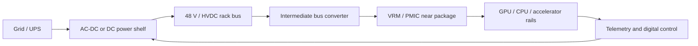
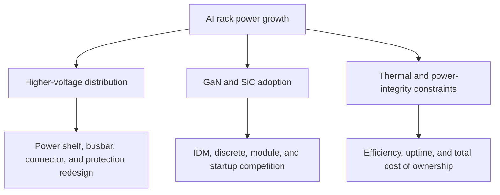

# Executive Summary
> **Last Updated:** 2026-07-28
> **Status:** Draft
> **Tags:** market, roadmap, AI-racks, WBG, strategy

## Overview
AI infrastructure is shifting datacenter power from a cost-optimized support subsystem into a
performance-constraining platform. Higher accelerator power, current slew rates, and rack
density increase semiconductor content at the facility front end, rack shelf, intermediate bus,
and point of load. Silicon remains the volume foundation, while GaN and SiC gain where switching
loss, passive size, voltage, or temperature justify their premium.

The architecture is not moving in one step from 12 V to 800 V. The observable transition is
12 V board distribution to 48/54 V rack distribution. NVIDIA has now published an 800 VDC
architecture for MW-scale racks and targets production deployment with Kyber systems beginning
in 2027; this is a vendor ecosystem roadmap, not yet a broadly ratified industry standard.
Safety, protection, connector, serviceability, and standards maturity are as important as
device efficiency.

## Key Findings / Highlights
- [ESTIMATED, MED confidence, 2026] Datacenter power-semiconductor TAM is about $4B, but definitions vary materially.
- [ESTIMATED, MED confidence, 2024-2026] Rack density spans ~8-15 kW legacy, 30-60 kW mainstream AI, and ~100-140 kW leading liquid-cooled systems.
- [CONFIRMED, 2024] Open Rack v3 uses a nominal 48 V bus and rack-level power shelf/BBU ecosystem [Source: OCP, 2024].
- [CONFIRMED, 2024] Infineon started 300 mm (12-inch) GaN wafer production development, a manufacturing-cost milestone [Source: Infineon, 2024].
- [ESTIMATED, MED confidence, 2025] WBG adoption is strongest in PFC/primary conversion; low-voltage POL remains silicon-heavy.
- [TO VERIFY] The prompt's "$12k-$15k per 130 kW rack" Infineon content claim requires a primary transcript/page citation.
- [CONFIRMED, 2026] NVIDIA's 800 VDC roadmap targets 1 MW IT racks and beyond beginning in
  2027, while retaining a staged migration path for brownfield AC facilities [Source: NVIDIA, 2026].
- [CONFIRMED, 2026] Infineon expects AI power-solution revenue of about €1.5B in FY2026 and
  €2.5B in FY2027; this vendor-defined category is broader than datacenter power semiconductors
  alone [Source: Infineon AGM, 2026].
- [CONFIRMED, 2026] Infineon opened its €5B Dresden Smart Power Fab on July 2, doubling
  capacity at the Dresden site for power and analog/mixed-signal products [Source: Infineon, 2026-07-02].

## Visual Guide

## Detailed Content
### Strategic Themes

| Theme | 2026 position | Investment/engineering implication |
|---|---|---|
| 48 V rollout | [CONFIRMED] Commercial and standardized | More 48 V converters, protection, busbars, and BBU electronics |
| WBG adoption | [CONFIRMED] GaN/SiC growing selectively | Device choice follows voltage, frequency, thermals, and qualification |
| Digital power | [CONFIRMED] PMBus telemetry is established | Firmware, telemetry, security, and fleet optimization matter |
| Thermal co-design | [CONFIRMED] Liquid cooling expanding | Power shelves and VRMs must join rack thermal design |
| Vertical integration | [ESTIMATED] Selective, not universal | Hyperscalers specify shelves/ASIC rails but still depend on merchant ICs |

### Architecture Inflections

| Architecture | Typical period | Main benefit | Main constraint |
|---|---:|---|---|
| 12 V rack/board | pre-2015 onward | Mature ecosystem | High distribution current |
| 48 V rack bus | 2016 onward; ORv3 2021+ | Lower I²R loss | Additional board conversion |
| 380/400 V DC | pilots/deployments, 2010s-2020s | Fewer AC/DC stages | Protection and service safety |
| NVIDIA 800 VDC | Roadmap; production target begins 2027 | Lower current at MW-scale rack power | Standards, protection, isolation, connector ecosystem |

See [02_power_architecture_roadmap.md](02_power_architecture_roadmap.md) and
[20_market_sizing.md](20_market_sizing.md).

## Data Tables (where applicable)
| Metric | Value | Source | Date |
|---|---|---|---|
| Legacy rack power | [ESTIMATED] 8-15 kW | Industry baseline | 2015 |
| Mainstream AI rack | [ESTIMATED] 30-60 kW | OEM configurations | 2024-2026 |
| Leading liquid-cooled AI rack | [ESTIMATED] 100-140 kW | OEM/NVIDIA ecosystem | 2025-2026 |
| Future rack roadmap | [ESTIMATED, LOW] 200 kW+ | Vendor roadmaps | 2027+ |
| NVIDIA future rack class | 1 MW IT racks and beyond [VENDOR ROADMAP] | NVIDIA | 2027+ |
| DC power-semiconductor TAM | [ESTIMATED, MED] ~$4B | Triangulated company/market data | 2026 |
| Infineon AI power revenue target | ~€1.5B FY2026; ~€2.5B FY2027 [COMPANY TARGET] | Infineon | 2026 |

## Open Questions / Gaps
- Define a reproducible bottom-up TAM boundary and avoid double-counting modules and ICs.
- Obtain primary support for Infineon's claimed content per 130 kW rack.
- Separate rack nameplate, average IT load, and facility input power in every benchmark.
- Quantify actual merchant share loss from hyperscaler custom power silicon.

## References
- OCP Open Rack | https://www.opencompute.org/wiki/Open_Rack/SpecsAndDesigns | Accessed 2026-06-10
- NVIDIA GB200 NVL72 | https://www.nvidia.com/en-us/data-center/gb200-nvl72/ | Accessed 2026-06-10
- Infineon 300 mm GaN announcement | https://www.infineon.com/cms/en/about-infineon/press/press-releases/2024/INFXX202409-158.html | Accessed 2026-06-10
- NVIDIA 800 VDC architecture | https://www.nvidia.com/en-us/data-center/technologies/800-vdc-architecture/ | Accessed 2026-07-28
- NVIDIA 800 VDC technical roadmap | https://developer.nvidia.com/blog/nvidia-800-v-hvdc-architecture-will-power-the-next-generation-of-ai-factories/ | Accessed 2026-07-28
- Infineon FY2026 AGM CEO speech | https://www.infineon.com/assets/row/public/documents/corporate/investors/annual-general-meeting/2026/agm2026-key-points-speech-jochen-hanebeck-chief-executive-officer-v01-00-en.pdf | Accessed 2026-07-28
- Infineon Dresden Smart Power Fab | https://www.infineon.com/press-release/2026/ifxpr202607-117 | Accessed 2026-07-28
