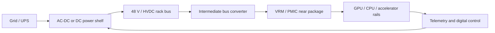
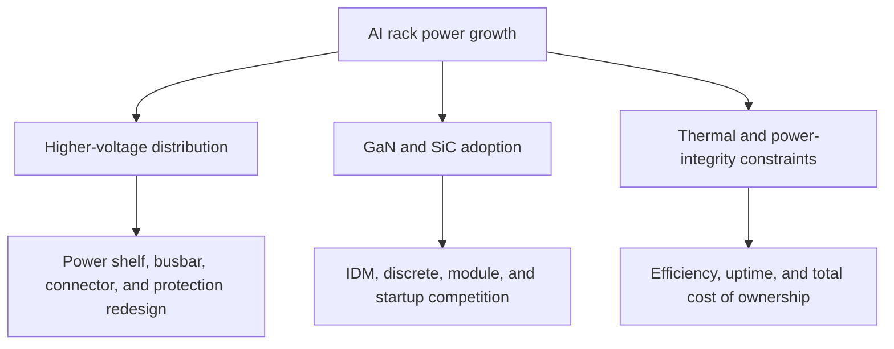

# Executive Summary
> **Last Updated:** 2026-11-12
> **Status:** Draft
> **Tags:** market, roadmap, AI-racks, WBG, strategy

## Overview
AI infrastructure is shifting datacenter power from a cost-optimized support subsystem into a
performance-constraining platform. Higher accelerator power, current slew rates, and rack
density increase semiconductor content at the facility front end, rack shelf, intermediate bus,
and point of load. Silicon remains the volume foundation, while GaN and SiC gain where switching
loss, passive size, voltage, or temperature justify their premium.

The architecture is not moving in one step from 12 V to 800 V. The observable transition is
12 V board distribution to 48/54 V rack distribution, now followed by disaggregated high-voltage
"sidecar" power: OCP published the ±400 VDC Mt. Diablo v1.0.0 specification on 2026-10-08, and
NVIDIA's staged 800 VDC rollout begins with AC-fed 800 VDC power racks in 2H 2026, row power
centers in 2027, and native 800 VDC Kyber-generation racks from 2027. Native 800 VDC remains a
vendor ecosystem roadmap rather than a ratified rack standard, and no commissioned native 800 VDC
data hall had been publicly confirmed by 2026-11-12. Safety, protection, connector,
serviceability, and standards maturity are as important as device efficiency.

The second half of 2026 also brought hard revenue evidence: Infineon reported ~€2.2B of FY2026
datacenter-power revenue and guided close to €4B for FY2027, MPS's Enterprise Data segment
reached 42% of quarterly revenue, and four processor-power startups (Empower, Claros, C2i,
Ferric) were acquired or agreed to be acquired within six months.

## Key Findings / Highlights
- [ESTIMATED, LOW-MED confidence, 2026-11] Datacenter power-semiconductor TAM is now estimated at
  ~$9B for 2026 (range $8-10.5B) and ~$20B for 2030, revised from ~$4B [SUPERSEDED] because
  Infineon, MPS, and onsemi disclosures alone sum to ~$4.9B; definitions vary materially
  [See: 20_market_sizing.md].
- [ESTIMATED, MED confidence, 2024-2026] Rack density spans ~8-15 kW legacy, 30-60 kW mainstream AI, and ~100-140 kW leading liquid-cooled systems;
  Vera Rubin NVL72 racks shipping since 2026-09 carry four 110 kW power shelves and are estimated
  at ~190-230 kW.
- [CONFIRMED, 2024] Open Rack v3 uses a nominal 48 V bus and rack-level power shelf/BBU ecosystem [Source: OCP, 2024].
- [CONFIRMED, 2024] Infineon started 300 mm (12-inch) GaN wafer production development, a manufacturing-cost milestone [Source: Infineon, 2024].
- [ESTIMATED, MED confidence, 2025] WBG adoption is strongest in PFC/primary conversion; low-voltage POL remains silicon-heavy.
- [TO VERIFY] The prompt's "$12k-$15k per 130 kW rack" Infineon content claim requires a primary transcript/page citation.
- [CONFIRMED, 2026] NVIDIA's 800 VDC roadmap targets 1 MW IT racks and beyond beginning in
  2027, while retaining a staged migration path for brownfield AC facilities [Source: NVIDIA, 2026].
- [SUPERSEDED, 2026-11] Infineon's earlier targets of about €1.5B FY2026 and €2.5B FY2027 AI
  power-solution revenue [Source: Infineon AGM, 2026] were overtaken by FY2026 actuals of ~€1.7B
  AI power and ~€2.2B total datacenter power, with FY2027 datacenter power guided close to €4B
  [Source: Infineon FY2026 results, 2026-11-10].
- [CONFIRMED, 2026] Infineon opened its €5B Dresden Smart Power Fab on July 2, doubling
  capacity at the Dresden site for power and analog/mixed-signal products [Source: Infineon, 2026-07-02].
- [CONFIRMED, 2026-10-08] OCP Mt. Diablo v1.0.0 (Microsoft, Meta, Google) standardizes a ±400 VDC
  sidecar power rack for 100 kW-1 MW IT racks; Google, Microsoft, and NVIDIA lead an OCP MV AC-to-
  800 VDC solid-state-transformer workstream (spec v0.3) [Source: OCP, 2026].
- [CONFIRMED, 2026] Processor-level power consolidated: ADI/Empower (~$1.5B), Navitas/Claros,
  Infineon/C2i, and onsemi/Ferric (up to $775M, pending) [See: 25_investment_and_ma_tracker.md].
- [CONFIRMED, 2026] Electrical majors and startups are commercializing MV SSTs for 800 VDC (ABB,
  Eaton with Infineon SiC, Siemens/Reinhausen, Delta, Heron Power, Amperesand, DG Matrix); most
  commercial availability is 2026-2027 [VENDOR ROADMAP].
- [CONFIRMED, 2026-10] IP risk widened from devices to architecture: Vicor's ITC case 337-TA-1526
  names Delta, Infineon, MPS, Flex, Celestica, Quanta, and Luxshare entities, alongside
  multi-front GaN litigation (Infineon/Innoscience, Wolfspeed/Navitas, Renesas/Navitas).

## Visual Guide

## Detailed Content
### Strategic Themes

| Theme | 2026 position | Investment/engineering implication |
|---|---|---|
| 48 V rollout | [CONFIRMED] Commercial and standardized | More 48 V converters, protection, busbars, and BBU electronics |
| WBG adoption | [CONFIRMED] GaN/SiC growing selectively | Device choice follows voltage, frequency, thermals, and qualification |
| Digital power | [CONFIRMED] PMBus telemetry is established | Firmware, telemetry, security, and fleet optimization matter |
| Thermal co-design | [CONFIRMED] Liquid cooling expanding | Power shelves and VRMs must join rack thermal design |
| Vertical integration | [ESTIMATED] Selective, not universal | Hyperscalers specify shelves/ASIC rails but still depend on merchant ICs |
| HVDC sidecar power | [CONFIRMED] ±400 VDC OCP spec; 800 VDC racks sampling/prototype | SiC/GaN PFC, DC/DC, SSCB, and BBU content per MW rises |
| Processor-level power | [CONFIRMED] IVR/vertical delivery consolidation | Larger IDMs own package-adjacent regulation IP |
| IP enforcement | [CONFIRMED] ITC and multi-country GaN cases | Dual sourcing and design-around planning matter |

### Architecture Inflections

| Architecture | Typical period | Main benefit | Main constraint |
|---|---:|---|---|
| 12 V rack/board | pre-2015 onward | Mature ecosystem | High distribution current |
| 48 V rack bus | 2016 onward; ORv3 2021+ | Lower I²R loss | Additional board conversion |
| 380/400 V DC | pilots/deployments, 2010s-2020s | Fewer AC/DC stages | Protection and service safety |
| ±400 VDC sidecar (OCP Mt. Diablo) | Spec v1.0.0 2026-10-08 | Disaggregated rack power to 1 MW | Protection, grounding, serviceability |
| NVIDIA 800 VDC | Sidecar 2H 2026; row power centers 2027; native Kyber 2027+ | Lower current at MW-scale rack power | Standards, protection, isolation, connector ecosystem |

See [02_power_architecture_roadmap.md](02_power_architecture_roadmap.md) and
[20_market_sizing.md](20_market_sizing.md).

## Data Tables (where applicable)
| Metric | Value | Source | Date |
|---|---|---|---|
| Legacy rack power | [ESTIMATED] 8-15 kW | Industry baseline | 2015 |
| Mainstream AI rack | [ESTIMATED] 30-60 kW | OEM configurations | 2024-2026 |
| Leading liquid-cooled AI rack | [ESTIMATED] 100-140 kW | OEM/NVIDIA ecosystem | 2025-2026 |
| Vera Rubin NVL72 rack | 4 × 110 kW shelves; [ESTIMATED, MED] ~190-230 kW | OEM datasheets / analyst estimate | 2026 |
| Future rack roadmap | [ESTIMATED, LOW] 250 kW (MGX 1.2 ceiling [RUMORED]) to 1 MW | Vendor roadmaps | 2027+ |
| NVIDIA future rack class | 1 MW IT racks and beyond [VENDOR ROADMAP] | NVIDIA | 2027+ |
| DC power-semiconductor TAM | [SUPERSEDED] ~$4B; [ESTIMATED, LOW-MED] ~$9B revised | Triangulated company/market data | 2026 |
| Infineon AI power revenue target | ~€1.5B FY2026; ~€2.5B FY2027 [COMPANY TARGET; SUPERSEDED] | Infineon | 2026 |
| Infineon FY2026 DC power revenue | ~€2.2B (AI ~€1.7B); FY2027 guide ~€4B | Infineon | 2026-11-10 |
| Mt. Diablo v1.0.0 | ±400 VDC; 100 kW-1 MW | OCP | 2026-10-08 |

## Open Questions / Gaps
- Define a reproducible bottom-up TAM boundary and avoid double-counting modules and ICs.
- Obtain primary support for Infineon's claimed content per 130 kW rack.
- Separate rack nameplate, average IT load, and facility input power in every benchmark.
- Quantify actual merchant share loss from hyperscaler custom power silicon.
- Confirm the first commissioned native 800 VDC data hall and its measured efficiency.
- Open primary IR documents for figures captured from search indexes in the 2026-11 refresh.

## References
- OCP Open Rack | https://www.opencompute.org/wiki/Open_Rack/SpecsAndDesigns | Accessed 2026-06-10
- NVIDIA GB200 NVL72 | https://www.nvidia.com/en-us/data-center/gb200-nvl72/ | Accessed 2026-06-10
- Infineon 300 mm GaN announcement | https://www.infineon.com/cms/en/about-infineon/press/press-releases/2024/INFXX202409-158.html | Accessed 2026-06-10
- NVIDIA 800 VDC architecture | https://www.nvidia.com/en-us/data-center/technologies/800-vdc-architecture/ | Accessed 2026-07-28
- NVIDIA 800 VDC technical roadmap | https://developer.nvidia.com/blog/nvidia-800-v-hvdc-architecture-will-power-the-next-generation-of-ai-factories/ | Accessed 2026-07-28
- Infineon FY2026 AGM CEO speech | https://www.infineon.com/assets/row/public/documents/corporate/investors/annual-general-meeting/2026/agm2026-key-points-speech-jochen-hanebeck-chief-executive-officer-v01-00-en.pdf | Accessed 2026-07-28
- Infineon Dresden Smart Power Fab | https://www.infineon.com/press-release/2026/ifxpr202607-117 | Accessed 2026-07-28
- Infineon FY2026 results (syndicated) | https://news.europawire.eu/infineon-reports-e16-35-billion-fy-2026-revenue-and-forecasts-over-20-percent-growth-for-2027/eu-press-release/2026/11/10/16/27/06/187084/ | Indexed 2026-11-12
- NVIDIA 800 VDC rollout blog | https://blogs.nvidia.com/blog/800-vdc-power-architecture-ai-factory/ | Indexed 2026-11-12
- OCP Mt. Diablo v1.0.0 | https://www.opencompute.org/wp-content/uploads/2026/10/OCP-Specification-Mt.-Diablo-Disaggregated-Power-Rack-Specification-v1.0.0.pdf | Indexed 2026-11-12
- Supermicro Vera Rubin NVL72 shipping | https://ir.supermicro.com/news/news-details/2026/Supermicro-Now-Shipping-NVIDIA-Vera-Rubin-NVL72-Racks/default.aspx | Indexed 2026-11-12
- USITC 337-TA-1526 | https://www.usitc.gov/press_room/news_release/2026/er1009_69342.htm | Indexed 2026-11-12
