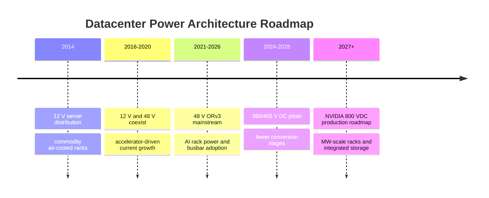
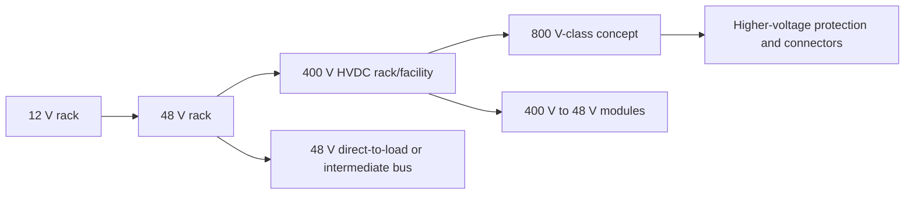

# Power Architecture Roadmap
> **Last Updated:** 2026-07-28
> **Status:** Draft
> **Tags:** architecture, 12V, 48V, HVDC, roadmap

## Overview
Datacenter power architecture evolves by increasing distribution voltage and moving conversion
closer to the load. Higher voltage reduces current and copper loss, while local regulation
improves transient response. The resulting trade is more demanding isolation, protection,
control, connector, and maintenance design.

48 V is commercially established through telecom heritage and OCP. 380/400 V DC has deployed
precedents but is not a universal AI-rack standard. NVIDIA has published a staged 800 VDC
architecture and targets production deployment with Kyber racks beginning in 2027. It remains
a vendor-led ecosystem roadmap rather than a broadly ratified deployment standard as of
2026-07-28.

## Key Findings / Highlights
- [CONFIRMED, 2024] ORv3 specifies a 48 V power shelf and busbar ecosystem [Source: OCP, 2024].
- [ESTIMATED, 2025] Leading liquid-cooled AI racks operate near 100-140 kW nameplate/configuration power.
- [CONFIRMED] Raising distribution from 12 V to 48 V cuts current by 4x at equal power and resistive loss by up to 16x at equal resistance.
- [CONFIRMED, VENDOR ROADMAP, 2027+] NVIDIA is leading an 800 VDC ecosystem for 1 MW IT
  racks and beyond, beginning with Kyber; production timing and interoperability remain
  execution risks [Source: NVIDIA, 2026].
- [CONFIRMED] Sub-1 V processor rails force the final converter physically close to the package.
- [CONFIRMED, 2026] NVIDIA's published late-stage Kyber concept uses a high-ratio 64:1 LLC
  conversion to step 800 VDC down to 12 V near the compute node [Source: NVIDIA, 2026].

## Visual Guide

### Official Roadmap Visual References
| Organization | Visual Material to Review | Official Source |
|---|---|---|
| Open Compute Project | ORv3, power shelf, busbar, and HPR architecture diagrams | https://www.opencompute.org/wiki/Open_Rack/SpecsAndDesigns |
| NVIDIA | 800 VDC facility/rack migration and MGX/Kyber visuals | https://www.nvidia.com/en-us/data-center/technologies/800-vdc-architecture/ |
| Vicor | 48 V power delivery and factorized power architecture diagrams | https://www.vicorpower.com/ |
| Delta Electronics | datacenter power shelf and rack power system visuals | https://www.deltaww.com/en-US/solutions/Data-Center |
| Vertiv | high-density rack and power infrastructure diagrams | https://www.vertiv.com/en-us/solutions/high-density-ai/ |

## Detailed Content
### Evolution Timeline

| Era | Year | Bus voltage | Rack power | Conversion stages | Key standard | Efficiency target | Driver |
|---|---:|---:|---:|---:|---|---|---|
| Legacy | pre-2015 | 12 V | ~8-15 kW | 3-4 | ATX/OCP early | 80 PLUS tiers | Commodity servers |
| Coexistence | 2016-2020 | 12/48 V | ~15-30 kW | 3-4 | CRPS/telecom/OCP | Platinum/Titanium | Accelerators |
| 48 V mainstream | 2021-2026 | 48 V | ~30-140 kW | 3-4 | ORv3 | >97% shelf peak | AI/HPC |
| HVDC expansion | 2024-2028E | 380/400 V | 100 kW+ | 2-3 | deployment-specific | fewer stages | Copper/stage reduction |
| NVIDIA 800 VDC roadmap | 2027E+ | 800 VDC | 1 MW IT racks and beyond | 2-3 | Vendor architecture; standards work open | [VENDOR CLAIM] fewer stages | Extreme density |

### Conversion Chains

| Architecture | Stage 1 | Stage 2 | Stage 3 | Stage 4 | Total | Indicative compounded efficiency |
|---|---|---|---|---|---:|---:|
| Traditional 12 V | AC/UPS | AC-12 V | 12 V-POL | load | 3 | 88-94% |
| ORv3 48 V | AC/UPS | AC-48 V shelf | 48 V-12 V or direct | POL | 3-4 | 90-95% |
| 400 V HVDC | AC-400 V | 400-48 V | 48 V-POL | load | 2-3 | 92-96% |
| 800 V direct concept | MV AC-800 VDC | 800-12/48 V near node | POL/load | - | 2-3 | Architecture-specific; no universal measured baseline |

### Standards Adoption

| Standard | Description | Year | Adoption | Proponents |
|---|---|---:|---|---|
| CRPS | Common redundant PSU form factor | 2010s | Broad | Server OEM ecosystem |
| Open Rack v3 | 48 V rack/busbar/power | 2021+ | Commercial | Meta/OCP members |
| OCP HPR | Higher-power ORv3 ecosystem | 2024+ | Development | Meta, Rittal, Delta, AE |
| 380 V DC | Facility/rack HVDC practice | 2010s+ | Selective | Telecom and DC operators |
| NVIDIA 800 VDC | AI-factory power architecture | 2025; production target 2027+ | Ecosystem development | NVIDIA and 30+ listed electrical/semiconductor partners |

### Power Density Roadmap

| Year | Typical AI rack | Leading rack | Accelerator TDP | Notes |
|---:|---:|---:|---:|---|
| 2018 | 10-20 kW | ~30 kW | 250-350 W | Air-cooled |
| 2022 | 20-40 kW | ~60 kW | 400-700 W | GPU clusters |
| 2025 | 40-80 kW | ~100-140 kW | 700-1,200 W class | Liquid cooling expands |
| 2027E+ | 80-150 kW | 1 MW+ roadmap class | 1,000 W+ | [VENDOR ROADMAP; LOW deployment confidence] |

Related: [Master Index](README.md).

## Data Tables (where applicable)
| Field | Value | Source | Date |
|---|---|---|---|
| ORv3 nominal bus | 48 V | OCP | 2024 |
| ORv3 HPR public target | 92 kW or more | OCP regional summit materials | 2024 |
| GB200 NVL72 GPUs | 72 Blackwell GPUs | NVIDIA | 2024 |
| NVIDIA 800 VDC production start | Kyber generation, 2027 | NVIDIA | 2026 roadmap |
| NVIDIA target rack class | 1 MW IT racks and beyond | NVIDIA | 2026 roadmap |
| 48 V current reduction vs 12 V | 4x | P=VI calculation | 2026 |
| I2R reduction at fixed resistance | 16x | Engineering calculation | 2026 |

## Open Questions / Gaps
- Obtain deployment counts for 380/400 V DC and distinguish facility bus from rack bus.
- Identify the standards body, connector, protection, and service-safety envelope for
  NVIDIA's proposed 800 VDC rack architecture.
- Replace rack power ranges with SKU-specific measured/nameplate values.

## References
- OCP Open Rack specifications | https://www.opencompute.org/wiki/Open_Rack/SpecsAndDesigns | Accessed 2026-06-10
- OCP ORv3 IT Gear Design Guide | https://www.opencompute.org/documents/ocp-orv3-it-gear-design-guide-rev-02-june032024-pdf | Accessed 2026-06-10
- NVIDIA GB200 NVL72 | https://www.nvidia.com/en-us/data-center/gb200-nvl72/ | Accessed 2026-06-10
- NVIDIA 800 VDC architecture | https://www.nvidia.com/en-us/data-center/technologies/800-vdc-architecture/ | Accessed 2026-07-28
- NVIDIA MGX/Kyber roadmap | https://www.nvidia.com/en-us/data-center/products/mgx/ | Accessed 2026-07-28
