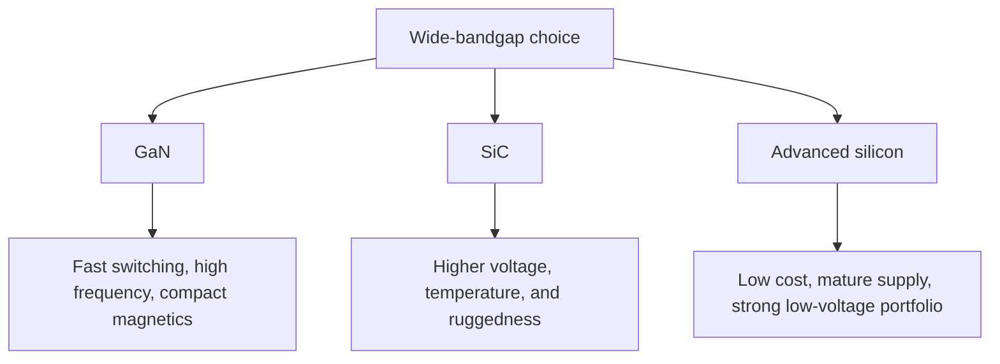
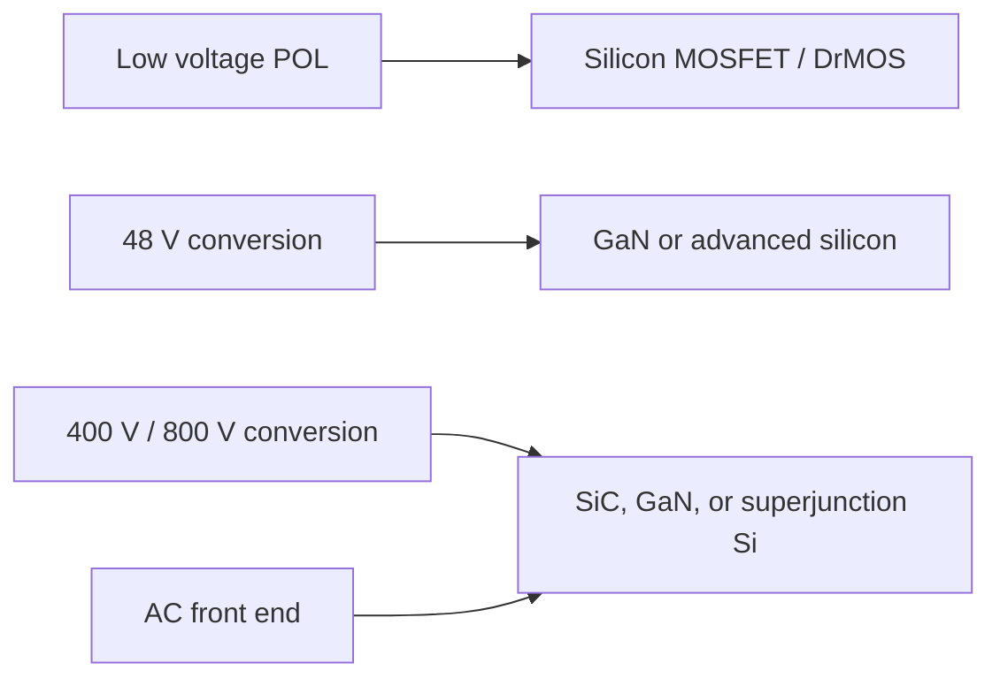

# Wide-Bandgap Semiconductors
> **Last Updated:** 2026-11-12
> **Status:** Draft
> **Tags:** WBG, GaN, SiC, reliability, adoption

## Overview
Wide-bandgap materials support higher electric field, switching speed, and temperature than
silicon, enabling smaller magnetics and lower conversion losses in selected operating regions.
Datacenter adoption is application-specific: GaN is strongest in fast 100-650 V conversion,
while SiC is strongest in 650 V and higher-power front-end, UPS, and HVDC stages.

WBG does not automatically improve a converter. Layout inductance, gate drive, reverse
conduction, thermal packaging, EMI filters, control, and qualification determine whether
device-level advantages survive at system level.

## Key Findings / Highlights
- [CONFIRMED] 650 V totem-pole PFC is a leading GaN datacenter use case.
- [CONFIRMED] SiC is commercially mature at 650-1,700 V and suited to UPS/HVDC power.
- [ESTIMATED, 2025] Silicon still supplies most datacenter power-semiconductor unit volume.
- [CONFIRMED] GaN dynamic RDS(on) and SiC gate-oxide stability require technology-specific qualification.
- [ESTIMATED, LOW confidence] Ga2O3 and diamond are unlikely to affect material DC revenue before 2030.
- [CONFIRMED, 2025-2026] The GaN voltage ceiling is rising for 800 VDC: Power Integrations
  detailed 1,250 V and 1,700 V PowiGaN (2025-10), and onsemi demonstrated a 1,200 V vertical-GaN
  800 V-to-6 V stage at OCP 2026 (projected, not measured, efficiency). Mainstream merchant GaN
  volume remains 650 V class [Sources: Power Integrations, 2025-10-13; onsemi, 2026-10-09].
- [CONFIRMED, 2026-10] 800 V-to-12 V and 800 V-to-6 V single-stage node converters built from
  stacked 650 V GaN half-bridges (e.g., Navitas/NVIDIA 24 kW board) show that GaN can serve
  800 VDC racks without 1,200 V devices; SiC remains favored in MV SST and 800 VDC front ends.

## Visual Guide

## Detailed Content
### Device Matrix

| Parameter | Si MOSFET | SiC MOSFET | GaN HEMT | Datacenter implication |
|---|---|---|---|---|
| Common voltage | 20-900 V | 650-3,300 V | 30-700 V mainstream; 1,200-1,700 V emerging (2025-2026) | Architecture selects device |
| Frequency | low to >1 MHz at LV | ~10-500 kHz typical | 100 kHz-several MHz | GaN shrinks passives |
| Cost | Lowest | Highest | Premium | WBG needs system value |
| Thermal | Mature; moderate k | High bulk k | Substrate/package dependent | SiC excels at heat spreading |
| Reverse behavior | Body diode | Body diode, higher Vf | No intrinsic body diode | Topology/gate timing differ |
| Supply chain | Broad | Concentrated substrate | Foundry/epi concentration | Dual sourcing matters |

### Readiness by Application

| Application | Si | SiC | GaN | 2025 maturity |
|---|---|---|---|---|
| Totem-pole PFC | Mature | Mature | Mature/growing | Production |
| LLC primary | Mature | Mature | Mature/growing | Production |
| 48 V intermediate bus | Dominant | Poor fit | Growing | Production |
| Sub-1 V VRM | Dominant | Not fit | Emerging | Early production |
| Gate-driver integration | Mature | Mature | Strong monolithic option | Production |

### Adoption S-Curve

- GaN: post-introduction, scaling in high-density PSUs and chargers; DC penetration is
  [ESTIMATED, MED confidence] early growth rather than majority adoption in 2025.
- SiC: scaled by EV and industrial demand; datacenter use is [ESTIMATED] early in UPS/PFC/HVDC.
- Silicon: mature incumbent with continuous packaging and super-junction improvement.

### Reliability

| Issue | Material | Mechanism | Mitigation |
|---|---|---|---|
| Dynamic RDS(on) | GaN | Charge trapping | Process, field plates, test protocol |
| Threshold shift | SiC | Oxide/interface traps | Gate bias limits, screening |
| Short circuit | SiC/GaN | Small die/thermal time constant | Fast protection |
| Cosmic-ray failure | High-voltage devices | Single-event burnout | Derating and qualification |

See [04_gan_technology.md](04_gan_technology.md) and
[05_sic_technology.md](05_sic_technology.md).

## Data Tables (where applicable)
| Field | Value | Source | Date |
|---|---|---|---|
| GaN commercial ceiling | ~650-700 V mainstream | Vendor portfolios | 2025 |
| GaN high-voltage frontier | 1,250/1,700 V lateral (PowiGaN); 1,200 V vertical demos (onsemi) | Vendor disclosures | 2025-2026 |
| SiC commercial range | 650-3,300 V common | Vendor portfolios | 2025 |
| GaN killer application | Totem-pole PFC | Industry designs | 2025 |
| SiC DC zone | UPS/PFC/HVDC | Vendor applications | 2025 |
| Beyond-WBG relevance | [ESTIMATED] post-2030 material revenue | Analyst assessment | 2026 |

## Open Questions / Gaps
- Build a shipment-based WBG penetration model by converter stage.
- Add field-return and FIT-rate comparisons using equivalent mission profiles.
- Quantify cosmic-ray derating practices for high-altitude datacenters.

## References
- JEDEC JEP173 overview | https://www.jedec.org/standards-documents/docs/jep173 | Accessed 2026-06-10
- Infineon CoolGaN | https://www.infineon.com/cms/en/product/power/gallium-nitride-gan/ | Accessed 2026-06-10
- Wolfspeed SiC devices | https://www.wolfspeed.com/products/power/ | Accessed 2026-06-10
- Power Integrations 1,250/1,700 V PowiGaN | https://www.businesswire.com/news/home/20251013503136/en/power-integrations-details-1250-v-and-1700-v-powigan-technology-for-next-generation-800-vdc-ai-data-centers | Indexed 2026-11-12
- onsemi grid-to-core OCP 2026 blog | https://www.onsemi.com/company/newsroom/blog/innovation/from-grid-to-core-powering-ai | Indexed 2026-11-12
