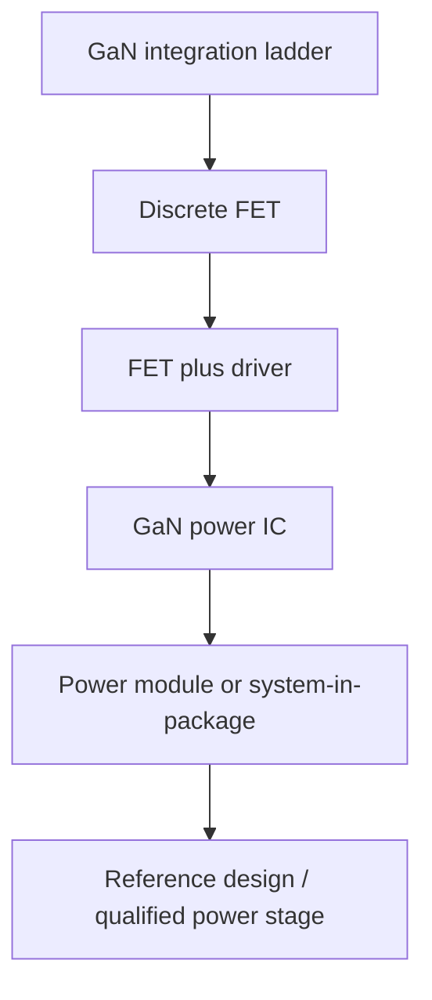

# GaN Technology
> **Last Updated:** 2026-11-12
> **Status:** Draft
> **Tags:** GaN, HEMT, substrates, PFC, reliability

## Overview
Power GaN uses a high-electron-mobility transistor formed around a two-dimensional electron gas
at an AlGaN/GaN interface. Enhancement-mode devices dominate new power designs; cascode devices
combine a normally-on GaN transistor with a silicon MOSFET to produce normally-off behavior.

GaN's low charge and output capacitance enable high-frequency operation, but package/layout
parasitics, dynamic RDS(on), reverse-conduction loss, gate-voltage margin, and EMI require
disciplined design. Datacenter revenue is concentrated in AC/DC PFC and high-density DC/DC.

## Key Findings / Highlights
- [CONFIRMED, 2024] Infineon announced 300 mm (12-inch), not 8-inch, GaN wafer production development.
- [CONFIRMED] GaN-on-Si is the cost/scale platform for most power GaN; GaN-on-SiC is common in RF.
- [CONFIRMED] 650 V enhancement-mode and cascode products are commercially available.
- [CONFIRMED] Totem-pole PFC prototypes/products can exceed 99% peak efficiency under specified conditions.
- [CORRECTION] Navitas GeneSiC is a SiC product brand, not a fully integrated GaN driver/controller.
- [CONFIRMED, 2023-2024] Infineon acquired GaN Systems; Renesas acquired Transphorm.
- [CONFIRMED, 2026] onsemi is sampling 700 V/1,200 V vertical GaN to early-access customers
  and plans 650 V lateral GaN on GlobalFoundries' 200 mm e-mode GaN-on-Si process
  [Source: onsemi, 2026]. Its late-2026 vertical-GaN volume target is now [COMPANY TARGET;
  unconfirmed as of 2026-11-12]: the OCP 2026 showing was a 1,200 V vertical-GaN 800 V-to-6 V
  stage with *projected* 96% efficiency, and Q3 results announced no volume production. onsemi
  launched its 40-650 V GaNEXUS lateral portfolio in Q2 2026 [Source: onsemi, 2026-08-03].
- [CONFIRMED, 2026-07] The US ITC import/sales remedies against infringing Innoscience
  products became final after Presidential Review, while German courts issued additional
  infringement rulings in Infineon's favor [Source: Infineon, 2026-07-07]. Innoscience disputes
  the scope (it says only legacy products are covered) and won Chinese rulings against Infineon
  GaN products (Suzhou court 2026-05-27; Supreme People's Court upheld injunctions 2026-06-12)
  [Source: Innoscience via Semiconductor Today, 2026-06].
- [CONFIRMED, 2026-10] GaN is now central to NVIDIA's 800 VDC node conversion: Navitas/NVIDIA
  showed a 24 kW single-stage 800 V-to-12 V board (16 × 650 V GaN FETs; 97% full-load target),
  and Infineon/NVIDIA agreed to co-develop GaN high-voltage IBCs (800 V to 50/12/6 V, up to
  1 MHz). Navitas guides native 800 V production to late 2027 at the earliest [COMPANY GUIDANCE].
- [CONFIRMED, 2026-08] Yole forecasts power GaN devices reaching $3.5B by 2031 (35% CAGR
  2025-2031), with telecom/infrastructure (including AI datacenters) at $750M by 2031 (45% CAGR);
  Yole ranked Innoscience first by 2025 power-GaN revenue [Source: Yole via Semiconductor Today].
- [CONFIRMED, 2026] Foundry structure is shifting: TSMC exits GaN foundry production by
  2027-07-31; GlobalFoundries licensed TSMC's 650 V and 80 V GaN technology (2025-11-10); EPC
  licensed low-voltage eGaN to Renesas as a qualified second source (2026-02-12).

## Visual Guide

### Official Visual References
| Vendor | Visual Material to Review | Official Source |
|---|---|---|
| Navitas | GaNFast, GaNSafe, and AI datacenter power architecture visuals | https://navitassemi.com/ |
| Infineon | GaN Systems / CoolGaN product and application diagrams | https://www.infineon.com/cms/en/product/power/gallium-nitride-gan/ |
| EPC | eGaN device, package, and application diagrams | https://epc-co.com/epc/products/gan-fets-and-ics |
| Renesas | Transphorm GaN product-line and application visuals | https://www.renesas.com/en/products/power-power-management/gan-fets |

## Detailed Content
### Device Structures

| Structure | Normally off? | Strength | Limitation |
|---|---|---|---|
| E-mode lateral HEMT | Yes | Low charge, monolithic integration | Tight gate margin |
| Cascode GaN | Yes at terminals | Familiar gate drive | Added silicon/device parasitics |
| D-mode HEMT | No | Strong native channel | Fail-safe complexity |
| Vertical GaN | Potentially | Higher voltage/current density | Early manufacturing |

### Substrates

| Platform | Cost | Thermal | Wafer scale | Power use | Representative ecosystem |
|---|---|---|---|---|---|
| GaN-on-Si | Lowest GaN path | Limited by Si | 150/200/300 mm | Dominant power platform | Infineon, Navitas partners, EPC |
| GaN-on-SiC | High | Excellent | 100/150 mm | Mostly RF/specialty | Wolfspeed/RF ecosystem |
| GaN-on-GaN | Very high | Good | Small | Vertical/specialty | Odyssey-class R&D |
| GaN-on-sapphire | Medium | Poor-moderate | 150/200 mm | LED/R&D, some devices | Asian epi ecosystem |

### Datacenter Product Families

| Company | Family | Voltage class | Integration/package | Target |
|---|---|---:|---|---|
| Navitas | GaNFast / GaNSafe | 650 V | IC/discrete variants | PFC/LLC |
| EPC | eGaN FET/IC | 30-350 V common | Chip-scale/LGA | 48 V conversion |
| Infineon | CoolGaN / GaN Systems legacy | 100-700 V | Discrete/IC/module | PFC/DC-DC |
| TI | LMG | 100/600-650 V | Driver-integrated stages | PFC/DC-DC |
| Renesas | Transphorm SuperGaN | 650 V | Cascode/discrete | PFC/industrial |
| STMicroelectronics | MasterGaN | 600-650 V | Half bridge + drivers | PSU/industrial |
| onsemi | GaNEXUS lateral/vertical GaN | 40-650 V lateral (launched 2026); 700/1,200 V vertical sampling/demos | discrete/integrated | AI PSU/800 V conversion |
| Power Integrations | PowiGaN | 1,250/1,700 V lateral | integrated switcher/IC | 800 VDC DC-DC (revenue seen 2028-29 by analysts) |
| Innoscience | InnoGaN | low/medium voltage to 700 V class; up to 1,200 V claimed | discrete/IC | 48 V/800 V AI datacenter, consumer |

> ⚠️ Note: Price is channel-, volume-, package-, and date-dependent; distributor spot prices
are not a valid proxy for hyperscaler/OEM contract ASP.

### Integration Ladder

1. Discrete GaN FET plus external driver/controller.
2. GaN FET plus optimized driver in one package or IC platform.
3. Half-bridge/power-stage integration with sensing/protection.
4. Converter module including magnetics, capacitors, and control.

### Wafer Roadmap

| Diameter | Status | Significance |
|---:|---|---|
| 150 mm / 6-inch | Mainstream legacy capacity | Established epi/process |
| 200 mm / 8-inch | Scaling | Better tool/foundry compatibility |
| 300 mm / 12-inch | Announced by Infineon in 2024; HVM not confirmed as of 2026-11-12 | Potential die-cost/productivity step |

onsemi's vertical GaN program is GaN-on-GaN rather than the mainstream lateral GaN-on-Si
platform. Early-access sampling, a 2026 OCP demonstration, and a late-2026 volume target should
not be treated as qualified mass deployment until production and field data are disclosed.

### 2026 Foundry and Supply Changes

| Date | Event | Implication |
|---|---|---|
| 2025-11-10 | GlobalFoundries licenses TSMC 650 V/80 V GaN for Burlington, VT | US/EU-aligned second source; production start [TO VERIFY] |
| 2026-02-12 | EPC licenses low-voltage eGaN to Renesas as second source | Dual sourcing for 48 V AI conversion |
| 2026-08-28 | Innoscience H1 2026 revenue ~RMB 834M (+50.6%) | Scale leader in GaN-on-Si volume |
| 2027-07-31 | TSMC GaN foundry production end date | Fabless GaN vendors must complete transfers (e.g., PSMC, GF) |

### IP and Qualification

JEDEC JEP173 provides dynamic on-resistance measurement guidance. AEC-Q101 is used by some
vendors as an automotive reliability benchmark but is not a datacenter-specific qualification.
Key IP clusters include e-mode process/field plates, monolithic driver integration, protection,
and low-inductance packaging. Infineon reported about 450 GaN patent families in July 2026,
but that owner-reported figure still requires independent normalization by legal status and
jurisdiction [See: 16_patents_ip_landscape.md].

Related: [Master Index](README.md).

## Data Tables (where applicable)
| Field | Value | Source | Date |
|---|---|---|---|
| Main high-voltage class | 650 V | Vendor portfolios | 2025 |
| Infineon wafer milestone | 300 mm GaN development | Infineon | 2024 |
| GaN Systems acquisition | $830M announced transaction value | Infineon | 2023 |
| Transphorm owner | Renesas | Renesas | 2024 |
| onsemi vertical GaN roadmap | 700/1,200 V sampling; late-2026 volume target [UNCONFIRMED at 2026-11-12] | onsemi | 2026 |
| Infineon reported GaN portfolio | ~450 patent families [OWNER-REPORTED] | Infineon | 2026-07 |
| Peak PFC efficiency | >99% under design-specific conditions | Vendor reference designs | 2024-2025 |
| Navitas/NVIDIA 800 V-to-12 V board | 24 kW; 97% full-load target | Navitas | 2026-10-13 |
| Yole power GaN forecast | $3.5B by 2031; 35% CAGR | Yole | 2026-08 |
| TSMC GaN foundry exit | By 2027-07-31 | Navitas 8-K / trade press | 2025 |

## Open Questions / Gaps
- Add current product-level RDS(on), Qg, Coss, package, qualification, and volume ASP snapshots.
- Verify Navitas patent-family count rather than repeating marketing patent counts.
- Track actual 300 mm yield, products, and customer qualification after Infineon's announcement.
- Obtain comparable dynamic RDS(on) and field-failure data.
- Confirm whether GlobalFoundries' TSMC-licensed GaN and Navitas' PSMC transfer reached production.
- Reconcile Yole's $750M 2031 telecom/infrastructure GaN forecast with this database's DC GaN segment.

## References
- Infineon 300 mm GaN | https://www.infineon.com/cms/en/about-infineon/press/press-releases/2024/INFXX202409-158.html | Accessed 2026-06-10
- Renesas completes Transphorm acquisition | https://www.renesas.com/en/about/press-room/renesas-completes-acquisition-transphorm | Accessed 2026-06-10
- ST MasterGaN | https://www.st.com/en/power-management/mastergan.html | Accessed 2026-06-10
- TI GaN | https://www.ti.com/power-management/gallium-nitride/overview.html | Accessed 2026-06-10
- EPC products | https://epc-co.com/epc/products/gan-fets-and-ics | Accessed 2026-06-10
- onsemi/GF 200 mm lateral GaN collaboration | https://investor.onsemi.com/news-releases/news-release-details/onsemi-develop-next-generation-gan-power-devices-globalfoundries | Accessed 2026-07-28
- onsemi Q1 2026 investor presentation | https://investor.onsemi.com/static-files/47c2ca2d-07d7-4d18-aa0b-87cc657b1ef4 | Accessed 2026-07-28
- Infineon US ITC final determination | https://www.infineon.com/press-release/2026/ifxpr202607-118 | Accessed 2026-07-28
- Infineon German infringement ruling | https://www.infineon.com/press-release/2026/infxx202606-115 | Accessed 2026-07-28
- Navitas/NVIDIA 800 V-to-12 V board | https://semiconductor-today.com/news_items/2026/oct/navitas-131026.shtml | Indexed 2026-11-12
- Infineon/NVIDIA GaN IBCs | https://www.semiconductor-today.com/news_items/2026/oct/infineon-211026.shtml | Indexed 2026-11-12
- Yole Power GaN 2026 | https://semiconductor-today.com/news_items/2026/aug/yole-200826.shtml | Indexed 2026-11-12
- GlobalFoundries/TSMC GaN license | https://semiconductor-today.com/news_items/2025/nov/globalfoundries-tsmc-101125.shtml | Indexed 2026-11-12
- EPC/Renesas GaN licensing | https://www.businesswire.com/news/home/20260212384290/en/EPC-Announces-Strategic-GaN-Technology-Licensing-and-Second-Sourcing-Agreement-With-Renesas/ | Indexed 2026-11-12
- Innoscience H1 2026 interim results | https://www1.hkexnews.hk/listedco/listconews/sehk/2026/0828/2026082803672.pdf | Indexed 2026-11-12
- Innoscience China rulings vs Infineon | https://www.semiconductor-today.com/news_items/2026/jun/innoscience-infineon-150626.shtml | Indexed 2026-11-12
- onsemi grid-to-core OCP 2026 blog | https://www.onsemi.com/company/newsroom/blog/innovation/from-grid-to-core-powering-ai | Indexed 2026-11-12
