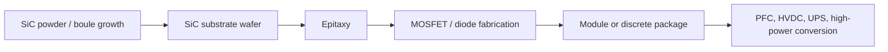
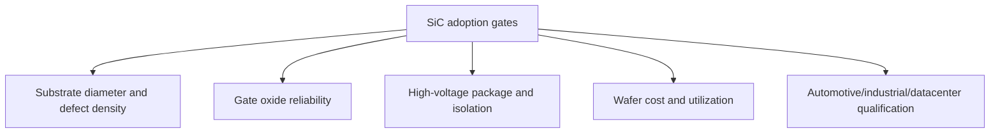

# Silicon Carbide Technology
> **Last Updated:** 2026-11-12
> **Status:** Draft
> **Tags:** SiC, MOSFET, substrates, capacity, reliability

## Overview
4H-SiC combines high critical electric field and thermal conductivity, making it attractive for
high-voltage, high-power conversion. Datacenter applications center on UPS, PFC, HVDC, and
rack-level converters rather than sub-100 V point-of-load regulation.

The SiC value chain starts with slow, defect-sensitive crystal growth, followed by wafering,
epitaxy, device fabrication, and power packaging. EV-led capacity investment created pricing
and utilization pressure in 2024-2026, potentially lowering device cost for infrastructure
applications while stressing highly leveraged suppliers.

## Key Findings / Highlights
- [CONFIRMED] 4H-SiC is the dominant power-electronics polytype.
- [CONFIRMED] Gate oxide/interface traps remain a central MOSFET reliability concern.
- [CONFIRMED, 2025] Wolfspeed filed Chapter 11 in June 2025 and completed financial restructuring later in 2025.
- [CORRECTION] SK Siltron is part of SK Group, not a Samsung subsidiary.
- [CORRECTION] ST and Soitec have a SmartSiC supply relationship; ST's China SiC JV is with Sanan.
- [ESTIMATED, 2025-2026] EV demand/capacity mismatch increased SiC pricing pressure and datacenter availability.
- [CONFIRMED, 2026] Wolfspeed completed the final Renesas-related equity issuance after CFIUS
  clearance in January 2026, closing a remaining restructuring milestone.
- [CONFIRMED, 2026] Wolfspeed shifted Durham 150 mm device production to its 200 mm Mohawk
  Valley fab and reported demonstrating 300 mm SiC wafer capability; 300 mm is a development
  milestone, not a volume-production baseline.
- [CONFIRMED, 2026-11] Wolfspeed reported FY2026 revenue of $665.1M (FY2025: $757.6M) and Q1
  FY2027 revenue of ~$155M with negative gross margin; it said AI-datacenter revenue more than
  doubled in FY2026. On 2026-10-07 it received a conditional commitment for up to $1.5B of
  30-year senior secured financing from the US Department of War's Office of Strategic Capital
  [Sources: Wolfspeed 8-Ks, 2026].
- [CONFIRMED, 2026-10] Infineon extended its Wolfspeed SiC wafer supply agreement from 150 mm
  to 200 mm and will supply SiC devices for Eaton's MVSST 2.0 medium-voltage SST for 800 VDC,
  with 2.3 kV and 3.3 kV SiC modules under evaluation.
- [CONFIRMED, 2026-09] Resonac and Sumitomo Metal Mining began sampling 300 mm SiC substrates
  (Sumitomo's is a bonded substrate); neither disclosed volume-production timing.
- [ESTIMATED, MED, 2026] 6-inch SiC substrate prices fell more than 30% YoY in Q1 2026 and were
  reported near $200-300 per wafer by mid-2026, pressuring margins at SICC, ST (Power & Discrete
  operating loss of $81M in Q3 2026 amid 200 mm start-up costs), onsemi, and Wolfspeed.

## Visual Guide

### Official Visual References
| Vendor | Visual Material to Review | Official Source |
|---|---|---|
| Wolfspeed | SiC substrate, device, and 200 mm manufacturing visuals | https://www.wolfspeed.com/ |
| onsemi | EliteSiC device and module application diagrams | https://www.onsemi.com/products/discrete-power-modules/silicon-carbide-sic |
| STMicroelectronics | silicon carbide product and application visuals | https://www.st.com/en/power-transistors/sic-mosfets.html |
| ROHM | SiC MOSFET and module package visuals | https://www.rohm.com/products/sic-power-devices |

## Detailed Content
### Device Physics and Reliability

| Topic | Engineering significance |
|---|---|
| 4H polytype | Best-established field/mobility/material balance |
| SiO2/SiC interface | Trap density affects mobility and threshold stability |
| Body diode | Higher forward drop; dead-time and external diode choices matter |
| Bipolar degradation | Basal-plane defects can degrade bipolar conduction |
| Avalanche/short circuit | Must be tested at mission-profile temperature and bus voltage |

### Supply Chain

| Step | Bottleneck | Leaders/examples |
|---|---|---|
| Boule growth | Defects, cycle time, diameter | Wolfspeed, Coherent, SiCrystal, SICC, TanKeBlue, SK Siltron |
| Wafering | Kerf loss, bow, surface | Integrated and specialist wafer firms |
| Epitaxy | Thickness/doping uniformity | IDMs and epi suppliers |
| Device fab | Oxide/interface, yield | Infineon, ST, onsemi, ROHM, Wolfspeed |
| Packaging | Inductance and thermal cycling | IDMs/module specialists |

### Device Families

| Company | Family | Voltage class | Package direction | DC target |
|---|---|---:|---|---|
| Wolfspeed | C3M/E3M | 650-1,700 V | TO/D2PAK/modules | PFC/UPS |
| Infineon | CoolSiC | 650-2,000 V class; 2.3/3.3 kV modules evaluated for SST (2026) | discrete/modules | PFC/UPS/HVDC/MV SST |
| onsemi | EliteSiC | 650-1,200 V | discrete/modules | PFC/energy |
| STMicroelectronics | STPOWER SiC | 650-1,200 V | discrete/modules | PFC/industrial |
| ROHM | SCT/BH series | 650-1,200 V | discrete/modules | PFC/UPS |
| Microchip | mSiC | 700-3,300 V | die/discrete/modules | high-reliability power |

### Capacity Tracker

| Company/site | Substrate/device | Diameter | 2026 status | Investment/status |
|---|---|---:|---|---|
| Wolfspeed Mohawk Valley | Devices | 200 mm | Ramping; low utilization | Restructured balance sheet; conditional $1.5B OSC loan (2026-10) |
| Wolfspeed John Palmour Manufacturing Center, Siler City, NC | Materials | 200 mm | Ramp/qualification | Restructured program |
| Coherent | Substrates | 150/200 mm | Commercial/ramping | Merchant supplier |
| SiCrystal/ROHM | Substrates | 150/200 mm path | Integrated | European base |
| ST/Sanan JV | Devices | 200 mm plan | Ramp plan | China manufacturing |
| SICC/TanKeBlue | Substrates | 150/200 mm path | Expanding | China localization; SICC 8-inch >50% of Q3 2026 revenue [company] |
| ST Catania / Chongqing (Sanan JV) | Devices/substrates | 200 mm | Start-up costs in 2026 | Power & Discrete operating loss in Q3 2026 |
| Resonac | Substrates | 300 mm | Samples (2026-09) | No epiwafer plan announced |
| Sumitomo Metal Mining | Bonded substrates ("SiCkrest") | 300 mm | Samples (2026-09) | Volume timing undisclosed |

> ⚠️ Note: Public "capacity" is reported as wafers, revenue capacity, floor space, or
equivalent wafer starts. These units are not directly comparable; unsupported mm2/month
estimates are intentionally omitted.

### Packaging Roadmap

TO-247/D2PAK remain common. Four-lead Kelvin-source and low-inductance surface-mount packages
improve switching behavior. Half-bridge and multi-switch modules using DBC/AMB substrates are
preferred as power and voltage rise. See [21_thermal_management.md](21_thermal_management.md).

## Data Tables (where applicable)
| Field | Value | Source | Date |
|---|---|---|---|
| Dominant polytype | 4H-SiC | Industry consensus | 2025 |
| Common DC voltage classes | 650/1,200 V | Vendor portfolios | 2025 |
| Mohawk Valley wafer diameter | 200 mm | Wolfspeed | 2025 |
| Wolfspeed Chapter 11 filing | June 30, 2025 | Wolfspeed/court disclosures | 2025 |
| Wolfspeed/Renesas restructuring milestone | CFIUS clearance and final equity issuance | Wolfspeed | 2026-01-30 |
| Wolfspeed 300 mm status | Demonstrated wafer capability; not HVM | Wolfspeed Q2 FY2026 | 2026 |
| ST China SiC partner | Sanan | STMicroelectronics | 2023 |
| Wolfspeed FY2026 revenue | $665.1M | Wolfspeed 8-K | FY ended 2026-06-28 |
| Wolfspeed Q1 FY2027 revenue | ~$155M; non-GAAP GM (13)% | Wolfspeed 8-K | 2026-11-04 |
| Wolfspeed OSC financing | Up to $1.5B, conditional | Wolfspeed 8-K | 2026-10-07 |
| 6-inch SiC substrate price | [ESTIMATED, MED] ~$200-300/wafer | Digitimes/TrendForce | mid-2026 |
| 300 mm SiC substrate samples | Resonac; Sumitomo Metal Mining | Company/trade press | 2026-09 |

## Open Questions / Gaps
- Normalize wafer capacity to 150 mm-equivalent good wafers per month.
- Add post-restructuring Wolfspeed utilization, capex, and customer commitments.
- Quantify datacenter-specific SiC shipments separately from EV/industrial.
- Add China substrate defect-density and qualification comparisons.
- Track whether the OSC loan closes and refinances Wolfspeed's high-coupon first-lien notes.
- Quantify SiC content in MV SSTs and 800 VDC sidecars versus EV demand.

## References
- Wolfspeed restructuring | https://investor.wolfspeed.com/ | Accessed 2026-06-10
- Wolfspeed restructuring completion milestone | https://investor.wolfspeed.com/news/news-details/2026/Wolfspeed-Announces-CFIUS-Clearance-and-Completion-of-Equity-Issuance-to-Renesas-as-Part-of-Court-Approved-Restructuring/default.aspx | Accessed 2026-07-28
- Wolfspeed Q2 FY2026 results | https://assets.wolfspeed.com/uploads/2026/02/Wolfspeed_Q2_2026_Earnings_Release.pdf | Accessed 2026-07-28
- ST and Sanan SiC JV | https://newsroom.st.com/media-center/press-item.html/c3184.html | Accessed 2026-06-10
- Soitec SmartSiC | https://www.soitec.com/en/products/smartcut/smartsic | Accessed 2026-06-10
- ROHM SiC | https://www.rohm.com/sic | Accessed 2026-06-10
- Microchip SiC | https://www.microchip.com/en-us/products/power-management/silicon-carbide | Accessed 2026-06-10
- Wolfspeed Q4 FY2026 results | https://www.sec.gov/Archives/edgar/data/0000895419/000089541926000049/ex991q4-26.htm | Indexed 2026-11-12
- Wolfspeed Q1 FY2027 results | https://www.sec.gov/Archives/edgar/data/0000895419/000089541926000075/ex991q1-27.htm | Indexed 2026-11-12
- Wolfspeed OSC loan commitment | https://www.sec.gov/Archives/edgar/data/0000895419/000119312526416987/d122407dex991.htm | Indexed 2026-11-12
- Infineon/Wolfspeed 200 mm supply extension | https://semiconductor-today.com/news_items/2026/oct/wolfspeed-infineon-161026.shtml | Indexed 2026-11-12
- Infineon/Eaton MVSST 2.0 | https://www.infineon.com/press-release/2026/infpr202609-146 | Indexed 2026-11-12
- Resonac / Sumitomo Metal Mining 300 mm SiC | https://eetimes.itmedia.co.jp/ee/articles/2609/25/news064.html | Indexed 2026-11-12
- TrendForce China WBG pricing | https://www.trendforce.com/news/2026/05/14/news-chinas-wide-bandgap-chip-players-diverge-as-gan-rf-surges-sic-profitability-under-pressure/ | Indexed 2026-11-12
- SICC H1 2026 interim results | https://www.hkexnews.hk/listedco/listconews/sehk/2026/0819/2026081901613.pdf | Indexed 2026-11-12
- ST Q3 2026 results (reprint) | https://www.generation-nt.com/communiques-presse/stmicroelectronics-reports-q3-2026-financial-results-2083619 | Indexed 2026-11-12
