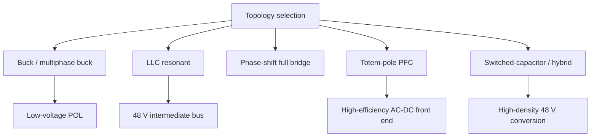

# Power Conversion Topology
> **Last Updated:** 2026-11-12
> **Status:** Draft
> **Tags:** topology, PFC, LLC, DAB, multiphase, switched-capacitor

## Overview
Converter topology determines voltage ratio, isolation, switch stress, magnetic requirements,
control complexity, and the ability to exploit a semiconductor's speed. Device comparisons
that ignore topology and operating mode are usually misleading.

Datacenter front ends increasingly use bridgeless/totem-pole PFC and resonant DC/DC, while
processor rails use multiphase bucks or proprietary factorized/switched-capacitor approaches.
Bidirectional CLLC and DAB stages support BBUs, UPS, and future HVDC architectures.

## Key Findings / Highlights
- [CONFIRMED] Totem-pole PFC removes the diode-bridge loss but increases control/commutation demands.
- [CONFIRMED] LLC uses resonant soft switching and is common in isolated server power conversion.
- [CONFIRMED] Multiphase operation shares current and cancels ripple at the output.
- [CONFIRMED] DAB provides isolated bidirectional power using two active bridges.
- [ESTIMATED] Hybrid switched-capacitor/inductor designs gain value as conversion ratios rise.
- [CONFIRMED, 2026] Medium-voltage solid-state transformers (MV AC-to-800 VDC) moved from
  concept to product programs: ABB Infinitus (SST commercial availability 2H 2027), Eaton
  MVSST 2.0 with Infineon SiC, Siemens/Reinhausen (up to 36 kV input), Delta, Heron Power,
  Amperesand, and DG Matrix [Sources: vendor releases, 2026].
- [CONFIRMED, 2026-10] Single-stage node conversion from 800 V directly to 12 V or 6 V was
  demonstrated with stacked GaN half-bridges and high-ratio resonant stages (Navitas/NVIDIA
  24 kW 800 V-to-12 V; Microchip/Navitas and TI 800 V-to-6 V). Efficiency values are vendor
  targets until independent measurements are published.

## Visual Guide

## Detailed Content
### Topology Matrix

| Topology | Type | Voltage/power | Efficiency potential | Complexity | DC use | WBG fit |
|---|---|---|---|---|---|---|
| Buck/boost/buck-boost | Non-isolated | LV-MV | High | Low-medium | POL/bus | Yes |
| SEPIC/flyback | Isolated optional | Low-medium power | Medium | Low | Aux rails | Yes |
| LLC/CLLC | Isolated resonant | 100 W-100 kW class | Very high | Medium-high | PSU/BBU | Strong |
| DAB | Isolated bidirectional | kW-MW class | High | High | HVDC/BBU | Strong |
| Totem-pole PFC | AC/DC | 1-100+ kW | >99% peak demonstrated | High | Front end | Strong |
| Vienna rectifier | 3-phase AC/DC | high power | High | High | UPS/front end | SiC fit |
| PSFB | Isolated | kW class | High | Medium | Bus converter | Yes |
| Multiphase buck | Non-isolated | 100-1,000+ A | High | High | CPU/GPU VRM | Si/GaN |
| Switched capacitor | Non-isolated | fixed ratios | High | Medium | 48-12 V | GaN/Si |
| Factorized/SAC | Proprietary resonant | high ratio | High | High | 48 V-POL | Module-specific |

### Multiphase Ripple

For N equally spaced phases, each phase is shifted by 360/N degrees. At favorable duty ratios,
the summed inductor ripple partially cancels, permitting smaller output capacitance and faster
transients. Real gains depend on current sharing, dead time, package/plane parasitics, and
controller bandwidth.

### Emerging 800 V Options

| Topology | Role | Key issue |
|---|---|---|
| SiC DAB | 800 V to isolated bus | Transformer/leakage optimization |
| CLLC | Bidirectional resonant conversion | Wide-gain control |
| Partial-power processing | Process only voltage difference | Protection/fault paths |
| Modular multilevel | Scale voltage with cells | Cost/control complexity |
| MV solid-state transformer | MV AC (13.8-36 kV) to 800 VDC, often with storage buffering | Certification, fault ride-through, MV insulation, cost per MW |
| Stacked-half-bridge GaN LLC | 800 V to 12 V/6 V single stage near the node | Voltage balancing, transformer ratio, transient response |
| Multi-port SST | MV AC, storage, and generation ports into one DC bus | Control complexity and protection coordination |

Related: [Master Index](README.md).

## Data Tables (where applicable)
| Field | Value | Source | Date |
|---|---|---|---|
| Typical VRM phases | 6-20+ | Controller/product designs | 2025 |
| Totem-pole peak efficiency | >99% demonstrated | Reference designs | 2024-2025 |
| Phase spacing | 360/N degrees | Topology identity | 2026 |
| DAB directionality | Bidirectional | Power-electronics literature | 2025 |
| LLC switching | ZVS/ZCS over designed range | Power-electronics literature | 2025 |
| Navitas/NVIDIA single-stage board | 24 kW, 800 V-to-12 V, 16 × 650 V GaN, 97% full-load target | Navitas | 2026-10-13 |
| TI 800 V-to-6 V bus converter | 97.6% peak [VENDOR CLAIM], >2,000 W/in³ | TI | 2026-03-16 |
| Delta MV SST | Up to 98.5% [VENDOR CLAIM, trade press] | Delta/OCP coverage | 2026-10 |
| DG Matrix Interport | Multi-port SST up to 2.4 MW per unit | DG Matrix | 2026-02 |

## Open Questions / Gaps
- Add apples-to-apples 5 kW and 30 kW loss models across PFC/LLC variants.
- Map proprietary Vicor claims to independently measured efficiency and transient data.
- Track OCP high-power shelf reference topologies.
- Compare MV SST efficiency, footprint, and cost per MW against line-frequency transformer plus rectifier baselines.

## References
- IEEE Transactions on Power Electronics | https://ieeexplore.ieee.org/xpl/RecentIssue.jsp?punumber=63 | Accessed 2026-06-10
- TI totem-pole PFC resources | https://www.ti.com/power-management/acdc-isolated-dcdc-switching-regulators/power-factor-correction-pfc/overview.html | Accessed 2026-06-10
- Vicor Factorized Power | https://www.vicorpower.com/technology/factorized-power-architecture | Accessed 2026-06-10
- ABB Infinitus DC portfolio | https://www.globenewswire.com/news-release/2026/09/21/3365178/0/en/abb-s-new-direct-current-portfolio-aims-to-rewire-ai-data-center-energy-infrastructure.html | Indexed 2026-11-12
- Siemens/Reinhausen SST | https://www.techzine.eu/news/infrastructure/143672/siemens-and-reinhausen-are-developing-an-sst-for-800v-dc-ai-data-centers/ | Indexed 2026-11-12
- Infineon/Eaton MVSST 2.0 | https://www.infineon.com/press-release/2026/infpr202609-146 | Indexed 2026-11-12
- Navitas/NVIDIA 24 kW board | https://www.powerelectronicsnews.com/navitas-nvidia-develop-24-kw-800v-to-12v-power-board/ | Indexed 2026-11-12
- Microchip/Navitas 800 V-to-6 V reference design | https://www.microchip.com/en-us/about/news-releases/products/the-data-center-is-moving-to-800v-microchip-and-navitas-are-enabling-transition | Indexed 2026-11-12
- DG Matrix Series A | https://techcrunch.com/2026/02/18/dg-matrix-raises-60m-to-make-data-center-power-smarter | Indexed 2026-11-12
