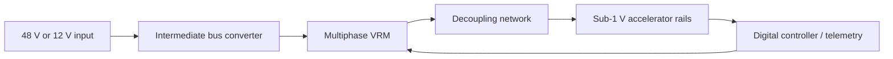
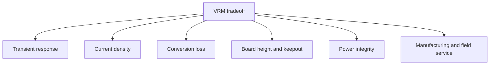

# VRM and PMIC
> **Last Updated:** 2026-11-12
> **Status:** Draft
> **Tags:** VRM, PMIC, DrMOS, GPU, CPU, POL

## Overview
VRMs translate board or rack intermediate rails into tightly regulated processor, memory, and
auxiliary voltages. AI accelerators combine high average power with abrupt load transients,
making current density, telemetry, control bandwidth, decoupling, and thermal design central.

Most high-current rails use multiphase controllers with integrated DrMOS or smart power stages.
Proprietary modules and direct 48 V approaches compete where board area, copper loss, or vertical
placement justify a different architecture.

## Key Findings / Highlights
- [CONFIRMED] H100 SXM has a configurable TDP up to 700 W [Source: NVIDIA, 2023].
- [CORRECTION] H200 SXM is generally a 700 W-class product, not a universally confirmed 1,000 W device.
- [CORRECTION] B200 SXM is up to roughly 1,000 W; 1,200 W figures are configuration/product-generation dependent.
- [ESTIMATED] A sub-1 V, 1 kW rail implies more than 1,000 A before conversion and distribution margins.
- [CONFIRMED] DrMOS integrates driver plus high/low-side MOSFETs to reduce parasitics and area.
- [CONFIRMED, 2026] Integrated and vertical voltage regulation became the year's main M&A theme:
  ADI closed Empower Semiconductor (~$1.5B cash, 2026-07-07); Navitas closed Claros (up to
  ~$232.8M, 2026-10-06); Infineon closed C2i Semiconductors (undisclosed, ~2026-10); onsemi
  agreed to buy Ferric ($600M cash plus up to $175M contingent, announced 2026-11-02).
- [CONFIRMED, 2026] TI's published 800 VDC architecture uses an isolated 800 V-to-6 V GaN bus
  converter (97.6% peak efficiency [VENDOR CLAIM]) followed by a 6 V-to-sub-1 V multiphase stage
  [Source: TI, 2026-03-16].
- [ESTIMATED, MED] Vera Rubin-generation GPUs are reported at ~1.8-2.3 kW per package depending on
  power mode; NVIDIA has not published a rail-level specification.
- [CONFIRMED, 2026-09/10] Vicor licensed its vertical power delivery (VPD) patents to an unnamed
  "leading AI OEM" and filed an ITC complaint (337-TA-1526) naming Delta, Infineon, MPS, Flex,
  Celestica, Quanta, and Luxshare entities; VPD supply chains now carry IP risk.

## Visual Guide

### Official Visual References
| Vendor | Visual Material to Review | Official Source |
|---|---|---|
| Monolithic Power Systems | VRM, power module, and datacenter power-stage visuals | https://www.monolithicpower.com/en/applications/data-center.html |
| Infineon | XDP, power stages, and multiphase VRM application diagrams | https://www.infineon.com/cms/en/applications/computing/data-center-and-servers/ |
| Texas Instruments | multiphase controllers, power stages, and PMBus examples | https://www.ti.com/power-management/non-isolated-dc-dc-switching-regulators/multiphase-controllers/overview.html |
| Renesas | digital multiphase controllers and power-stage diagrams | https://www.renesas.com/en/products/power-power-management/multiphase-controllers |
| Analog Devices | digital power management and POL regulator visuals | https://www.analog.com/en/solutions/data-center.html |

## Detailed Content
### VRM Evolution

| Generation | Period | Input | Output | Current | Phases | Technology | Example |
|---|---:|---:|---:|---:|---:|---|---|
| ATX12V/VR11 | 2000s | 12 V | ~1 V | <150 A | 3-6 | discrete FET | CPUs |
| VR12/13 | 2010s | 12 V | sub-1.5 V | 100-300 A | 4-10 | DrMOS | Xeon/accelerators |
| VR14 era | 2020s | 12 V | sub-1 V | 300-800 A | 8-16 | smart stages | CPU/GPU |
| 48 V board input | 2020s | 48 V | 12 V/intermediate/POL | 500-1,000+ A load | multi-stage | GaN/modules | AI boards |
| Direct/vertical delivery | emerging | 48 V/intermediate | sub-1 V | 1,000 A+ | distributed | package-adjacent | Roadmap |
| 800 V-to-6/12 V node + low-voltage POL | 2026 demos | 6 V or 12 V from 800 VDC | sub-1 V | 2,000 A+ class | multiphase/IVR | GaN bus converter + IVR | TI, Navitas/NVIDIA, Infineon |

### Accelerator Power Snapshot

| Processor | Published power | Core voltage | Current implication | Notes |
|---|---:|---:|---:|---|
| NVIDIA H100 SXM | up to 700 W | [TO VERIFY rail] | hundreds of A | Product configurable |
| NVIDIA H200 SXM | up to 700 W class | [TO VERIFY rail] | hundreds of A | Memory increase |
| NVIDIA B200 SXM | up to ~1,000 W | [TO VERIFY rail] | ~1,000 A class at core | Liquid-cooled systems |
| AMD MI300X | 750 W class | [TO VERIFY rail] | hundreds of A | OAM |
| NVIDIA Rubin (Vera Rubin NVL72) | ~1.8-2.3 kW [ESTIMATED, MED] | [TO VERIFY rail] | >2,000 A class implied | Shipping from 2026-09; not an NVIDIA-published TDP |
| Intel Xeon 8592+ | 350 W base | multiple rails | hundreds of A aggregate | CPU |

> ⚠️ Note: TDP is not equal to a single VCC rail. Maximum rail current and required phase count
are platform design values generally not disclosed in public product briefs.

### Vendor Matrix

| Company | Families | Input range | Control | Position |
|---|---|---|---|---|
| Renesas | RAA/ISL | 5-48 V class | digital/multiphase | Strong server VR |
| MPS | MP/MPQ | broad | digital/analog | Integrated power stages/modules |
| Infineon | XDPE/TDA/IR stages | broad | digital/multiphase | Controllers + FETs |
| TI | TPS/LM/UCD | broad | analog/digital | Breadth and telemetry |
| AOS | AOZ/stages | low voltage | multiphase stages | Server/notebook power |
| Richtek/Silergy | controller/stage families | low voltage | mixed | ODM/value segments |
| ADI (Empower, acquired 2026) | IVR + silicon capacitors | low voltage | integrated | Package-adjacent regulation |
| Navitas (Claros, acquired 2026) | IVR stacks for vertical/embedded delivery | low voltage | integrated | Grid-to-XPU portfolio |
| onsemi (Ferric, pending) | IVR + advanced magnetics | low voltage | integrated | Closing expected by end-2026 |
| Infineon (C2i, acquired 2026) | software-defined multiphase + smart stages | 12/6 V class | digital | AI accelerator VR |
| Vicor | VPD/factorized modules | 48 V to POL | module | IP licensing and ITC enforcement (2026) |

### Architecture Tradeoff

Separate controller/driver/FET designs maximize component choice and thermal spreading.
Integrated power stages reduce loop inductance and design effort. Full modules reduce time to
market and area but add vendor concentration and may limit repair/customization.

Related: [Master Index](README.md).

## Data Tables (where applicable)
| Field | Value | Source | Date |
|---|---|---|---|
| H100 SXM TDP | Up to 700 W | NVIDIA | 2023 |
| H200 SXM TDP | 700 W class | NVIDIA | 2024 |
| B200 SXM TDP | Up to ~1,000 W | NVIDIA | 2024 |
| MI300X power | 750 W class | AMD | 2023 |
| High-current VRM phases | [ESTIMATED] 8-20+ | Board designs | 2025 |
| ADI/Empower | ~$1.5B cash; closed 2026-07-07 | ADI | 2026 |
| onsemi/Ferric | $600M + up to $175M contingent; announced 2026-11-02 | onsemi | 2026 |
| Navitas/Claros | Up to ~$232.8M; closed 2026-10-06 | Navitas | 2026 |
| TI 800 V-to-6 V converter | 97.6% peak [VENDOR CLAIM] | TI | 2026-03-16 |

## Open Questions / Gaps
- Obtain platform design guides for exact rail currents, load lines, and phase requirements.
- Estimate datacenter-only VR controller and smart-power-stage market shares.
- Map GPU ODM sockets to controller, stage, inductor, and capacitor suppliers.
- Determine which 2026 IVR acquisitions reach production sockets and on what process/package.

## References
- NVIDIA H100 datasheet | https://resources.nvidia.com/en-us-tensor-core | Accessed 2026-06-10
- NVIDIA Blackwell platform | https://www.nvidia.com/en-us/data-center/technologies/blackwell-architecture/ | Accessed 2026-06-10
- AMD Instinct MI300X | https://www.amd.com/en/products/accelerators/instinct/mi300/mi300x.html | Accessed 2026-06-10
- Renesas multiphase controllers | https://www.renesas.com/en/products/power-power-management/multiphase-controllers | Accessed 2026-06-10
- Infineon digital multiphase controllers | https://www.infineon.com/cms/en/product/power/dc-dc-converters/digital-multiphase-controllers/ | Accessed 2026-06-10
- ADI completes Empower acquisition | https://www.analog.com/en/newsroom/press-releases/2026/7-7-26-adi-completes-acquisition-of-empower-semiconductor.html | Indexed 2026-11-12
- Navitas closes Claros acquisition | https://www.globenewswire.com/news-release/2026/10/06/3376021/0/en/navitas-closes-acquisition-of-claros-advancing-ai-infrastructure-with-grid-to-xpu-power-delivery.html | Indexed 2026-11-12
- Infineon C2i acquisition | https://www.infineon.com/press-release/2026/infpr202610-002 | Indexed 2026-11-12
- onsemi to acquire Ferric | https://www.globenewswire.com/news-release/2026/11/02/3393726/0/en/onsemi-to-acquire-ferric-establishing-leadership-in-power-delivery-for-next-generation-ai-processors.html | Indexed 2026-11-12
- TI 800 VDC architecture | https://www.nasdaq.com/press-release/ti-unveils-complete-800-vdc-power-architecture-future-generation-ai-data-centers | Indexed 2026-11-12
- Vicor VPD license | https://www.morningstar.com/news/globe-newswire/9828402/vicor-licenses-vpd-to-a-leading-ai-oem | Indexed 2026-11-12
- USITC 337-TA-1526 institution | https://www.usitc.gov/press_room/news_release/2026/er1009_69342.htm | Indexed 2026-11-12
