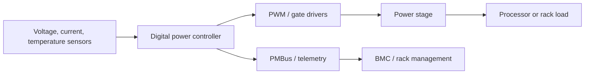
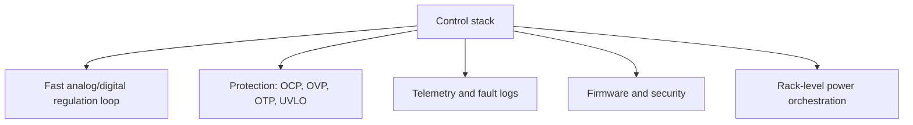

# Digital Power Management
> **Last Updated:** 2026-11-12
> **Status:** Draft
> **Tags:** PMBus, telemetry, firmware, AVS, security

## Overview
Digital power adds programmable control, telemetry, sequencing, and fault history to converters
and VRMs. PMBus is the established management interface, while Redfish exposes system-level
power data northbound through the BMC.

The value is operational as much as electrical: fleet operators can detect drift, cap power,
correlate faults, and tune voltage to workloads. The same programmability creates firmware,
authentication, rollback, and supply-chain security obligations.

## Key Findings / Highlights
- [CONFIRMED] PMBus is built on SMBus and defines standardized power commands plus manufacturer extensions.
- [CONFIRMED] Telemetry commonly includes voltage, current, temperature, power, status, and fault logs.
- [CONFIRMED] AVS/DVFS trade voltage/frequency against performance and energy.
- [CONFIRMED] Redfish supplies a RESTful management model for server/facility power telemetry.
- [ESTIMATED] Per-phase telemetry and predictive maintenance become more valuable above 100 kW/rack.
- [CONFIRMED, 2026-10-12] TI introduced the LMI800PS 800 V isolated hot-swap controller with
  PMBus and 5 kVrms reinforced isolation (±400 V and 800 V systems; 10 kW EVM), plus a 3 GSPS
  ADC for nanosecond-scale power-rail telemetry; parts are preproduction [Source: TI, 2026-10-12].
- [CONFIRMED, 2026] Controller IP is consolidating: Infineon acquired C2i Semiconductors
  (software-defined multiphase controllers and smart power stages; closed ~2026-10), while
  onsemi (Ferric), Navitas (Claros), and ADI (Empower) bought integrated-voltage-regulator teams.
- [CONFIRMED, 2026-10-05] The Microchip/Navitas 800 V-to-6 V reference design pairs a dsPIC33AK
  digital controller with a TA100 secure element, an example of hardware root-of-trust moving
  into rack power conversion.

## Visual Guide

## Detailed Content
### Controller Vendors

| Company | Families | Features | Protocol | Target |
|---|---|---|---|---|
| Infineon | XDPE/TDA | multiphase, telemetry | PMBus/AVSBus variants | CPU/GPU |
| TI | UCD/TPS | sequencing, digital PWM | PMBus | board/rack |
| Renesas | ISL/RAA | multiphase, telemetry | PMBus/AVSBus | server VR |
| Microchip | dsPIC DSC | software-defined control | PMBus/custom | PSU/converter |
| MPS | MP/MPQ digital | telemetry/integration | PMBus/I2C | server/accelerator |
| Infineon (C2i, acquired 2026) | software-defined multiphase | firmware-configurable control, smart stages | PMBus | AI accelerator VR |
| TI | LMI800PS (preproduction) | 800 V isolated hot-swap, telemetry | PMBus | ±400/800 VDC rack protection |

### Control and Management Stack

| Layer | Interface | Function |
|---|---|---|
| Power stage | PWM/gate drive | Fast switching and protection |
| Digital controller | ADC/DPWM | Regulation, telemetry, faults |
| BMC | PMBus/SMBus/I2C | Inventory, policy, logging |
| Host/accelerator | AVSBus/vendor interface | Workload voltage requests |
| Fleet manager | Redfish/API | Power cap, health, optimization |

### Protection

Digital implementation improves configurability and logging for OCP, OVP, UVP, OTP,
phase-current balance, black-box capture, and sequencing. Hardware comparators remain necessary
for faults faster than firmware/control-loop response.

### Security Baseline

- Authenticate firmware and configuration updates.
- Lock or authorize writable PMBus commands in production.
- Provide rollback protection and recovery images.
- Log configuration changes and fault-clearing actions.
- Threat-model BMC compromise and shared-bus access.

> 🔄 Refresh Needed: High Priority. PCIe VDM-based accelerator power telemetry and DC-SCM
interfaces are evolving; confirm ratified specifications before implementation.

Related: [Master Index](README.md).

## Data Tables (where applicable)
| Field | Value | Source | Date |
|---|---|---|---|
| PMBus current public revision | 1.4 family | PMBus | 2023-2025 |
| Physical basis | SMBus/I2C-compatible | PMBus | 2025 |
| Common telemetry | V/I/T/P/faults | Vendor datasheets | 2025 |
| Northbound model | DMTF Redfish | DMTF | 2025 |
| Fast fault path | Hardware comparator required | Engineering practice | 2025 |

## Open Questions / Gaps
- Confirm PCIe VDM power-telemetry adoption and public specifications.
- Collect disclosed power-controller CVEs and mitigation status.
- Quantify energy savings from production AVS policies without double-counting DVFS.
- Define telemetry and protection interfaces for ±400/800 VDC hot-swap and SSCB devices.

## References
- PMBus | https://pmbus.org/ | Accessed 2026-06-10
- DMTF Redfish | https://www.dmtf.org/standards/redfish | Accessed 2026-06-10
- OCP DC-SCM | https://www.opencompute.org/projects/dc-scm | Accessed 2026-06-10
- Microchip digital power | https://www.microchip.com/en-us/solutions/power-conversion/digital-power | Accessed 2026-06-10
- TI LMI800 product page | https://www.ti.com/product/LMI800 | Indexed 2026-11-12
- Infineon completes C2i acquisition | https://www.infineon.com/press-release/2026/infpr202610-002 | Indexed 2026-11-12
- Microchip/Navitas 800 VDC reference design | https://www.microchip.com/en-us/about/news-releases/products/the-data-center-is-moving-to-800v-microchip-and-navitas-are-enabling-transition | Indexed 2026-11-12
