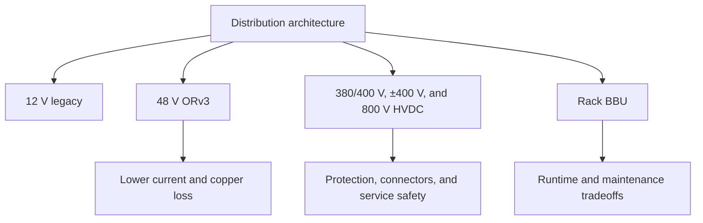

# Power Distribution Architecture
> **Last Updated:** 2026-11-12
> **Status:** Draft
> **Tags:** ORv3, HVDC, power-shelf, busbar, BBU

## Overview
Power distribution spans utility interconnect through the processor package. At rack scale,
rising power makes voltage, conductor geometry, fault energy, connector temperature, and
service procedures first-order design variables.

ORv3 standardizes a 48 V rack ecosystem including power shelves, busbars, and BBUs. HVDC can
remove conversion stages but raises protection and human-safety requirements. No single
architecture is optimal for every brownfield and greenfield datacenter.

## Key Findings / Highlights
- [CONFIRMED] ORv3 uses rear 48 V busbars and rack power shelves.
- [CONFIRMED] Rack-level BBUs can replace or complement centralized UPS designs.
- [CONFIRMED] Busbars reduce harness resistance and improve current distribution at high power.
- [ESTIMATED] 400 V DC architectures can remove one AC/DC stage in suitable facilities.
- [CONFIRMED, VENDOR ROADMAP] NVIDIA targets 800 VDC distribution for 1 MW IT racks and beyond;
  its 2026-08 rollout plan starts with AC-fed 800 VDC sidecar power racks in 2H 2026, adds row
  power centers (up to 2 MW per row) in 2027, and ends with greenfield grid-to-800 VDC "DC power
  blocks". It is not yet a broadly adopted industry standard.
- [CONFIRMED, 2026-10-08] OCP Mt. Diablo v1.0.0 standardizes a ±400 VDC disaggregated power rack
  (sidecar) for 100 kW-1 MW IT racks; the OCP SST specification (v0.3) covers MV AC-to-800 VDC
  conversion that can act as a medium-voltage UPS with storage.
- [CONFIRMED, 2026-10] OCP Global Summit hardware: Delta's 660 kW 800 VDC in-row power rack with
  480 kW integrated BBU (800 kW without BBU) and 90 kW 800 V-to-50 V DC/DC shelves (up to 98.5%
  [VENDOR CLAIM]); LITEON 800 VDC racks for 330 kW-1.2 MW scenarios and an ORv3 180 kW shelf;
  Vertiv PowerDirect 5000 (400-900 kW sidecar; launch reported early 2027 [RUMORED]).
- [CONFIRMED, 2026-10] Microsoft describes an SST architecture taking 13.8-34.5 kV AC to 800 VDC
  with integrated storage, SSCBs, 800 VDC switchboards, and busway [Source: Microsoft Azure].
- [ESTIMATED, 2026] TrendForce expects the 800 V power rack to be optional for Vera Rubin, with
  adoption after Rubin Ultra (2H 2027) and widespread deployment likely in 2028; Dell'Oro notes
  that protection, insulation, and safety practices lag the hardware.
- [CONFIRMED, 2026] Emerging SST vendors are targeting direct MV AC-to-800 VDC conversion,
  combining conversion, protection, controls, and optional energy storage; published
  performance remains vendor-reported until independent deployment data is available.
- [CONFIRMED, 2026-07-13] Infineon and LS ELECTRIC signed an MoU covering power conversion
  for energy storage, solid-state transformers, and solid-state circuit breakers for AI
  datacenters and next-generation grids; the announcement is a collaboration roadmap, not a
  deployment disclosure.

## Visual Guide

### Official Visual References
| Organization | Visual Material to Review | Official Source |
|---|---|---|
| OCP | ORv3 rack busbar, power shelf, and HPR diagrams | https://www.opencompute.org/wiki/Open_Rack/SpecsAndDesigns |
| Delta Electronics | rack power, power shelf, and datacenter infrastructure visuals | https://www.deltaww.com/en-US/solutions/Data-Center |
| Vertiv | AI-ready power and cooling architecture diagrams | https://www.vertiv.com/en-us/solutions/high-density-ai/ |
| Eaton | datacenter power distribution and UPS visuals | https://www.eaton.com/us/en-us/markets/data-centers.html |
| Schneider Electric | datacenter power architecture and sustainability visuals | https://www.se.com/us/en/work/solutions/for-business/data-centers-and-networks/ |

## Detailed Content
### Power Chain

| Layer | Component | Input | Output | Vendors | Standards |
|---|---|---:|---:|---|---|
| Grid | transformer/switchgear | utility MV | 400/480 V AC | Eaton, Schneider, Siemens | NEC/IEC |
| Facility backup | UPS | AC | conditioned AC/DC | Vertiv, Eaton, Schneider | IEC/UL |
| Distribution | PDU/busway | AC/DC | rack feed | Vertiv, Eaton, Delta | IEC/IEEE |
| Rack | power shelf | AC/HVDC | 48 V | Delta, AE, Lite-On, Flex | ORv3 |
| Rack bus | copper busbar | 48 V | 48 V | Rittal/ecosystem | ORv3 |
| Board | converter/VRM | 48/12 V | sub-1 V | Vicor, Infineon, Renesas, MPS | platform specs |

### HVDC Options

| Voltage | Efficiency mechanism | Components | Proponents | Timeline |
|---:|---|---|---|---|
| 380 V DC | Fewer conversions | rectifier, DC protection, isolated DC/DC | telecom/DC operators | Deployed selectively |
| 400 V DC | Aligns with emerging AI concepts | SiC/GaN front end, DAB/LLC | vendor/hyperscaler studies | 2024+ pilots |
| ±400 V DC (Mt. Diablo) | Disaggregated sidecar power; ORv3 heritage | SiC/GaN PFC and DC/DC, three-conductor busbar | Microsoft, Meta, Google (OCP) | OCP v1.0.0 published 2026-10-08 |
| 800 V DC | Lower current at MW-scale rack power | 1.2 kV SiC/GaN, isolation, DC protection, connectors, storage | NVIDIA ecosystem | Sidecar racks 2H 2026; row power centers 2027; native racks 2027+ |
| MV AC-to-800 VDC SST | Removes line-frequency transformer and rectifier stages | MV SiC modules, HF transformers, storage, SSCBs | ABB, Eaton, Siemens/Reinhausen, Delta, Heron, Amperesand, DG Matrix | Pilots 2026; ABB commercial 2H 2027 |

### Power Shelf Ecosystem

| Company | Product class | Power | Voltage | Efficiency | Notes |
|---|---|---:|---:|---|---|
| Delta | ORv3/high-power shelves | multi-kW to 90 kW-class ecosystem | 48 V | high-90s target | OCP contributor |
| Advanced Energy | OCP rectifiers/shelves | multi-kW | 48 V | Titanium-class | Server power heritage |
| Murata | rack/board power | multi-kW | 48 V | product-specific | Modules + shelves |
| Flex | hyperscale power platforms | custom | 48 V | custom | ODM/JDM |
| Lite-On/Acbel | server PSUs/shelves | custom | 12/48 V | product-specific | ODM suppliers |
| Eaton/Vertiv | facility-to-rack systems | kW-MW | AC/DC | product-specific | Infrastructure breadth |
| Heron Power | Heron Link SST + SuperBBU [VENDOR SPEC] | 4.2 MW | 34.5 kV AC-800 VDC | 98.5% claimed | 800 VDC AI-rack foundation |
| Amperesand | Medium-voltage SST [VENDOR SPEC] | product-specific | MV AC-LV/800 VDC | >98.5% claimed | First commercial units targeted for 2026 |
| Delta | 800 VDC in-row power rack [VENDOR SPEC] | 660 kW + 480 kW BBU; 800 kW without BBU | 800 VDC out; 90 kW 800-50 V shelves | up to 98% AC-DC; 98.5% DC-DC claimed | Vera Rubin NVL72/MGX; OCP 2026 |
| LITEON | 800 VDC power rack + BBU; ORv3 180 kW shelf [VENDOR SPEC] | 330 kW-1.2 MW scenarios | 800 VDC; 800-50 V brick | product-specific | Prototypes ship Q4 2026; ramp after Q1 2027 [company/trade press] |
| Vertiv | PowerDirect 5000 sidecar [VENDOR SPEC] | 400-900 kW | 800 VDC or ±400 VDC | product-specific | Launch reported early 2027 [RUMORED] |
| Schneider Electric | 800 VDC sidecar | racks up to 1.2 MW | 800 VDC | product-specific | Shown at Computex 2026-06 |
| Eaton | MVSST 2.0 (Infineon SiC) | MW-class | MV AC-800 VDC | product-specific | Claimed IEC-certified MV SST; APAC focus |
| ABB | Infinitus DC portfolio (SST-based) | MW-class | MV AC-800 VDC | >5% system gain claimed | SST commercial 2H 2027 |
| Infineon | 12 kW HV power distribution board (reference) | 12 kW | ±400 V/800 VDC in | product-specific | Availability planned 2026-11 |

### BBU versus UPS

| Attribute | Rack BBU | Central UPS |
|---|---|---|
| Failure domain | Rack | Room/facility |
| Distribution loss | Lower backup path distance | Centralized |
| Maintenance | Many distributed units | Fewer large systems |
| Chemistry | Often lithium-ion | Lithium-ion or VRLA |
| Scaling | Incremental per rack | Facility blocks |

Related: [Master Index](README.md).

## Data Tables (where applicable)
| Field | Value | Source | Date |
|---|---|---|---|
| ORv3 bus | 48 V nominal | OCP | 2024 |
| HPR public ecosystem | 92 kW+ | OCP | 2024 |
| NVIDIA 800 VDC roadmap | 1 MW IT racks and beyond, starting 2027 | NVIDIA | 2026 |
| Telecom HVDC heritage | ~380 V DC | Industry deployments | 2025 |
| Equal-power current at 400 V vs 48 V | 8.3x lower | P=VI calculation | 2026 |
| Rack backup chemistry | Lithium-ion growing | OCP/vendor designs | 2025 |
| Mt. Diablo v1.0.0 | ±400 VDC; 100 kW-1 MW | OCP | 2026-10-08 |
| OCP SST specification | v0.3 | OCP | 2026-07 |
| NVIDIA row power center | Up to 2 MW per row | NVIDIA | 2027 roadmap |
| Delta in-row power rack | 660 kW + 480 kW BBU [VENDOR SPEC] | Delta | 2026-10-15 |
| Equal-power current at 800 V vs 48 V | 16.7x lower | P=VI calculation | 2026 |

## Open Questions / Gaps
- Populate SKU-level shelf power, efficiency curves, dimensions, and certifications.
- Identify public 400 V DC production deployments versus demonstrations.
- Add fault-current, arc-flash, connector touch-safety, and serviceability comparisons.
- Track the first commissioned native 800 VDC data hall (none publicly confirmed as of 2026-11-12).
- Verify SSCB products for 800 VDC (TI LMI800PS hot-swap, Ideal Power B-TRAN, SolarEdge/Infineon [RUMORED]).

## References
- OCP Rack and Power | https://www.opencompute.org/projects/rack-and-power | Accessed 2026-06-10
- OCP ORv3 design guide | https://www.opencompute.org/documents/ocp-orv3-it-gear-design-guide-rev-02-june032024-pdf | Accessed 2026-06-10
- IEEE 519 | https://standards.ieee.org/standard/519-2022.html | Accessed 2026-06-10
- NVIDIA 800 VDC architecture | https://www.nvidia.com/en-us/data-center/technologies/800-vdc-architecture/ | Accessed 2026-07-28
- Heron Power data-center system | https://heronpower.com/product/data-centers | Accessed 2026-07-28
- Amperesand SST platform | https://www.amperesand.io/ | Accessed 2026-07-28
- Infineon/LS ELECTRIC MoU | https://www.infineon.com/press-release/2026/infpr202607-121 | Accessed 2026-07-28
- NVIDIA 800 VDC rollout blog | https://blogs.nvidia.com/blog/800-vdc-power-architecture-ai-factory/ | Indexed 2026-11-12
- OCP Mt. Diablo v1.0.0 | https://www.opencompute.org/wp-content/uploads/2026/10/OCP-Specification-Mt.-Diablo-Disaggregated-Power-Rack-Specification-v1.0.0.pdf | Indexed 2026-11-12
- OCP LVDC/SST workstream | https://www.opencompute.org/news/powering-the-next-era-of-ai-how-google-microsoft-and-nvidia-are-standardizing-and-accelerating-the-industry-transition-to-lvdc/ | Indexed 2026-11-12
- Delta OCP 2026 800 VDC | https://www.prnewswire.com/news-releases/delta-highlights-collaboration-with-nvidia-in-advancing-energy-efficient-800-vdc-power-and-cooling-solutions-for-ai-data-centers-at-ocp-global-summit-2026-302909912.html | Indexed 2026-11-12
- LITEON OCP 2026 | https://www.liteon.com/en/news/press-center/content/liteon-ocp-2026 | Indexed 2026-11-12
- Vertiv 800 VDC guide | https://www.vertiv.com/en-us/insights/articles/educational-articles/the-800-vdc-decision-a-practical-guide-for-ai-power-architecture/ | Indexed 2026-11-12
- Microsoft Azure grid-to-chip power | https://techcommunity.microsoft.com/blog/azureinfrastructureblog/powering-azure-infrastructure-from-grid-to-chip/4563890 | Indexed 2026-11-12
- Dell'Oro OCP 2026 analysis | https://www.delloro.com/inside-ocp-global-summit-2026-cold-plates-800-vdc-sidecars-and-a-buildout-at-full-steam/ | Indexed 2026-11-12
- TrendForce 800 V power rack outlook | https://www.trendforce.com/presscenter/news/20260625-13121.html | Indexed 2026-11-12
- Infineon 12 kW HV power distribution board | https://www.powersemiconductorsweekly.com/2026/10/27/infineon-introduces-12kw-high-voltage-power-distribution-board-for-800v-ai-data-centers/ | Indexed 2026-11-12
