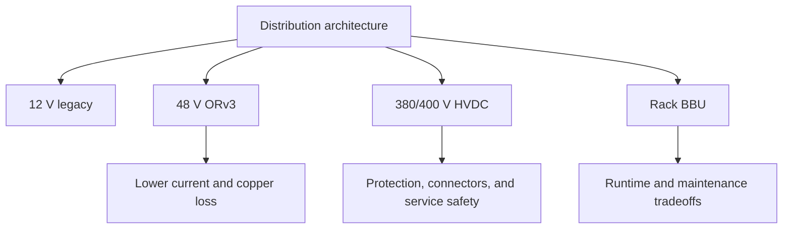

# Power Distribution Architecture
> **Last Updated:** 2026-07-28
> **Status:** Draft
> **Tags:** ORv3, HVDC, power-shelf, busbar, BBU

## Overview
Power distribution spans utility interconnect through the processor package. At rack scale,
rising power makes voltage, conductor geometry, fault energy, connector temperature, and
service procedures first-order design variables.

ORv3 standardizes a 48 V rack ecosystem including power shelves, busbars, and BBUs. HVDC can
remove conversion stages but raises protection and human-safety requirements. No single
architecture is optimal for every brownfield and greenfield datacenter.

## Key Findings / Highlights
- [CONFIRMED] ORv3 uses rear 48 V busbars and rack power shelves.
- [CONFIRMED] Rack-level BBUs can replace or complement centralized UPS designs.
- [CONFIRMED] Busbars reduce harness resistance and improve current distribution at high power.
- [ESTIMATED] 400 V DC architectures can remove one AC/DC stage in suitable facilities.
- [CONFIRMED, VENDOR ROADMAP] NVIDIA targets 800 VDC distribution for 1 MW IT racks and beyond
  beginning in 2027; it is not yet a broadly adopted industry standard.
- [CONFIRMED, 2026] Emerging SST vendors are targeting direct MV AC-to-800 VDC conversion,
  combining conversion, protection, controls, and optional energy storage; published
  performance remains vendor-reported until independent deployment data is available.
- [CONFIRMED, 2026-07-13] Infineon and LS ELECTRIC signed an MoU covering power conversion
  for energy storage, solid-state transformers, and solid-state circuit breakers for AI
  datacenters and next-generation grids; the announcement is a collaboration roadmap, not a
  deployment disclosure.

## Visual Guide

### Official Visual References
| Organization | Visual Material to Review | Official Source |
|---|---|---|
| OCP | ORv3 rack busbar, power shelf, and HPR diagrams | https://www.opencompute.org/wiki/Open_Rack/SpecsAndDesigns |
| Delta Electronics | rack power, power shelf, and datacenter infrastructure visuals | https://www.deltaww.com/en-US/solutions/Data-Center |
| Vertiv | AI-ready power and cooling architecture diagrams | https://www.vertiv.com/en-us/solutions/high-density-ai/ |
| Eaton | datacenter power distribution and UPS visuals | https://www.eaton.com/us/en-us/markets/data-centers.html |
| Schneider Electric | datacenter power architecture and sustainability visuals | https://www.se.com/us/en/work/solutions/for-business/data-centers-and-networks/ |

## Detailed Content
### Power Chain

| Layer | Component | Input | Output | Vendors | Standards |
|---|---|---:|---:|---|---|
| Grid | transformer/switchgear | utility MV | 400/480 V AC | Eaton, Schneider, Siemens | NEC/IEC |
| Facility backup | UPS | AC | conditioned AC/DC | Vertiv, Eaton, Schneider | IEC/UL |
| Distribution | PDU/busway | AC/DC | rack feed | Vertiv, Eaton, Delta | IEC/IEEE |
| Rack | power shelf | AC/HVDC | 48 V | Delta, AE, Lite-On, Flex | ORv3 |
| Rack bus | copper busbar | 48 V | 48 V | Rittal/ecosystem | ORv3 |
| Board | converter/VRM | 48/12 V | sub-1 V | Vicor, Infineon, Renesas, MPS | platform specs |

### HVDC Options

| Voltage | Efficiency mechanism | Components | Proponents | Timeline |
|---:|---|---|---|---|
| 380 V DC | Fewer conversions | rectifier, DC protection, isolated DC/DC | telecom/DC operators | Deployed selectively |
| 400 V DC | Aligns with emerging AI concepts | SiC/GaN front end, DAB/LLC | vendor/hyperscaler studies | 2024+ pilots |
| 800 V DC | Lower current at MW-scale rack power | 1.2 kV SiC/GaN, isolation, DC protection, connectors, storage | NVIDIA ecosystem | 2027+ production target |

### Power Shelf Ecosystem

| Company | Product class | Power | Voltage | Efficiency | Notes |
|---|---|---:|---:|---|---|
| Delta | ORv3/high-power shelves | multi-kW to 90 kW-class ecosystem | 48 V | high-90s target | OCP contributor |
| Advanced Energy | OCP rectifiers/shelves | multi-kW | 48 V | Titanium-class | Server power heritage |
| Murata | rack/board power | multi-kW | 48 V | product-specific | Modules + shelves |
| Flex | hyperscale power platforms | custom | 48 V | custom | ODM/JDM |
| Lite-On/Acbel | server PSUs/shelves | custom | 12/48 V | product-specific | ODM suppliers |
| Eaton/Vertiv | facility-to-rack systems | kW-MW | AC/DC | product-specific | Infrastructure breadth |
| Heron Power | Heron Link SST + SuperBBU [VENDOR SPEC] | 4.2 MW | 34.5 kV AC-800 VDC | 98.5% claimed | 800 VDC AI-rack foundation |
| Amperesand | Medium-voltage SST [VENDOR SPEC] | product-specific | MV AC-LV/800 VDC | >98.5% claimed | First commercial units targeted for 2026 |

### BBU versus UPS

| Attribute | Rack BBU | Central UPS |
|---|---|---|
| Failure domain | Rack | Room/facility |
| Distribution loss | Lower backup path distance | Centralized |
| Maintenance | Many distributed units | Fewer large systems |
| Chemistry | Often lithium-ion | Lithium-ion or VRLA |
| Scaling | Incremental per rack | Facility blocks |

Related: [Master Index](README.md).

## Data Tables (where applicable)
| Field | Value | Source | Date |
|---|---|---|---|
| ORv3 bus | 48 V nominal | OCP | 2024 |
| HPR public ecosystem | 92 kW+ | OCP | 2024 |
| NVIDIA 800 VDC roadmap | 1 MW IT racks and beyond, starting 2027 | NVIDIA | 2026 |
| Telecom HVDC heritage | ~380 V DC | Industry deployments | 2025 |
| Equal-power current at 400 V vs 48 V | 8.3x lower | P=VI calculation | 2026 |
| Rack backup chemistry | Lithium-ion growing | OCP/vendor designs | 2025 |

## Open Questions / Gaps
- Populate SKU-level shelf power, efficiency curves, dimensions, and certifications.
- Identify public 400 V DC production deployments versus demonstrations.
- Add fault-current, arc-flash, connector touch-safety, and serviceability comparisons.

## References
- OCP Rack and Power | https://www.opencompute.org/projects/rack-and-power | Accessed 2026-06-10
- OCP ORv3 design guide | https://www.opencompute.org/documents/ocp-orv3-it-gear-design-guide-rev-02-june032024-pdf | Accessed 2026-06-10
- IEEE 519 | https://standards.ieee.org/standard/519-2022.html | Accessed 2026-06-10
- NVIDIA 800 VDC architecture | https://www.nvidia.com/en-us/data-center/technologies/800-vdc-architecture/ | Accessed 2026-07-28
- Heron Power data-center system | https://heronpower.com/product/data-centers | Accessed 2026-07-28
- Amperesand SST platform | https://www.amperesand.io/ | Accessed 2026-07-28
- Infineon/LS ELECTRIC MoU | https://www.infineon.com/press-release/2026/infpr202607-121 | Accessed 2026-07-28
