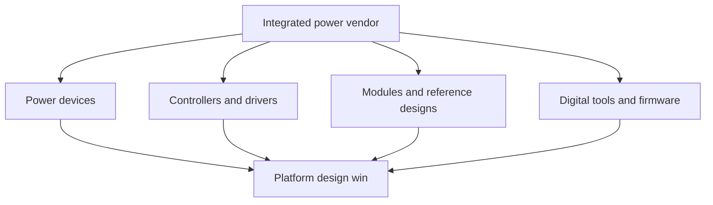
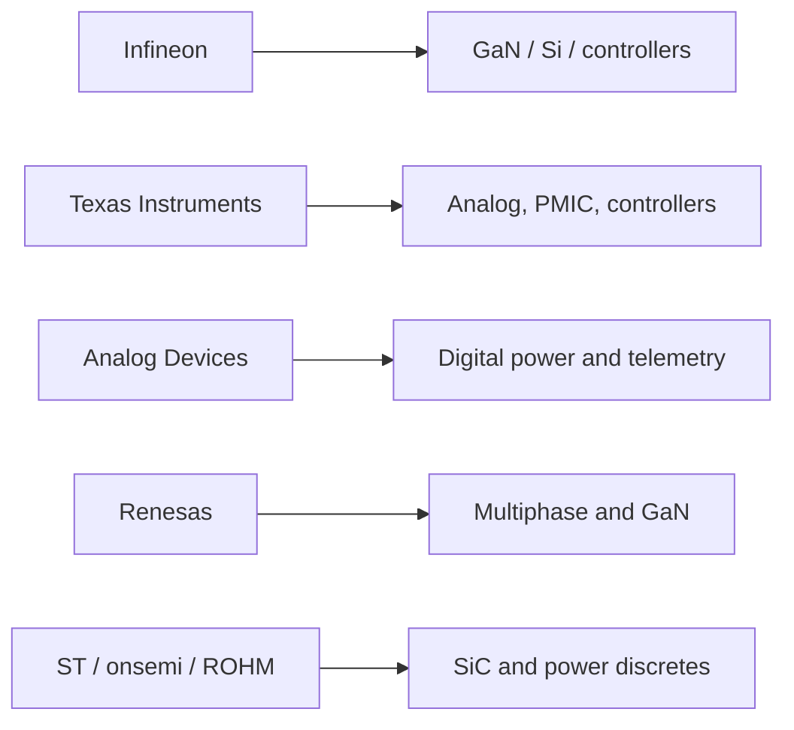

# Integrated Power Semiconductor Vendors
> **Last Updated:** 2026-11-12
> **Status:** Draft
> **Tags:** vendors, IDM, financials, Infineon, TI, Renesas

## Overview
Integrated vendors combine analog/control ICs, power devices, packaging, manufacturing, and
application engineering. Their advantage is platform breadth and supply assurance; their
challenge is allocating capacity and R&D across automotive, industrial, consumer, and
datacenter markets with different cycles.

Datacenter-specific revenue is rarely disclosed. The database therefore separates reported
company revenue from [ESTIMATED] DC exposure and avoids treating total power revenue as AI
revenue.

## Key Findings / Highlights
- [CONFIRMED] Infineon spans silicon MOSFET, SiC, GaN, gate drivers, and digital controllers.
- [CONFIRMED] TI has GaN and broad power management but no commercial SiC device portfolio.
- [CONFIRMED] Renesas gained Intersil server power and acquired Transphorm GaN in 2024.
- [CONFIRMED] ST, onsemi, and ROHM are vertically invested in SiC.
- [TO VERIFY] Infineon "$12k-$15k content per 130 kW rack" requires a primary cited disclosure.
- [SUPERSEDED, 2026-11-10] Infineon's earlier targets of about €1.5B AI power-solution revenue
  in FY2026 and €2.5B in FY2027 are retained as history; see the FY2026 actuals below.
- [CONFIRMED, COMPANY DISCLOSURE, 2026-11-10] Infineon reported FY2026 revenue of €16.353B
  (+12%) and a record Q4 of €4.706B; AI-power revenue was ~€1.7B and total datacenter power
  ~€2.2B (including ~€0.5B traditional datacenter). FY2027 guidance: group revenue ~€20B and
  datacenter power close to €4B [Sources: syndicated release and call coverage; IR deck not reviewed].
- [CONFIRMED, 2026-11-02] onsemi disclosed >$250M of AI-datacenter revenue in FY2025, $180M in
  Q3 2026 (+175% YoY), ~$620M expected for 2026, and a 2030 target raised to >$3B alongside the
  pending Ferric acquisition.
- [CONFIRMED, 2026-10-21] TI's data-center revenue grew ~95% YoY and was ~13% of Q3 2026 revenue
  ($6.06B), implying ~$0.79B [ESTIMATED] across all TI product lines, not power alone.
- [CONFIRMED, 2026-08-19] ADI said data center is ~80% of its Communications segment, with power
  and optical each growing >100% YoY; ADI closed its ~$1.5B Empower Semiconductor (IVR) deal on
  2026-07-07.
- [CONFIRMED, 2026-10-29] MPS Q3 2026 revenue was $1,202.4M (+63.1% YoY); Enterprise Data was
  $506.7M (42.1% of revenue) and its 2026 growth floor was raised to ≥150%.
- [CONFIRMED, 2026] MPS reported $2.790B FY2025 revenue and disclosed sampling an 800 V
  datacenter power solution; its storage/computing and enterprise-data categories must not be
  treated as pure AI-power revenue.
- [CONFIRMED, 2026-07-13] Infineon and LS ELECTRIC signed an MoU to co-develop DC power
  infrastructure spanning energy storage, SSTs, and solid-state circuit breakers; no revenue
  or deployment value was disclosed.
- [CONFIRMED, 2026-09/11] Infineon broadened its 800 VDC partnerships: SiC for Eaton's MVSST 2.0
  (2026-09-29), GaN high-voltage IBCs co-developed with NVIDIA (2026-10-21), a 12 kW HV power
  distribution reference board (2026-10-27), and expanded HVDC work with SOLUM (2026-11-05).
- [CONFIRMED, 2026-10] STMicroelectronics targets ~$1.3B of AI-datacenter revenue in 2026 and
  >$2B in 2027, mostly silicon photonics and microcontrollers rather than power devices; its
  Power & Discrete segment posted an $81M Q3 2026 operating loss on 200 mm SiC start-up costs.

## Visual Guide

### Official Visual References
| Vendor | Visual Material to Review | Official Source |
|---|---|---|
| Infineon | datacenter power architecture, GaN, MOSFET, controller visuals | https://www.infineon.com/cms/en/applications/computing/data-center-and-servers/ |
| Texas Instruments | server power, PMIC, controller, and power-stage diagrams | https://www.ti.com/applications/enterprise-systems/data-center-enterprise-computing/overview.html |
| Analog Devices | data center power, telemetry, and digital power diagrams | https://www.analog.com/en/solutions/data-center.html |
| Renesas | multiphase controller, power stage, and GaN product visuals | https://www.renesas.com/en/applications/data-center-computing |
| STMicroelectronics | power management and SiC application visuals | https://www.st.com/content/st_com/en/applications/power-and-energy.html |
| onsemi | EliteSiC and power conversion application visuals | https://www.onsemi.com/applications/industrial-cloud-power/cloud-power |
| ROHM | SiC and power device application diagrams | https://www.rohm.com/products/sic-power-devices |

## Detailed Content
### Vendor Profiles

**Infineon Technologies (IFX.DE)**
HQ: Germany | FY2026 revenue: €16.353B (FY2025: €14.662B) | DC exposure: [CONFIRMED, COMPANY
DISCLOSURE] ~€1.7B AI power and ~€2.2B total datacenter power in FY2026; FY2027 datacenter power
guided close to €4B. Products: CoolMOS, OptiMOS, CoolSiC, CoolGaN, XDPE/XDP controllers, and C2i
software-defined multiphase controllers (acquired 2026-10). Manufacturing: IDM, including
Villach/Kulim and announced 300 mm GaN development; Wolfspeed 200 mm SiC wafer supply extended
(2026-10). From Q4 FY2026 it reports three segments: Automotive, Power Systems, and Edge Systems,
which breaks comparability with earlier segment data. Strength: complete grid-to-core power
chain. Risk: capital intensity, category-boundary comparability, and IP disputes (Innoscience
rulings in China; Vicor ITC respondent).

**Texas Instruments (TXN)**
HQ: US | FY2025 revenue: $17.682B; Q3 2026 revenue $6.06B (+28% YoY) | DC exposure: data
center ~13% of Q3 2026 revenue, +~95% YoY [COMPANY DISCLOSURE; all product lines]
Products: TPS/LM/UCD controllers, LMG GaN, sensing/isolation, LMI800PS 800 V hot-swap controller
(preproduction, 2026-10), and a published 800 VDC architecture with an 800 V-to-6 V GaN bus
converter. Manufacturing: IDM with expanding 300 mm analog capacity. Strength: catalog breadth
and process cost. Weakness: no SiC devices.

**Analog Devices (ADI)**  
HQ: US | FY2025 revenue: $11.020B; FQ3 FY2026 revenue $4.02B (+40% YoY) | Data center ~80% of
Communications segment [COMPANY DISCLOSURE] | Products: LTC/MAX power, telemetry, isolation,
signal chain, and Empower IVRs/silicon capacitors (acquired 2026-07-07, ~$1.5B). Manufacturing:
hybrid internal/foundry. Strength: high-performance control/sensing and package-adjacent
regulation. Weakness: limited power discretes. FQ4 FY2026 results due 2026-11-24 [UPCOMING].

**Renesas Electronics (6723.T)**  
HQ: Japan | FY2025 IFRS revenue: ¥1.321T | Products: RAA/ISL multiphase, smart stages, PMICs, Transphorm GaN. Acquisitions:
Intersil (2017), Dialog (2021), Transphorm (2024). Strength: server VR design history.

**STMicroelectronics (STM)**  
HQ: Switzerland | FY2025 revenue: $11.800B; Q3 2026 revenue $3.76B (+17.9%) | Products: MDmesh,
MasterGaN, STPOWER SiC, controllers. SiC: internal devices, Norstel substrate assets, Soitec
supply, Sanan JV; 200 mm SiC start-up costs drove an $81M Q3 2026 Power & Discrete operating
loss. AI-datacenter revenue targets (~$1.3B 2026; >$2B 2027) are mostly photonics/MCU, not power.
[CORRECTION] No relevant "Masimo partnership" was used because the seed claim lacks DC-power support.

**onsemi (ON)**
HQ: US | FY2025 revenue: $5.995B; Q3 2026 revenue ~$1.72B | AI-datacenter revenue: >$250M FY2025;
$180M Q3 2026; ~$620M expected 2026; >$3B 2030 target [COMPANY DISCLOSURE/TARGET]
Products: EliteSiC, SiC JFETs, GaNEXUS 40-650 V lateral GaN (launched 2026), 700/1,200 V vertical
GaN (sampling/demos; volume target unconfirmed), silicon MOSFET/IGBT, drivers; Ferric IVRs
pending ($600M + up to $175M). Volume shipments into Google platforms disclosed (2026-11-02).
Strength: manufacturing and high-voltage breadth. Note: the Synaptics acquisition (2026) is an
edge-AI deal, not datacenter power.

**ROHM Semiconductor (6963.T)**  
HQ: Japan | Products: SiC MOSFET/SBD/modules, silicon power, drivers. SiCrystal supplies internal
substrate capability. Strength: vertical SiC and Japanese/European industrial relationships.

**Vishay Intertechnology (VSH)**  
HQ: US | Products: MOSFETs, diodes, resistors, inductors/current sensing. Strength: broad
passives/discretes. Weakness: limited proprietary WBG position.

**Microchip Technology (MCHP)**  
HQ: US | FY2026 revenue: $4.713B | Products: dsPIC digital power, mSiC, timing/control. Microsemi acquisition closed 2018.
Strength: high-reliability control and SiC breadth; lower AI-VRM visibility.

**Monolithic Power Systems (MPWR)**
HQ: US | FY2025 revenue: $2.790B; Q3 2026 revenue $1,202.4M (+63.1% YoY) | Products: multiphase
controllers, power stages, modules, vertical power delivery, and datacenter conversion. FY2025
storage/computing revenue was $732.5M and enterprise-data revenue was $701.8M; Q3 2026
Enterprise Data was $506.7M (42.1% of revenue). These categories include non-AI products and
must not be summed as AI-power revenue. MPS disclosed sampling an 800 V datacenter solution,
reports >$6B annual revenue capacity, and is a named respondent in Vicor's ITC case 337-TA-1526.

### Comparative Table

| Company | Si | GaN | SiC | VRM/PMIC | Digital power | Manufacturing |
|---|---:|---:|---:|---:|---:|---|
| Infineon | High | High | High | High | High | IDM |
| TI | High | High | None | High | High | IDM |
| ADI | Low | Low | None | High (incl. Empower IVR) | Medium | Hybrid |
| Renesas | Medium | High via Transphorm | Low | High | High | Hybrid/IDM |
| ST | High | High | High | Medium | Medium | IDM |
| onsemi | High | Developing (lateral launched; vertical sampling) | High | Medium; IVR via Ferric (pending) | Medium | IDM |
| ROHM | High | Low | High | Medium | Medium | IDM |
| Vishay | High | Low | Low | Low | Low | IDM |
| Microchip | Medium | Low | Medium-high | Medium | High | Hybrid/IDM |
| MPS | High | Low/not separately disclosed | Low | Very high | High | Fabless/hybrid |

### Revenue Trajectory Schema

| Company | Reported period | Revenue | Datacenter/AI disclosure | Status |
|---|---|---:|---|---|
| Infineon | FY ended 2025-09-30 | €14.662B | >€700M FY2025 AI power; ~€1.5B FY2026 and ~€2.5B FY2027 targets | [CONFIRMED / COMPANY TARGET] |
| TI | CY2025 | $17.682B | Not separately disclosed | [CONFIRMED] |
| ADI | FY ended 2025-11-01 | $11.020B | Not separately disclosed | [CONFIRMED] |
| Renesas | CY2025 | ¥1.321T IFRS | Not separately disclosed | [CONFIRMED] |
| STMicroelectronics | CY2025 | $11.800B | Not separately disclosed | [CONFIRMED] |
| onsemi | CY2025 | $5.995B | >$250M AI-datacenter revenue | [CONFIRMED] |
| Microchip | FY ended 2026-03-31 | $4.713B | Not separately disclosed | [CONFIRMED] |
| MPS | CY2025 | $2.790B | $732.5M storage/computing; $701.8M enterprise data; not AI-pure | [CONFIRMED] |
| Infineon | FY ended 2026-09-30 | €16.353B | ~€1.7B AI power; ~€2.2B DC power; FY2027 DC power guided ~€4B | [CONFIRMED / COMPANY GUIDANCE] |
| TI | Q3 2026 | $6.06B | DC ~13% of revenue; +~95% YoY | [CONFIRMED] |
| ADI | FQ3 FY2026 (to 2026-08-01) | $4.02B | DC ~80% of Communications | [CONFIRMED] |
| STMicroelectronics | Q3 2026 | $3.76B | AI DC ~$1.3B 2026 target, mostly non-power | [CONFIRMED / COMPANY TARGET] |
| onsemi | Q3 2026 | ~$1.72B | $180M AI DC; ~$620M 2026E | [CONFIRMED] |
| MPS | Q3 2026 | $1,202.4M | $506.7M Enterprise Data | [CONFIRMED] |

> ⚠️ Note: Fiscal year ends and currencies differ. The table is a revenue baseline, not a
valuation comparison; no currency translation or LTM normalization has been applied.

Related: [Master Index](README.md).

## Data Tables (where applicable)
| Field | Value | Source | Date |
|---|---|---|---|
| Renesas/Intersil close | 2017 | Renesas | 2017 |
| Renesas/Dialog close | 2021 | Renesas | 2021 |
| Renesas/Transphorm close | 2024 | Renesas | 2024 |
| Microchip/Microsemi close | 2018 | Microchip | 2018 |
| Infineon/GaN Systems value | $830M announced | Infineon | 2023 |
| ADI/Empower | ~$1.5B cash; closed | ADI | 2026-07-07 |
| Infineon/C2i | Undisclosed; closed | Infineon | ~2026-10 |
| onsemi/Ferric | $600M + up to $175M; announced | onsemi | 2026-11-02 |

## Open Questions / Gaps
- Add ROHM and Vishay current fiscal baselines and reconcile currencies for comparison.
- Estimate DC revenue using product/customer evidence rather than total industrial revenue.
- Verify customer relationships; do not infer a hyperscaler customer from an OCP membership.
- Locate the primary Infineon rack-content statement.
- Retrieve the Infineon FY2026 IR presentation to confirm the AI/DC power split and new segment mapping.
- Refresh Renesas, ROHM, Microchip, NXP, Vishay, and Toshiba (not covered in the 2026-11 refresh).

## References
- Infineon investor relations | https://www.infineon.com/cms/en/about-infineon/investor/ | Accessed 2026-06-10
- TI investor relations | https://investor.ti.com/ | Accessed 2026-06-10
- Renesas acquisitions | https://www.renesas.com/en/about/company/mergers-acquisitions | Accessed 2026-06-10
- ST investor relations | https://investors.st.com/ | Accessed 2026-06-10
- onsemi investor relations | https://investor.onsemi.com/ | Accessed 2026-06-10
- Infineon FY2025 results | https://www.infineon.com/press-release/2025/infxx202511-021 | Accessed 2026-07-28
- Infineon Dresden Smart Power Fab | https://www.infineon.com/press-release/2026/ifxpr202607-117 | Accessed 2026-07-28
- TI FY2025 results | https://investor.ti.com/news-releases/news-release-details/ti-reports-q4-2025-and-2025-financial-results-and-shareholder | Accessed 2026-07-28
- ADI FY2025 results | https://investor.analog.com/news-releases/news-release-details/analog-devices-reports-strong-fourth-quarter-and-fiscal-2025 | Accessed 2026-07-28
- Renesas FY2025 results | https://www.renesas.com/en/about/newsroom/renesas-reports-financial-results-year-ended-december-31-2025 | Accessed 2026-07-28
- ST 2025 financial baseline | https://investors.st.com/st-glance | Accessed 2026-07-28
- onsemi 2025 annual report | https://investor.onsemi.com/static-files/8d674d4f-cc6b-44e5-8e31-e898ab0b4371 | Accessed 2026-07-28
- Microchip FY2026 results | https://ir.microchip.com/sec-filings/all-sec-filings/content/0000827054-26-000012/exhibit991q4fy26.htm | Accessed 2026-07-28
- MPS FY2025 Form 10-K | https://media.monolithicpower.com/mps_cms_document/2/0/2025_form_10-k_final.pdf | Accessed 2026-07-28
- MPS Q4/FY2025 earnings commentary | https://www.monolithicpower.com/media/investor-relations/press-releases/Q4_2025_MPS_Earnings_Commentary.pdf | Accessed 2026-07-28
- Infineon/LS ELECTRIC MoU | https://www.infineon.com/press-release/2026/infpr202607-121 | Accessed 2026-07-28
- Infineon FY2026 results (syndicated) | https://news.europawire.eu/infineon-reports-e16-35-billion-fy-2026-revenue-and-forecasts-over-20-percent-growth-for-2027/eu-press-release/2026/11/10/16/27/06/187084/ | Indexed 2026-11-12
- Infineon FY2026 call highlights | https://www.gurufocus.com/news/9193285/infineon-technologies-ag-ifnnf-q4-2026-earnings-call-highlights-record-revenue-ai-power-surge-and-a-20-billion-fy2027-outlook | Indexed 2026-11-12
- Infineon Q3 FY2026 results | https://live.deutsche-boerse.com/news/EQS-News-Infineon-Technolgies-AG-Q3-FY-2026-concluded-with-record-sales-driven-by-strong-AI-business-further-significant-increase-in-revenue-and-margin-expected-in-Q4-FY-2026-5fd33ab1-1e11-4cd8-a8a6-8e06fb98cb0e | Indexed 2026-11-12
- Infineon/Eaton MVSST 2.0 | https://www.infineon.com/press-release/2026/infpr202609-146 | Indexed 2026-11-12
- Infineon C2i acquisition | https://www.infineon.com/press-release/2026/infpr202610-002 | Indexed 2026-11-12
- SOLUM/Infineon HVDC collaboration | https://www.manilatimes.net/2026/11/05/tmt-newswire/pr-newswire/solum-and-infineon-expand-collaboration-on-hvdc-power-solutions-for-ai-data-centers/2463161 | Indexed 2026-11-12
- TI Q3 2026 results | https://investor.ti.com/news-releases/news-release-details/ti-reports-third-quarter-2026-financial-results-and-shareholder | Indexed 2026-11-12
- TI LMI800 | https://www.ti.com/product/LMI800 | Indexed 2026-11-12
- ADI FQ3 FY2026 results | https://investor.analog.com/news-releases/news-release-details/analog-devices-reports-record-fiscal-third-quarter-2026 | Indexed 2026-11-12
- ADI completes Empower acquisition | https://www.analog.com/en/newsroom/press-releases/2026/7-7-26-adi-completes-acquisition-of-empower-semiconductor.html | Indexed 2026-11-12
- onsemi Q3 2026 results | https://investor.onsemi.com/news-releases/news-release-details/onsemi-reports-third-quarter-2026-results | Indexed 2026-11-12
- onsemi to acquire Ferric | https://www.onsemi.com/company/newsroom/news-and-insights/onsemi-to-acquire-ferric-establishing-leadership-in-power-delivery-for-next-generation-ai-processors | Indexed 2026-11-12
- MPS Q3 2026 results | https://www.sec.gov/Archives/edgar/data/0001280452/000162828026068202/mpwr-20260930xexx991.htm | Indexed 2026-11-12
- ST Q3 2026 results (reprint) | https://www.generation-nt.com/communiques-presse/stmicroelectronics-reports-q3-2026-financial-results-2083619 | Indexed 2026-11-12
