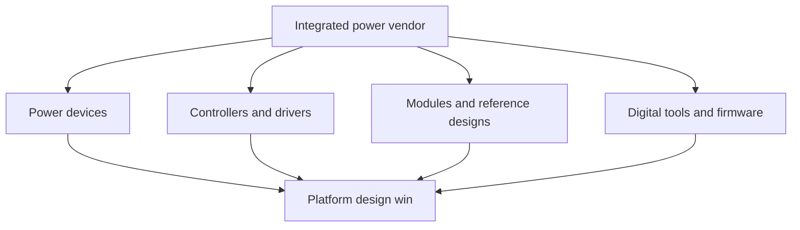
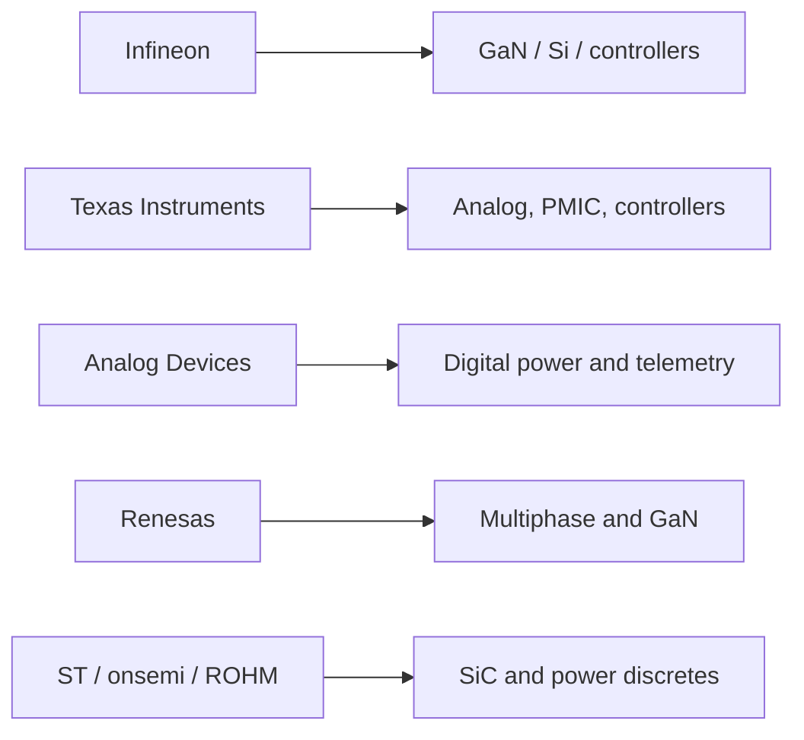

# Integrated Power Semiconductor Vendors
> **Last Updated:** 2026-07-28
> **Status:** Draft
> **Tags:** vendors, IDM, financials, Infineon, TI, Renesas

## Overview
Integrated vendors combine analog/control ICs, power devices, packaging, manufacturing, and
application engineering. Their advantage is platform breadth and supply assurance; their
challenge is allocating capacity and R&D across automotive, industrial, consumer, and
datacenter markets with different cycles.

Datacenter-specific revenue is rarely disclosed. The database therefore separates reported
company revenue from [ESTIMATED] DC exposure and avoids treating total power revenue as AI
revenue.

## Key Findings / Highlights
- [CONFIRMED] Infineon spans silicon MOSFET, SiC, GaN, gate drivers, and digital controllers.
- [CONFIRMED] TI has GaN and broad power management but no commercial SiC device portfolio.
- [CONFIRMED] Renesas gained Intersil server power and acquired Transphorm GaN in 2024.
- [CONFIRMED] ST, onsemi, and ROHM are vertically invested in SiC.
- [TO VERIFY] Infineon "$12k-$15k content per 130 kW rack" requires a primary cited disclosure.
- [CONFIRMED, 2026] Infineon targets about €1.5B of AI power-solution revenue in FY2026 and
  €2.5B in FY2027; onsemi disclosed more than $250M of AI-datacenter revenue in FY2025.
- [CONFIRMED, 2026] MPS reported $2.790B FY2025 revenue and disclosed sampling an 800 V
  datacenter power solution; its storage/computing and enterprise-data categories must not be
  treated as pure AI-power revenue.
- [CONFIRMED, 2026-07-13] Infineon and LS ELECTRIC signed an MoU to co-develop DC power
  infrastructure spanning energy storage, SSTs, and solid-state circuit breakers; no revenue
  or deployment value was disclosed.

## Visual Guide

### Official Visual References
| Vendor | Visual Material to Review | Official Source |
|---|---|---|
| Infineon | datacenter power architecture, GaN, MOSFET, controller visuals | https://www.infineon.com/cms/en/applications/computing/data-center-and-servers/ |
| Texas Instruments | server power, PMIC, controller, and power-stage diagrams | https://www.ti.com/applications/enterprise-systems/data-center-enterprise-computing/overview.html |
| Analog Devices | data center power, telemetry, and digital power diagrams | https://www.analog.com/en/solutions/data-center.html |
| Renesas | multiphase controller, power stage, and GaN product visuals | https://www.renesas.com/en/applications/data-center-computing |
| STMicroelectronics | power management and SiC application visuals | https://www.st.com/content/st_com/en/applications/power-and-energy.html |
| onsemi | EliteSiC and power conversion application visuals | https://www.onsemi.com/applications/industrial-cloud-power/cloud-power |
| ROHM | SiC and power device application diagrams | https://www.rohm.com/products/sic-power-devices |

## Detailed Content
### Vendor Profiles

**Infineon Technologies (IFX.DE)**
HQ: Germany | FY2025 revenue: €14.662B | DC exposure: [CONFIRMED] >€700M AI power solutions
Products: CoolMOS, OptiMOS, CoolSiC, CoolGaN, XDPE/XDP controllers. Manufacturing: IDM,
including Villach/Kulim and announced 300 mm GaN development. Strength: complete power chain.
The €5B Dresden Smart Power Fab opened in July 2026 and doubled capacity at the Dresden site.
Company targets: about €1.5B AI power revenue in FY2026 and €2.5B in FY2027. Risk:
industrial/auto cyclicality, capital intensity, and category-boundary comparability.

**Texas Instruments (TXN)**
HQ: US | FY2025 revenue: $17.682B | DC exposure: [ESTIMATED, MED] meaningful analog share
Products: TPS/LM/UCD controllers, LMG GaN, sensing/isolation. Manufacturing: IDM with expanding
300 mm analog capacity. Strength: catalog breadth and process cost. Weakness: no SiC devices.

**Analog Devices (ADI)**  
HQ: US | FY2025 revenue: $11.020B | Products: LTC/MAX power, telemetry, isolation, signal chain. Manufacturing: hybrid
internal/foundry. Strength: high-performance control/sensing. Weakness: limited power discretes.

**Renesas Electronics (6723.T)**  
HQ: Japan | FY2025 IFRS revenue: ¥1.321T | Products: RAA/ISL multiphase, smart stages, PMICs, Transphorm GaN. Acquisitions:
Intersil (2017), Dialog (2021), Transphorm (2024). Strength: server VR design history.

**STMicroelectronics (STM)**  
HQ: Switzerland | FY2025 revenue: $11.800B | Products: MDmesh, MasterGaN, STPOWER SiC, controllers. SiC: internal devices,
Norstel substrate assets, Soitec supply, Sanan JV. [CORRECTION] No relevant "Masimo partnership"
was used because the seed claim lacks DC-power support.

**onsemi (ON)**
HQ: US | FY2025 revenue: $5.995B | AI-datacenter revenue: >$250M [COMPANY DISCLOSURE]
Products: EliteSiC, GaNEXUS lateral/vertical GaN, silicon MOSFET/IGBT, drivers. The 700/1,200 V
vertical-GaN program is sampling with a late-2026 volume target; a separate 650 V lateral-GaN
program uses GlobalFoundries' 200 mm process. Strength: manufacturing and high-voltage breadth.

**ROHM Semiconductor (6963.T)**  
HQ: Japan | Products: SiC MOSFET/SBD/modules, silicon power, drivers. SiCrystal supplies internal
substrate capability. Strength: vertical SiC and Japanese/European industrial relationships.

**Vishay Intertechnology (VSH)**  
HQ: US | Products: MOSFETs, diodes, resistors, inductors/current sensing. Strength: broad
passives/discretes. Weakness: limited proprietary WBG position.

**Microchip Technology (MCHP)**  
HQ: US | FY2026 revenue: $4.713B | Products: dsPIC digital power, mSiC, timing/control. Microsemi acquisition closed 2018.
Strength: high-reliability control and SiC breadth; lower AI-VRM visibility.

**Monolithic Power Systems (MPWR)**
HQ: US | FY2025 revenue: $2.790B | Products: multiphase controllers, power stages, modules,
vertical power delivery, and datacenter conversion. FY2025 storage/computing revenue was
$732.5M and enterprise-data revenue was $701.8M; these categories include non-AI products and
must not be summed as AI-power revenue. MPS disclosed sampling an 800 V datacenter solution.

### Comparative Table

| Company | Si | GaN | SiC | VRM/PMIC | Digital power | Manufacturing |
|---|---:|---:|---:|---:|---:|---|
| Infineon | High | High | High | High | High | IDM |
| TI | High | High | None | High | High | IDM |
| ADI | Low | Low | None | High | Medium | Hybrid |
| Renesas | Medium | High via Transphorm | Low | High | High | Hybrid/IDM |
| ST | High | High | High | Medium | Medium | IDM |
| onsemi | High | Developing | High | Medium | Medium | IDM |
| ROHM | High | Low | High | Medium | Medium | IDM |
| Vishay | High | Low | Low | Low | Low | IDM |
| Microchip | Medium | Low | Medium-high | Medium | High | Hybrid/IDM |
| MPS | High | Low/not separately disclosed | Low | Very high | High | Fabless/hybrid |

### Revenue Trajectory Schema

| Company | Reported period | Revenue | Datacenter/AI disclosure | Status |
|---|---|---:|---|---|
| Infineon | FY ended 2025-09-30 | €14.662B | >€700M FY2025 AI power; ~€1.5B FY2026 and ~€2.5B FY2027 targets | [CONFIRMED / COMPANY TARGET] |
| TI | CY2025 | $17.682B | Not separately disclosed | [CONFIRMED] |
| ADI | FY ended 2025-11-01 | $11.020B | Not separately disclosed | [CONFIRMED] |
| Renesas | CY2025 | ¥1.321T IFRS | Not separately disclosed | [CONFIRMED] |
| STMicroelectronics | CY2025 | $11.800B | Not separately disclosed | [CONFIRMED] |
| onsemi | CY2025 | $5.995B | >$250M AI-datacenter revenue | [CONFIRMED] |
| Microchip | FY ended 2026-03-31 | $4.713B | Not separately disclosed | [CONFIRMED] |
| MPS | CY2025 | $2.790B | $732.5M storage/computing; $701.8M enterprise data; not AI-pure | [CONFIRMED] |

> ⚠️ Note: Fiscal year ends and currencies differ. The table is a revenue baseline, not a
valuation comparison; no currency translation or LTM normalization has been applied.

Related: [Master Index](README.md).

## Data Tables (where applicable)
| Field | Value | Source | Date |
|---|---|---|---|
| Renesas/Intersil close | 2017 | Renesas | 2017 |
| Renesas/Dialog close | 2021 | Renesas | 2021 |
| Renesas/Transphorm close | 2024 | Renesas | 2024 |
| Microchip/Microsemi close | 2018 | Microchip | 2018 |
| Infineon/GaN Systems value | $830M announced | Infineon | 2023 |

## Open Questions / Gaps
- Add ROHM and Vishay current fiscal baselines and reconcile currencies for comparison.
- Estimate DC revenue using product/customer evidence rather than total industrial revenue.
- Verify customer relationships; do not infer a hyperscaler customer from an OCP membership.
- Locate the primary Infineon rack-content statement.

## References
- Infineon investor relations | https://www.infineon.com/cms/en/about-infineon/investor/ | Accessed 2026-06-10
- TI investor relations | https://investor.ti.com/ | Accessed 2026-06-10
- Renesas acquisitions | https://www.renesas.com/en/about/company/mergers-acquisitions | Accessed 2026-06-10
- ST investor relations | https://investors.st.com/ | Accessed 2026-06-10
- onsemi investor relations | https://investor.onsemi.com/ | Accessed 2026-06-10
- Infineon FY2025 results | https://www.infineon.com/press-release/2025/infxx202511-021 | Accessed 2026-07-28
- Infineon Dresden Smart Power Fab | https://www.infineon.com/press-release/2026/ifxpr202607-117 | Accessed 2026-07-28
- TI FY2025 results | https://investor.ti.com/news-releases/news-release-details/ti-reports-q4-2025-and-2025-financial-results-and-shareholder | Accessed 2026-07-28
- ADI FY2025 results | https://investor.analog.com/news-releases/news-release-details/analog-devices-reports-strong-fourth-quarter-and-fiscal-2025 | Accessed 2026-07-28
- Renesas FY2025 results | https://www.renesas.com/en/about/newsroom/renesas-reports-financial-results-year-ended-december-31-2025 | Accessed 2026-07-28
- ST 2025 financial baseline | https://investors.st.com/st-glance | Accessed 2026-07-28
- onsemi 2025 annual report | https://investor.onsemi.com/static-files/8d674d4f-cc6b-44e5-8e31-e898ab0b4371 | Accessed 2026-07-28
- Microchip FY2026 results | https://ir.microchip.com/sec-filings/all-sec-filings/content/0000827054-26-000012/exhibit991q4fy26.htm | Accessed 2026-07-28
- MPS FY2025 Form 10-K | https://media.monolithicpower.com/mps_cms_document/2/0/2025_form_10-k_final.pdf | Accessed 2026-07-28
- MPS Q4/FY2025 earnings commentary | https://www.monolithicpower.com/media/investor-relations/press-releases/Q4_2025_MPS_Earnings_Commentary.pdf | Accessed 2026-07-28
- Infineon/LS ELECTRIC MoU | https://www.infineon.com/press-release/2026/infpr202607-121 | Accessed 2026-07-28
