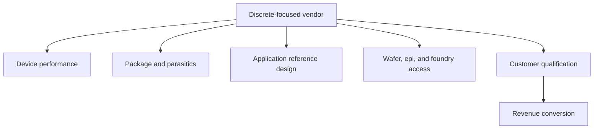
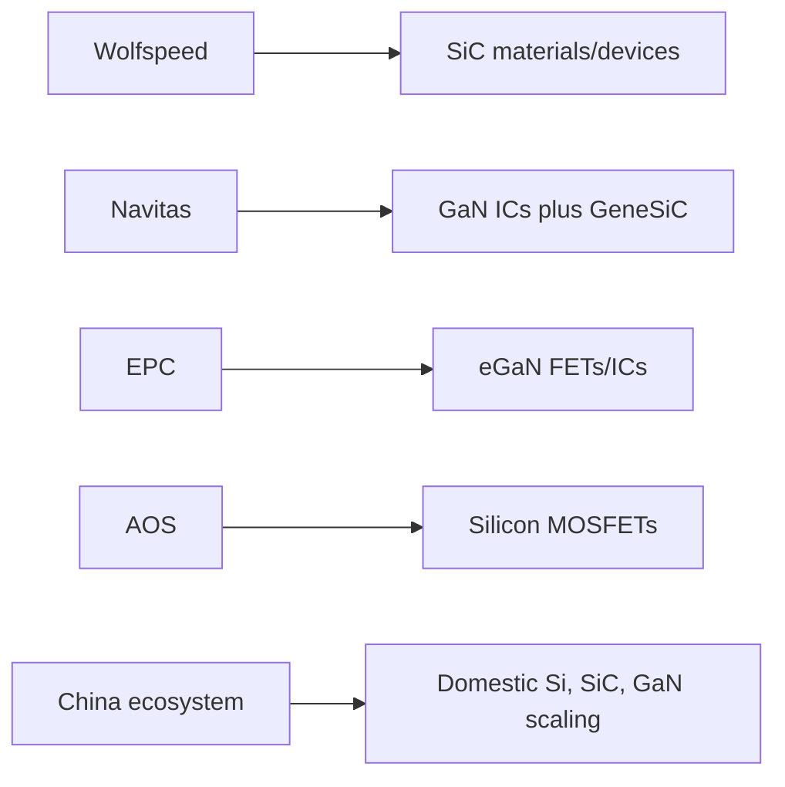

# Discrete-Focused Power Semiconductor Vendors
> **Last Updated:** 2026-11-12
> **Status:** Draft
> **Tags:** vendors, Wolfspeed, Navitas, EPC, AOS, China

## Overview
Discrete-focused vendors compete through device performance, process IP, package design, and
application specialization. Their narrower portfolios can accelerate technology adoption but
create exposure to single-market cycles, foundry partners, capital intensity, and customer
qualification timing.

Acquisition status matters: GaN Systems belongs to Infineon, Transphorm belongs to Renesas,
UnitedSiC belongs to Qorvo, and IXYS belongs to Littelfuse. They are tracked here as technology
lineages, not independent public competitors.

## Key Findings / Highlights
- [CONFIRMED, 2025] Wolfspeed completed a court-supervised restructuring after a June 2025 Chapter 11 filing.
- [CONFIRMED, 2022] Navitas acquired GeneSiC and therefore spans GaN and SiC.
- [CONFIRMED] EPC focuses on enhancement-mode GaN FETs/ICs in chip-scale packages.
- [CONFIRMED, 2024] Transphorm was acquired by Renesas.
- [CONFIRMED, 2021] Qorvo acquired UnitedSiC.
- [ESTIMATED] Chinese SiC suppliers are scaling faster than their datacenter qualification evidence.
- [CONFIRMED, 2026-07-07] Wolfspeed sued Navitas in US federal court, alleging infringement
  of five patents by named GaNFast, GaNSlim, GaNSafe, GeneSiC, and SiCPAK product lines.
  The complaint is an allegation; no merits decision is recorded as of 2026-11-12. Since filing,
  Wolfspeed amended its complaint (2026-09-18), Navitas moved to dismiss (2026-10-09), filed USPTO
  reexamination requests against all five patents (2026-10-16/19), and moved to stay (2026-10-27).
- [CONFIRMED, 2026-11] Wolfspeed: FY2026 revenue $665.1M; Q1 FY2027 revenue ~$155M with
  non-GAAP gross margin of (13)%; cash and short-term investments $995.1M; conditional OSC loan
  commitment of up to $1.5B (2026-10-07).
- [CONFIRMED, 2026-11-03] Navitas: Q3 2026 revenue $14.0M; Q4 guidance $15.5-16.5M with AI
  infrastructure above 40% of Q4 revenue; cash $531.5M and no debt. It closed the Claros
  vertical-power-delivery acquisition (up to ~$232.8M) on 2026-10-06 and faces two new disputes
  with Renesas (Renesas trade-secret suit filed 2026-07-22; Navitas patent suit against Renesas
  filed 2026-08-10). All are allegations.
- [CONFIRMED, 2026-08-28] Innoscience reported H1 2026 revenue of ~RMB 834M (+50.6%), 11.6% gross
  margin, and ~RMB 532M from AI datacenter, industrial, storage, and EV applications (+70%).

## Visual Guide

### Official Visual References
| Vendor | Visual Material to Review | Official Source |
|---|---|---|
| Wolfspeed | SiC wafer, device, package, and application visuals | https://www.wolfspeed.com/ |
| Navitas | GaNFast, GaNSafe, GeneSiC, and AI power architecture graphics | https://navitassemi.com/ |
| EPC | eGaN package and application diagrams | https://epc-co.com/epc/products/gan-fets-and-ics |
| Alpha and Omega Semiconductor | MOSFET and power-stage product visuals | https://www.aosmd.com/ |
| Littelfuse / IXYS | discrete and module power device visuals | https://www.littelfuse.com/products/power-semiconductors.aspx |

## Detailed Content
### Active Vendors

**Wolfspeed (WOLF)**  
HQ: US | Technology: SiC materials/devices | Assets: Mohawk Valley 200 mm fab and North
Carolina materials expansion. Financial: restructured in 2025 after debt/capacity stress;
FY2026 revenue $665.1M; Q1 FY2027 revenue ~$155M at negative gross margin; conditional
$1.5B Department of War OSC loan commitment (2026-10-07); Infineon 200 mm wafer supply extension
(2026-10). Strength: SiC IP/materials scale. Wolfspeed created a dedicated Silicon Valley
datacenter solutions team in June 2026 and reports AI-datacenter revenue more than doubled in
FY2026. Risk: utilization, pricing, customer concentration, and litigation cost/uncertainty.

**Navitas Semiconductor (NVTS)**  
HQ: US/Ireland roots | Technology: GaNFast/GaNSafe GaN ICs plus GeneSiC, and (since 2026-10)
Claros integrated voltage regulators. Q3 2026 revenue $14.0M; AI infrastructure guided to
exceed 40% of Q4 2026 revenue while mobile/low-end consumer is exited. Showed a 24 kW 800 V-to-12 V
board with NVIDIA and an 800 V-to-6 V design with Microchip (2026-10). Opportunity values (2030
SAM >$8B) are [COMPANY TARGET], not market consensus. Risk: small revenue base, design-win
conversion, native 800 V production not before late 2027 [COMPANY GUIDANCE], and three open
disputes (Wolfspeed patents; Renesas trade secrets; Navitas v. Renesas patents).

**Efficient Power Conversion (private)**  
HQ: US | Technology: eGaN, mostly GaN-on-Si, chip-scale FETs/ICs. Strength: low-voltage/high-
frequency performance; Renesas licensed its low-voltage eGaN as a qualified second source
(2026-02-12); EPC2370 18 V GaN FET for AI power entered mass production (2026-08-20). Risk:
handling/package adoption and larger IDM competition.

**Innoscience (2577.HK)**  
HQ: China | Technology: 8-inch GaN-on-Si IDM (InnoGaN) | H1 2026 revenue ~RMB 834M (+50.6%);
Yole ranked it first in 2025 power-GaN revenue. Risk: multi-jurisdiction litigation with Infineon
and EPC, low gross margin (11.6% in H1 2026), and geopolitical market access.

**Power Integrations (POWI)**  
HQ: US | Technology: PowiGaN including 1,250 V and 1,700 V parts for 800 VDC | Q3 2026 revenue
$125.5M. Analysts now place meaningful 800 VDC revenue in 2028-2029 [ESTIMATED, MED].

**Alpha and Omega Semiconductor (AOSL)**  
HQ: US | Technology: silicon MOSFETs and power stages. Strength: computing/consumer volume.
Risk: China manufacturing/geopolitics and cyclical end markets.

**BYD Semiconductor / Sanan IC / CR Micro**  
China-based integrated suppliers scaling Si, SiC, and modules. Datacenter design wins are
[TO VERIFY]; domestic substitution and cost are strategic advantages.

### Acquired Technology Lines

| Lineage | Current owner | Technology | Acquisition year |
|---|---|---|---:|
| GaN Systems | Infineon | GaN discretes/modules | 2023 |
| Transphorm | Renesas | Cascode GaN | 2024 |
| UnitedSiC | Qorvo | SiC FETs/JFET-cascode | 2021 |
| IXYS | Littelfuse | IGBT/SCR/modules | 2018 |
| GeneSiC | Navitas | SiC MOSFET/SBD | 2022 |
| Empower Semiconductor | ADI | Integrated voltage regulators | 2026 |
| Claros | Navitas | IVR / vertical power delivery | 2026 |
| C2i Semiconductors | Infineon | Multiphase controllers / smart stages | 2026 |
| Ferric | onsemi (pending) | IVR / magnetics | 2026 (announced) |

### China Ecosystem

| Company | Focus | Scale signal | Datacenter status |
|---|---|---|---|
| BYD Semiconductor | captive/merchant SiC | EV volume | [TO VERIFY] |
| Sanan IC | SiC/GaN fab | ST JV and domestic investment | Early/adjacent |
| CR Micro | Si MOSFET/IGBT/foundry | Domestic IDM | [TO VERIFY] |
| SICC/TanKeBlue | SiC substrates | Public capacity expansion | Upstream |
| Innoscience | GaN-on-Si IDM | H1 2026 revenue ~RMB 834M | AI datacenter revenue disclosed within a combined category |

Related: [Master Index](README.md).

## Data Tables (where applicable)
| Field | Value | Source | Date |
|---|---|---|---|
| Wolfspeed Chapter 11 filing | 2025-06-30 | Company/court | 2025 |
| Wolfspeed debt reduction plan | ~$4.6B announced | Company | 2025 |
| Navitas/GeneSiC | $100M stock + earnouts structure [verify] | Navitas | 2022 |
| Infineon/GaN Systems | $830M announced | Infineon | 2023 |
| Renesas/Transphorm | ~$339M equity value announced | Renesas | 2024 |
| Wolfspeed v. Navitas filing | Five asserted US patents; merits unresolved | Wolfspeed complaint | 2026-07-07 |
| Wolfspeed FY2026 revenue | $665.1M | Wolfspeed | FY ended 2026-06-28 |
| Navitas Q3 2026 revenue | $14.0M | Navitas | 2026-11-03 |
| Navitas/Claros | Up to ~$232.8M | Navitas | Closed 2026-10-06 |
| Innoscience H1 2026 revenue | ~RMB 834M | Innoscience | 2026-08-28 |

## Open Questions / Gaps
- Refresh Wolfspeed post-restructuring capitalization and factory utilization.
- Verify Navitas AI revenue/design wins separately from pipeline and TAM claims.
- Obtain datacenter qualification/design-win evidence for Chinese vendors.
- Add current product and price benchmarking.
- Reconcile Navitas/Claros consideration components (reported parts do not sum to the headline value).

## References
- Wolfspeed investor relations | https://investor.wolfspeed.com/ | Accessed 2026-06-10
- Navitas investor relations | https://ir.navitassemi.com/ | Accessed 2026-06-10
- EPC | https://epc-co.com/ | Accessed 2026-06-10
- Renesas/Transphorm | https://www.renesas.com/en/about/press-room/renesas-completes-acquisition-transphorm | Accessed 2026-06-10
- Qorvo/UnitedSiC | https://www.qorvo.com/newsroom/news/2021/qorvo-acquires-unitedsic | Accessed 2026-06-10
- Wolfspeed datacenter solutions team | https://www.wolfspeed.com/company/news-events/news/wolfspeed-launches-dedicated-data-center-solutions-team-in-silicon-valley/ | Accessed 2026-07-28
- Wolfspeed v. Navitas announcement | https://www.wolfspeed.com/company/news-events/news/wolfspeed-files-patent-infringement-lawsuit-against-navitas-semiconductor/ | Accessed 2026-07-28
- Wolfspeed Q1 FY2027 results | https://www.sec.gov/Archives/edgar/data/0000895419/000089541926000075/ex991q1-27.htm | Indexed 2026-11-12
- Wolfspeed OSC loan commitment | https://www.sec.gov/Archives/edgar/data/0000895419/000119312526416987/d122407dex991.htm | Indexed 2026-11-12
- Navitas Q3 2026 results | https://www.sec.gov/Archives/edgar/data/0001821769/000162828026069489/exhibit991-navitassemicond.htm | Indexed 2026-11-12
- Navitas closes Claros | https://www.globenewswire.com/news-release/2026/10/06/3376021/0/en/navitas-closes-acquisition-of-claros-advancing-ai-infrastructure-with-grid-to-xpu-power-delivery.html | Indexed 2026-11-12
- Renesas v. Navitas trade-secret suit | https://compoundsemiconductor.net/article/124896/Renesas_sues_Navitas_over_trade_secrets | Indexed 2026-11-12
- Navitas v. Renesas patent suit | https://www.barchart.com/story/news/3762841/navitas-files-patent-infringement-lawsuit-against-renesas-electronics | Indexed 2026-11-12
- Innoscience H1 2026 interim results | https://www1.hkexnews.hk/listedco/listconews/sehk/2026/0828/2026082803672.pdf | Indexed 2026-11-12
- Power Integrations Q3 2026 results | https://s25.q4cdn.com/829851629/files/doc_news/Power-Integrations-Reports-Third-Quarter-Financial-Results-2026.pdf | Indexed 2026-11-12
- EPC/Renesas licensing | https://www.businesswire.com/news/home/20260212384290/en/EPC-Announces-Strategic-GaN-Technology-Licensing-and-Second-Sourcing-Agreement-With-Renesas/ | Indexed 2026-11-12
