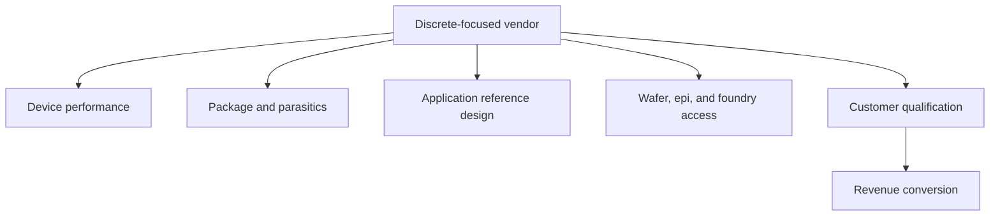
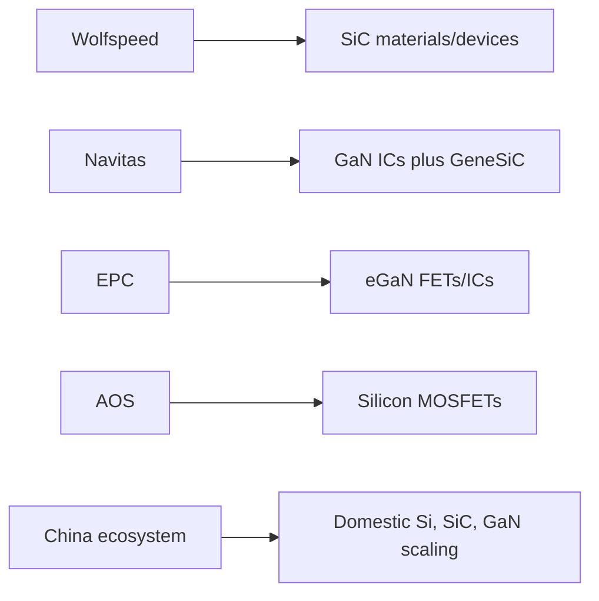

# Discrete-Focused Power Semiconductor Vendors
> **Last Updated:** 2026-07-28
> **Status:** Draft
> **Tags:** vendors, Wolfspeed, Navitas, EPC, AOS, China

## Overview
Discrete-focused vendors compete through device performance, process IP, package design, and
application specialization. Their narrower portfolios can accelerate technology adoption but
create exposure to single-market cycles, foundry partners, capital intensity, and customer
qualification timing.

Acquisition status matters: GaN Systems belongs to Infineon, Transphorm belongs to Renesas,
UnitedSiC belongs to Qorvo, and IXYS belongs to Littelfuse. They are tracked here as technology
lineages, not independent public competitors.

## Key Findings / Highlights
- [CONFIRMED, 2025] Wolfspeed completed a court-supervised restructuring after a June 2025 Chapter 11 filing.
- [CONFIRMED, 2022] Navitas acquired GeneSiC and therefore spans GaN and SiC.
- [CONFIRMED] EPC focuses on enhancement-mode GaN FETs/ICs in chip-scale packages.
- [CONFIRMED, 2024] Transphorm was acquired by Renesas.
- [CONFIRMED, 2021] Qorvo acquired UnitedSiC.
- [ESTIMATED] Chinese SiC suppliers are scaling faster than their datacenter qualification evidence.
- [CONFIRMED, 2026-07-07] Wolfspeed sued Navitas in US federal court, alleging infringement
  of five patents by named GaNFast, GaNSlim, GaNSafe, GeneSiC, and SiCPAK product lines.
  The complaint is an allegation; no merits decision is recorded as of 2026-07-28.

## Visual Guide

### Official Visual References
| Vendor | Visual Material to Review | Official Source |
|---|---|---|
| Wolfspeed | SiC wafer, device, package, and application visuals | https://www.wolfspeed.com/ |
| Navitas | GaNFast, GaNSafe, GeneSiC, and AI power architecture graphics | https://navitassemi.com/ |
| EPC | eGaN package and application diagrams | https://epc-co.com/epc/products/gan-fets-and-ics |
| Alpha and Omega Semiconductor | MOSFET and power-stage product visuals | https://www.aosmd.com/ |
| Littelfuse / IXYS | discrete and module power device visuals | https://www.littelfuse.com/products/power-semiconductors.aspx |

## Detailed Content
### Active Vendors

**Wolfspeed (WOLF)**  
HQ: US | Technology: SiC materials/devices | Assets: Mohawk Valley 200 mm fab and North
Carolina materials expansion. Financial: restructured in 2025 after debt/capacity stress.
Strength: SiC IP/materials scale. Wolfspeed created a dedicated Silicon Valley datacenter
solutions team in June 2026. Risk: utilization, pricing, customer concentration, and litigation
cost/uncertainty.

**Navitas Semiconductor (NVTS)**  
HQ: US/Ireland roots | Technology: GaNFast/GaNSafe GaN ICs plus GeneSiC. Claims a large AI
datacenter opportunity and promotes high-voltage AI architectures; opportunity values are
[COMPANY TARGET], not market consensus. Risk: small revenue base, design-win conversion, and
the unresolved July 2026 Wolfspeed patent suit.

**Efficient Power Conversion (private)**  
HQ: US | Technology: eGaN, mostly GaN-on-Si, chip-scale FETs/ICs. Strength: low-voltage/high-
frequency performance. Risk: handling/package adoption and larger IDM competition.

**Alpha and Omega Semiconductor (AOSL)**  
HQ: US | Technology: silicon MOSFETs and power stages. Strength: computing/consumer volume.
Risk: China manufacturing/geopolitics and cyclical end markets.

**BYD Semiconductor / Sanan IC / CR Micro**  
China-based integrated suppliers scaling Si, SiC, and modules. Datacenter design wins are
[TO VERIFY]; domestic substitution and cost are strategic advantages.

### Acquired Technology Lines

| Lineage | Current owner | Technology | Acquisition year |
|---|---|---|---:|
| GaN Systems | Infineon | GaN discretes/modules | 2023 |
| Transphorm | Renesas | Cascode GaN | 2024 |
| UnitedSiC | Qorvo | SiC FETs/JFET-cascode | 2021 |
| IXYS | Littelfuse | IGBT/SCR/modules | 2018 |
| GeneSiC | Navitas | SiC MOSFET/SBD | 2022 |

### China Ecosystem

| Company | Focus | Scale signal | Datacenter status |
|---|---|---|---|
| BYD Semiconductor | captive/merchant SiC | EV volume | [TO VERIFY] |
| Sanan IC | SiC/GaN fab | ST JV and domestic investment | Early/adjacent |
| CR Micro | Si MOSFET/IGBT/foundry | Domestic IDM | [TO VERIFY] |
| SICC/TanKeBlue | SiC substrates | Public capacity expansion | Upstream |

Related: [Master Index](README.md).

## Data Tables (where applicable)
| Field | Value | Source | Date |
|---|---|---|---|
| Wolfspeed Chapter 11 filing | 2025-06-30 | Company/court | 2025 |
| Wolfspeed debt reduction plan | ~$4.6B announced | Company | 2025 |
| Navitas/GeneSiC | $100M stock + earnouts structure [verify] | Navitas | 2022 |
| Infineon/GaN Systems | $830M announced | Infineon | 2023 |
| Renesas/Transphorm | ~$339M equity value announced | Renesas | 2024 |
| Wolfspeed v. Navitas filing | Five asserted US patents; merits unresolved | Wolfspeed complaint | 2026-07-07 |

## Open Questions / Gaps
- Refresh Wolfspeed post-restructuring capitalization and factory utilization.
- Verify Navitas AI revenue/design wins separately from pipeline and TAM claims.
- Obtain datacenter qualification/design-win evidence for Chinese vendors.
- Add current product and price benchmarking.

## References
- Wolfspeed investor relations | https://investor.wolfspeed.com/ | Accessed 2026-06-10
- Navitas investor relations | https://ir.navitassemi.com/ | Accessed 2026-06-10
- EPC | https://epc-co.com/ | Accessed 2026-06-10
- Renesas/Transphorm | https://www.renesas.com/en/about/press-room/renesas-completes-acquisition-transphorm | Accessed 2026-06-10
- Qorvo/UnitedSiC | https://www.qorvo.com/newsroom/news/2021/qorvo-acquires-unitedsic | Accessed 2026-06-10
- Wolfspeed datacenter solutions team | https://www.wolfspeed.com/company/news-events/news/wolfspeed-launches-dedicated-data-center-solutions-team-in-silicon-valley/ | Accessed 2026-07-28
- Wolfspeed v. Navitas announcement | https://www.wolfspeed.com/company/news-events/news/wolfspeed-files-patent-infringement-lawsuit-against-navitas-semiconductor/ | Accessed 2026-07-28
