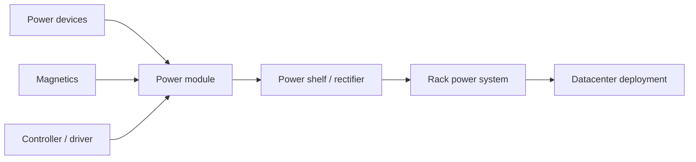
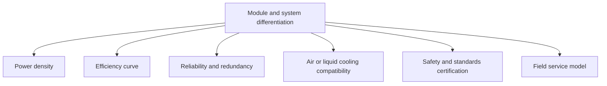

# Power Module and System Vendors
> **Last Updated:** 2026-11-12
> **Status:** Draft
> **Tags:** vendors, modules, power-shelves, UPS, Vicor, Delta, Vertiv

## Overview
Module and system vendors turn semiconductor, magnetic, capacitor, firmware, mechanical, and
thermal components into qualified power products. They capture value through integration,
certification, custom engineering, and hyperscaler supply relationships.

Vendor boundaries overlap: Vicor and Murata sell board modules, Delta and Flex build shelves,
and Vertiv/Eaton span facility infrastructure. Contract ODM revenue can be large while product
visibility and customer attribution remain limited.

## Key Findings / Highlights
- [CONFIRMED] Vicor's architecture combines BCM/PRM/VTM families and ChiP packaging.
- [CONFIRMED] Delta spans components, PSUs, shelves, UPS, and thermal systems.
- [CONFIRMED] Vertiv and Eaton participate from facility power into rack-level infrastructure.
- [CONFIRMED] Flex, Lite-On, and Acbel are important custom manufacturing/JDM suppliers.
- [TO VERIFY] Specific NVIDIA/Vicor GB200 content should be tied to public platform evidence, not inference.
- [CONFIRMED, 2026] NVIDIA lists a broad 800 VDC ecosystem spanning semiconductor, power
  conversion, switchgear, energy-storage, and infrastructure partners; inclusion is ecosystem
  evidence, not proof of a production design win.
- [CONFIRMED PRODUCT CLAIM] Heron Power and Amperesand are commercializing SiC-based
  medium-voltage SST systems for 800 VDC AI infrastructure, with first deployments/units
  targeted in 2026.
- [CONFIRMED, 2026-10-20] Vicor Q3 2026 revenue was $197.1M (+78.5% YoY), including $66.6M of
  royalties (~34%), with 68.3% gross margin and $406M backlog. It licensed vertical-power-delivery
  (VPD) patents to an unnamed AI OEM (2026-09-16) and the USITC instituted 337-TA-1526 on its
  complaint against Delta, Infineon, MPS, Flex, Celestica, Quanta, and Luxshare entities (2026-10-09).
- [CONFIRMED, 2026-10-28] Vertiv Q3 2026 net sales were $4,313M (+61%) with organic orders up more
  than 100%; FY2026 guidance was raised to $14.45-14.85B. Vertiv no longer reports dollar backlog
  and closed the UtilityInnovation Group acquisition (2026-10-27).
- [CONFIRMED, 2026-11-03] Eaton Q3 2026 sales were a record $8.9B (+28%); Electrical Americas
  backlog was ~$16.0B. Eaton agreed to buy COL Group (EV €810M, MV switchgear) and closed Boyd
  Thermal ($9.5B, 2026-03-12); its MVSST 2.0 SST uses Infineon SiC.
- [CONFIRMED, 2026-10] Delta reported record Q3 2026 revenue of ~NT$197.1B; datacenter/AI products
  were ~50% of nine-month revenue. At OCP it showed a 660 kW 800 VDC in-row power rack with
  480 kW BBU and an MV-to-800 VDC SST. LITEON's Cloud & AIoT segment grew 57% in Q3 2026; its
  800 VDC power-rack prototypes ship from Q4 2026, and its board approved spinning off LITEON Rack.
- [CONFIRMED, 2026-08/09] Electrical majors entered 800 VDC: ABB launched its SST-based Infinitus
  DC portfolio (SST commercial 2H 2027), Siemens and Reinhausen are co-developing a modular SST
  (up to 36 kV in, 800 VDC out), and Schneider showed an 800 VDC sidecar for racks up to 1.2 MW.

## Visual Guide

### Official Visual References
| Vendor | Visual Material to Review | Official Source |
|---|---|---|
| Vicor | factorized power architecture and 48 V AI power diagrams | https://www.vicorpower.com/ |
| Delta Electronics | power shelf, rectifier, and datacenter power-system visuals | https://www.deltaww.com/en-US/solutions/Data-Center |
| Vertiv | rack power, cooling, and AI infrastructure diagrams | https://www.vertiv.com/en-us/solutions/high-density-ai/ |
| Eaton | UPS and datacenter power distribution visuals | https://www.eaton.com/us/en-us/markets/data-centers.html |
| Murata | power module and datacenter DC-DC visuals | https://www.murata.com/en-us/products/power |
| Flex Power Modules | DC-DC module and datacenter power visuals | https://flexpowermodules.com/ |

## Detailed Content
### Vendor Matrix

| Company | Ticker | Products | Range | Input/output | Customers | Notes |
|---|---|---|---|---|---|---|
| Vicor | VICR | BCM, PRM, VTM, ChiP | board kW-class | 48 V to POL/intermediate | OEMs | Premium factorized architecture |
| Murata | 6981.T | DC/DC modules, POL, power | W-kW | broad | OEMs | Components + modules |
| Bel Fuse/Bel Power | BELFA/BELFB | PSU/modules | W-kW | AC/DC, DC/DC | OEMs | Power Solutions portfolio |
| Flex | FLEX | custom PSUs/shelves | kW-rack | AC to 48/12 V | hyperscalers | ODM/JDM |
| Delta Electronics | 2308.TW | PSU, shelf, UPS, PDU, thermal | W-MW | full chain | cloud/OEM | Broadest vertical system stack |
| Vertiv | VRT | UPS, PDU, busway, thermal | kW-MW | facility/rack | DC operators | High AI infrastructure exposure |
| Eaton | ETN | switchgear, UPS, busway/shelves | kW-MW | facility/rack | DC operators | Electrical distribution scale |
| Advanced Energy | AEIS | server PSUs/rectifiers | W-kW | AC/DC | OEMs | Artesyn heritage |
| Lite-On | 2301.TW | server PSUs/shelves | kW | AC-48/12 V | OEM/cloud | ODM scale |
| Acbel | 6282.TW | server power | kW | AC-48/12 V | OEM/cloud | Taiwan ODM |
| Great Wall Power | private/state-linked | PSU | kW | AC/DC | China cloud/OEM | Domestic ecosystem |
| Heron Power | private | Heron Link SST + SuperBBU | 4.2 MW [VENDOR SPEC] | 34.5 kV AC-800 VDC | AI datacenters | 98.5% claimed; deployment proof pending |
| Amperesand | private | medium-voltage SiC SST | product-specific | MV AC-LV/800 VDC | critical infrastructure | First commercial units targeted 2026 |
| ABB | ABBN.SW | Infinitus DC portfolio, MV SST | MW-class | MV AC-800 VDC | datacenter developers | SST commercial 2H 2027 |
| Siemens / Reinhausen | SIE.DE / private | modular SST (development) | MW-class | up to 36 kV AC-800 VDC | datacenters | Test systems >200 h reported |
| Schneider Electric | SU.PA | 800 VDC sidecar | racks up to 1.2 MW | 800 VDC | datacenters | Shown at Computex 2026-06 |
| SOLUM | 248070.KS | PSUs, BBU converters | 26 kW-class 800 VDC BBU converter | 800 VDC | AI datacenters | Expanded HVDC work with Infineon (2026-11-05) |
| DG Matrix | private | Interport multi-port SST | up to 2.4 MW per unit | MV AC/DC multi-port | datacenters/microgrids | $60M Series A (2026-02) |

### Integration Layers

| Layer | Margin driver | Main risk |
|---|---|---|
| Board module | IP, density, qualification | Sole source and ASP pressure |
| Server PSU | Volume, efficiency, reliability | ODM competition |
| Rack shelf | Custom engineering, standards | Customer concentration |
| UPS/PDU | Installed base and service | Project cycles |
| Full infrastructure | Bundling and lifecycle service | Capital/project execution |

Related: [Master Index](README.md).

## Data Tables (where applicable)
| Field | Value | Source | Date |
|---|---|---|---|
| ORv3 bus served | 48 V | OCP/vendor products | 2025 |
| Vertiv 2024 revenue | ~$8.0B [CONFIRMED] | Vertiv 10-K | FY2024 |
| Vicor packaging | ChiP | Vicor | 2025 |
| Delta scope | PSU through UPS/thermal | Delta | 2025 |
| Advanced Energy heritage | Artesyn Embedded Power acquired 2019 | AE | 2019 |
| NVIDIA 800 VDC ecosystem | 30+ listed electrical/semiconductor partners [SUPERSEDED: >80 manufacturers per NVIDIA, 2026-08] | NVIDIA | 2026 |
| Vicor Q3 2026 revenue | $197.1M; royalty $66.6M; backlog $406M | Vicor 8-K | 2026-10-20 |
| Vertiv FY2026 sales guidance | $14.45-14.85B | Vertiv | 2026-10-28 |
| Vertiv Q3 2026 net sales | $4,313M (+61%) | Vertiv | 2026-10-28 |
| Eaton Q3 2026 sales | $8.9B (+28%) | Eaton | 2026-11-03 |
| Delta Q3 2026 revenue | ~NT$197.1B (record) | Taipei Times | 2026-10-31 |
| LITEON Q3 2026 revenue | NT$57.4B (+28% YoY) | LITEON | 2026-10/11 |
| Vertiv/UtilityInnovation Group | ~$1.45B cash + up to $1.15B earn-out | Vertiv | Closed 2026-10-27 |
| Eaton/COL Group | EV €810M | Eaton | Announced 2026-09-24 |

## Open Questions / Gaps
- Build SKU-level power shelf tracker with efficiency curves and OCP accepted-product status.
- Validate hyperscaler customer relationships using public filings or teardowns.
- Separate product revenue from contract manufacturing pass-through.
- Identify the unnamed Vicor VPD licensee and track 337-TA-1526 milestones.
- Refresh Flex, Murata, Advanced Energy, Bel Fuse, and nVent (not covered in the 2026-11 refresh).

## References
- Vicor | https://www.vicorpower.com/ | Accessed 2026-06-10
- Delta datacenter solutions | https://www.deltaww.com/en-US/solutions/Data-Center/ALL/ | Accessed 2026-06-10
- Vertiv investor relations | https://investors.vertiv.com/ | Accessed 2026-06-10
- Eaton datacenters | https://www.eaton.com/us/en-us/markets/data-centers.html | Accessed 2026-06-10
- Advanced Energy | https://www.advancedenergy.com/ | Accessed 2026-06-10
- NVIDIA 800 VDC ecosystem | https://www.nvidia.com/en-us/data-center/technologies/800-vdc-architecture/ | Accessed 2026-07-28
- Heron Power datacenter system | https://heronpower.com/product/data-centers | Accessed 2026-07-28
- Amperesand SST platform | https://www.amperesand.io/ | Accessed 2026-07-28
- Vicor Q3 2026 results | https://www.sec.gov/Archives/edgar/data/0000751978/000119312526425697/d153882dex991.htm | Indexed 2026-11-12
- Vicor VPD license | https://www.morningstar.com/news/globe-newswire/9828402/vicor-licenses-vpd-to-a-leading-ai-oem | Indexed 2026-11-12
- USITC 337-TA-1526 | https://www.usitc.gov/press_room/news_release/2026/er1009_69342.htm | Indexed 2026-11-12
- Vertiv Q3 2026 results | https://investors.vertiv.com/news/news-details/2026/Vertiv-Reports-Strong-Third-Quarter-2026-with-Net-Sales-Growth-of-61-Organic-Orders-Growth-over-100-and-Diluted-EPS-Growth-of-91-Adjusted-Diluted-EPS-Growth-of-78-Raises-Full-Year-2026-Guidance-Across-All-Key-Metrics/ | Indexed 2026-11-12
- Vertiv completes UIG acquisition | https://www.vertiv.com/en-us/about/news-and-events/corporate-news/2026/vertiv-completes-acquisition-of-utilityinnovation-group/ | Indexed 2026-11-12
- Eaton Q3 2026 results | https://www.eaton.com/us/en-us/company/news-insights/news-releases/2026/eaton-reports-record-third-quarter-2026-results.html | Indexed 2026-11-12
- Eaton/COL Group | https://datacenterdynamics.com/en/news/eaton-to-acquire-col-group | Indexed 2026-11-12
- Delta Q3 2026 results | https://www.taipeitimes.com/News/biz/archives/2026/10/31/2003866890 | Indexed 2026-11-12
- LITEON Q3 2026 | https://finance.technews.tw/2026/10/09/ai-power-demand-remains-strong-liteon-q3-revenue-up-9-percent-acbel-hits-new-high/ | Indexed 2026-11-12
- ABB Infinitus | https://www.globenewswire.com/news-release/2026/09/21/3365178/0/en/abb-s-new-direct-current-portfolio-aims-to-rewire-ai-data-center-energy-infrastructure.html | Indexed 2026-11-12
- Siemens/Reinhausen SST | https://www.techzine.eu/news/infrastructure/143672/siemens-and-reinhausen-are-developing-an-sst-for-800v-dc-ai-data-centers/ | Indexed 2026-11-12
- SOLUM/Infineon HVDC | https://www.manilatimes.net/2026/11/05/tmt-newswire/pr-newswire/solum-and-infineon-expand-collaboration-on-hvdc-power-solutions-for-ai-data-centers/2463161 | Indexed 2026-11-12
