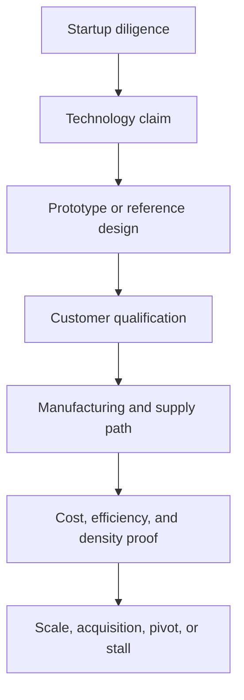
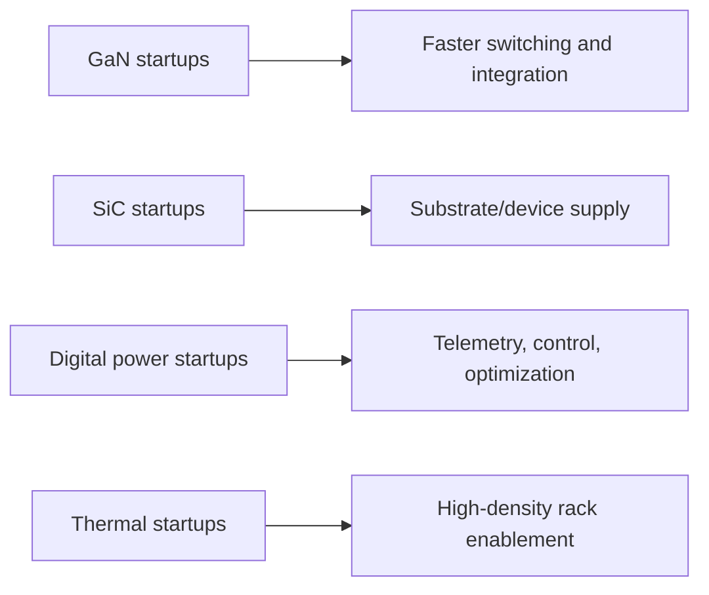

# Startups Watchlist
> **Last Updated:** 2026-11-12
> **Status:** Draft
> **Tags:** startups, venture, GaN, SiC, magnetics, M&A

## Overview
This watchlist tracks private or emerging companies whose devices, packaging, magnetics,
sensing, or control could affect datacenter power. The seed list included several acquired,
mature public, or weakly related companies; those are retained in an exclusion/correction
register to prevent false startup classification.

Funding values and design wins are especially prone to stale or promotional reporting.
Unverified values are omitted and marked for primary-source confirmation.

## Key Findings / Highlights
- [CONFIRMED] Cambridge GaN Devices develops ICeGaN enhancement-mode power devices.
- [CONFIRMED] Ideal Power is public, not a startup, and develops B-TRAN bidirectional switches.
- [CONFIRMED] Exagan was acquired by ST in 2020; UnitedSiC by Qorvo in 2021.
- [CONFIRMED] Enpirion assets moved from Intel to MPS in 2020.
- [CORRECTION] Heliogen, Nextracker, and Movella are not direct DC power-semiconductor startups.
- [CONFIRMED, 2026] Cambridge GaN Devices and NXP announced a long-term collaboration for
  GaN-based system solutions targeting datacenter, automotive, and industrial power.
- [CONFIRMED, COMPANY DISCLOSURE] Amperesand reports more than $100M total funding and targets
  first commercial medium-voltage SiC SST units in 2026.
- [CONFIRMED PRODUCT CLAIM] Heron Power specifies a 4.2 MW, 34.5 kV AC-to-800 VDC Heron Link
  SST with integrated battery buffering; independent deployment validation is pending.
- [CONFIRMED, 2026-02-18] Heron Power raised a $140M Series B led by a16z American Dynamism and
  Breakthrough Energy Ventures to build a US factory sized for 40 GW of Heron Link SSTs; DG Matrix
  raised a $60M Series A (Engine Ventures lead) for its Interport multi-port SST (up to 2.4 MW).
- [CONFIRMED, 2026] Four processor-power startups were acquired or agreed to be acquired:
  Empower (ADI, ~$1.5B, closed 2026-07-07), Claros (Navitas, closed 2026-10-06), C2i
  Semiconductors (Infineon, closed ~2026-10), and Ferric (onsemi, up to $775M, pending).
- [CONFIRMED, LETTER OF INTENT, 2026-10] Vertical Semiconductor (vertical GaN) received a CHIPS
  R&D letter of intent for up to $73M, with the government taking a minority non-voting stake.
- [CONFIRMED, 2026-08-13] Ideal Power said a customer's B-TRAN-based SSCB prototypes for 800 V AI
  datacenters are due in Q4 2026.
- [ESTIMATED, LOW] SST startups reportedly raised more than $320M in the 12 months to March 2026
  (SemiAnalysis, cited second-hand).

## Visual Guide

## Detailed Content
### Active Watchlist

| Company | Founded/HQ | Stage/funding | Technology | DC target | M&A view | Risk |
|---|---|---|---|---|---|---|
| Cambridge GaN Devices | 2016/UK | Private; $32M Series C (2025-02, British Patient Capital lead) | ICeGaN e-mode GaN; NXP collaboration | PSU/PFC | MAYBE | Scaling/competition; CEO change reported [MED] |
| Ideal Power | US/public | Nasdaq: IPWR | B-TRAN bidirectional switch; SSCB for 800 V | UPS/BDC/SSCB | MAYBE | Commercial adoption; prototypes due Q4 2026 |
| Tagore Technology | US/India | Private; [TO VERIFY] | GaN RF/power | power conversion adjacent | MAYBE | DC evidence limited |
| Odyssey Semiconductor | US | Private; [TO VERIFY] | vertical GaN | high-voltage conversion | MAYBE | Process scale |
| Silanna Semiconductor | Australia/US | Private; [TO VERIFY] | power ICs/controllers | high-density AC/DC | MAYBE | Product visibility |
| SemiQ | US/private | Private; no 2026 round found | SiC devices/modules; 1,700 V QSiC Dual3 (2026-06) | AI AC-DC/SST/PFC/UPS | YES/MAYBE | Scale |
| Halo Microelectronics | China/US links | Private; [TO VERIFY] | analog/power ICs | server/consumer | MAYBE | Disclosure |
| Celtonn/Celonics [name verify] | [TO VERIFY] | [TO VERIFY] | GaN/module claim | [TO VERIFY] | UNKNOWN | Entity ambiguity |
| Amperesand | US/Singapore | Private; >$100M total funding [COMPANY DISCLOSURE]; $80M Series A (2025-11, Walden Catalyst/Temasek); +$30M (2026-06) [RUMORED] | SiC medium-voltage SST; Reno, NV manufacturing | MV AC-to-800 VDC AI infrastructure | MAYBE | First commercial units/qualification |
| Heron Power | US/private | Private; $140M Series B (2026-02-18); ~$178M total [ESTIMATED, MED] | SST, DC protection, controls, SuperBBU | 34.5 kV AC-to-800 VDC | MAYBE | Vendor claims/deployment proof |
| DG Matrix | US/private | Private; $60M Series A (2026-02-18) | Interport multi-port SST, up to 2.4 MW | MV AC/storage/generation to DC | MAYBE | Scale-up; funding totals conflict |
| Vertical Semiconductor | US/private | $11M seed (2025-10); CHIPS R&D LOI up to $73M (2026-10) | Vertical GaN devices | 800 V-class conversion; 2.5 MW AI rack goal | MAYBE | Pre-commercial |

### Acquired or Mature Companies

| Seed name | Correct status | Owner/year | Relevance |
|---|---|---|---|
| Exagan | Acquired | STMicroelectronics, 2020 | GaN process/IP |
| UnitedSiC | Acquired | Qorvo, 2021 | SiC devices |
| Enpirion | Assets acquired | MPS, 2020 | Power modules |
| pSemi/Peregrine | Subsidiary | Murata, 2014 | RF/power IC adjacency |
| Nitronex | Acquired lineage | MACOM via GaN assets/history | GaN IP |
| Power Integrations | Mature public | POWI | Offline power ICs |
| Empower Semiconductor | Acquired | ADI, 2026 (~$1.5B) | IVR / silicon capacitors |
| Claros | Acquired | Navitas, 2026 (up to ~$232.8M) | IVR / vertical power delivery |
| C2i Semiconductors | Acquired | Infineon, 2026 (undisclosed) | Multiphase controllers / smart stages |
| Ferric | Being acquired | onsemi, announced 2026-11-02 (up to $775M) | IVR / magnetics |
| CR Micro | Mature public IDM | 688396.SS | China power semis |

### Exclusion / Low-Relevance Register

| Company | Reason |
|---|---|
| Heliogen | Solar-thermal developer, not power-semiconductor startup |
| Nextracker | Solar tracker systems, not DC power-semiconductor startup |
| Movella | Motion-sensing company; direct power-sensing thesis unsupported |
| Magnetics International | Entity and DC product scope require verification |
| Starkpower | Entity/product identity requires verification |

> 🔄 Refresh Needed: High Priority. Funding, ownership, and operating status should be checked
against company registries and primary announcements each quarter.

Related: [Master Index](README.md).

## Data Tables (where applicable)
| Field | Value | Source | Date |
|---|---|---|---|
| ST/Exagan | Acquisition | ST | 2020 |
| Qorvo/UnitedSiC | Acquisition | Qorvo | 2021 |
| MPS/Enpirion assets | Acquisition | MPS/Intel | 2020 |
| Murata/Peregrine | Acquisition | Murata | 2014 |
| CGD technology | ICeGaN | CGD | 2025 |
| CGD/NXP collaboration | Long-term GaN system-solutions collaboration | CGD | 2026-06-09 |
| Amperesand funding | >$100M total [COMPANY DISCLOSURE] | Amperesand | 2026 |
| Heron Power Series B | $140M | Heron Power | 2026-02-18 |
| DG Matrix Series A | $60M | DG Matrix | 2026-02-18 |
| Vertical Semiconductor CHIPS LOI | Up to $73M | NIST | 2026-10 |
| ADI/Empower | ~$1.5B | ADI | 2026-07-07 |

## Open Questions / Gaps
- Verify legal entities, funding totals, and latest rounds for every active private company.
- Add at least one public datacenter design win or qualification milestone per included startup.
- Resolve ambiguous seed names Celonics and Starkpower before adding investment conclusions.
- Check Odyssey Semiconductor, Tagore, and Silanna status (not covered in the 2026-11 refresh).

## References
- Cambridge GaN Devices | https://camgandevices.com/ | Accessed 2026-06-10
- Ideal Power | https://ir.idealpower.com/ | Accessed 2026-06-10
- ST acquires Exagan | https://newsroom.st.com/media-center/press-item.html/t4261.html | Accessed 2026-06-10
- MPS acquires Enpirion assets | https://www.monolithicpower.com/en/about-mps/newsroom.html | Accessed 2026-06-10
- CGD/NXP collaboration | https://camgandevices.com/en/p/cgd-joins-forces-with-nxp-semiconductors-to-accelerate-time-to-market/ | Accessed 2026-07-28
- Amperesand | https://www.amperesand.io/about | Accessed 2026-07-28
- Heron Power datacenter system | https://heronpower.com/product/data-centers | Accessed 2026-07-28
- Heron Power Series B | https://techcrunch.com/2026/02/18/heron-power-raises-140m-to-ramp-production-of-grid-altering-tech/ | Indexed 2026-11-12
- DG Matrix Series A | https://techcrunch.com/2026/02/18/dg-matrix-raises-60m-to-make-data-center-power-smarter | Indexed 2026-11-12
- Amperesand Series A | https://www.businesswire.com/news/home/20251118244299/en/ | Indexed 2026-11-12
- NIST CHIPS R&D letters of intent | https://nist.gov/news-events/news/2026/10/department-commerce-announces-letters-intent-4-companies-389-million-rd | Indexed 2026-11-12
- Ideal Power Q2 2026 | https://www.barchart.com/story/news/3829814/ideal-power-reports-second-quarter-2026-financial-results | Indexed 2026-11-12
- SemiQ 1,700 V modules | https://www.semiconductor-today.com/news_items/2026/jun/semiq-100626.shtml | Indexed 2026-11-12
- CGD Series C | https://www.businesswire.com/news/home/20250218968474/en | Indexed 2026-11-12
- ADI completes Empower acquisition | https://www.analog.com/en/newsroom/press-releases/2026/7-7-26-adi-completes-acquisition-of-empower-semiconductor.html | Indexed 2026-11-12
