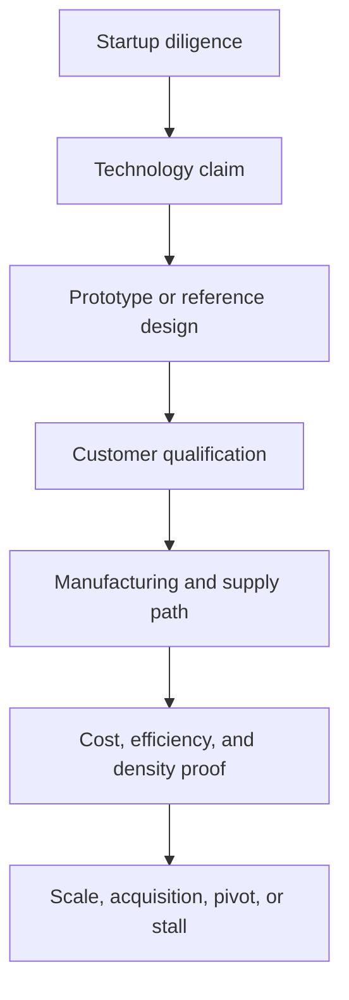
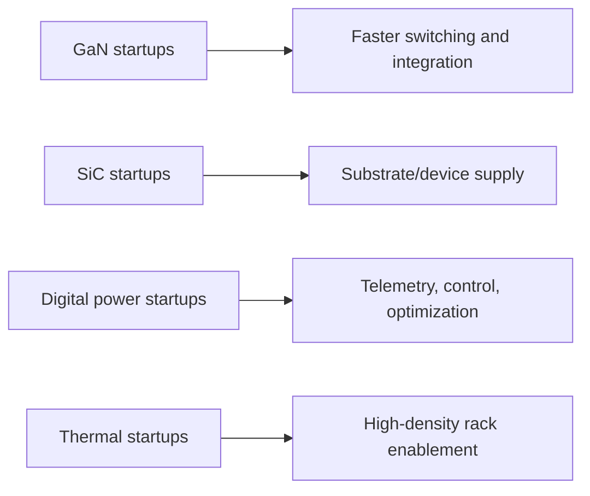

# Startups Watchlist
> **Last Updated:** 2026-07-28
> **Status:** Draft
> **Tags:** startups, venture, GaN, SiC, magnetics, M&A

## Overview
This watchlist tracks private or emerging companies whose devices, packaging, magnetics,
sensing, or control could affect datacenter power. The seed list included several acquired,
mature public, or weakly related companies; those are retained in an exclusion/correction
register to prevent false startup classification.

Funding values and design wins are especially prone to stale or promotional reporting.
Unverified values are omitted and marked for primary-source confirmation.

## Key Findings / Highlights
- [CONFIRMED] Cambridge GaN Devices develops ICeGaN enhancement-mode power devices.
- [CONFIRMED] Ideal Power is public, not a startup, and develops B-TRAN bidirectional switches.
- [CONFIRMED] Exagan was acquired by ST in 2020; UnitedSiC by Qorvo in 2021.
- [CONFIRMED] Enpirion assets moved from Intel to MPS in 2020.
- [CORRECTION] Heliogen, Nextracker, and Movella are not direct DC power-semiconductor startups.
- [CONFIRMED, 2026] Cambridge GaN Devices and NXP announced a long-term collaboration for
  GaN-based system solutions targeting datacenter, automotive, and industrial power.
- [CONFIRMED, COMPANY DISCLOSURE] Amperesand reports more than $100M total funding and targets
  first commercial medium-voltage SiC SST units in 2026.
- [CONFIRMED PRODUCT CLAIM] Heron Power specifies a 4.2 MW, 34.5 kV AC-to-800 VDC Heron Link
  SST with integrated battery buffering; independent deployment validation is pending.

## Visual Guide

## Detailed Content
### Active Watchlist

| Company | Founded/HQ | Stage/funding | Technology | DC target | M&A view | Risk |
|---|---|---|---|---|---|---|
| Cambridge GaN Devices | 2016/UK | Private | ICeGaN e-mode GaN; NXP collaboration | PSU/PFC | MAYBE | Scaling/competition |
| Ideal Power | US/public | Nasdaq: IPWR | B-TRAN bidirectional switch | UPS/BDC | MAYBE | Commercial adoption |
| Tagore Technology | US/India | Private; [TO VERIFY] | GaN RF/power | power conversion adjacent | MAYBE | DC evidence limited |
| Odyssey Semiconductor | US | Private; [TO VERIFY] | vertical GaN | high-voltage conversion | MAYBE | Process scale |
| Silanna Semiconductor | Australia/US | Private; [TO VERIFY] | power ICs/controllers | high-density AC/DC | MAYBE | Product visibility |
| SemiQ | US/private | Private; [TO VERIFY] | SiC devices/modules | PFC/UPS | YES/MAYBE | Scale |
| Halo Microelectronics | China/US links | Private; [TO VERIFY] | analog/power ICs | server/consumer | MAYBE | Disclosure |
| Celtonn/Celonics [name verify] | [TO VERIFY] | [TO VERIFY] | GaN/module claim | [TO VERIFY] | UNKNOWN | Entity ambiguity |
| Amperesand | US/Singapore | Private; >$100M total funding [COMPANY DISCLOSURE] | SiC medium-voltage SST | MV AC-to-800 VDC AI infrastructure | MAYBE | First commercial units/qualification |
| Heron Power | US/private | Private; [TO VERIFY] | SST, DC protection, controls, SuperBBU | 34.5 kV AC-to-800 VDC | MAYBE | Vendor claims/deployment proof |

### Acquired or Mature Companies

| Seed name | Correct status | Owner/year | Relevance |
|---|---|---|---|
| Exagan | Acquired | STMicroelectronics, 2020 | GaN process/IP |
| UnitedSiC | Acquired | Qorvo, 2021 | SiC devices |
| Enpirion | Assets acquired | MPS, 2020 | Power modules |
| pSemi/Peregrine | Subsidiary | Murata, 2014 | RF/power IC adjacency |
| Nitronex | Acquired lineage | MACOM via GaN assets/history | GaN IP |
| Power Integrations | Mature public | POWI | Offline power ICs |
| CR Micro | Mature public IDM | 688396.SS | China power semis |

### Exclusion / Low-Relevance Register

| Company | Reason |
|---|---|
| Heliogen | Solar-thermal developer, not power-semiconductor startup |
| Nextracker | Solar tracker systems, not DC power-semiconductor startup |
| Movella | Motion-sensing company; direct power-sensing thesis unsupported |
| Magnetics International | Entity and DC product scope require verification |
| Starkpower | Entity/product identity requires verification |

> 🔄 Refresh Needed: High Priority. Funding, ownership, and operating status should be checked
against company registries and primary announcements each quarter.

Related: [Master Index](README.md).

## Data Tables (where applicable)
| Field | Value | Source | Date |
|---|---|---|---|
| ST/Exagan | Acquisition | ST | 2020 |
| Qorvo/UnitedSiC | Acquisition | Qorvo | 2021 |
| MPS/Enpirion assets | Acquisition | MPS/Intel | 2020 |
| Murata/Peregrine | Acquisition | Murata | 2014 |
| CGD technology | ICeGaN | CGD | 2025 |
| CGD/NXP collaboration | Long-term GaN system-solutions collaboration | CGD | 2026-06-09 |
| Amperesand funding | >$100M total [COMPANY DISCLOSURE] | Amperesand | 2026 |

## Open Questions / Gaps
- Verify legal entities, funding totals, and latest rounds for every active private company.
- Add at least one public datacenter design win or qualification milestone per included startup.
- Resolve ambiguous seed names Celonics and Starkpower before adding investment conclusions.

## References
- Cambridge GaN Devices | https://camgandevices.com/ | Accessed 2026-06-10
- Ideal Power | https://ir.idealpower.com/ | Accessed 2026-06-10
- ST acquires Exagan | https://newsroom.st.com/media-center/press-item.html/t4261.html | Accessed 2026-06-10
- MPS acquires Enpirion assets | https://www.monolithicpower.com/en/about-mps/newsroom.html | Accessed 2026-06-10
- CGD/NXP collaboration | https://camgandevices.com/en/p/cgd-joins-forces-with-nxp-semiconductors-to-accelerate-time-to-market/ | Accessed 2026-07-28
- Amperesand | https://www.amperesand.io/about | Accessed 2026-07-28
- Heron Power datacenter system | https://heronpower.com/product/data-centers | Accessed 2026-07-28
