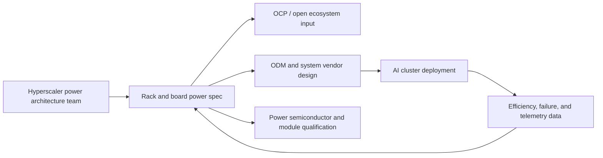
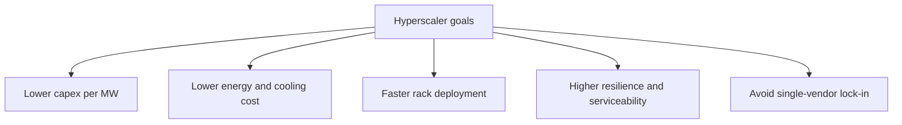

# Hyperscaler Power Strategy
> **Last Updated:** 2026-11-12
> **Status:** Draft
> **Tags:** hyperscalers, NVIDIA, Google, Meta, Microsoft, AWS

## Overview
Hyperscalers influence power semiconductors through rack specifications, custom accelerators,
fleet telemetry, qualification, and procurement scale. Public evidence is strongest for open
rack/shelf designs and system-level sustainability; custom VRM ASIC and merchant supplier
relationships are often confidential.

The strategic pattern is selective vertical integration: operators define architectures and
sometimes custom control silicon while continuing to buy power stages, discretes, magnetics,
shelves, and facility equipment from merchant suppliers.

## Key Findings / Highlights
- [CONFIRMED] Meta is a primary contributor to ORv3 48 V rack and BBU specifications.
- [CONFIRMED] Google has published 48 V and switched-tank converter research.
- [PARTIALLY CONFIRMED] Microsoft publishes custom Maia infrastructure but detailed power silicon is limited.
- [RUMORED] AWS custom power-management silicon and supplier attribution lack sufficient public evidence.
- [CONFIRMED] GB200 NVL72 integrates 72 Blackwell GPUs in a liquid-cooled rack-scale system.
- [CONFIRMED, 2026] NVIDIA has expanded MGX to a third-generation rack design for Vera Rubin
  and published an 800 VDC migration path for MW-scale IT racks beginning with Kyber in 2027.
- [CONFIRMED] NVIDIA publicly lists ecosystem participants for 800 VDC, but a logo/listing is
  not evidence of revenue, shipment volume, or an exclusive design win.
- [CONFIRMED, 2026-10-08] Microsoft, Meta, and Google co-authored OCP Mt. Diablo v1.0.0, a
  ±400 VDC sidecar power rack for 100 kW-1 MW IT racks; Google had committed to ±400 VDC at OCP
  EMEA 2025.
- [CONFIRMED, 2026] Google, Microsoft, and NVIDIA lead an OCP workstream for MV AC-to-800 VDC SSTs
  (spec v0.3); Microsoft is developing and validating SSTs with integrated storage for 800 VDC.
- [CONFIRMED, 2026-10] Google, Meta, Microsoft, and NVIDIA published an OCP Grid Resilience
  Specification targeting ride-through and recovery to near-full load within about 2 s.
- [CONFIRMED, 2026] Vera Rubin entered full production (2026-05-31), NVL72 racks began shipping
  through OEMs (2026-09), NVIDIA contributed Vera Rubin rack/tray designs to OCP (2026-10-12), and
  introduced the containerized DSX POD reference design (availability early 2027).
- [CONFIRMED, 2026-11-02] onsemi reported volume shipments of SiC and silicon MOSFETs into
  multiple AI platforms including Google (PSUs and 54 V-to-12 V conversion), a rare named public
  hyperscaler supply disclosure.

## Visual Guide

### Official Visual References
| Organization | Visual Material to Review | Official Source |
|---|---|---|
| Open Compute Project | ORv3 and higher-power rack ecosystem visuals | https://www.opencompute.org/wiki/Open_Rack/SpecsAndDesigns |
| Meta Engineering | open infrastructure and rack-power context | https://engineering.fb.com/category/data-center-engineering/ |
| Microsoft Azure | datacenter infrastructure and power/cooling visuals | https://azure.microsoft.com/en-us/explore/global-infrastructure |
| Google Data Centers | energy efficiency and infrastructure visuals | https://www.google.com/about/datacenters/ |
| NVIDIA | AI rack system visuals that drive hyperscaler power needs | https://www.nvidia.com/en-us/data-center/gb200-nvl72/ |

## Detailed Content
### Strategy Matrix

| Organization | Architecture | Voltage target | Public suppliers | Custom silicon evidence | Programs |
|---|---|---|---|---|---|
| Google | 48 V, STC research; ±400 VDC Mt. Diablo; MV-to-800 VDC SST workstream | 48 V today; ±400 VDC / 800 VDC | Murata research collaboration; onsemi MOSFET shipments | [TO VERIFY custom VRM ASIC] | TPU, fleet optimization |
| Meta | ORv3 rack/shelf/BBU; Mt. Diablo co-author | 48 V; ±400 VDC sidecar | OCP ecosystem | Shelf/system design confirmed | Open Rack |
| Microsoft | Mt. Diablo v0.7/v1.0 contributor; SST + storage to 800 VDC | ±400 VDC / 800 VDC | Eaton/OCP ecosystem [verify SKU] | Maia power details limited | Maia/Azure |
| AWS | custom server/accelerator | undisclosed | undisclosed | [RUMORED] | Trainium, Inferentia, Graviton |
| NVIDIA | rack-scale GPU and AI-factory reference architecture | 54 V in rack; 800 VDC sidecar 2H 2026, row power centers 2027 | Public 800 VDC ecosystem list (>80 manufacturers) | Platform specifications; MGX/Vera Rubin designs contributed to OCP | GB200/GB300; Vera Rubin (shipping); Kyber; DSX POD |
| AMD | OAM/rack platforms | 12/48 V ecosystem | OEM ecosystem | Platform specifications | Instinct |
| Intel | server/accelerator | 12/48 V ecosystem | VRM ecosystem | VR specifications | Xeon/Gaudi |
| Alibaba/Baidu/ByteDance | China cloud/AI | 48 V/domestic trend | [TO VERIFY] | [TO VERIFY] | Domestic substitution |

### Evidence Levels

| Claim | Status | Rationale |
|---|---|---|
| Meta custom power shelf | [CONFIRMED] | OCP specifications/contributions |
| Google STC collaboration | [CONFIRMED] | Published research/presentations |
| Google custom VRM ASIC | [TO VERIFY] | Need primary publication/patent-to-product link |
| Microsoft Maia custom power delivery | [PARTIALLY CONFIRMED] | Platform public; circuit suppliers private |
| AWS custom PMIC | [RUMORED] | Insufficient primary disclosure |
| Google/Meta/Microsoft ±400 VDC | [CONFIRMED] | Co-authored OCP Mt. Diablo v1.0.0 |
| Microsoft SST + storage to 800 VDC | [CONFIRMED, development] | Azure infrastructure blog, 2026-10 |
| onsemi supply to Google platforms | [CONFIRMED, supplier disclosure] | onsemi Q3 2026 results |

### Supplier Implications

- Open specifications expand the qualified ecosystem but intensify price competition.
- Custom controllers can reduce merchant control-IC content without eliminating power stages.
- High rack power favors suppliers that can co-design electrical, thermal, mechanical, and firmware.
- China cloud operators may accelerate domestic device/controller qualification.

Related: [Master Index](README.md).

## Data Tables (where applicable)
| Field | Value | Source | Date |
|---|---|---|---|
| GB200 NVL72 GPU count | 72 | NVIDIA | 2024 |
| GB200 NVL72 CPU count | 36 Grace CPUs | NVIDIA | 2024 |
| ORv3 nominal bus | 48 V | OCP | 2024 |
| Meta HPR public target | 92 kW+ ecosystem | OCP | 2024 |
| NVIDIA 800 VDC target | 1 MW IT racks and beyond, starting 2027 | NVIDIA | 2026 roadmap |
| Google 24/7 CFE target | 2030 | Google | 2020/current |
| Mt. Diablo v1.0.0 authors | Microsoft, Meta, Google | OCP | 2026-10-08 |
| Vera Rubin NVL72 power shelves | 4 × 110 kW per rack | Supermicro/Cisco | 2026-09 |
| OCP Grid Resilience recovery target | ~2 s to near-full load | OCP (via NVIDIA) | 2026-10 |

## Open Questions / Gaps
- Verify merchant power-semiconductor BOMs through teardowns and supplier disclosures.
- Separate operator-authored standards from actual fleet deployment percentages.
- Find primary evidence for custom VRM ASIC claims.
- Add GB300 electrical specifications; Vera Rubin NVL72 shelf configuration is now public, but
  rack-level kW and rail specifications remain unpublished by NVIDIA.
- Research AWS, Oracle, OpenAI (Stargate), and xAI power architectures (not covered in the
  2026-11 refresh because of search limits).

## References
- Meta/OCP Open Rack | https://www.opencompute.org/wiki/Open_Rack/SpecsAndDesigns | Accessed 2026-06-10
- NVIDIA GB200 NVL72 | https://www.nvidia.com/en-us/data-center/gb200-nvl72/ | Accessed 2026-06-10
- Google data center efficiency | https://datacenters.google/efficiency/ | Accessed 2026-06-10
- Microsoft Maia | https://azure.microsoft.com/en-us/blog/azure-maia-for-the-era-of-ai-from-silicon-to-software-to-systems/ | Accessed 2026-06-10
- AWS Trainium | https://aws.amazon.com/machine-learning/trainium/ | Accessed 2026-06-10
- NVIDIA 800 VDC architecture | https://www.nvidia.com/en-us/data-center/technologies/800-vdc-architecture/ | Accessed 2026-07-28
- NVIDIA MGX third-generation rack roadmap | https://www.nvidia.com/en-us/data-center/products/mgx/ | Accessed 2026-07-28
- Microsoft Azure OCP 2026 blog | https://azure.microsoft.com/en-us/blog/infrastructure-for-the-frontier-era-scaling-intelligence-through-open-industry-collaboration/ | Indexed 2026-11-12
- Microsoft Azure grid-to-chip power | https://techcommunity.microsoft.com/blog/azureinfrastructureblog/powering-azure-infrastructure-from-grid-to-chip/4563890 | Indexed 2026-11-12
- Google ±400 VDC at OCP EMEA 2025 | https://cloud.google.com/blog/topics/systems/enabling-1-mw-it-racks-and-liquid-cooling-at-ocp-emea-summit | Indexed 2026-11-12
- NVIDIA Vera Rubin full production | https://nvidianews.nvidia.com/news/vera-rubin-full-production-agentic-ai-factory | Indexed 2026-11-12
- NVIDIA OCP 2026 blog | https://blogs.nvidia.com/blog/ocp-global-summit-vera-rubin-scale-ai-factories/ | Indexed 2026-11-12
- NVIDIA DSX POD | https://nvidianews.nvidia.com/news/nvidia-introduces-dsx-pod-ai-factories-to-accelerate-europes-infrastructure-deployment | Indexed 2026-11-12
- Meta OCP 2026 engineering post | https://engineering.fb.com/2026/10/12/open-source/ocp-summit-2026-powering-ai-with-open-innovations-in-scale-up-scale-out-and-scale-across-networks/ | Indexed 2026-11-12
- onsemi Q3 2026 results | https://www.onsemi.com/company/newsroom/news-and-insights/onsemi-reports-third-quarter-2026-results | Indexed 2026-11-12
