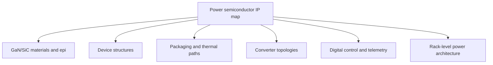

# Patents and IP Landscape
> **Last Updated:** 2026-11-12
> **Status:** Draft
> **Tags:** patents, IP, FTO, GaN, SiC, topology

## Overview
Power-semiconductor IP spans crystal growth, epitaxy, device structures, gate stacks, process
integration, packaging, control algorithms, protection, and converter topology. Raw patent
counts are poor competitive measures unless grouped into families, filtered for legal status,
and mapped to commercial products and jurisdictions.

Freedom-to-operate analysis is product-specific and requires counsel. This research file
identifies high-density claim areas and acquisition lineages; it does not provide a legal
opinion.

## Key Findings / Highlights
- [CONFIRMED] Wolfspeed/Cree has foundational SiC materials and device patent history.
- [CONFIRMED] Vicor holds extensive factorized power, SAC/ZVS, and packaging IP.
- [CONFIRMED] EPC, Infineon, TI, Navitas, and Renesas/Transphorm hold overlapping GaN portfolios.
- [ESTIMATED] Highest FTO density is around e-mode structures, trench SiC, integrated drive/protection, and soft-switching control.
- [TO VERIFY] Marketing patent counts must be converted to active simple families.
- [CONFIRMED, 2026-07] The Infineon/Innoscience dispute produced final US import/sales
  remedies after Presidential Review and additional German infringement rulings; scope is
  patent- and product-specific.
- [CONFIRMED, ALLEGATION ONLY, 2026-07-07] Wolfspeed filed suit against Navitas asserting
  five US patents across named GaN and SiC families; no merits ruling is recorded as of
  2026-11-12. Navitas has requested USPTO reexamination of all five patents and moved to stay.
- [CONFIRMED, 2026-10-09] The USITC instituted 337-TA-1526 on Vicor's vertical-power-delivery
  complaint (US 10,903,734) naming Delta, Infineon, MPS, Flex, Celestica, Quanta, and Luxshare
  entities; Vicor separately licensed VPD patents to an unnamed AI OEM (2026-09-16).
- [CONFIRMED, ALLEGATION ONLY, 2026-07/08] GaN disputes multiplied: Renesas sued Navitas for
  trade-secret misappropriation (2026-07-22), and Navitas sued Renesas for patent infringement
  including SuperGaN lines (2026-08-10).
- [CONFIRMED, PER INNOSCIENCE, 2026-05/06] Chinese courts ruled Infineon GaN products infringe two
  Innoscience patents (Suzhou, 2026-05-27; Supreme People's Court upheld injunctions 2026-06-12);
  no Infineon statement was located.

## Visual Guide

## Detailed Content
### Holder Map

| Company | GaN | SiC | Topology | Power IC/control | Trend |
|---|---|---|---|---|---|
| Infineon | High | High | Medium | High | Active |
| Wolfspeed/Cree | Medium/RF | Very high | Medium | Low | Materials/device-heavy |
| Navitas | High integration focus | Medium via GeneSiC | Medium | High | Active |
| EPC | High e-mode/package | Low | Medium | Medium | Active |
| TI | High driver/power stage | Low | Medium | Very high | Active |
| Vicor | Low | Low | Very high | High | Active; enforcing via ITC (2026) and licensing |
| Renesas/Intersil/Transphorm | High | Low | Medium | Very high | Consolidated |
| Google | Low | Low | Medium | System/optimization | Selective |

### Key Families / Themes

| Owner | Theme | Commercial relevance |
|---|---|---|
| Infineon | CoolGaN e-mode, CoolSiC trench, digital control | Cross-layer portfolio |
| Navitas | Monolithic GaN power IC, sensing/protection | Integrated GaN |
| EPC | E-mode GaN process and chip-scale LGA | Low-voltage/high-frequency |
| Wolfspeed/Cree | SiC boule/epi/MOSFET/contacts | Upstream and devices |
| TI | GaN drivers/stages and UCD digital power | Integrated stage/control |
| Vicor | FPA, SAC, ZVS and ChiP | 48 V modules |
| Renesas/Intersil | Multiphase control and power stages | Server VRM |

### FTO Risk Matrix

| Area | Density | Mitigation |
|---|---|---|
| GaN e-mode/field plates | High | Claim chart by process and region |
| SiC trench gate/oxide | High | Structure/process design-around |
| Driver + FET integration | High | Partition and license review |
| Multiphase digital control | High | Algorithm and implementation analysis |
| Low-inductance packaging | Medium-high | Mechanical/package claim review |

### Litigation and Standards

Patent disputes frequently involve device structures, process, and packaging; compile court/ITC
dockets before drawing competitive conclusions. PMBus and OCP specifications should be reviewed
for their explicit IP policies. A connector specification is not automatically an SEP pool.

| Date | Matter | Jurisdiction/status | Scope | Research treatment |
|---|---|---|---|---|
| 2026-07-07 | Infineon v. Innoscience | US ITC remedies final after Presidential Review | Import/sales ban for products found to infringe the adjudicated patent | [CONFIRMED outcome]; do not generalize to all Innoscience GaN |
| 2026-06-18 | Infineon v. Innoscience | Munich rulings for Infineon (two cases: patent and utility model) | GaN infringement; German relief | [CONFIRMED outcome]; appeals to monitor |
| 2026-07-03 | Infineon v. Innoscience | Munich District Court ruling for Infineon | Additional GaN patent infringement; German import/sales/marketing relief and damages | [CONFIRMED outcome]; appeals/status to monitor |
| 2026-05-27 / 2026-06-12 | Innoscience v. Infineon | Suzhou Intermediate Court; Supreme People's Court upheld injunctions | Two Innoscience invention patents; RMB 10M damages | [CONFIRMED per Innoscience]; Infineon response not located |
| 2026-05 | Infineon v. Innoscience (337-TA-1414) scope | Parties dispute surviving claims | Innoscience says only legacy products covered | [DISPUTED] |
| 2026-02-20 | EPC v. Innoscience | CBP ruled redesigned Innoscience chips outside the 2024 ITC exclusion order; PTAB had found challenged '294 claims invalid (2025-03-18) | Low-voltage GaN | [CONFIRMED per Innoscience counsel]; Federal Circuit appeal pending |
| 2026-07-07 | Wolfspeed v. Navitas | D. Del. 1:26-cv-00818; amended complaint 2026-09-18; motion to dismiss 2026-10-09; reexam requests 2026-10-16/19; motion to stay 2026-10-27 | Five asserted patents; GaNFast/GaNSlim/GaNSafe and GeneSiC/SiCPAK accused | [ALLEGATION]; no infringement finding |
| 2026-07-22 | Renesas v. Navitas | N.D. Cal. trade-secret complaint | Datacenter GaN confidential information | [ALLEGATION] |
| 2026-08-10 | Navitas v. Renesas | E.D. Tex. 2:26-cv-00676 | Four US patents vs Renesas GaN incl. SuperGaN | [ALLEGATION] |
| 2026-10-09 | Vicor (VPD) | USITC 337-TA-1526 instituted | US 10,903,734; vertical power delivery modules | [INVESTIGATION OPEN]; final determination likely 2027+ |

> ⚠️ Note: This file is research triage only and is not legal advice.

Related: [Master Index](README.md).

## Data Tables (where applicable)
| Field | Value | Source | Date |
|---|---|---|---|
| Patent comparison unit | INPADOC/simple family | Research convention | 2026 |
| Legal-status filter | Active/pending | Research convention | 2026 |
| Priority jurisdictions | US/EP/CN/JP/KR/TW | Market footprint | 2026 |
| Navitas patent claim | "300+" marketing count [TO NORMALIZE] | Company materials | 2025 |
| Infineon GaN claim | ~450 patent families [OWNER-REPORTED; TO NORMALIZE] | Infineon | 2026-07 |
| Wolfspeed v. Navitas asserted patents | US 8,169,005; 10,998,418; 10,886,396; 10,749,443; 11,888,392 | Wolfspeed complaint announcement | 2026-07-07 |
| Vicor 337-TA-1526 asserted patent | US 10,903,734 | USITC | 2026-10-09 |
| Navitas v. Renesas asserted patents | US 9,929,079; 11,545,838; 11,770,010; 11,862,996 | Navitas | 2026-08-10 |
| FTO conclusion | Counsel required | Legal practice | 2026 |

## Open Questions / Gaps
- Run reproducible Lens/Google Patents queries and export family-level datasets.
- Add assignee normalization after acquisitions and name changes.
- Build litigation docket with claims, jurisdiction, outcome, and surviving patents.
- Review PMBus/OCP IP policies for actual royalty obligations.
- Confirm formal respondents in 337-TA-1526 (Hon Hai/QCT appear in the complaint notice).
- Track Federal Circuit outcome in EPC v. Innoscience and appeals in the German/Chinese cases.

## References
- Google Patents | https://patents.google.com/ | Accessed 2026-06-10
- USPTO Patent Center | https://patentcenter.uspto.gov/ | Accessed 2026-06-10
- EPO Espacenet | https://worldwide.espacenet.com/ | Accessed 2026-06-10
- OCP IP policy | https://www.opencompute.org/about/ocp-policies | Accessed 2026-06-10
- PMBus | https://pmbus.org/ | Accessed 2026-06-10
- Infineon US ITC final determination | https://www.infineon.com/press-release/2026/ifxpr202607-118 | Accessed 2026-07-28
- Infineon Munich ruling | https://www.infineon.com/press-release/2026/infxx202606-115 | Accessed 2026-07-28
- Wolfspeed v. Navitas filing announcement | https://www.wolfspeed.com/company/news-events/news/wolfspeed-files-patent-infringement-lawsuit-against-navitas-semiconductor/ | Accessed 2026-07-28
- Wolfspeed v. Navitas docket | https://dockets.justia.com/docket/delaware/dedce/1:2026cv00818/93782 | Indexed 2026-11-12
- USITC 337-TA-1526 | https://www.usitc.gov/press_room/news_release/2026/er1009_69342.htm | Indexed 2026-11-12
- Vicor VPD license | https://www.morningstar.com/news/globe-newswire/9828402/vicor-licenses-vpd-to-a-leading-ai-oem | Indexed 2026-11-12
- Renesas v. Navitas | https://compoundsemiconductor.net/article/124896/Renesas_sues_Navitas_over_trade_secrets | Indexed 2026-11-12
- Navitas v. Renesas docket | https://ipverse.greyb.com/litigations/navitas-semiconductor-ireland-llc-v-renesas-electr--txed--2-26-cv-00676 | Indexed 2026-11-12
- Innoscience China rulings | https://www.tomshardware.com/tech-industry/chinas-top-court-bars-infineon-from-selling-gan-power-chips-in-china | Indexed 2026-11-12
- Innoscience ITC scope claim | https://www.trendforce.com/news/2026/05/09/news-innoscience-claims-itc-ruling-victory-confirms-no-infringement-for-current-gan-devices-u-s-shipments-uninterrupted/ | Indexed 2026-11-12
- EPC v. Innoscience CBP ruling | https://www.finnegan.com/en/firm/news/cbp-clears-redesigned-innoscience-chips-after-itc-case.html | Indexed 2026-11-12
- Infineon June 2026 Munich rulings | https://evertiq.com/design/2026-06-23-infineon-wins-two-more-patent-cases-against-innoscience-in-germany | Indexed 2026-11-12
