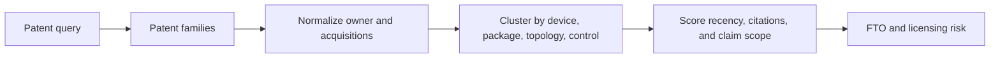
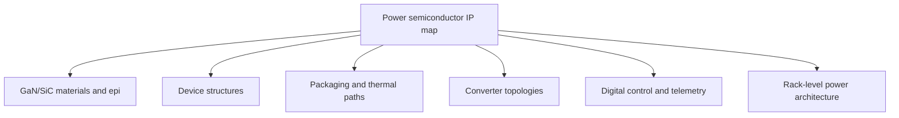

# Patents and IP Landscape
> **Last Updated:** 2026-07-28
> **Status:** Draft
> **Tags:** patents, IP, FTO, GaN, SiC, topology

## Overview
Power-semiconductor IP spans crystal growth, epitaxy, device structures, gate stacks, process
integration, packaging, control algorithms, protection, and converter topology. Raw patent
counts are poor competitive measures unless grouped into families, filtered for legal status,
and mapped to commercial products and jurisdictions.

Freedom-to-operate analysis is product-specific and requires counsel. This research file
identifies high-density claim areas and acquisition lineages; it does not provide a legal
opinion.

## Key Findings / Highlights
- [CONFIRMED] Wolfspeed/Cree has foundational SiC materials and device patent history.
- [CONFIRMED] Vicor holds extensive factorized power, SAC/ZVS, and packaging IP.
- [CONFIRMED] EPC, Infineon, TI, Navitas, and Renesas/Transphorm hold overlapping GaN portfolios.
- [ESTIMATED] Highest FTO density is around e-mode structures, trench SiC, integrated drive/protection, and soft-switching control.
- [TO VERIFY] Marketing patent counts must be converted to active simple families.
- [CONFIRMED, 2026-07] The Infineon/Innoscience dispute produced final US import/sales
  remedies after Presidential Review and additional German infringement rulings; scope is
  patent- and product-specific.
- [CONFIRMED, ALLEGATION ONLY, 2026-07-07] Wolfspeed filed suit against Navitas asserting
  five US patents across named GaN and SiC families; no merits ruling is recorded as of
  2026-07-28.

## Visual Guide

## Detailed Content
### Holder Map

| Company | GaN | SiC | Topology | Power IC/control | Trend |
|---|---|---|---|---|---|
| Infineon | High | High | Medium | High | Active |
| Wolfspeed/Cree | Medium/RF | Very high | Medium | Low | Materials/device-heavy |
| Navitas | High integration focus | Medium via GeneSiC | Medium | High | Active |
| EPC | High e-mode/package | Low | Medium | Medium | Active |
| TI | High driver/power stage | Low | Medium | Very high | Active |
| Vicor | Low | Low | Very high | High | Active |
| Renesas/Intersil/Transphorm | High | Low | Medium | Very high | Consolidated |
| Google | Low | Low | Medium | System/optimization | Selective |

### Key Families / Themes

| Owner | Theme | Commercial relevance |
|---|---|---|
| Infineon | CoolGaN e-mode, CoolSiC trench, digital control | Cross-layer portfolio |
| Navitas | Monolithic GaN power IC, sensing/protection | Integrated GaN |
| EPC | E-mode GaN process and chip-scale LGA | Low-voltage/high-frequency |
| Wolfspeed/Cree | SiC boule/epi/MOSFET/contacts | Upstream and devices |
| TI | GaN drivers/stages and UCD digital power | Integrated stage/control |
| Vicor | FPA, SAC, ZVS and ChiP | 48 V modules |
| Renesas/Intersil | Multiphase control and power stages | Server VRM |

### FTO Risk Matrix

| Area | Density | Mitigation |
|---|---|---|
| GaN e-mode/field plates | High | Claim chart by process and region |
| SiC trench gate/oxide | High | Structure/process design-around |
| Driver + FET integration | High | Partition and license review |
| Multiphase digital control | High | Algorithm and implementation analysis |
| Low-inductance packaging | Medium-high | Mechanical/package claim review |

### Litigation and Standards

Patent disputes frequently involve device structures, process, and packaging; compile court/ITC
dockets before drawing competitive conclusions. PMBus and OCP specifications should be reviewed
for their explicit IP policies. A connector specification is not automatically an SEP pool.

| Date | Matter | Jurisdiction/status | Scope | Research treatment |
|---|---|---|---|---|
| 2026-07-07 | Infineon v. Innoscience | US ITC remedies final after Presidential Review | Import/sales ban for products found to infringe the adjudicated patent | [CONFIRMED outcome]; do not generalize to all Innoscience GaN |
| 2026-07-03 | Infineon v. Innoscience | Munich District Court ruling for Infineon | Additional GaN patent infringement; German import/sales/marketing relief and damages | [CONFIRMED outcome]; appeals/status to monitor |
| 2026-07-07 | Wolfspeed v. Navitas | Delaware federal complaint filed | Five asserted patents; GaNFast/GaNSlim/GaNSafe and GeneSiC/SiCPAK accused | [ALLEGATION]; no infringement finding |

> ⚠️ Note: This file is research triage only and is not legal advice.

Related: [Master Index](README.md).

## Data Tables (where applicable)
| Field | Value | Source | Date |
|---|---|---|---|
| Patent comparison unit | INPADOC/simple family | Research convention | 2026 |
| Legal-status filter | Active/pending | Research convention | 2026 |
| Priority jurisdictions | US/EP/CN/JP/KR/TW | Market footprint | 2026 |
| Navitas patent claim | "300+" marketing count [TO NORMALIZE] | Company materials | 2025 |
| Infineon GaN claim | ~450 patent families [OWNER-REPORTED; TO NORMALIZE] | Infineon | 2026-07 |
| Wolfspeed v. Navitas asserted patents | US 8,169,005; 10,998,418; 10,886,396; 10,749,443; 11,888,392 | Wolfspeed complaint announcement | 2026-07-07 |
| FTO conclusion | Counsel required | Legal practice | 2026 |

## Open Questions / Gaps
- Run reproducible Lens/Google Patents queries and export family-level datasets.
- Add assignee normalization after acquisitions and name changes.
- Build litigation docket with claims, jurisdiction, outcome, and surviving patents.
- Review PMBus/OCP IP policies for actual royalty obligations.

## References
- Google Patents | https://patents.google.com/ | Accessed 2026-06-10
- USPTO Patent Center | https://patentcenter.uspto.gov/ | Accessed 2026-06-10
- EPO Espacenet | https://worldwide.espacenet.com/ | Accessed 2026-06-10
- OCP IP policy | https://www.opencompute.org/about/ocp-policies | Accessed 2026-06-10
- PMBus | https://pmbus.org/ | Accessed 2026-06-10
- Infineon US ITC final determination | https://www.infineon.com/press-release/2026/ifxpr202607-118 | Accessed 2026-07-28
- Infineon Munich ruling | https://www.infineon.com/press-release/2026/infxx202606-115 | Accessed 2026-07-28
- Wolfspeed v. Navitas filing announcement | https://www.wolfspeed.com/company/news-events/news/wolfspeed-files-patent-infringement-lawsuit-against-navitas-semiconductor/ | Accessed 2026-07-28
