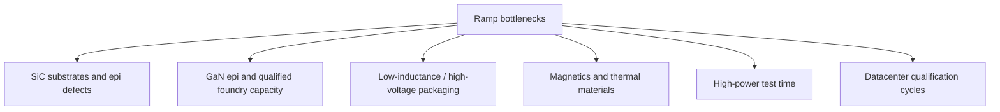

# Production Ramp and Supply Chain
> **Last Updated:** 2026-11-12
> **Status:** Draft
> **Tags:** supply-chain, substrates, foundry, packaging, capacity

## Overview
Datacenter power supply chains combine specialty materials with mature analog foundries and
high-volume assembly. SiC substrates remain a strategic bottleneck, while GaN power devices
rely on epi quality, foundry process control, and advanced low-inductance packaging.

Capacity claims are difficult to compare because suppliers report wafers, wafer starts, revenue
capacity, floor area, or 150 mm equivalents. This database avoids false precision until units
and yields are normalized.

## Key Findings / Highlights
- [CONFIRMED] SiC boule growth has longer cycles and greater defect sensitivity than silicon.
- [CONFIRMED] 200 mm SiC device production is ramping, while much substrate supply remains 150 mm.
- [CONFIRMED] GaN power production spans 150, 200, and announced 300 mm lines.
- [CORRECTION] SK Siltron is an SK Group company.
- [CONFIRMED] TSMC, GlobalFoundries, Tower, X-Fab, and SSMC serve analog/power IC ecosystems.
- [CONFIRMED, 2026-07-02] Infineon opened its €5B Dresden Smart Power Fab ahead of schedule,
  doubling Dresden capacity for power and analog/mixed-signal products and adding 1,000 jobs.
- [CONFIRMED, 2026] onsemi is developing 650 V lateral GaN products on GlobalFoundries'
  200 mm e-mode GaN-on-Si process and is separately sampling 700/1,200 V vertical GaN.
- [CONFIRMED, 2026] Wolfspeed reported demonstrating 300 mm SiC wafer capability; its volume
  device baseline remains the 200 mm Mohawk Valley ramp. Resonac and Sumitomo Metal Mining
  began sampling 300 mm SiC substrates in 2026-09; no supplier has 300 mm SiC in HVM.
- [CONFIRMED, COMPANY DISCLOSURE (secondary), 2026-11-10] Infineon said multi-year supply and
  capacity-reservation agreements with datacenter customers exceed €10B of combined revenue
  volume (signed plus under negotiation); customers were not named.
- [CONFIRMED, 2026-10] MPS reported annual revenue capacity above $6B, expected to reach $8B by
  2H 2027; Vicor plans first Fab-2 equipment in Q2 2027.
- [CONFIRMED, 2026] TSMC exits GaN foundry production by 2027-07-31; GlobalFoundries licensed
  TSMC's 650 V/80 V GaN for Burlington, VT (production status [TO VERIFY]).
- [CONFIRMED, 2026-10-07] Wolfspeed's federal support route shifted to a conditional up-to-$1.5B
  Department of War OSC loan; its ~$750M CHIPS preliminary award (2024) was never finalized
  [TO VERIFY: GAO reporting].
- [ESTIMATED, MED, 2026] SiC substrate oversupply drove 6-inch prices down >30% YoY in Q1 2026;
  Delta cited component shortages and customer construction delays in its Q3 2026 margin.
- [CONFIRMED, 2026-11] Policy watch: China's suspension of its US-specific gallium/germanium
  export ban (MOFCOM 2025 No. 72) runs to 2026-11-27 with no extension found; US Section 232
  tariffs (2026-01-14) cover a narrow set of advanced computing chips, with no broad
  power-semiconductor tariff enacted as of 2026-11-12.

## Visual Guide

## Detailed Content
### End-to-End Map

Epitaxial wafer -> device fab -> wafer probe -> packaging/test -> module/shelf assembly ->
OEM/ODM qualification -> hyperscaler deployment.

### SiC Substrates

| Company | Diameter | Capacity disclosure | 2026 direction | Customers | Notes |
|---|---:|---|---|---|---|
| Wolfspeed | 150/200 mm | Non-comparable public metrics | 200 mm ramp | internal/merchant | Restructured 2025 |
| Coherent | 150/200 mm | [TO NORMALIZE] | 200 mm ramp | merchant | II-VI heritage |
| SiCrystal/ROHM | 150/200 mm path | [TO NORMALIZE] | vertical | ROHM/merchant | Germany |
| SK Siltron CSS | 150/200 mm path | [TO NORMALIZE] | expansion | merchant | SK Group |
| SICC | 150/200 mm | [TO NORMALIZE] | expansion | China/merchant | Public China supplier |
| TanKeBlue | 150/200 mm | [TO NORMALIZE] | expansion | China | Domestic ecosystem |
| Resonac | 300 mm (samples) | Samples on request (2026-09) | development | merchant | No 300 mm epiwafer plan announced |
| Sumitomo Metal Mining | 300 mm bonded (samples) | "SiCkrest" samples (2026-09) | development | merchant | Volume timing undisclosed |

### GaN Epi / Platform Supply

| Company | Platform | Diameter | Role | Customers |
|---|---|---:|---|---|
| IQE | GaN-on-Si/SiC | 150/200 mm class | epi foundry | multiple |
| Enkris | GaN-on-Si | 150/200 mm | epi wafers | power/RF |
| DOWA | GaN substrates/epi | product-specific | materials | multiple |
| NTT-AT | GaN substrates/materials | product-specific | specialty | R&D/device |
| Wolfspeed | GaN-on-SiC | 150 mm class | RF materials | RF ecosystem |

### Controller/Driver Foundries

| Foundry | Nodes | Power IC relevance | Notes |
|---|---|---|---|
| TSMC | mature BCD/analog nodes | Fabless controller/driver ICs | Scale |
| GlobalFoundries | BCD/analog/RF | Power management | US/EU footprint |
| Tower | analog/BCD | Power ICs | Specialty focus |
| X-Fab | HV/BCD | Drivers/controllers | Auto/industrial |
| SSMC | specialty analog | Power/automotive | NXP-linked JV heritage |
| GlobalFoundries/onsemi | 200 mm e-mode GaN-on-Si | 650 V lateral GaN devices | Samples targeted H1 2026; volume status to verify |
| GlobalFoundries (TSMC-licensed GaN) | 650 V/80 V GaN | Second source after TSMC exit | Licensed 2025-11-10; production [TO VERIFY] |
| TSMC | GaN-on-Si foundry | Exit by 2027-07-31 | Customer transfers (e.g., Navitas to PSMC) required |

### Packaging

| Package | Device | Benefit |
|---|---|---|
| TO-247-4L / Kelvin | SiC | Lower common-source inductance |
| D2PAK-7L/TOLL/TOLT | Si/SiC/GaN | Surface mount and low inductance |
| LGA/BGA/chip-scale | GaN/DrMOS | Small loop/area |
| DBC/AMB module | SiC/IGBT | Isolation and heat spreading |
| Vicor ChiP/EPC LGA | modules/GaN | Proprietary density |

### Lead-Time Baseline

| Component | 2025 range | Constraint | Direction |
|---|---|---|---|
| SiC MOSFET | [ESTIMATED] 12-30 weeks | qualification/utilization | Improving/volatile |
| GaN IC | [ESTIMATED] 12-26 weeks | foundry/package | Improving |
| Power module | [ESTIMATED] 16-40 weeks | custom materials/test | Mixed |
| Controller IC | [ESTIMATED] 8-24 weeks | mature-node allocation | Normalized |
| Gate driver | [ESTIMATED] 8-20 weeks | isolation/package | Normalized |

Related: [Master Index](README.md).

## Data Tables (where applicable)
| Field | Value | Source | Date |
|---|---|---|---|
| SiC production transition | 150 to 200 mm | Supplier disclosures | 2025 |
| GaN announced maximum | 300 mm | Infineon | 2024 |
| Infineon Dresden Smart Power Fab | €5B investment; opened 2026-07-02; Dresden capacity doubled | Infineon | 2026 |
| onsemi vertical GaN | 700/1,200 V early-access sampling; late-2026 volume target | onsemi | 2026 |
| Wolfspeed 300 mm SiC | Wafer capability demonstrated; not HVM | Wolfspeed | 2026 |
| US SiC device site | Mohawk Valley, NY | Wolfspeed | 2025 |
| US SiC materials site | Siler City, NC | Wolfspeed | 2025 |
| CHIPS support relevance | WBG/domestic capacity eligible | US Commerce | 2024-2025 |
| Wolfspeed OSC loan | Up to $1.5B, conditional | Wolfspeed 8-K | 2026-10-07 |
| Infineon DC capacity agreements | >€10B (signed + negotiating) [secondary] | Infineon earnings call | 2026-11-10 |
| MPS revenue capacity | >$6B now; $8B by 2H 2027 | MPS | 2026-10-29 |
| TSMC GaN foundry exit | 2027-07-31 | Navitas 8-K / trade press | 2025 |
| China Ga/Ge US-ban suspension expiry | 2026-11-27 | MOFCOM 2025 No. 72 | 2025-11 |
| CHIPS R&D LOI (Vertical Semiconductor) | Up to $73M | NIST | 2026-10 |

## Open Questions / Gaps
- Normalize capacity and yield by good-die-equivalent output.
- Add OSAT dependencies and package substrate/ceramic supplier map.
- Refresh lead times using distributor and direct OEM surveys.
- Track CHIPS award modifications after supplier restructurings.
- Check whether China extends the gallium/germanium suspension beyond 2026-11-27.
- Confirm GlobalFoundries GaN production start and Navitas' PSMC transfer before the TSMC exit.

## References
- US CHIPS for America | https://www.nist.gov/chips | Accessed 2026-06-10
- Wolfspeed manufacturing | https://www.wolfspeed.com/company/manufacturing/ | Accessed 2026-06-10
- GlobalFoundries power technologies | https://gf.com/technology-platforms/ | Accessed 2026-06-10
- X-Fab technologies | https://www.xfab.com/technology | Accessed 2026-06-10
- Infineon Dresden Smart Power Fab | https://www.infineon.com/press-release/2026/ifxpr202607-117 | Accessed 2026-07-28
- onsemi/GlobalFoundries GaN collaboration | https://investor.onsemi.com/news-releases/news-release-details/onsemi-develop-next-generation-gan-power-devices-globalfoundries | Accessed 2026-07-28
- onsemi Q1 2026 investor presentation | https://investor.onsemi.com/static-files/47c2ca2d-07d7-4d18-aa0b-87cc657b1ef4 | Accessed 2026-07-28
- Wolfspeed Q2 FY2026 results | https://assets.wolfspeed.com/uploads/2026/02/Wolfspeed_Q2_2026_Earnings_Release.pdf | Accessed 2026-07-28
- Wolfspeed OSC loan commitment | https://www.sec.gov/Archives/edgar/data/0000895419/000119312526416987/d122407dex991.htm | Indexed 2026-11-12
- GAO CHIPS report | https://www.gao.gov/assets/gao-26-109121.pdf | Indexed 2026-11-12
- Infineon FY2026 earnings call highlights | https://www.gurufocus.com/news/9193285/infineon-technologies-ag-ifnnf-q4-2026-earnings-call-highlights-record-revenue-ai-power-surge-and-a-20-billion-fy2027-outlook | Indexed 2026-11-12
- MPS Q3 2026 earnings call | https://www.fool.com/earnings/call-transcripts/2026/10/30/monolithic-power-systems-mpwr-q3-2026-earnings-call-transcript/ | Indexed 2026-11-12
- GlobalFoundries/TSMC GaN license | https://semiconductor-today.com/news_items/2025/nov/globalfoundries-tsmc-101125.shtml | Indexed 2026-11-12
- Resonac/Sumitomo Metal Mining 300 mm SiC | https://monoist.itmedia.co.jp/mn/articles/2609/25/news034.html | Indexed 2026-11-12
- China Ga/Ge suspension | https://www.fastmarkets.com/insights/china-suspends-export-prohibition-on-superhard-materials-us/ | Indexed 2026-11-12
- Section 232 advanced-chip tariff | https://www.whitecase.com/insight-alert/president-trump-orders-narrowly-targeted-25-section-232-tariff-certain-advanced | Indexed 2026-11-12
- NIST CHIPS R&D letters of intent | https://nist.gov/news-events/news/2026/10/department-commerce-announces-letters-intent-4-companies-389-million-rd | Indexed 2026-11-12
