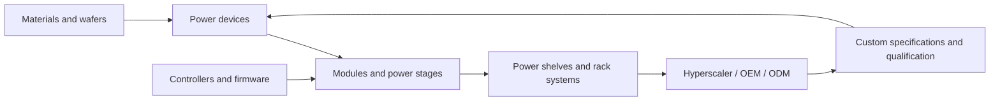
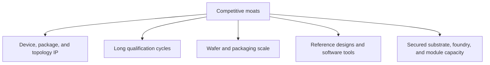

# Competitive Landscape
> **Last Updated:** 2026-11-12
> **Status:** Draft
> **Tags:** competition, Porter, margins, positioning, M&A

## Overview
Competition occurs at several layers with different moats. Substrate and device firms depend
on process yield and capital scale; controller IC firms depend on algorithms, qualification,
software, and customer sockets; module/system firms depend on integration and service.

AI datacenters expand the opportunity but also increase customer bargaining power. Hyperscalers
can specify open shelves or custom controllers while retaining merchant device and manufacturing
suppliers.

## Key Findings / Highlights
- [CONFIRMED] Infineon has the broadest WBG-plus-controller portfolio among large IDMs.
- [CONFIRMED] TI, Renesas, MPS, and Infineon compete strongly in server power control/stages.
- [CONFIRMED] Vicor competes architecturally with conventional multiphase/intermediate-bus designs.
- [ESTIMATED] SiC oversupply reduces substrate/device pricing power through the mid-2020s.
- [CONFIRMED] Recent M&A consolidated GaN and SiC specialists into larger portfolios.
- [CONFIRMED, 2026] Public financial disclosures sharpen the AI-power comparison: Infineon
  reported ~€1.7B FY2026 AI-power and ~€2.2B total datacenter-power revenue (FY2027 DC power
  guided close to €4B); onsemi expects ~$620M 2026 AI-datacenter revenue; MPS Enterprise Data
  reached $506.7M in Q3 2026 alone; TI said data center was ~13% of Q3 2026 revenue. Categories
  differ and are not pure AI-power measures.
- [CONFIRMED, 2026] Processor-level power is consolidating: ADI/Empower, Navitas/Claros,
  Infineon/C2i, and onsemi/Ferric (pending) moved IVR and controller IP into larger portfolios
  within six months, while Vertiv (UtilityInnovation Group) and Eaton (Boyd Thermal, COL Group)
  bought scale in facility power and thermal.
- [CONFIRMED, 2026] IP enforcement broadened from GaN/SiC devices to architecture: Vicor's ITC case
  (337-TA-1526) names Delta, Infineon, MPS, Flex, Celestica, Quanta, and Luxshare entities, and
  royalties were ~34% of Vicor's Q3 2026 revenue. Device disputes also multiplied
  (Infineon/Innoscience in the US, Germany, and China; Wolfspeed v. Navitas; Renesas/Navitas).

## Visual Guide

## Detailed Content
### Market Structure

| Tier | Companies | Revenue scale | Basis | Power share |
|---|---|---|---|---|
| Tier-1 IDM | Infineon, TI, ST, onsemi, ROHM | multi-$B | Scale/portfolio/fabs | High-variable |
| Tier-2/specialist | Wolfspeed, Vishay, Microchip, AOS | $0.5B-several B | Niche/process | Medium-high |
| Fabless/fab-lite | Navitas, EPC, MPS | sub-$B to multi-$B | IP/integration | High |
| Module/system | Vicor, Delta, Vertiv, Murata | varied | Integration/service | Product-dependent |

### Porter's Five Forces

| Force | Intensity | Factors | Five-year trend |
|---|---|---|---|
| Rivalry | High | Many technologies and capacity | Rising |
| Buyer power | High | Hyperscaler concentration/qualification | Rising |
| Supplier power | Medium-high | SiC substrates, specialty packaging | Easing for SiC |
| New entrants | Medium | Foundry access but qualification/IP barriers | Mixed |
| Substitution | High | Si/GaN/SiC/topology tradeoffs | Rising |

### Value Chain Economics

| Layer | Example | Gross-margin range | R&D intensity | Moat |
|---|---|---:|---:|---|
| SiC substrate | Wolfspeed/Coherent | [ESTIMATED] 20-50% cycle-dependent | High | Crystal yield |
| Device IDM | Infineon/ST/onsemi | [ESTIMATED] 35-50% company-level | High | Process/scale |
| Controller IC | TI/Renesas/MPS | [ESTIMATED] 45-65% company-level | High | Design socket |
| Module | Vicor/Murata | [ESTIMATED] 35-55% | High | Packaging/topology |
| System | Delta/Vertiv | [ESTIMATED] 25-40% | Medium | Integration/service |

### Positioning

| Company | DC exposure | WBG | VRM/PMIC | Modules | Systems | Position |
|---|---|---|---|---|---|---|
| Infineon | Medium-high est. | GaN+SiC | High | High | Low | Broad leader |
| TI | Medium-high est. | GaN | High | Medium | Low | Control/analog leader |
| Renesas | Medium-high est. | GaN | High | Medium | Low | Server VR specialist |
| MPS | High est. | limited device WBG | High | High | Low | Integrated challenger |
| Wolfspeed | Low DC today est. | SiC | Low | Medium | Low | Upstream option |
| Navitas | Low today/high target | GaN+SiC | Medium | Low | Low | Challenger |
| Vicor | High | device-agnostic modules | Low | Very high | Low | Architecture specialist; licensing/ITC enforcement |
| onsemi | Medium est. (~$620M 2026E AI DC) | SiC+GaN | Medium; IVR via Ferric (pending) | Medium | Low | High-voltage IDM entering VR |
| Delta/Vertiv | High | sourced | Low | High | Very high | System integrators |

> ⚠️ Note: Infineon, onsemi, and MPS use different reporting categories. AI power,
AI datacenter, storage/computing, and enterprise data are not interchangeable and should not
be used to calculate share without a product-level bridge.

### M&A History

| Year | Acquirer | Target | Value | Rationale | DC impact |
|---:|---|---|---:|---|---|
| 2024 | Renesas | Transphorm | ~$339M equity | GaN | Adds HV GaN |
| 2023 | Infineon | GaN Systems | $830M | GaN scale | Consolidates GaN |
| 2022 | Navitas | GeneSiC | ~$100M + earnouts [verify] | Add SiC | WBG breadth |
| 2021 | Qorvo | UnitedSiC | Undisclosed | Add SiC | New owner |
| 2021 | ADI | Maxim | ~$20.8B announced | Analog/PMIC scale | Controller consolidation |
| 2021 | Renesas | Dialog | EUR4.9B equity value | PMIC/connectivity | Broader power |
| 2018 | Microchip | Microsemi | ~$8.35B enterprise value | High-reliability semis | Adds power/SiC |
| 2017 | ADI | Linear Technology | ~$14.8B | Power/analog | Major PMIC consolidation |
| 2017 | Renesas | Intersil | ~$3.2B | Power management | Server VR strength |
| 2016 | onsemi | Fairchild | ~$2.4B | Power discretes | Scale |
| 2026 | onsemi | Ferric (announced 2026-11-02) | $600M + up to $175M contingent | IVR/magnetics | Processor-level power |
| 2026 | Navitas | Claros (closed 2026-10-06) | Up to ~$232.8M | IVR/vertical delivery | Grid-to-XPU portfolio |
| 2026 | Infineon | C2i Semiconductors (closed ~2026-10) | Undisclosed | Multiphase controllers/stages | AI VR control |
| 2026 | Vertiv | UtilityInnovation Group (closed 2026-10-27) | ~$1.45B + up to $1.15B earn-out | On-site power/microgrids | Time-to-power |
| 2026 | Eaton | COL Group (announced 2026-09-24) | EV €810M | MV switchgear | Facility power |
| 2026 | ADI | Empower Semiconductor (closed 2026-07-07) | ~$1.5B | IVR/silicon capacitors | Processor-level power |
| 2026 | Eaton | Boyd Thermal (closed 2026-03-12) | $9.5B | Liquid cooling | Thermal/power co-design |

Related: [Master Index](README.md).

## Data Tables (where applicable)
| Field | Value | Source | Date |
|---|---|---|---|
| Infineon/GaN Systems | $830M | Infineon | 2023 |
| Renesas/Transphorm | ~$339M equity value | Renesas | 2024 |
| ADI/Maxim | ~$20.8B announced | ADI | 2020/2021 close |
| Renesas/Dialog | EUR4.9B equity value | Renesas | 2021 |
| onsemi/Fairchild | ~$2.4B | onsemi | 2016 |
| ADI/Empower | ~$1.5B | ADI | 2026 |
| onsemi/Ferric | Up to $775M | onsemi | 2026 (pending) |
| Vicor royalty share | ~34% of Q3 2026 revenue | Vicor | 2026-10-20 |

## Open Questions / Gaps
- Replace company-level margin ranges with segment-level economics.
- Quantify DC revenue exposure using disclosed end-market and product data.
- Add design-win churn and qualification cycle length by layer.
- Model merchant silicon displacement under custom hyperscaler control ICs.
- Assess the competitive effect of 337-TA-1526 on VPD module sourcing.

## References
- Company transaction announcements | respective investor-relations sites | Accessed 2026-06-10
- Infineon/GaN Systems | https://www.infineon.com/cms/en/about-infineon/press/press-releases/2023/INFXX202303-074.html | Accessed 2026-06-10
- Renesas/Transphorm | https://www.renesas.com/en/about/press-room/renesas-completes-acquisition-transphorm | Accessed 2026-06-10
- Infineon FY2026 AGM CEO speech | https://www.infineon.com/assets/row/public/documents/corporate/investors/annual-general-meeting/2026/agm2026-key-points-speech-jochen-hanebeck-chief-executive-officer-v01-00-en.pdf | Accessed 2026-07-28
- onsemi 2025 annual report | https://investor.onsemi.com/static-files/8d674d4f-cc6b-44e5-8e31-e898ab0b4371 | Accessed 2026-07-28
- MPS 2025 Form 10-K | https://media.monolithicpower.com/mps_cms_document/2/0/2025_form_10-k_final.pdf | Accessed 2026-07-28
- Infineon US ITC final determination | https://www.infineon.com/press-release/2026/ifxpr202607-118 | Accessed 2026-07-28
- Wolfspeed v. Navitas announcement | https://www.wolfspeed.com/company/news-events/news/wolfspeed-files-patent-infringement-lawsuit-against-navitas-semiconductor/ | Accessed 2026-07-28
- Infineon FY2026 call highlights | https://www.gurufocus.com/news/9193285/infineon-technologies-ag-ifnnf-q4-2026-earnings-call-highlights-record-revenue-ai-power-surge-and-a-20-billion-fy2027-outlook | Indexed 2026-11-12
- USITC 337-TA-1526 | https://www.usitc.gov/press_room/news_release/2026/er1009_69342.htm | Indexed 2026-11-12
- Vicor Q3 2026 results | https://www.sec.gov/Archives/edgar/data/0000751978/000119312526425697/d153882dex991.htm | Indexed 2026-11-12
- Vertiv completes UIG acquisition | https://www.vertiv.com/en-us/about/news-and-events/corporate-news/2026/vertiv-completes-acquisition-of-utilityinnovation-group/ | Indexed 2026-11-12
- Eaton/Boyd Thermal completion | https://www.businesswire.com/news/home/20260312582488/en | Indexed 2026-11-12
- ADI completes Empower acquisition | https://www.analog.com/en/newsroom/press-releases/2026/7-7-26-adi-completes-acquisition-of-empower-semiconductor.html | Indexed 2026-11-12
