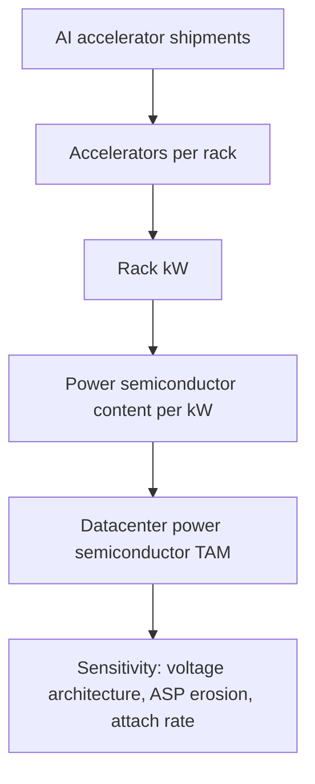
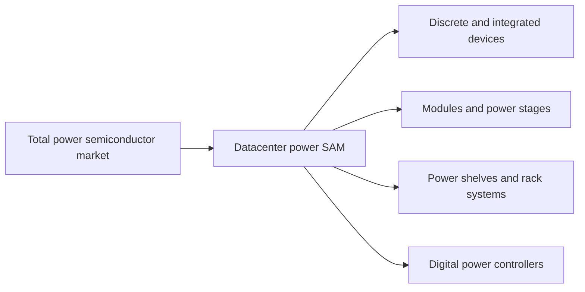

# Market Sizing
> **Last Updated:** 2026-11-12
> **Status:** Draft
> **Tags:** TAM, forecast, scenarios, content-per-kW

## Overview
Market size is modeled from rack shipments, power per rack, semiconductor content per kW, and
WBG/controller penetration. Published research often mixes power supplies, modules, power ICs,
and facility equipment, so top-down numbers are not directly comparable.

The baseline below is an analyst framework, not a purchased market-research dataset. Values are
[ESTIMATED] and should be replaced with auditable bottom-up inputs before investment use.

## Key Findings / Highlights
- [SUPERSEDED, 2026-11-12] The June 2026 baseline of roughly $4B total DC power semiconductors in
  2026 is retained as history. Vendor disclosures now exceed it: Infineon (~€2.2B FY2026 DC power),
  MPS (Enterprise Data growth floor ≥150% on $701.8M, i.e., ≥$1.75B in 2026), and onsemi (~$620M
  2026 AI DC) alone sum to roughly $4.9B.
- [ESTIMATED, LOW-MED, 2026-11] Revised base case: ~$9B in 2026 (range $8-10.5B), ~$13B in 2027,
  and ~$20B in 2030 (range $14-28B), a ~22% 2026-2030 CAGR. See Revised Forecast below.
- [ESTIMATED, MED] VRM/PMIC/control is the largest semiconductor pool; rack systems are tracked separately.
- [ESTIMATED, HIGH] Content per rack rises faster than rack count as accelerator TDP and conversion stages rise.
- [ESTIMATED, MED] WBG ASP premiums fall while penetration rises, making revenue impact non-linear.
- [TO VERIFY] $12k-$15k semiconductor content for a 130 kW rack requires primary-source confirmation.
- [CONFIRMED, 2026] Infineon's AI power-solution category exceeded €700M in FY2025 and is
  targeted at ~€1.5B in FY2026 and ~€2.5B in FY2027; this category is broader than the
  database's device-only boundary and is a useful upper-bound cross-check, not a share figure.
- [CONFIRMED, 2025] onsemi disclosed >$250M AI-datacenter revenue; MPS disclosed $732.5M
  storage/computing and $701.8M enterprise-data revenue, neither of which is a clean
  datacenter-power-semiconductor measure.
- [CONFIRMED, 2026-08] Yole forecasts power GaN devices at $3.5B by 2031 (35% CAGR), with
  telecom/infrastructure including AI datacenters at $750M (45% CAGR); power SiC at ~$11B by
  2031 (~20% CAGR); and the datacenter power-supply market (systems, not chips) at >$14B by 2030.
- [CONFIRMED, 2026-07] Dell'Oro raised its datacenter physical-infrastructure forecast to $120B
  by 2030 (22% CAGR 2025-2030), a non-semiconductor boundary that frames system-level demand.
- [ESTIMATED, 2026-06] TrendForce expects 800 V power racks to be optional on Vera Rubin, with
  adoption after Rubin Ultra (2H 2027) and broad deployment likely in 2028.

## Visual Guide

## Detailed Content
### Revised Forecast (November 2026)

| Scenario | 2026E $B | 2027E $B | 2030E $B | CAGR 26-30 | Assumption |
|---|---:|---:|---:|---:|---|
| Bear | 8.0 | 11.0 | 14.0 | ~15% | AI capex pause; 800 VDC slips to 2028+; ASP compression |
| Base | 9.0 | 13.0 | 20.0 | ~22% | Vendor DC-power guidance met; 800 VDC ramps 2027-2028 |
| Bull | 10.5 | 15.0 | 28.0 | ~28% | 200 kW-1 MW racks, fast IVR/SST adoption, rising content/kW |

Triangulation for 2026 (USD, ~$1.15/€; categories are vendor-defined and partly overlapping):

| Input | 2026 value | Basis |
|---|---:|---|
| Infineon datacenter power | ~$2.5B (~€2.2B, FY to 2026-09) | Company disclosure |
| MPS Enterprise Data | ≥$1.75B | ≥150% growth floor on FY2025 $701.8M |
| onsemi AI datacenter | ~$0.62B | Company expectation |
| Subtotal, three disclosed vendors | ~$4.9B | Sum |
| TI, Renesas, ADI, Vicor, AOS, Vishay, ST, Toshiba, Navitas, EPC, Innoscience, China vendors, others | ~$3-6B [ESTIMATED, LOW] | Not separately disclosed; TI data center (~13% of revenue) spans non-power products |
| Total (base) | ~$9B | Analyst estimate |

> ⚠️ Note: The revised totals keep the original device-plus-controller boundary (discretes,
WBG devices, controllers, smart power stages, gate drivers, IVRs, and semiconductor value inside
modules). Vendor categories may include modules or non-AI datacenter content; treat the revision
as directional until a bottom-up shipment model is built.

### Segment Forecast (June 2026 baseline, [SUPERSEDED] 2026-11-12)

| Segment | 2024A $B | 2025E | 2026E | 2028E | 2030E | CAGR 24-30 | Confidence |
|---|---:|---:|---:|---:|---:|---:|---|
| Total DC power semiconductors | 3.0 | 3.5 | 4.0 | 5.5 | 7.2 | ~16% | MED |
| GaN devices/ICs for DC | 0.15 | 0.23 | 0.34 | 0.75 | 1.25 | ~42% | LOW-MED |
| SiC devices for DC | 0.12 | 0.18 | 0.26 | 0.60 | 1.00 | ~42% | LOW |
| Silicon power discretes | 0.85 | 0.93 | 1.02 | 1.25 | 1.45 | ~9% | MED |
| VRM/PMIC/controllers | 1.35 | 1.55 | 1.75 | 2.30 | 2.85 | ~13% | MED |
| Gate drivers/sensing | 0.28 | 0.32 | 0.37 | 0.50 | 0.65 | ~15% | LOW-MED |
| Power modules (semiconductor value) | 0.25 | 0.29 | 0.34 | 0.50 | 0.70 | ~19% | LOW |

> ⚠️ Note: Rows overlap if controller/driver content is embedded in GaN ICs or modules.
Do not sum subsegments without applying overlap adjustments. The GaN row's 2030E $1.25B is above
Yole's 2031 forecast of $750M for all telecom/infrastructure GaN; treat it as an upper bound unless
800 V-to-12/6 V GaN node conversion is adopted faster than Yole assumes.

### Content per Rack

| Rack type | kW | Semiconductor content | $/kW | Status/source |
|---|---:|---:|---:|---|
| Legacy server | 12 | $500-1,200 | $42-100 | [ESTIMATED, LOW] |
| AI rack | 30 | $2,000-4,000 | $67-133 | [ESTIMATED, LOW] |
| High-density AI | 80 | $6,000-10,000 | $75-125 | [ESTIMATED, LOW] |
| Future rack | 130 | $12,000-15,000 | $92-115 | [TO VERIFY Infineon claim] |

### Scenarios (June 2026 baseline, [SUPERSEDED] 2026-11-12)

| Scenario | 2025 $B | 2027 $B | 2030 $B | Assumption |
|---|---:|---:|---:|---|
| Bear | 3.3 | 4.0 | 5.2 | Slower AI builds, ASP compression |
| Base | 3.5 | 4.7 | 7.2 | Strong AI and gradual WBG |
| Bull | 3.7 | 5.5 | 9.5 | 200 kW racks and rapid WBG/HVDC |

### Driver Equation

Semiconductor revenue = AI rack shipments x average rack kW x semiconductor dollars/kW,
adjusted for non-AI servers, replacement, ASP erosion, custom silicon, and channel inventory.
See [25_investment_and_ma_tracker.md](25_investment_and_ma_tracker.md).

### Public-Disclosure Cross-Checks

| Company | Period | Disclosure | Boundary caveat |
|---|---|---:|---|
| Infineon | FY2025 actual | >€700M AI power solutions | Vendor-defined grid-to-core category |
| Infineon | FY2026/FY2027 target | ~€1.5B / ~€2.5B | Forward-looking company target |
| onsemi | FY2025 actual | >$250M AI-datacenter revenue | Company category; product mix not fully disclosed |
| MPS | FY2025 actual | $732.5M storage/computing + $701.8M enterprise data | Includes memory, storage, notebook, graphics, and other non-AI content |
| Infineon | FY2026 actual | ~€1.7B AI power; ~€2.2B total DC power | Vendor-defined; includes ~€0.5B traditional datacenter |
| Infineon | FY2027 guidance | DC power close to €4B | Forward-looking company guidance |
| onsemi | 2026 expectation | ~$620M AI datacenter; >$3B 2030 target | Company expectation/target |
| MPS | Q3 2026 actual | $506.7M Enterprise Data | Single quarter; not AI-pure |
| TI | Q3 2026 actual | Data center ~13% of $6.06B revenue | All TI product lines |

### Third-Party Forecasts

| Publisher | Scope | Forecast | Horizon | Date |
|---|---|---|---|---|
| Yole | Power GaN devices (all markets) | $3.5B; 35% CAGR | 2031 | 2026-08 |
| Yole | Telecom/infrastructure GaN incl. AI DC | $750M; 45% CAGR | 2031 | 2026-08 |
| Yole | Power SiC devices (all markets) | ~$11B; ~20% CAGR | 2031 | 2026-06 |
| Yole | Datacenter power supplies (systems) | >$14B; 15.5% CAGR from 2024 | 2030 | 2025-07 |
| Dell'Oro | Datacenter physical infrastructure | $120B; 22% CAGR 2025-2030 | 2030 | 2026-07 |
| SemiAnalysis (second-hand) | Power racks/sidecars | ~$11B peak [ESTIMATED, LOW] | 2028 | 2026 |
| ABB | Share of new DC capacity using DC distribution | 25-40% [VENDOR ESTIMATE] | 2030 | 2026-09 |

> ⚠️ Note: These disclosures cannot be summed or directly compared with the superseded $4.0B
model without boundary adjustments. They demonstrate why the TAM boundary must state whether it
includes controllers, modules, sensing, protection, and non-semiconductor power content.

## Data Tables (where applicable)
| Field | Value | Source | Date |
|---|---|---|---|
| Base TAM (June 2026 baseline) | [SUPERSEDED] $4.0B | Analyst model | 2026E |
| Base 2030 TAM (June 2026 baseline) | [SUPERSEDED] $7.2B | Analyst model | 2030E |
| Revised base TAM | [ESTIMATED, LOW-MED] ~$9B | Triangulated vendor disclosures | 2026E |
| Revised base 2027 | [ESTIMATED, LOW] ~$13B | Scenario model | 2027E |
| Revised base 2030 | [ESTIMATED, LOW] ~$20B | Scenario model | 2030E |
| Revised base CAGR | ~22% | Calculation | 2026-2030 |
| Revised bull / bear 2030 | [ESTIMATED, LOW] ~$28B / ~$14B | Scenario model | 2030E |

## Open Questions / Gaps
- Build a shipment model by hyperscaler, accelerator generation, rack type, and geography.
- License/obtain comparable Omdia, Yole, TechInsights, and company datasets.
- Eliminate overlap between integrated GaN ICs, drivers, controllers, and modules.
- Validate content-per-kW through teardowns and supplier revenue bridges.
- Rebuild the segment split under the revised total; add SST, SSCB, and IVR content per MW.
- Add Omdia, IDC, Gartner, and Sightline forecasts (not covered in the 2026-11 refresh).

## References
- Yole Group power electronics | https://www.yolegroup.com/ | Accessed 2026-06-10
- Omdia datacenter research | https://omdia.tech.informa.com/ | Accessed 2026-06-10
- TechInsights power semiconductor analysis | https://www.techinsights.com/ | Accessed 2026-06-10
- Company investor-day disclosures | respective IR sites | Accessed 2026-06-10
- Infineon FY2026 AGM CEO speech | https://www.infineon.com/assets/row/public/documents/corporate/investors/annual-general-meeting/2026/agm2026-key-points-speech-jochen-hanebeck-chief-executive-officer-v01-00-en.pdf | Accessed 2026-07-28
- onsemi 2025 annual report | https://investor.onsemi.com/static-files/8d674d4f-cc6b-44e5-8e31-e898ab0b4371 | Accessed 2026-07-28
- MPS 2025 Form 10-K | https://media.monolithicpower.com/mps_cms_document/2/0/2025_form_10-k_final.pdf | Accessed 2026-07-28
- Infineon FY2026 call highlights | https://www.gurufocus.com/news/9193285/infineon-technologies-ag-ifnnf-q4-2026-earnings-call-highlights-record-revenue-ai-power-surge-and-a-20-billion-fy2027-outlook | Indexed 2026-11-12
- Infineon datacenter power outlook | https://convergedigest.com/infineon-data-center-power-revenue-4-billion-fy2027/ | Indexed 2026-11-12
- onsemi Q3 2026 results | https://www.globenewswire.com/news-release/2026/11/02/3393744/0/en/onsemi-reports-third-quarter-2026-results.html | Indexed 2026-11-12
- MPS Q3 2026 results | https://www.sec.gov/Archives/edgar/data/0001280452/000162828026068202/mpwr-20260930xexx991.htm | Indexed 2026-11-12
- TI Q3 2026 results | https://investor.ti.com/news-releases/news-release-details/ti-reports-third-quarter-2026-financial-results-and-shareholder | Indexed 2026-11-12
- Yole Power GaN 2026 | https://semiconductor-today.com/news_items/2026/aug/yole-200826.shtml | Indexed 2026-11-12
- Yole Power SiC 2026 | https://www.yolegroup.com/press-release/power-sic-enters-the-ai-age/ | Indexed 2026-11-12
- Yole Power Electronics for Data Centers 2025 | https://www.yolegroup.com/product/report/power-electronics-for-datacenters-2025/ | Indexed 2026-11-12
- Dell'Oro DCPI forecast | https://www.delloro.com/news/data-center-physical-infrastructure-market-forecast-to-reach-120-billion-by-2030/ | Indexed 2026-11-12
- TrendForce 800 V power rack outlook | https://www.trendforce.com/presscenter/news/20260625-13121.html | Indexed 2026-11-12
